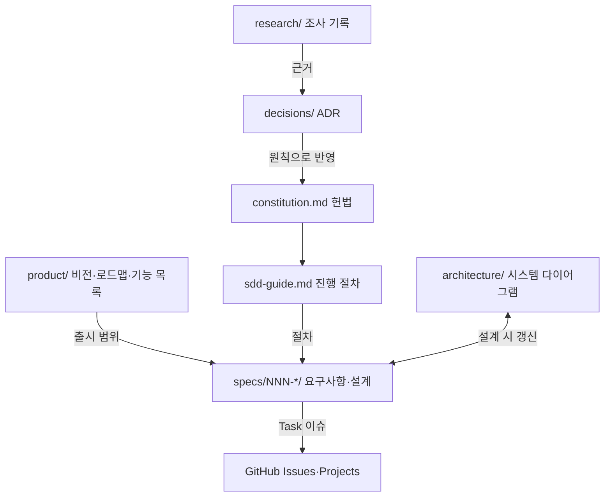

# 문서 지도

이 문서는 `docs/` 아래 문서가 어디에 있고 각각 무엇을 다루는지 설명한다. 작업 종류별로 어떤 문서를 먼저 읽고 어떤 문서를 고쳐야 하는지 이 문서에서 찾을 수 있다.

## 문서 사이의 관계

조사 기록이 결정의 근거가 되고, 결정은 헌법과 진행 절차로 이어진다. 기능 명세는 로드맵이 정한 범위 안에서 작성하며, 설계 단계에서 아키텍처 다이어그램을 함께 갱신한다.

## 폴더별 역할

| 위치 | 다루는 내용 | 상태 값 | 고치는 시점 |
|---|---|---|---|
| [constitution.md](constitution.md) | 모든 작업이 지킬 원칙과 확인 방법 | `active` | ADR로 원칙을 바꿀 때 |
| [sdd-guide.md](sdd-guide.md) | 요구사항부터 검증까지 진행 절차 | `active` | 절차를 바꿀 때 |
| [product/](product/) | 제품 방향, 출시 로드맵, 기능 목록 | `active` | 출시 범위나 기능 배정이 바뀔 때 |
| [decisions/](decisions/README.md) | ADR과 미결정 항목 | ADR별 `accepted` 등 | 새 결정을 내리거나 기존 결정을 대체할 때 |
| [architecture/](architecture/) | 시스템 구성, 모노레포, 도메인, 전체 ERD, 배포 | `active` | `/sdd-design` 단계에서 |
| [research/](research/) | 날짜가 붙은 조사 기록 | `record` | 고치지 않는다. 새 조사는 새 파일로 남긴다 |
| [specs/](specs/) | 기능별 요구사항과 설계 다이어그램 | `review`, `approved` | SDD 단계마다 |

## 작업별로 읽을 문서

| 하려는 일 | 먼저 읽을 문서 | 고칠 문서 |
|---|---|---|
| 새 기능 개발 | [sdd-guide.md](sdd-guide.md), [product/roadmap.md](product/roadmap.md) | `specs/NNN-*/` |
| 결정 배경 확인 | [decisions/README.md](decisions/README.md) | 없음 |
| 새 결정 기록 | [decisions/README.md](decisions/README.md)의 작성 규칙 | 새 ADR 파일, 필요하면 [constitution.md](constitution.md) |
| 출시 범위 조정 | [product/roadmap.md](product/roadmap.md), [product/feature-catalog.md](product/feature-catalog.md) | 두 문서와 GitHub 마일스톤 |
| 외부 규정 확인 | [research/](research/) | 새 조사 문서 |

## 공통 작성 규칙

- 모든 문서는 frontmatter에 `doc_type`, `status`, `updated`를 적는다. `doc_type`은 독자가 문서를 여는 목적(`reference`, `explanation`, `how-to`)이다.
- 제목 바로 아래에는 이 문서가 무엇을 설명하는지와 독자가 무엇을 얻는지를 두 문장 이상으로 쓴다.
- 문장은 평서체(`-다`)로 쓰고 한 문서 안에서 어체를 섞지 않는다.
- 다이어그램은 Mermaid로 그리고, 그림 아래에 읽는 방법을 한두 문장으로 적는다.
- 확인하지 못한 사실은 현재 적용 문서에 넣지 않는다. 조사 기록에서는 `(추정)`으로 표시한다.
