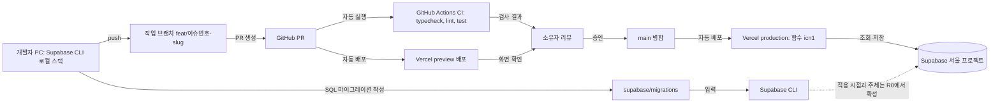

# 배포 구조

이 문서는 코드가 PR을 거쳐 Vercel과 Supabase 서울 프로젝트에 배포되는 흐름과 환경 구성을 설명한다. 독자는 이미 정한 배포 방식과 R0 인프라 작업에서 확정할 항목, 그리고 릴리스별 비용 계획을 구분해서 확인할 수 있다.

## 배포 흐름

실선은 정한 흐름이고, 점선은 방식이 아직 정해지지 않아 R0 인프라 작업에서 확정할 흐름이다. 웹 코드는 PR과 main 병합을 따라 Vercel에 배포되고, DB 구조는 supabase/migrations의 SQL을 Supabase CLI로 서울 프로젝트에 적용한다.

이 흐름의 단위는 Task 이슈 하나와 PR 하나다. 브랜치 이름, PR 템플릿, 리뷰 절차는 [SDD 가이드](../sdd-guide.md)에서 설명한다. typecheck, lint, test 같은 실행 가능한 검사가 통과 여부를 정한다는 원칙은 [constitution](../constitution.md)에 있다.

## 환경

| 환경 | 웹 실행 위치 | Supabase | 용도 | 확정 상태 |
|---|---|---|---|---|
| 로컬 | 개발자 PC의 Next.js 개발 서버 | Supabase CLI 로컬 스택 | 개발, 마이그레이션 작성과 검증 | 구성 절차는 R0에서 확정 |
| preview | PR마다 만드는 Vercel preview 배포 | 연결할 프로젝트는 R0에서 확정 | PR 리뷰 중 화면 확인 | R0에서 확정 |
| production | Vercel production, 함수 리전 icn1 | 서울(ap-northeast-2) 프로젝트 | 실제 서비스 | 결정됨 ([ADR-0002](../decisions/0002-stack-nextjs-supabase-vercel.md)) |

Vercel 함수의 기본 리전은 iad1이므로 production 함수 리전을 icn1로 명시해야 한다([Vercel icn1 문서](https://vercel.com/docs/pricing/regional-pricing/icn1)). Supabase Free 플랜은 활성 프로젝트를 2개까지 허용한다([Supabase 요금](https://supabase.com/pricing)). 따라서 preview 전용 Supabase 프로젝트를 둘지는 이 한도를 함께 고려해 정한다.

## R0에서 확정할 항목

아래 항목은 방향만 정했고 구체적인 방식은 아직 정하지 않았다. R0 인프라 Task에서 정하고, 정한 내용을 이 문서에 반영한다.

| 항목 | 정해진 것 | R0에서 확정할 것 |
|---|---|---|
| CI 워크플로 | GitHub Actions에서 typecheck, lint, test를 실행한다 | 워크플로 파일 구성, Turborepo 작업 이름, 실행 조건 |
| 병합 조건 | 소유자가 PR을 리뷰한 뒤 main에 병합한다 | CI 통과를 병합 조건으로 강제하는 브랜치 보호 설정 |
| 마이그레이션 적용 | supabase/migrations의 SQL을 Supabase CLI로 서울 프로젝트에 적용한다 | 적용 시점과 주체(로컬 실행 또는 CI 작업), 실패 시 처리 |
| preview 데이터 | PR마다 Vercel preview를 만든다 | preview가 연결할 Supabase 프로젝트와 테스트 데이터 |
| 함수 리전 지정 | production 함수 리전은 icn1이다 | 리전을 지정하는 설정 파일과 위치 |
| 환경 변수 | 환경마다 Supabase 접속 정보가 다르다 | 변수 이름, 보관 위치, 로컬 예시 파일 |
| OAuth 리디렉션 | 카카오·구글 로그인을 쓴다 | 환경별 리디렉션 URL 등록과 로컬 스택의 소셜 로그인 확인 방법 |

R0의 종료 조건은 운영 도메인에서 가입, 로그인, 탈퇴가 동작하는 것이다([로드맵](../product/roadmap.md)). 위 항목은 이 조건을 확인하기 전에 모두 정한다.

## 비용 계획

[ADR-0002](../decisions/0002-stack-nextjs-supabase-vercel.md)가 정한 단계별 비용 계획은 다음과 같다.

| 단계 | 구성 | 월 비용 | 지켜야 할 조건 |
|---|---|---|---|
| 개발과 비공개 베타 (R0~R1 베타) | Vercel Hobby + Supabase Free | $0 | Hobby는 개인적·비상업적 용도로만 쓸 수 있다. Supabase Free는 1주 동안 활동이 없으면 일시 중지되고 업로드 상한이 50MB다 |
| R1 공개 출시 이후 | Vercel Pro $20 + Supabase Pro $25 | 약 $45 | 포함 사용량 안에서 운영한다는 가정의 추정치다 |
| R4 Spring 서버 추가 이후 | 위 구성 + Spring 서버(예: Lightsail 서울 2GB 약 $12) | 약 $57 (예시 구성 기준) | 전체 월 비용을 ₩100,000 이하로 유지한다 |

출처는 다음과 같다. Vercel Hobby의 용도 제한과 Pro 요금은 [Vercel 이용약관](https://vercel.com/terms)에서 확인했다. Supabase 요금과 Free 플랜의 일시 중지 조건은 [Supabase 요금](https://supabase.com/pricing)에서 확인했다. 업로드 상한은 [Supabase Storage 다운로드 문서](https://supabase.com/docs/guides/storage/serving/downloads)에, Lightsail 서울 요금은 [Lightsail 요금](https://aws.amazon.com/lightsail/pricing/)에 있다.

Vercel Pro는 개발자 좌석당 월 $20이다. Hobby는 Fast Data Transfer 100GB, 함수 호출 100만 회, Active CPU 4시간을 제공하고, 한도를 넘으면 30일을 기다려야 한다([Vercel 이용약관](https://vercel.com/terms)). 비공개 베타 동안 이 한도와 Supabase Free의 일시 중지 조건을 확인한다.

Hobby의 비상업적 용도 조건은 사업자등록 시점(OD-04)과 연결되므로, OD-04는 R1 공개 출시 전에 정한다. 각 결정의 상태는 [결정 목록](../decisions/README.md)에서 확인한다.

## 나중에 추가하는 배포 경로

| 릴리스 | 추가하는 대상 | 정할 것 |
|---|---|---|
| R4 | apps/api (Kotlin + Spring Boot) | 호스팅 위치, 빌드·배포 파이프라인, Flyway로 commerce 스키마를 적용하는 시점 |
| A1 | apps/mobile (Expo) | 앱 빌드와 스토어 제출 절차, 앱 결제 전략(OD-18) |

두 경로의 구체적인 방식은 해당 릴리스에서 정한다. 스키마별 마이그레이션 소유권은 [ERD 개요](erd-overview.md)와 [ADR-0006](../decisions/0006-migration-ownership.md)에서 설명한다.

## 관련 문서

- [시스템 구성](system-context.md): 실행 구성 요소와 외부 서비스
- [모노레포 구조](monorepo.md): 패키지와 빌드 단위
- [스택 조사 기록](../research/2026-11-18-stack-options.md): 요금과 리전 조사 원문
