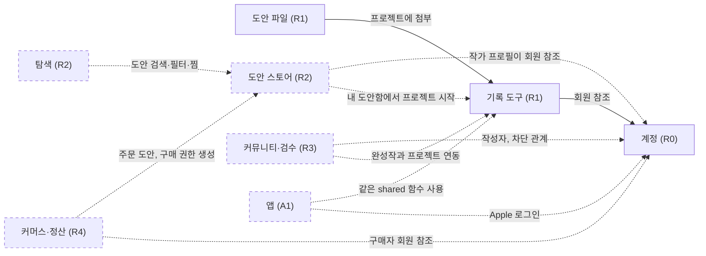
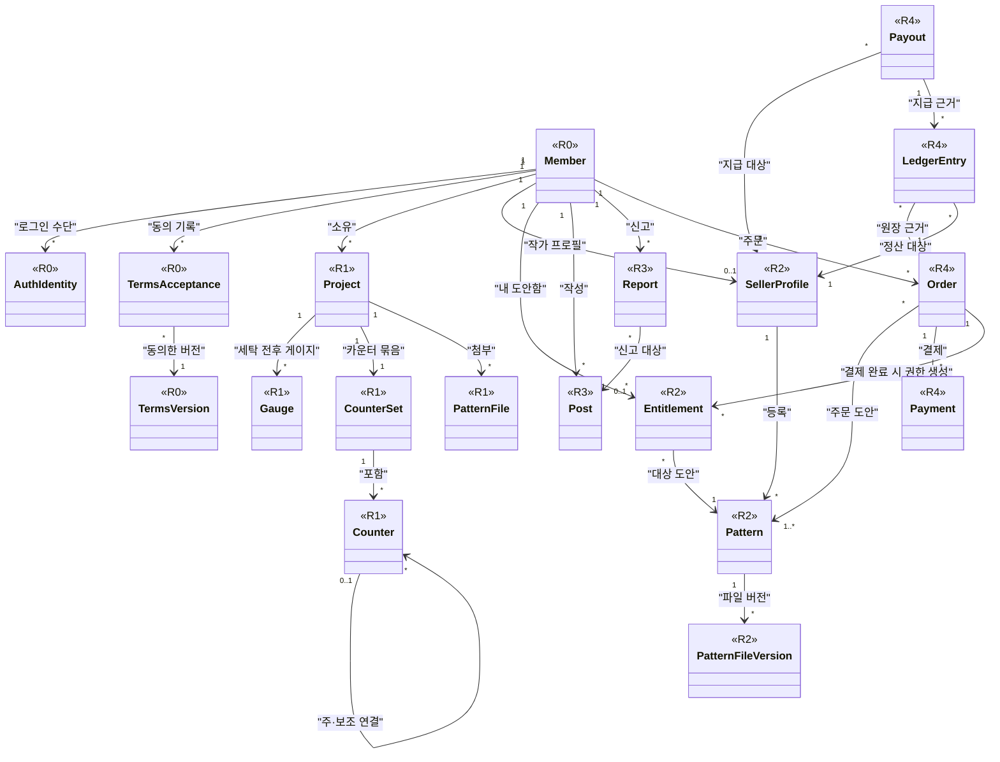

# 도메인 지도

이 문서는 함뜨까의 기능을 바운디드 컨텍스트(bounded context)로 나누고, 각 컨텍스트가 어느 릴리스에서 생기는지 설명한다. 독자는 새 기능이 어느 컨텍스트에 속하는지와 핵심 애그리거트(aggregate) 사이의 관계를 개념 수준에서 확인할 수 있다.

## 이 지도의 범위와 갱신 규칙

이 지도는 컨텍스트와 애그리거트의 이름과 관계만 다룬다. 애그리거트의 속성과 메서드는 각 기능의 `docs/specs/NNN-name/design/domain.md`에서 정하며, 이 지도와 설계 문서가 다르면 설계 문서를 따른다. 이 지도는 `/sdd-design` 단계가 설계를 반영하면서 갱신한다([SDD 가이드](../sdd-guide.md)).

R2 이후의 컨텍스트와 애그리거트는 계획이다. 해당 릴리스의 요구사항과 설계를 승인하면 이름과 관계가 바뀔 수 있다.

## 바운디드 컨텍스트

화살표는 출발 컨텍스트가 도착 컨텍스트의 데이터를 참조한다는 뜻이다. 실선은 R0~R1 스펙(001~004) 범위의 관계이고, 점선 화살표와 점선 테두리는 R2 이후에 생기는 컨텍스트와 관계다. 계정 컨텍스트는 대부분의 컨텍스트가 참조하므로 R0에서 가장 먼저 만든다.

## 컨텍스트별 기능과 릴리스

| 컨텍스트 | 릴리스 | 기능 ID | 이슈 라벨 | 스펙 폴더 |
|---|---|---|---|---|
| 계정 | R0, 네이버 R1+, Apple A1 | F-ACCT-01, F-ACCT-04, F-ACCT-05 (R0), F-ACCT-02 (R1+), F-ACCT-03 (A1) | area:account | [001-account](../specs/001-account/requirements.md) |
| 기록 도구 | R1, 보강 R1+ | F-PROJ-01, F-PROJ-02, F-TOOL-01, F-COUNTER-01~04 (R1), F-PROJ-03, F-PROJ-04, F-COUNTER-05, F-STASH-01, F-TOOL-02 (R1+) | area:project, area:counter | [002-projects](../specs/002-projects/requirements.md), [003-row-counter](../specs/003-row-counter/requirements.md) |
| 도안 파일 | R1, 보강 R1+ | F-VIEWER-01 (R1), F-VIEWER-02~04 (R1+) | area:pattern-file | [004-pattern-files](../specs/004-pattern-files/requirements.md) |
| 도안 스토어 | R2, 확장 R3 | F-STORE-01~08, F-SELL-01 (R2), F-STORE-09~12 (R3) | area:pattern-store | 아직 없음 |
| 탐색 | R2, 확장 R3 | F-DISC-01~04 (R2), F-DISC-05, F-DISC-06 (R3) | area:discovery | 아직 없음 |
| 커뮤니티·검수 | R3 | F-COMM-01~04, F-MOD-01~05 | area:community, area:moderation | 아직 없음 |
| 커머스·정산 | R4 | F-PAY-01~04, F-SETTLE-01~03, F-SELL-02, F-SELL-05, F-SELL-06, F-LEGAL-01 | area:commerce | 아직 없음 |
| 앱 | A1 | F-APP-01, F-COUNTER-06, F-NOTI-03 | area:app | 아직 없음 |

다음 기능은 특정 컨텍스트에 속하지 않고 여러 컨텍스트가 함께 쓴다.

- R0: F-UX-01 반응형 모바일 웹, F-UX-02 다크 모드, F-SUPPORT-01 고객 지원 채널 (R0 인프라 작업에서 처리)
- R1+: F-UX-03 데이터 내보내기와 백업
- R2: F-NOTI-01 사이트 내 알림함, F-NOTI-02 트랜잭션 이메일, F-ADMIN-01 관리자 콘솔

release가 Later인 기능은 이 표에 넣지 않는다. 전체 기능과 릴리스는 [기능 카탈로그](../product/feature-catalog.md)와 [로드맵](../product/roadmap.md)에 있다.

## 핵심 애그리거트

각 클래스 위의 표시는 그 애그리거트가 처음 생기는 릴리스다. R4 애그리거트는 계획이며, 거래 구조(OD-12)와 PG 선택(OD-14)에 따라 바뀔 수 있다. 다이어그램에 속성과 메서드를 적지 않은 이유는 그것을 각 기능의 design/domain.md에서 정하기 때문이다.

| 클래스 | 뜻 | 릴리스 | 속성을 정하는 문서 |
|---|---|---|---|
| Member | 회원 | R0 | 001 design/domain.md |
| AuthIdentity | 로그인 수단. (provider, provider_user_id)로 회원을 식별한다 | R0 | 001 design/domain.md |
| TermsVersion | 이용약관·개인정보 처리방침의 버전 | R0 | 001 design/domain.md |
| TermsAcceptance | 회원이 동의한 약관 버전과 시각 | R0 | 001 design/domain.md |
| Project | 뜨개 프로젝트. 다음에 뜰 작품은 '뜰 예정' 상태로 다루며, 위시리스트·큐를 따로 두지 않는다(002 Q-08) | R1 | 002 design/domain.md |
| Gauge | 세탁 전후 게이지 기록 | R1 | 002 design/domain.md |
| CounterSet | 한 프로젝트의 카운터 묶음. 별도 테이블로 둘지는 003 설계에서 정한다 | R1 | 003 design/domain.md |
| Counter | 단수 카운터. 1세트당 단수 설정, 주·보조 연결, 카운트 이력을 포함한다 | R1 | 003 design/domain.md |
| PatternFile | 프로젝트에 첨부한 내 도안 자료(PDF, 링크, 영상) | R1 | 004 design/domain.md |
| SellerProfile | 작가 프로필. 회원과 분리하며, 회원 한 명에게 최대 1개 있다 | R2 | R2 설계 |
| Pattern | 공개 도안. 가격 필드가 있고 R4 전까지 0원만 허용한다 | R2 | R2 설계 |
| PatternFileVersion | 도안 파일의 버전 | R2 | R2 설계 |
| Entitlement | 내 도안함에 들어간 도안 권한. 무료 도안도 기록한다 | R2 | R2 설계 |
| Post | 커뮤니티 게시글 | R3 | R3 설계 |
| Report | 신고. 신고 대상의 범위는 R3 설계에서 정한다 | R3 | R3 설계 |
| Order | 주문 (예정) | R4 | R4 설계 |
| Payment | 결제 (예정) | R4 | R4 설계 |
| LedgerEntry | 정산 원장 항목 (예정) | R4 | R4 설계 |
| Payout | PG 지급대행을 통한 작가 지급 (예정) | R4 | R4 설계 |

로그인 없이 쓰는 퀵 카운터(F-COUNTER-02)의 저장 위치와 로그인 후 옮기는 방식은 003 요구사항과 설계에서 정한다.

## 경계를 이렇게 나눈 이유

- 기록 도구와 도안 파일을 R1에 먼저 둔다. 다른 사용자가 없어도 혼자 쓸 가치가 있는 개인 도구를 MVP로 정했기 때문이다([ADR-0008](../decisions/0008-mvp-personal-tools.md)).
- 작가 프로필(SellerProfile)을 회원(Member)과 분리한다. 판매를 시작하면 정산 정보와 판매자 신원 정보를 회원이 아니라 작가 프로필에 붙이기 위해서다([ADR-0007](../decisions/0007-sales-ready-data-model.md)).
- 무료 도안을 받을 때도 Entitlement를 만든다. R4에서 결제가 완료되면 같은 애그리거트에 출처만 다르게 기록하면 되기 때문이다([ADR-0007](../decisions/0007-sales-ready-data-model.md)).
- 커머스·정산은 별도 컨텍스트로 두고 R4에서 apps/api가 맡는다. 테이블은 Flyway가 소유하는 commerce 스키마에 둔다([ADR-0006](../decisions/0006-migration-ownership.md)).
- 앱은 도메인이 아니라 같은 shared 함수를 쓰는 별도 채널이다. A1 범위에서 앱에만 생기는 기능은 Apple 로그인, 푸시 알림, 네이티브 카운터 위젯이다.
- 개인 도안 파일(R1)은 private 버킷과 signed URL로 제공한다. R2 도안 스토어의 파일 제공 방식은 R2 설계에서 확정하며, 그때 R1에서 검증한 방식을 기준으로 삼는다.

## 관련 문서

- [ERD 개요](erd-overview.md): 이 지도의 애그리거트를 테이블 개념 모델로 옮긴 문서
- [시스템 구성](system-context.md): 실행 구성 요소와 외부 서비스
- [설계 템플릿 design/domain.md](../specs/_template/design/domain.md)
- [SDD 가이드](../sdd-guide.md): `/sdd-design`이 이 지도를 갱신하는 절차
