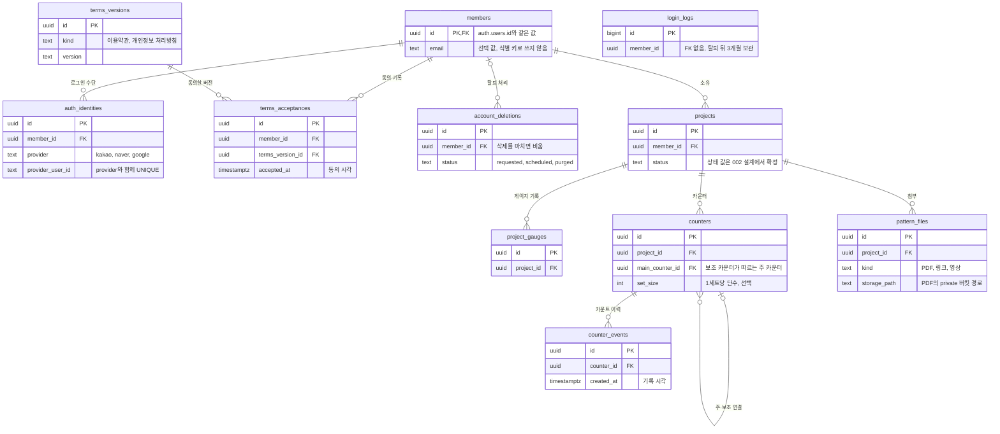
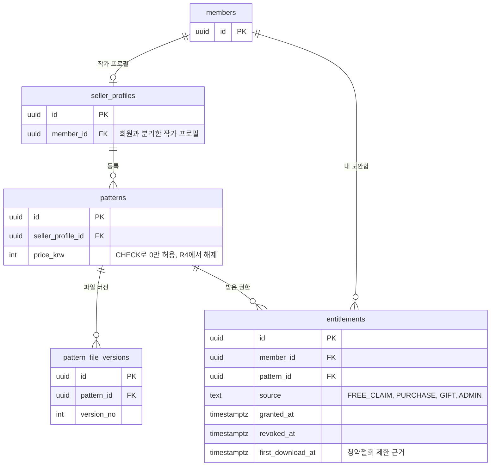

# ERD 개요

이 문서는 R0~R1 테이블과 R2 핵심 테이블을 개념 모델로 보여 주고, 스키마마다 마이그레이션을 누가 소유하는지 설명한다. 독자는 테이블 사이의 관계와 판매에 대비해 미리 넣는 컬럼을 확인할 수 있다.

## 이 문서의 위치

이 문서는 개념 모델이다. 정확한 컬럼, 타입, 제약, 인덱스, RLS 정책은 각 스펙의 `docs/specs/NNN-name/design/erd.md`에서 정하며, 이 문서와 다르면 design/erd.md를 따른다. RLS 정책은 각 design/erd.md의 정책 표에 기록하고 이 문서에는 적지 않는다([ADR-0004](../decisions/0004-rls-authorization.md)).

`/sdd-design` 단계가 각 기능의 design/erd.md를 만들면서 이 문서를 함께 갱신한다([SDD 가이드](../sdd-guide.md)). 다이어그램에는 키 컬럼과 꼭 알아야 하는 몇 개의 컬럼만 적는다.

## R0~R1 개념 ERD

members를 중심으로 계정(001), 프로젝트(002), 카운터(003), 도안 파일(004) 테이블이 이어진다. login_logs는 회원이 삭제된 뒤에도 남아야 하므로 members와 관계를 두지 않는다. counters의 자기 참조는 보조 카운터가 같은 프로젝트의 주 카운터 하나를 따르는 연결(F-COUNTER-04)을 나타낸다. 보조 카운터는 다른 카운터의 주 카운터가 될 수 없다(003 FR-27~FR-31).

| 테이블 | 스펙 | 개념 모델에서 알아 둘 점 |
|---|---|---|
| members | 001 | id는 Supabase `auth.users.id`와 같은 값이어서 RLS가 `auth.uid()`로 회원을 찾는다. 이메일은 선택 값이다. 연령 확인 시각도 이 테이블에 둔다 |
| auth_identities | 001 | 회원은 (provider, provider_user_id)로 식별한다. R0의 provider는 kakao, naver, google이고, Apple(A1)도 같은 테이블에 추가한다 |
| terms_versions | 001 | 약관과 처리방침을 버전별로 보관한다 |
| terms_acceptances | 001 | 회원이 동의한 약관 버전, 동의 여부, 시각을 첫 가입자부터 남기고 추가만 한다 |
| account_deletions | 001 | 탈퇴 처리 상태(requested, scheduled, purged)와 상태별 시각. 삭제를 마치면 회원 ID를 비운다 |
| login_logs | 001 | 로그인 일시, IP 주소, 로그인 수단. 회원 데이터와 분리해 3개월 동안 보관한다 |
| projects | 002 | 상태는 뜰 예정, 진행 중, 완성, 휴면, 풀었음이다. 위시리스트·큐 테이블은 두지 않는다(002 Q-08) |
| project_gauges | 002 | 세탁 전후 게이지를 기록한다. 컬럼 구성은 002 설계에서 정한다 |
| counters | 003 | set_size는 '1세트당 단수' 설정이고, 카운터에는 전체 단수를 저장한다. 연결 방식(따라가기, N단마다 초기화)과 정확한 컬럼은 003 설계에서 정한다 |
| counter_events | 003 | 카운트 변경 이력이다. 이력의 용도(예: 리셋 실행 취소, 과거 기록 조회)는 003 요구사항과 설계에서 정한다 |
| pattern_files | 004 | PDF 파일은 private 버킷에 둔다. 파일당 50MB, 회원당 합계 200MB로 제한한다(004 Q-01, Q-02) |

001 설계는 이 밖에 약관 변경 안내 확인 기록(terms_notice_acknowledgements), 유출 안내(breach_notices)와 본 기록(breach_notice_views), 메일 발송 기록(email_deliveries)을 둔다. 정확한 열과 RLS 정책은 [001 design/erd.md](../specs/001-account/design/erd.md)에 있다. 광고성 정보 수신 동의는 R2에서 받는다.

OD-02에서 정한 대로, 탈퇴하면 유예 기간 없이 24시간 안에 삭제한다. 탈퇴 처리 작업이 회원의 저장소 파일을 먼저 지우고 `auth.users` 행을 지우면, members와 회원 소유 테이블은 ON DELETE CASCADE로 함께 지워진다. 002~004의 회원 데이터도 members(id)를 같은 방식으로 참조한다.

## R2 예정 핵심 테이블

아래 테이블은 R2 무료 도안 배포에서 만들 예정이다. 판매에 대비한 컬럼을 처음부터 넣기 위해 지금 개념을 정해 둔다([ADR-0007](../decisions/0007-sales-ready-data-model.md)).

이 다이어그램의 테이블은 모두 예정이다. members는 R0~R1 다이어그램의 같은 테이블이며 관계를 보이기 위해 다시 적었다.

| 테이블 | 상태 | 개념 모델에서 알아 둘 점 |
|---|---|---|
| seller_profiles | R2 예정 | 작가 프로필은 회원과 분리하며, 회원 한 명은 작가 프로필을 최대 1개 가진다([ADR-0007](../decisions/0007-sales-ready-data-model.md)) |
| patterns | R2 예정 | 가격 컬럼을 처음부터 두고 CHECK 제약으로 0원만 허용한다. R4에서 제약을 푼다 |
| pattern_file_versions | R2 예정 | 파일을 교체하면 새 버전을 만들고, 도안을 받은 회원에게 업데이트를 알린다 |
| entitlements | R2 예정 | 무료 도안을 받을 때도 행을 만든다. source로 출처를 구분하고 first_download_at을 남긴다 |

내 도안함의 다운로드 기간(무기한 또는 12개월)은 OD-05에서 정한다. 컬럼 이름 price_krw와 version_no는 개념을 보이기 위한 이름이며, 실제 이름은 R2 설계에서 정한다.

## R4 이후 commerce 스키마

R4에서는 주문, 결제, 원장, 지급 테이블을 commerce 스키마에 만든다. 이 테이블은 apps/api의 Flyway가 만들고 바꾸므로, 이 문서에는 개념 다이어그램을 그리지 않는다. 수수료율, 원천징수율, 정산 주기는 상수가 아니라 적용 시작일이 있는 설정 테이블로 관리한다([ADR-0007](../decisions/0007-sales-ready-data-model.md)). commerce 테이블이 public 테이블을 참조하는 방식은 R4 설계에서 확정한다.

## 스키마 소유권

테이블 구조를 바꾸는 도구는 스키마마다 하나로 정한다. 두 도구가 같은 테이블을 바꾸지 않는다([ADR-0006](../decisions/0006-migration-ownership.md)).

| 스키마 | 소유 도구 | 마이그레이션 위치 | 포함하는 테이블 | 시작 릴리스 |
|---|---|---|---|---|
| public과 그 밖의 비커머스 스키마 | Supabase CLI로 적용하는 SQL 마이그레이션 | supabase/migrations | 이 문서의 R0~R2 테이블 전부 | R0 |
| commerce | Spring Flyway | apps/api 안 (경로는 R4에서 확정) | 주문, 결제, 원장, 지급 | R4 |

public 스키마의 RLS 정책도 supabase/migrations의 SQL로 관리한다. 마이그레이션을 운영 프로젝트에 적용하는 절차는 [배포 구조](deployment.md)에서 설명한다.

## 판매에 대비한 데이터 원칙

[ADR-0007](../decisions/0007-sales-ready-data-model.md)이 정한 원칙 가운데 이 ERD에 드러나는 것은 다음과 같다.

- 작가 프로필(seller_profiles)은 회원(members)과 분리하고, 회원 한 명은 작가 프로필을 최대 1개 가진다.
- 무료 도안도 entitlements에 기록하고 source, granted_at, revoked_at, first_download_at을 남긴다.
- 도안 가격 컬럼은 처음부터 두고 R4 전까지 CHECK 제약으로 0원만 허용한다.
- first_download_at과 동의 기록은 디지털 콘텐츠의 청약철회와 관련된 근거로 보관한다.
- 수수료, 원천징수, 정산 주기는 적용 시작일이 있는 설정 테이블로 관리한다.

## 관련 문서

- [ADR-0006 DB 마이그레이션 소유권을 스키마별로 분리](../decisions/0006-migration-ownership.md)
- [ADR-0007 판매에 대비한 데이터 원칙](../decisions/0007-sales-ready-data-model.md)
- [도메인 지도](domain-map.md): 이 테이블들의 개념 애그리거트
- [설계 템플릿 design/erd.md](../specs/_template/design/erd.md)
- [배포 구조](deployment.md): 마이그레이션 적용 흐름
