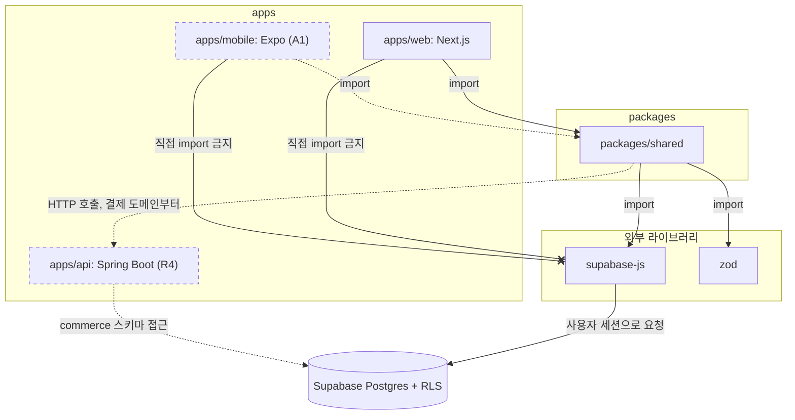
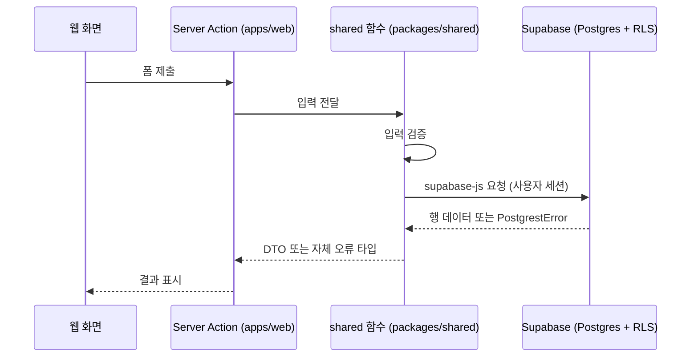
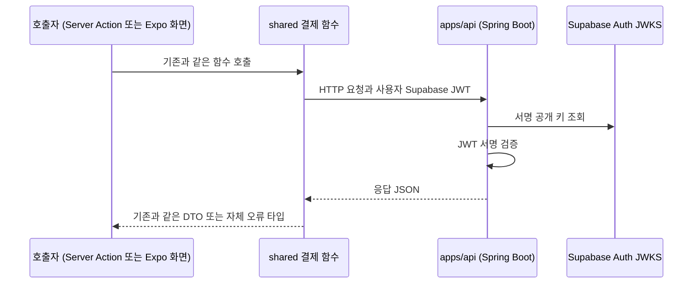

# 모노레포 구조

이 문서는 함뜨까 저장소의 디렉터리 구조와 패키지 사이에 허용하는 의존 방향을 설명한다. 독자는 새 코드를 어느 패키지에 두어야 하는지와, 나중에 Spring 서버와 Expo 앱이 들어올 때 무엇이 바뀌는지 알 수 있다.

## 디렉터리 구조

### R0에서 만드는 구조

apps/web과 packages/shared는 R0 작업 [#2](https://github.com/god3v/hamtteukka/issues/2)에서 만들었고, supabase/는 R0 작업 [#3](https://github.com/god3v/hamtteukka/issues/3)에서 만들었다.

```text
hamtteukka/
├── apps/
│   └── web/              Next.js 16 App Router 웹앱
├── packages/
│   └── shared/           Supabase 접근, zod DTO, 자체 오류 타입
├── supabase/
│   └── migrations/       public 스키마 SQL 마이그레이션과 RLS 정책
├── docs/                 제품, 설계, 결정, 조사 문서
├── .github/              이슈 양식, PR 템플릿 (CI 워크플로는 R0에서 추가)
├── .claude/              SDD 단계별 프로젝트 스킬과 Claude Code 훅
├── scripts/              저장소 검사 스크립트
├── .coderabbit.yaml      CodeRabbit PR 리뷰 설정
├── AGENTS.md             사람과 코딩 에이전트가 함께 따르는 작업 규칙
├── CLAUDE.md             Claude Code 진입점 (AGENTS.md를 가져온다)
└── README.md
```

TypeScript 쪽 패키지는 pnpm workspaces와 Turborepo로 묶는다. 워크스페이스는 루트의 `pnpm-workspace.yaml`이 정하고, 패키지 사이의 작업 순서(build, typecheck, lint, test, dev)는 루트의 `turbo.json`이 정한다. 실행 명령과 도구 버전은 [AGENTS.md](../../AGENTS.md)의 명령 절에 있다.

### 나중에 추가하는 구조

```text
apps/
├── api/        Kotlin + Spring Boot 서버, Gradle 빌드 (R4)
└── mobile/     Expo 앱 (A1)
```

두 앱은 해당 릴리스 전에는 빈 디렉터리나 뼈대도 만들지 않는다([ADR-0001](../decisions/0001-monorepo-structure.md)). apps/mobile은 TypeScript 패키지이므로 pnpm 워크스페이스에 들어간다. apps/api는 Gradle로 따로 빌드하며, pnpm 워크스페이스는 TypeScript 쪽만 묶는다.

## 의존 방향



실선 화살표는 지금 허용하는 의존이고, 점선 화살표와 점선 테두리는 괄호에 적은 릴리스에서 생기는 의존과 패키지다. 끝이 x로 표시된 선은 ESLint no-restricted-imports 규칙으로 막는 import다.

| 규칙 | 이유 |
|---|---|
| apps는 packages를 import할 수 있지만, packages는 apps를 import하지 않는다 | 공유 코드가 특정 앱에 묶이지 않게 한다 |
| supabase-js는 packages/shared 안에서만 import한다 | Supabase 타입과 PostgrestError가 앱 코드로 새지 않게 한다 |
| 앱끼리 서로 import하지 않는다 | 웹과 앱이 함께 쓸 코드는 packages/shared에 둔다 |
| TypeScript 코드는 apps/api와 HTTP로만 통신한다 | Spring 서버는 별도 빌드와 배포 단위다 |

ADR-0003의 경계는 모든 앱에 적용되고, 지금은 앱이 하나뿐이라 apps/web의 ESLint 설정이 이를 검사한다. 이 설정은 `@supabase/`로 시작하는 모든 패키지의 import를 lint 오류로 만든다. `no-restricted-imports`가 import 문, `export ... from` 문, `import type` 문, 하위 경로를 막는다. `no-restricted-syntax`는 동적 `import()`와 `require()`를 막되, 인수가 문자열이거나 치환식 없는 템플릿 리터럴일 때만 검사하고 경로를 조합하는 식은 검사하지 않는다. A1에서 apps/mobile을 추가할 때 같은 규칙을 넣는다. 규칙은 [apps/web/eslint.config.mjs](../../apps/web/eslint.config.mjs)에 있고, 같은 폴더의 `eslint.config.test.mjs`가 막아야 하는 경우와 허용하는 경우를 `pnpm test`에서 확인한다. 이 경계는 [ADR-0003](../decisions/0003-data-access-boundary.md)이 정했다.

## 패키지별 책임

| 경로 | 맡는 일 | 맡지 않는 일 | 릴리스 |
|---|---|---|---|
| apps/web | 화면, 라우팅, Server Action, 화면 상태 | Supabase 직접 호출, 비즈니스 규칙 | R0 |
| packages/shared | Supabase 클라이언트 생성과 호출, zod DTO, 자체 오류 타입, 도메인 함수 | 화면 렌더링, Next.js 전용 API 사용 | R0 |
| supabase/ | public 스키마 마이그레이션, RLS 정책, 로컬 스택 설정 | commerce 스키마 변경 | R0 |
| docs/ | 제품, 설계, 결정, 조사 문서 | 실행 코드 | 지금 |
| apps/api | 결제·주문·환불·원장·지급 API, commerce 스키마의 Flyway 마이그레이션 | public 스키마 변경 | R4 |
| apps/mobile | Expo 화면과 네이티브 기능 | Supabase 직접 호출, 비즈니스 규칙 | A1 |

packages/shared 안의 함수는 도메인별로 나눈다. 나중에 도메인 단위로 내부 구현을 바꾸려면 경계가 코드 구조에 드러나야 하기 때문이다. 도메인마다 `packages/shared/src/<도메인>/` 폴더를 두고, 다른 패키지가 쓸 수 있는 이름은 모두 `src/index.ts`에 모은다. 앱은 `@hamtteukka/shared`라는 패키지 이름으로만 import하고 내부 경로를 직접 가져오지 않는다. 스키마 소유권은 [ERD 개요](erd-overview.md)와 [ADR-0006](../decisions/0006-migration-ownership.md)에서 설명한다.

## Server Action이 shared 함수를 감싸는 방식

Server Action은 입력을 packages/shared 함수에 넘기고, shared 함수가 반환한 결과를 화면에 전달하는 얇은 래퍼다. 입력 검증, 데이터 조회와 변환, 오류 변환은 shared 함수가 맡는다. Expo 앱은 Server Action을 호출할 수 없으므로, 로직이 Server Action에 있으면 A1에서 같은 로직을 다시 작성해야 하기 때문이다.



shared 함수는 Supabase의 응답을 받으면 함수 안에서 DTO나 자체 오류 타입으로 변환한다. 따라서 Server Action과 화면 코드는 Supabase 타입을 알지 못한다.

| 항목 | 규칙 |
|---|---|
| 반환 값 | zod 스키마로 정의한 자체 DTO 타입을 반환한다. Supabase 행 타입을 그대로 반환하지 않는다 |
| 오류 | 자체 오류 타입으로 바꿔 반환한다. PostgrestError를 밖으로 내보내지 않는다 |
| 권한 | 호출한 사용자의 세션으로 요청하므로 RLS가 그대로 적용된다 |
| 호출 위치 | 같은 함수를 Server Action, 브라우저 코드, A1의 Expo 앱이 함께 쓴다 |

서버에서 사용자 세션을 shared 함수에 넘기는 방식은 쿠키 처리를 포함해 R0에서 확정한다.

## shared 내부를 Spring 호출로 바꾸는 방식 (R4)

R4에서 apps/api가 생기면 packages/shared의 일부 함수는 내부 구현만 바꾼다. 함수 이름, 입력, 반환 DTO, 오류 타입은 그대로 두고, supabase-js 요청을 apps/api로 보내는 HTTP 요청으로 교체한다. 따라서 이 함수를 호출하는 Server Action과 Expo 화면은 수정하지 않는다.



apps/api는 Supabase의 비대칭 서명 키를 JWKS로 받아 JWT를 검증한다([ADR-0005](../decisions/0005-auth-supabase-social-login.md)). 호출자 쪽에서 바뀌는 것은 없고, 바뀌는 범위는 shared 함수의 내부 구현으로 한정된다.

교체는 도메인 단위로 진행하고 결제 도메인부터 시작한다. 결제·주문·원장·지급 데이터는 R4에서 처음 생기며 Flyway가 소유하는 commerce 스키마에 있다([ADR-0006](../decisions/0006-migration-ownership.md)). 다른 도메인을 apps/api로 옮길지는 도메인마다 따로 판단하고, 그 결과를 ADR로 남긴다. apps/api로 옮기는 도메인의 권한 규칙은 각 기능의 design/erd.md 정책 표를 기준으로 옮긴다([ADR-0004](../decisions/0004-rls-authorization.md)).

## 관련 문서

- [ADR-0001 모노레포 구조와 앱의 단계적 추가](../decisions/0001-monorepo-structure.md)
- [ADR-0003 Supabase 접근을 packages/shared로 제한](../decisions/0003-data-access-boundary.md)
- [시스템 구성](system-context.md): 실행 구성 요소와 외부 서비스
- [배포 구조](deployment.md): CI와 배포 흐름
- [constitution](../constitution.md): 설계와 구현이 지켜야 하는 원칙
