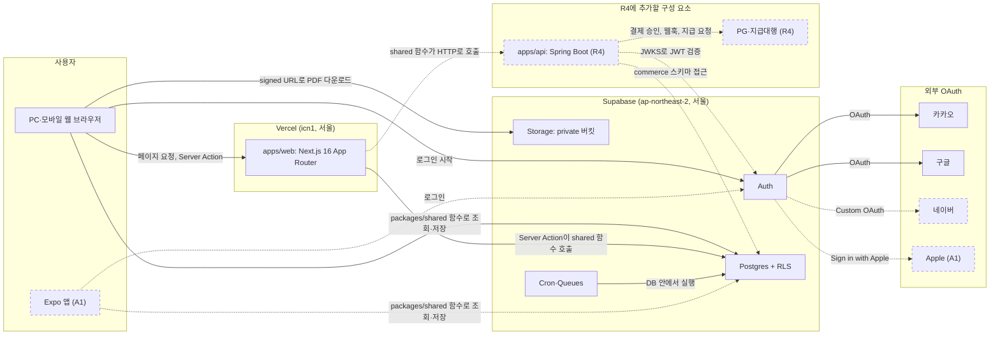

# 시스템 구성

이 문서는 함뜨까를 이루는 실행 구성 요소와 외부 서비스가 서로 어떻게 연결되는지 설명한다. 독자는 각 구성 요소를 정한 ADR과 외부 서비스가 처음 쓰이는 릴리스를 한곳에서 확인할 수 있다.

## 구성도

실선은 R0~R1에서 쓰는 연결이다. 점선 화살표와 점선 테두리는 괄호에 적은 릴리스에서 추가할 연결과 구성 요소다. 화살표는 요청을 보내는 쪽에서 받는 쪽으로 향한다.

## 요청이 지나가는 경로

R0~R1에서 요청은 다음 네 경로로 처리된다. Supabase에 접근하는 코드는 모두 packages/shared에 있으므로, Supabase 타입이 앱 코드로 새지 않는다([ADR-0003](../decisions/0003-data-access-boundary.md)).

| 경로 | 흐름 | 권한 검사 |
|---|---|---|
| 화면과 Server Action | 브라우저가 apps/web에 요청하고, Server Action이 packages/shared 함수를 호출한다 | RLS |
| 브라우저의 직접 접근 | 브라우저에서 실행되는 packages/shared 함수가 Supabase에 직접 요청한다 | RLS |
| 파일 다운로드 | 브라우저가 signed URL로 Storage의 private 버킷에서 파일을 받는다 | Storage 접근 정책 |
| 로그인 | 브라우저가 Supabase Auth로 로그인을 시작하고, Auth가 카카오·구글과 OAuth를 진행한다 | Supabase Auth |

브라우저도 Supabase에 직접 요청하므로, 권한은 화면 코드가 아니라 RLS로 검사한다([ADR-0004](../decisions/0004-rls-authorization.md)). 파일 본문은 Vercel 함수로 중계하지 않는 것을 기본으로 한다. Vercel 서울 리전의 Fast Data Transfer 단가가 GB당 $0.35로 높기 때문이다([Vercel icn1 요금](https://vercel.com/docs/pricing/regional-pricing/icn1)). signed URL을 발급하는 구체적인 흐름은 004 설계에서 정한다.

## 구성 요소와 결정 문서

### 사용자 쪽

PC와 모바일 브라우저는 A1 전까지 유일한 사용 채널이다. 반응형 모바일 웹(F-UX-01)은 R0에서 만든다.

Expo 앱(apps/mobile)은 A1에서 추가한다. 앱은 Next.js Server Action을 호출할 수 없으므로 웹과 같은 packages/shared 함수를 직접 쓴다. 이 배치는 [ADR-0001](../decisions/0001-monorepo-structure.md)과 [ADR-0003](../decisions/0003-data-access-boundary.md)이 정했다. Supabase는 Expo에서 같은 supabase-js 클라이언트를 쓰는 공식 가이드를 제공한다([Supabase Expo 가이드](https://supabase.com/docs/guides/getting-started/quickstarts/expo-react-native)). 앱 결제 전략(OD-18)과 앱 착수 시점(OD-19)은 [결정 목록](../decisions/README.md)에서 관리한다.

### Vercel (icn1)

apps/web은 Next.js 16 App Router 웹앱이며 Vercel에 배포한다. 2026-11-18 기준 Next.js 안정 버전은 16.4.x다([npm next](https://www.npmjs.com/package/next)). Vercel 함수의 기본 리전은 iad1(워싱턴 D.C.)이므로 함수 리전을 서울 icn1로 고정한다([Vercel icn1 문서](https://vercel.com/docs/pricing/regional-pricing/icn1)). 스택과 리전은 [ADR-0002](../decisions/0002-stack-nextjs-supabase-vercel.md)가 정했다.

### Supabase (서울)

Supabase 프로젝트는 서울 리전 ap-northeast-2에 만든다. 일반 APAC 리전을 고르면 싱가포르 등에 배치될 수 있으므로 서울을 직접 선택한다([Supabase 리전 문서](https://supabase.com/docs/guides/platform/regions)).

| 서비스 | 쓰임 | 결정 문서 |
|---|---|---|
| Auth | 신원 제공자. 카카오·구글 로그인과 세션 발급 | [ADR-0005](../decisions/0005-auth-supabase-social-login.md) |
| Postgres + RLS | 서비스 데이터 저장. RLS를 1차 권한 검사로 사용 | [ADR-0002](../decisions/0002-stack-nextjs-supabase-vercel.md), [ADR-0004](../decisions/0004-rls-authorization.md) |
| Storage | 개인 PDF를 private 버킷에 보관하고 signed URL로 제공 | [ADR-0002](../decisions/0002-stack-nextjs-supabase-vercel.md) |
| Cron·Queues | pg_cron 기반 예약 작업과 pgmq 기반 큐 | [ADR-0002](../decisions/0002-stack-nextjs-supabase-vercel.md) |

- Auth: 사용자는 이메일이 아니라 (provider, provider_user_id) 조합으로 식별한다. 카카오는 비즈 앱으로 전환해야 이메일을 제공하기 때문이다([Supabase 카카오 로그인 문서](https://supabase.com/docs/guides/auth/social-login/auth-kakao)).
- RLS: 각 정책은 기능별 design/erd.md의 정책 표에 기록한다. 나중에 같은 규칙을 Spring으로 옮길 수 있게 하기 위해서다.
- Storage: 개별 signed URL은 취소할 수 없으므로 만료 시간을 짧게 둔다. Free 플랜의 업로드 상한은 50MB다([Supabase Storage 다운로드 문서](https://supabase.com/docs/guides/storage/serving/downloads)). 파일당·회원당 업로드 한도는 OD-03에서 정한다.
- Cron·Queues: Cron은 SQL, DB 함수, HTTP 요청을 예약 실행하고, Queues는 RLS로 접근을 제어한다([Supabase Cron 문서](https://supabase.com/docs/guides/cron)). R0~R1에서 어떤 기능이 이 둘을 쓰는지는 각 기능의 설계 문서에서 정한다.

### 외부 OAuth

카카오, 네이버, 구글 로그인은 R0에서 연결한다. 네이버는 Supabase가 기본 제공하지 않으므로 커스텀 OAuth 제공자로 연결하고, 사용자 정보 주소에는 네이버 응답을 Supabase가 읽는 형식으로 바꾸는 apps/web의 경로를 등록한다. 커스텀 제공자는 Free 플랜에서 3개까지, Pro 이상에서 제한 없이 쓸 수 있다([Supabase Custom OAuth 문서](https://supabase.com/docs/guides/auth/custom-oauth-providers)). Apple 로그인은 A1에서 추가한다. 로그인 제공자 구성은 [ADR-0015](../decisions/0015-auth-providers-with-naver.md)가 정했다.

### R4에 추가할 구성 요소

apps/api는 Kotlin과 Spring Boot로 만드는 서버이며 Gradle로 빌드한다. R4 유료 판매에서 추가하고, 그 전에는 뼈대도 만들지 않는다([ADR-0001](../decisions/0001-monorepo-structure.md)). apps/api는 Supabase가 발급한 JWT를 JWKS로 받은 비대칭 서명 공개 키로 검증한다([ADR-0015](../decisions/0015-auth-providers-with-naver.md)). 주문·결제·원장·지급 테이블이 있는 commerce 스키마는 apps/api의 Flyway가 소유한다([ADR-0006](../decisions/0006-migration-ownership.md)).

PG·지급대행도 R4에서 연결한다. 구매자가 낸 돈을 운영자 계좌로 받은 뒤 작가에게 보내는 흐름은 만들지 않는다. 이 흐름은 전자금융거래법상 등록이 필요한 PG 업무에 해당하고, 미등록 영업은 형사 처벌 대상이기 때문이다([금융위원회 자료](https://www.fsc.go.kr/no010102/82523)). 작가 지급은 PG 지급대행이나 PortOne 파트너 정산과 지급대행 PG로만 처리한다([ADR-0009](../decisions/0009-payout-via-pg.md)). 거래 구조(OD-12)와 PG 선택(OD-14)은 R4 착수 전에 정한다.

## 외부 서비스와 등장 릴리스

| 외부 서비스 | 용도 | 처음 쓰는 릴리스 | 결정 문서 |
|---|---|---|---|
| GitHub Issues·Projects | 업무 관리 | R0 | [ADR-0011](../decisions/0011-github-issues-projects.md) |
| GitHub Actions | CI (typecheck, lint, test) | R0 | [배포 구조](deployment.md), 세부 구성은 R0에서 확정 |
| Vercel | apps/web 호스팅, 함수 리전 icn1 | R0 | [ADR-0002](../decisions/0002-stack-nextjs-supabase-vercel.md) |
| Supabase | Auth, Postgres, RLS, Storage, Cron, Queues | R0 | [ADR-0002](../decisions/0002-stack-nextjs-supabase-vercel.md), [ADR-0004](../decisions/0004-rls-authorization.md), [ADR-0015](../decisions/0015-auth-providers-with-naver.md) |
| 카카오 로그인 | 소셜 로그인 | R0 | [ADR-0015](../decisions/0015-auth-providers-with-naver.md) |
| 네이버 로그인 | 소셜 로그인 (커스텀 OAuth) | R0 | [ADR-0015](../decisions/0015-auth-providers-with-naver.md) |
| 구글 로그인 | 소셜 로그인 | R0 | [ADR-0015](../decisions/0015-auth-providers-with-naver.md) |
| 트랜잭션 이메일 발송 서비스 | 약관 변경 안내와 유출 통지(001), 도안 업데이트 알림 등(F-NOTI-02) | R0 | 미정, [OD-21](../decisions/README.md)에서 정한다 |
| Meilisearch | 한국어 검색 (조건부 후보) | R2 | OD-08 결과에 따라 정한다 |
| PG·지급대행 | 결제, 환불, 작가 지급 | R4 | [ADR-0009](../decisions/0009-payout-via-pg.md), OD-14 |
| Spring 서버 호스팅 | apps/api 실행 | R4 | 미정, 비용 계획의 예시는 Lightsail 서울 |
| Apple 로그인 | 앱 로그인 | A1 | [ADR-0005](../decisions/0005-auth-supabase-social-login.md) |
| App Store·Google Play | 앱 배포와 심사 | A1 | OD-18, OD-19 |

미정으로 적은 서비스는 해당 릴리스의 설계나 결정에서 고른다. 각 결정의 진행 상태는 [결정 목록](../decisions/README.md)에서 확인한다.

## 이 구성이 강제하는 규칙

- apps/web과 apps/mobile은 supabase-js를 직접 import하지 않는다. Supabase 접근은 packages/shared에만 둔다([ADR-0003](../decisions/0003-data-access-boundary.md)).
- 브라우저와 앱이 Supabase에 직접 요청하는 동안에는 RLS를 1차 권한 검사로 쓴다([ADR-0004](../decisions/0004-rls-authorization.md)).
- 사용자 식별 키로 이메일을 쓰지 않고, 이메일은 선택 값으로 다룬다([ADR-0005](../decisions/0005-auth-supabase-social-login.md)).
- Vercel 함수와 Supabase 프로젝트를 모두 서울 리전에 둔다([ADR-0002](../decisions/0002-stack-nextjs-supabase-vercel.md)).
- 판매 대금은 PG 지급대행으로만 정산하고, 충전식 잔액이나 포인트를 만들지 않는다. 할인은 가격이나 쿠폰으로 처리한다([ADR-0009](../decisions/0009-payout-via-pg.md)).

## 검토했지만 채택하지 않은 구성

| 구성 | 채택하지 않은 이유 | 출처 |
|---|---|---|
| Next.js + Drizzle + Better Auth + Neon | Neon에는 서울·도쿄 리전이 없어 서울 함수에서 싱가포르 DB를 호출해야 한다 | [Neon 리전 문서](https://neon.com/docs/introduction/regions) |
| Kotlin + Spring Boot API로 시작 | 1인이 백엔드와 프런트엔드 두 코드베이스를 유지해야 해서 기능당 개발 시간이 늘어난다(추정). R4에서 판매·정산용으로 추가한다 | [스택 조사 기록](../research/2026-11-18-stack-options.md) |
| Firebase | App Hosting이 서울·도쿄 리전을 지원하지 않는다 | [Firebase App Hosting 문서](https://firebase.google.com/docs/app-hosting/about-app-hosting) |
| Cloudflare Workers + D1 | D1은 서울을 지정할 수 없고 apac 위치 힌트도 배치를 보장하지 않는다 | [Cloudflare D1 문서](https://developers.cloudflare.com/d1/configuration/data-location/) |

자세한 비교와 비용 추정은 [ADR-0002](../decisions/0002-stack-nextjs-supabase-vercel.md)와 [스택 조사 기록](../research/2026-11-18-stack-options.md)에 있다.

## 관련 문서

- [모노레포 구조](monorepo.md): 패키지 배치와 의존 방향
- [도메인 지도](domain-map.md): 바운디드 컨텍스트와 릴리스
- [ERD 개요](erd-overview.md): 테이블 개념 모델과 스키마 소유권
- [배포 구조](deployment.md): 배포 흐름, 환경, 비용 계획
- [결제와 법규 조사 기록](../research/2026-11-18-payments-and-law.md)
- [앱스토어 정책 조사 기록](../research/2026-11-18-app-store-policy.md)
