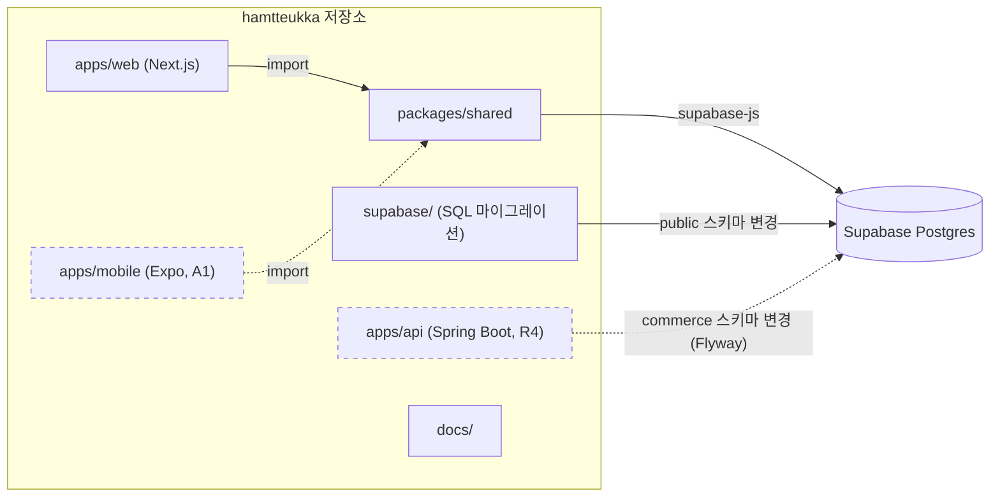

# ADR-0001: 모노레포 구조와 앱의 단계적 추가

이 문서는 함뜨까 저장소를 하나의 모노레포로 구성하고, 웹을 제외한 앱은 해당 릴리스에 도달했을 때 추가하기로 한 결정을 설명한다. 독자는 지금 저장소에 어떤 폴더가 있어야 하는지, Spring 서버와 Expo 앱이 언제 어느 위치에 추가되는지, 그 순서를 지키는 이유를 알 수 있다.

## 상태

| 항목 | 내용 |
|---|---|
| 상태 | 확정 (accepted) |
| 결정일 | 2026-11-18 |
| 결정자 | 프로젝트 소유자 |
| 이 ADR이 대신하는 이전 ADR | 없음 |
| 이 ADR을 대신하는 새 ADR | 없음 |

## 맥락

함뜨까는 한 사람이 개발하는 사이드 프로젝트이며, 웹을 먼저 출시하고 앱은 나중에 출시한다. [로드맵](../product/roadmap.md)에 따르면 R4 유료 판매에서 주문, 결제, 정산을 다룰 서버가 필요하고, A1에서 Expo 앱을 출시한다.

웹과 앱은 데이터 접근 함수, DTO 타입, zod 스키마를 함께 써야 한다. 기술 조사는 pnpm workspaces나 Turborepo로 `apps/web`을 먼저 만들고, DB 타입과 zod 스키마를 별도 패키지로 분리해 웹과 앱이 공유하는 구성을 권했다([스택 조사](../research/2026-11-18-stack-options.md)).

Next.js Server Actions는 Expo 앱에서 호출할 수 없다. 따라서 공유할 로직을 Next.js 앱 안에 두면, 앱을 추가할 때 그 로직을 다른 위치로 다시 옮겨야 한다.

같은 조사는 Kotlin과 Spring Boot 구성을 처음부터 쓰지는 않되, 정산 로직이 복잡해지면 별도 서비스로 추가할 수 있게 남겨 두라고 권했다. 개발자가 Kotlin과 Spring에 익숙하다는 점도 이 판단에 반영했다.

## 결정

저장소는 아래 구성을 따른다. R0에서는 처음 네 경로만 만든다.

| 경로 | 역할 | 추가 시점 |
|---|---|---|
| `apps/web` | Next.js 웹 앱 | R0 기반 |
| `packages/shared` | Supabase 접근 함수, DTO, zod 스키마, 오류 타입 | R0 기반 |
| `supabase/` | Supabase 설정과 SQL 마이그레이션 | R0 기반 |
| `docs/` | 제품, 아키텍처, 결정, 명세 문서 | R0 기반 |
| `apps/api` | Kotlin과 Spring Boot 서버 (Gradle) | R4 유료 판매 |
| `apps/mobile` | Expo 앱 | A1 앱 |

- TypeScript 패키지는 pnpm workspaces와 Turborepo로 관리한다.
- `apps/api`는 Gradle로 빌드한다. pnpm workspaces와 Turborepo는 TypeScript 패키지에만 적용한다.
- 이후 릴리스에서 추가할 앱은 그 릴리스를 시작하기 전까지 폴더, 설정 파일, 빈 뼈대를 만들지 않는다.

범례: 점선 테두리는 아직 만들지 않은 앱이고, 점선 화살표는 그 앱이 추가된 뒤에 생길 연결이다.

웹과 나중에 추가할 앱은 모두 `packages/shared`를 거쳐 Supabase에 접근한다. 스키마를 바꾸는 도구가 스키마별로 나뉘는 이유는 [ADR-0006](0006-migration-ownership.md)에서 설명한다.

## 검토한 대안

### 단일 Next.js 앱만 유지

저장소를 Next.js 앱 하나로 두고 공유 코드도 그 앱 안에 두는 방안이다. 저장소를 처음 설정할 때는 이 방안이 가장 간단하다.

그러나 A1에서 Expo 앱을 추가하면 데이터 접근 함수와 스키마를 패키지로 다시 옮겨야 한다. 또한 Supabase 접근 경계를 패키지 단위로 강제할 수 없다([ADR-0003](0003-data-access-boundary.md)). 이 비용이 앱을 추가하는 시점에 한꺼번에 생기므로 채택하지 않았다.

### 처음부터 Spring 서버를 둔다

Kotlin과 Spring Boot로 API 서버를 만들고, 웹은 화면만 맡기는 방안이다. 트랜잭션과 상태 전이가 많은 정산 영역을 다루기 좋고, 플랫폼 종속도 낮다고 추정했다.

그러나 한 사람이 두 코드베이스를 유지해야 하고, 인증, 세션, 파일 저장, 서버 운영을 직접 구성해야 한다. 조사에서 추정한 첫 배포 기간은 이 방안이 3~5주였고, Next.js와 Supabase 조합은 1~2주였다([스택 조사](../research/2026-11-18-stack-options.md)).

R0부터 R3까지는 결제와 정산이 없으므로, Spring의 장점이 필요해지는 시점은 R4다. 그래서 Spring 서버는 R4에서 `apps/api`로 추가한다.

## 결과

### 좋은 점

- 웹과 앱이 `packages/shared`에 있는 같은 함수와 타입을 쓴다.
- 지금 쓰지 않는 앱의 의존성과 설정을 관리하지 않아도 된다.
- Spring 서버와 Expo 앱을 추가할 위치가 미리 정해져 있으므로, 추가할 때 기존 폴더 구조를 바꾸지 않는다.

### 감수할 점

- 앱이 하나뿐인 R0~R3 기간에도 pnpm workspaces와 Turborepo 설정을 유지해야 한다.
- R4부터는 TypeScript 빌드(Turborepo)와 JVM 빌드(Gradle)를 함께 운영해야 한다.
- 앱을 늦게 추가하므로 추가하는 시점에 버전 호환성을 다시 확인해야 한다. 예를 들어 Supabase의 Expo 가이드가 현재 Expo SDK 58에서 그대로 동작하는지는 아직 확인하지 않았다([스택 조사](../research/2026-11-18-stack-options.md)).

## 관련 문서

- [모노레포 구조](../architecture/monorepo.md): 폴더와 패키지 구성의 세부 규칙
- [배포 구성](../architecture/deployment.md): 앱별 배포 위치
- [ADR-0003: Supabase 접근을 packages/shared로 제한](0003-data-access-boundary.md)
- [ADR-0006: DB 마이그레이션 소유권을 스키마별로 분리](0006-migration-ownership.md)
- [로드맵](../product/roadmap.md): 릴리스별 범위와 진입 조건
