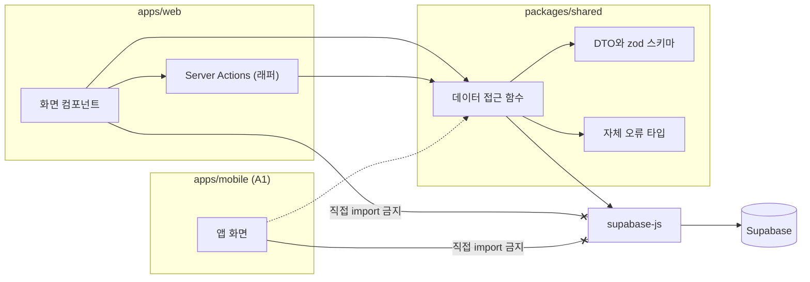

# ADR-0003: Supabase 접근을 packages/shared로 제한

이 문서는 Supabase 클라이언트(supabase-js)를 `packages/shared` 안에서만 쓰고, 앱은 shared가 제공하는 함수만 호출하게 한 결정을 설명한다. 독자는 이 경계가 어디에 있는지, 경계를 넘는 코드가 왜 문제가 되는지, Server Actions와 HTTP API를 어떤 위치에 두는지 알 수 있다.

## 상태

| 항목 | 내용 |
|---|---|
| 상태 | 확정 (accepted) |
| 결정일 | 2026-11-18 |
| 결정자 | 프로젝트 소유자 |
| 이 ADR이 대신하는 이전 ADR | 없음 |
| 이 ADR을 대신하는 새 ADR | 없음 |

## 맥락

웹은 Server Components, Server Actions, 브라우저 코드에서 Supabase를 호출하고, A1에서 추가할 Expo 앱도 Supabase를 호출한다. 앱마다 supabase-js를 직접 쓰면 비즈니스 규칙이 호출 코드 곳곳에 흩어진다. 또한 Supabase가 생성한 DB 타입과 `PostgrestError` 같은 오류 타입이 화면 코드까지 퍼진다.

이렇게 되면 R4에서 일부 기능을 Spring 서버로 옮길 때 그 기능을 호출하는 화면 코드까지 모두 고쳐야 한다. 기술 조사도 가격 계산이나 권한 판단 같은 규칙을 Supabase 호출 코드에 흩어 두지 말고 한 모듈에 모으라고 권했다([스택 조사](../research/2026-11-18-stack-options.md)).

Next.js Server Actions는 Expo 앱에서 호출할 수 없다. 따라서 로직을 Server Actions 안에 쓰면, 앱을 추가할 때 같은 로직을 다시 작성해야 한다.

## 결정

- `@supabase/supabase-js`와 `@supabase/ssr`은 `packages/shared` 안에서만 import한다.
- `apps/*`에서는 ESLint `no-restricted-imports` 규칙으로 이 import를 막는다.
- shared 함수는 자체 DTO 타입(zod 스키마로 정의)과 자체 오류 타입을 반환한다. Supabase가 생성한 타입이나 `PostgrestError`를 함수 밖으로 내보내지 않는다.
- `apps/web`의 Server Actions는 입력을 받아 shared 함수를 호출하고 결과를 넘기는 래퍼로만 쓴다. 비즈니스 규칙은 Server Actions에 쓰지 않는다.
- 브라우저와 앱은 shared 함수를 거쳐 Supabase를 직접 호출하고, 권한은 RLS가 검사한다([ADR-0004](0004-rls-authorization.md)).

범례: 점선 화살표는 A1에서 앱을 추가한 뒤에 생길 연결이다. X로 끝나는 화살표는 ESLint가 막는 import다.

화면은 Server Actions를 거치든 shared 함수를 바로 부르든 결국 shared 함수만 호출한다. supabase-js를 아는 코드는 `packages/shared` 한 곳뿐이다.

## 검토한 대안

### HTTP API를 먼저 만든다

Next.js Route Handler로 `/api/v1` 아래에 버전이 붙은 HTTP API를 먼저 만들고, 웹과 앱이 모두 이 API를 호출하는 방안이다. 클라이언트가 Supabase를 모르게 되고, 나중에 Spring으로 옮기기도 쉽다.

그러나 앱이 없는 R0~R3 기간에도 API 설계, 버전 관리, 인증 토큰 전달, 클라이언트 코드를 모두 유지해야 한다. supabase-js는 Expo에서도 동작하고 웹과 앱이 같은 RLS 정책을 공유하므로, 앱을 추가할 때 API 계층을 새로 만들 부담이 작다([Supabase Expo 가이드](https://supabase.com/docs/guides/getting-started/quickstarts/expo-react-native)). 그래서 지금은 HTTP API를 만들지 않는다.

외부 시스템이 호출해야 하는 경로처럼 HTTP 엔드포인트가 꼭 필요한 기능이 생기면, 그 엔드포인트도 shared 함수를 호출하는 형태로 추가한다.

## 결과

### 좋은 점

- Supabase를 다른 구현으로 바꿔야 할 때 고칠 곳이 `packages/shared` 하나로 모인다.
- Expo 앱이 웹과 같은 함수를 그대로 가져다 쓴다.
- 화면 코드는 DTO와 자체 오류 타입만 알기 때문에, Supabase 버전이 바뀌어도 화면 코드에 미치는 영향이 작다.
- R4에서 commerce 기능을 Spring으로 옮기면 해당 shared 함수의 내부 구현만 Spring API 호출로 바꾸면 된다.

### 감수할 점

- 실시간 구독이나 Storage 업로드처럼 Supabase 기능을 쓰는 코드도 shared 함수로 감싸야 하므로 래퍼 코드가 늘어난다.
- 조회 결과를 DTO로 바꾸는 변환 코드와 zod 검증 비용이 생긴다.
- `@supabase/ssr`처럼 요청의 쿠키가 필요한 클라이언트도 shared가 만들어야 한다. 따라서 shared가 Next.js API에 직접 의존하지 않도록, 앱이 쿠키 접근 방법을 넘겨주는 형태로 설계해야 한다.
- 경계는 ESLint로만 강제되므로 CI에서 lint를 반드시 실행해야 한다.

## 관련 문서

- [모노레포 구조](../architecture/monorepo.md): 패키지 사이의 의존 방향
- [프로젝트 헌법](../constitution.md): 이 경계를 모든 작업에 적용하는 원칙
- [ADR-0001: 모노레포 구조와 앱의 단계적 추가](0001-monorepo-structure.md)
- [ADR-0004: RLS를 1차 권한 검사로 사용](0004-rls-authorization.md)
