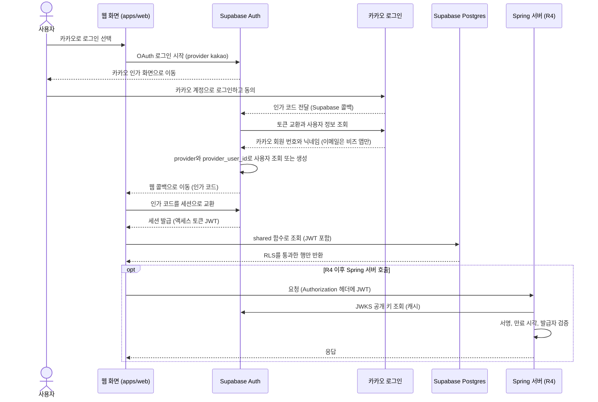

# ADR-0005: Supabase Auth와 카카오·구글 로그인

이 문서는 Supabase Auth를 인증 제공자로 쓰고, 첫 출시 로그인을 카카오와 구글로 정하며, 회원을 이메일이 아닌 로그인 제공자 계정으로 식별하기로 한 결정을 설명한다. 독자는 로그인 수단을 추가하는 순서, 이메일을 키로 쓰지 않는 이유, R4의 Spring 서버가 로그인한 사용자를 확인하는 방법을 알 수 있다.

## 상태

| 항목 | 내용 |
|---|---|
| 상태 | 대체됨 (→ [ADR-0015](0015-auth-providers-with-naver.md)) |
| 결정일 | 2026-11-18 |
| 결정자 | 프로젝트 소유자 |
| 이 ADR이 대신하는 이전 ADR | 없음 |
| 이 ADR을 대신하는 새 ADR | [ADR-0015](0015-auth-providers-with-naver.md) |

## 맥락

한국 사용자를 대상으로 하므로 카카오와 네이버 로그인이 중요하고, 앱을 출시할 때는 Apple 로그인도 고려해야 한다. 조사에서 확인한 사실은 다음과 같다.

- Supabase Auth는 카카오, 구글, Apple을 기본 제공하지만 네이버는 기본 제공하지 않는다. 네이버는 2026년 4월에 출시된 Custom OAuth/OIDC Provider로 연결해야 하며, 이 기능은 Free 플랜에서 최대 3개까지 쓸 수 있다([Supabase Custom OAuth](https://supabase.com/docs/guides/auth/custom-oauth-providers)).
- 카카오에서 이메일을 받으려면 카카오 비즈 앱으로 전환해야 한다. 비즈 앱이 아니면 Supabase에서 이메일이 없는 사용자를 허용하는 옵션을 켜야 한다([Supabase 카카오 로그인](https://supabase.com/docs/guides/auth/social-login/auth-kakao)).
- Apple 심사 지침 4.8은 소셜 로그인을 쓰는 앱에 개인정보 보호 요건을 갖춘 다른 로그인 방식을 함께 제공하도록 요구한다. 카카오와 구글 로그인을 쓰는 앱은 실무상 Sign in with Apple을 추가해야 할 가능성이 높다(추정, [App Store 심사 지침](https://developer.apple.com/app-store/review/guidelines/)).
- Better Auth는 카카오와 네이버를 기본 제공자로 지원하고, 사용자와 세션 테이블을 내 DB 스키마에 둔다([Better Auth 네이버](https://www.better-auth.com/docs/authentication/naver)).

R4에서 추가할 Spring 서버도 웹과 같은 사용자를 확인해야 한다([ADR-0001](0001-monorepo-structure.md)).

## 결정

- 인증 제공자는 Supabase Auth로 한다.
- 로그인 수단은 아래 순서로 추가한다.

| 로그인 수단 | 추가 시점 | 연결 방법 |
|---|---|---|
| 카카오 | R0 기반 | Supabase Auth 기본 제공자 |
| 구글 | R0 기반 | Supabase Auth 기본 제공자 |
| 네이버 | R1+ 도구 보강 | Supabase Custom OAuth Provider |
| Apple | A1 앱 | Supabase Auth 기본 제공자 |

- 회원은 로그인 제공자와 그 제공자의 사용자 ID 조합 `(provider, provider_user_id)`로 식별한다.
- 이메일은 선택 속성으로만 저장하고 회원 식별 키로 쓰지 않는다. 이메일이 없는 회원도 가입할 수 있어야 한다.
- R4의 Spring 서버는 Supabase가 발급한 JWT를 JWKS로 받은 공개 키로 검증한다. 이를 위해 Supabase 프로젝트는 비대칭 서명 키를 쓴다. 구체적인 설정 방법은 R4 설계 단계에서 Supabase 문서로 확인한다.

위쪽 흐름은 R0에서 만드는 카카오 로그인이며, 구글 로그인도 같은 순서를 따른다. `opt` 블록은 R4에서 Spring 서버를 추가한 뒤의 흐름으로, Spring은 Supabase에 사용자 정보를 묻지 않고 공개 키로 토큰을 직접 검증한다.

## 검토한 대안

### Better Auth

Better Auth로 인증을 직접 구성하는 방안이다. 카카오와 네이버를 기본 제공자로 쓸 수 있고, 인증 데이터가 내 스키마에 있어 호스팅을 바꿔도 그대로 옮길 수 있다.

그러나 Better Auth의 세션은 Supabase Auth가 발급하는 JWT가 아니므로, RLS 정책이 기대는 Supabase Auth 사용자 정보를 그대로 쓸 수 없다고 추정했다. 그러면 [ADR-0004](0004-rls-authorization.md)의 RLS 중심 권한 검사를 서버 코드 검사로 바꿔야 한다.

앱 지원도 불확실하다. Better Auth의 Expo 가이드는 Expo SDK 55 기준이고, 기기 안에서 ID 토큰으로 로그인하는 방식은 구글, Apple, Facebook만 문서화되어 있다([Better Auth Expo](https://www.better-auth.com/docs/integrations/expo)). 또한 Better Auth는 2026년 7월 7일 Vercel에 합류했으므로, Vercel 생태계 의존이 커질 수 있다(추정, [Better Auth 블로그](https://better-auth.com/blog/authjs-joins-better-auth)). 이런 이유로 채택하지 않았다.

### 이메일을 회원 키로 쓴다

이메일을 회원의 고유 키로 두고, 같은 이메일이면 같은 회원으로 보는 방안이다. 회원 조회와 계정 연결이 단순해진다.

그러나 카카오는 비즈 앱에만 이메일을 제공하므로, 비즈 앱이 아니면 이메일이 없는 회원이 생긴다([Supabase 카카오 로그인](https://supabase.com/docs/guides/auth/social-login/auth-kakao)). 한 사람이 로그인 수단마다 다른 이메일을 쓸 수도 있다. 이메일을 키로 쓰면 이 회원들을 식별할 수 없으므로 채택하지 않았다.

## 결과

### 좋은 점

- 카카오와 구글 로그인을 Supabase 설정만으로 시작할 수 있다.
- RLS 정책이 Supabase Auth 사용자 정보로 권한을 검사할 수 있다.
- 카카오는 Supabase에서 ID 토큰 로그인(`signInWithIdToken`)도 지원하므로, A1 앱에서도 같은 인증 체계를 쓸 수 있다([Supabase 카카오 로그인](https://supabase.com/docs/guides/auth/social-login/auth-kakao)).
- 이메일이 없는 회원도 가입하고 이용할 수 있다.

### 감수할 점

- 네이버 로그인은 Custom OAuth Provider로 연결해야 하고, 네이버의 비표준 사용자 정보 응답을 변환하는 작업이 필요할 수 있다. 이 방식의 안정성은 R1+에서 직접 검증해야 한다([스택 조사](../research/2026-11-18-stack-options.md)).
- 인증 데이터가 Supabase Auth에 있으므로, 다른 인증 시스템으로 옮기려면 사용자 이전 작업이 필요하다(추정).
- 이메일로 회원을 식별하지 않으므로, 한 사람이 서로 다른 로그인 수단으로 가입하면 별도 회원이 될 수 있다. 계정 연결 기능이 필요해지면 따로 정한다.
- 2026년 1월 1일부터 한국에 기반을 둔 개발자는 Sign in with Apple Services ID를 등록하거나 수정할 때 서버 간 알림 엔드포인트를 제공해야 한다. A1에서 Apple 로그인을 추가할 때 이 엔드포인트도 함께 만든다([Apple 개발자 소식](https://developer.apple.com/news/?id=j9zukcr6)).
- R4 전에 Supabase 프로젝트의 JWT 서명 키를 비대칭 키로 준비해야 한다.

## 관련 문서

- [001 계정: 가입·로그인·약관 동의·탈퇴](../specs/001-account/requirements.md): R0 로그인 요구사항
- [앱스토어 정책 조사](../research/2026-11-18-app-store-policy.md): Apple 로그인과 계정 삭제 요건
- [시스템 구성](../architecture/system-context.md): 인증 흐름이 지나는 외부 서비스
- [ADR-0002: Next.js·Supabase·Vercel 스택과 서울 리전](0002-stack-nextjs-supabase-vercel.md)
- [ADR-0004: RLS를 1차 권한 검사로 사용](0004-rls-authorization.md)
