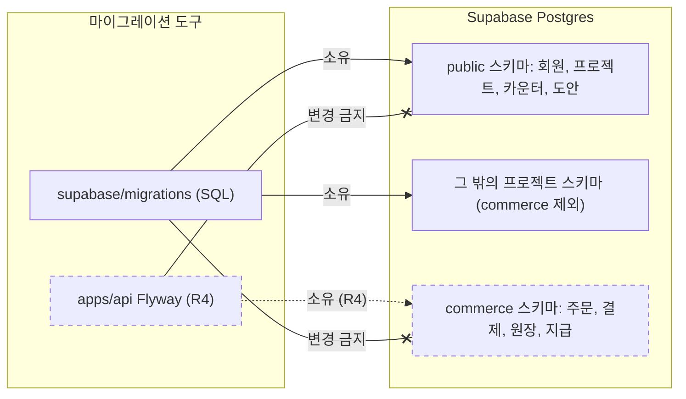

# ADR-0006: DB 마이그레이션 소유권을 스키마별로 분리

이 문서는 하나의 Supabase Postgres를 두 마이그레이션 도구가 함께 다룰 때, 도구마다 담당할 스키마를 나누기로 한 결정을 설명한다. 독자는 어떤 테이블을 어느 도구로 바꿔야 하는지, 두 도구가 같은 테이블을 바꾸면 안 되는 이유를 알 수 있다.

## 상태

| 항목 | 내용 |
|---|---|
| 상태 | 확정 (accepted) |
| 결정일 | 2026-11-18 |
| 결정자 | 프로젝트 소유자 |
| 이 ADR이 대신하는 이전 ADR | 없음 |
| 이 ADR을 대신하는 새 ADR | 없음 |

## 맥락

R0부터 R3까지는 모든 스키마 변경을 `supabase/migrations`의 SQL 파일로 관리한다. R4에서는 주문, 결제, 정산을 다루는 Spring 서버를 `apps/api`로 추가하며([ADR-0001](0001-monorepo-structure.md)), Spring 서버는 Flyway로 자기 테이블을 관리한다.

두 도구는 각자 적용 이력을 따로 기록한다. 두 도구가 같은 테이블을 바꾸면 한쪽 이력만 보고는 테이블의 현재 구조를 알 수 없고, 적용 순서가 엇갈리면 마이그레이션이 실패한다. 기술 조사도 정산 관련 테이블을 Supabase 전용 기능에 묶지 않게 설계해 두면 나중에 Spring 정산 서비스를 붙이기 쉽다고 보았다(추정, [스택 조사](../research/2026-11-18-stack-options.md)).

## 결정

- `public` 스키마와 commerce를 제외한 프로젝트 스키마는 `supabase/migrations`의 SQL 파일이 소유한다.
- R4에서 만들 `commerce` 스키마(주문, 결제, 원장, 지급)는 Spring 서버의 Flyway가 소유한다.
- 한 도구는 다른 도구가 소유한 스키마의 테이블을 만들거나 바꾸지 않는다.
- R4 전에는 `commerce` 스키마를 만들지 않는다.

범례: 점선 테두리와 점선 화살표는 R4에서 추가할 도구와 스키마다. X로 끝나는 화살표는 허용하지 않는 변경이다.

스키마 하나에는 소유 도구가 하나만 있다. 회원이나 도안처럼 R0~R3에서 만든 테이블은 R4 이후에도 계속 SQL 마이그레이션으로 바꾼다.

## 검토한 대안

### 마이그레이션 도구를 하나만 쓴다

모든 스키마를 한 도구로 관리하는 방안이다. 이력이 한 곳에 모이므로 현재 구조를 파악하기 쉽다.

모든 변경을 `supabase/migrations`로 관리하면, Spring 코드와 그 코드가 쓰는 테이블의 변경이 서로 다른 도구와 위치에 나뉜다. 그러면 Spring 서버를 배포할 때마다 SQL 마이그레이션을 먼저 적용했는지 따로 확인해야 한다.

모든 변경을 Flyway로 관리하면, Spring 서버가 없는 R0~R3 기간에도 Flyway를 별도로 실행해야 한다. 또한 Supabase CLI가 쓰는 `supabase/migrations` 기반 로컬 개발 흐름을 포기해야 한다.

두 경우 모두 지금 또는 R4 이후의 작업 흐름이 불편해지므로 채택하지 않았다. 대신 스키마 경계로 소유권을 나눠 두 도구가 서로 부딪치지 않게 한다.

## 결과

### 좋은 점

- 두 도구의 이력이 서로 겹치지 않으므로 각 이력만 보고도 담당 스키마의 구조를 알 수 있다.
- R4에서 Spring 서버를 추가해도 R0~R3 테이블의 관리 방식은 바뀌지 않는다.
- 주문, 결제, 정산 테이블이 별도 스키마에 모이므로, 이 영역의 접근 권한을 따로 관리하기 쉽다.

### 감수할 점

- R4부터 두 마이그레이션 이력을 함께 관리해야 하며, 로컬 개발 환경에서도 두 도구를 모두 실행해야 한다.
- `commerce` 테이블이 `public` 테이블(회원, 도안)을 참조하는 방식과 `commerce` 스키마의 접근 권한은 R4 설계 단계에서 정해야 한다.
- 새 테이블을 만들 때마다 어느 스키마에 둘지 먼저 판단해야 한다. 판단 기준은 이 문서의 스키마 구분을 따른다.

## 관련 문서

- [전체 ERD](../architecture/erd-overview.md): 스키마별 테이블 구성
- [모노레포 구조](../architecture/monorepo.md): `supabase/`와 `apps/api`의 위치
- [ADR-0001: 모노레포 구조와 앱의 단계적 추가](0001-monorepo-structure.md)
- [ADR-0007: 판매에 대비한 데이터 원칙](0007-sales-ready-data-model.md)
