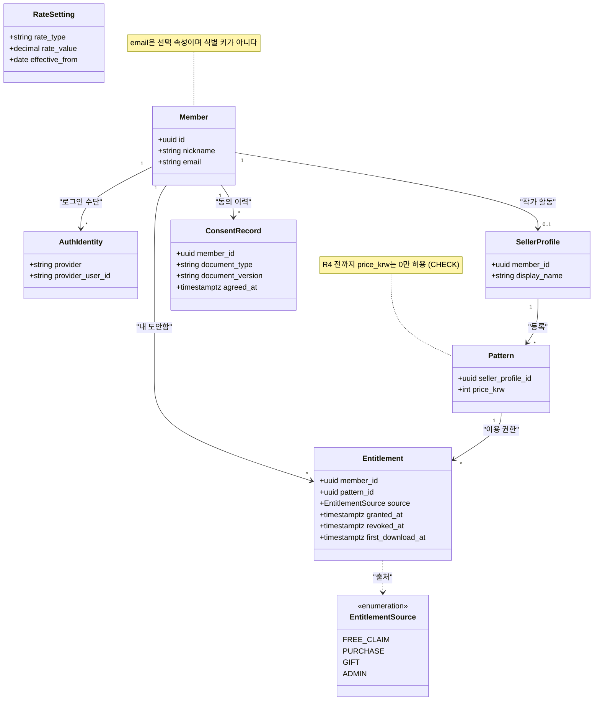

# ADR-0007: 판매에 대비한 데이터 원칙

이 문서는 유료 판매(R4)를 시작하기 전부터 데이터 모델에 판매용 구조를 미리 넣어 두기로 한 결정을 설명한다. 독자는 작가 프로필, 내 도안함 권한, 가격 필드, 동의 기록, 요율 설정을 왜 R4보다 먼저 만드는지, 각 기능을 설계할 때 어떤 원칙을 지켜야 하는지 알 수 있다.

## 상태

| 항목 | 내용 |
|---|---|
| 상태 | 확정 (accepted) |
| 결정일 | 2026-11-18 |
| 결정자 | 프로젝트 소유자 |
| 이 ADR이 대신하는 이전 ADR | 없음 |
| 이 ADR을 대신하는 새 ADR | 없음 |

## 맥락

함뜨까는 R2에서 무료 도안 배포를 시작하고, R4에서 유료 판매를 시작한다. R2와 R3 동안 쌓인 데이터를 R4에서 그대로 쓰려면, 판매에 필요한 구조가 R2부터 있어야 한다. 조사에서 확인한 사실은 다음과 같다.

- 전자상거래법 제17조 제2항 제5호에 따라 디지털콘텐츠는 제공이 시작되면 청약철회가 제한된다. 다만 사업자가 표시와 시험사용 조치를 하지 않으면 소비자는 철회할 수 있다([찾기쉬운 생활법령정보](https://www.easylaw.go.kr/CSP/CnpClsMainBtr.laf?ccfNo=4&cciNo=1&cnpClsNo=2&csmSeq=835&menuType=onhunqna)).
- 대법원(2018다214746)은 청약철회 제한 사유와 표시 의무를 이행했다는 사실을 사업자가 증명해야 한다고 판단했다. 따라서 표시한 문구, 동의한 약관 버전, 첫 다운로드 시각을 기록해 두어야 한다([판례 정리](https://korea.legal/wiki/2018%eb%8b%a4214746/)).
- 2026년 정부 세제개편안은 인적용역 사업소득 원천징수세율을 3%에서 2%로 낮추는 내용을 담았다. 2026년 8월 3일 발표 시점에는 국회를 통과하지 않았다([보도](https://www.sejungilbo.com/news/articleView.html?idxno=59503)).
- 토스페이먼츠 지급대행에 셀러를 등록하려면 개인, 개인사업자, 법인 같은 사업자 구분과 정산 계좌가 필요하다([토스페이먼츠 지급대행](https://docs.tosspayments.com/en/integration-payouts)).
- Ravelry는 구매한 도안과 무료로 받은 도안을 같은 라이브러리에 저장한다([Ravelry 블로그](https://blog.ravelry.com/100000-patterns-sold-the-ravelry-pattern-store/)).

## 결정

1. 작가 프로필은 회원과 분리한다. 회원 한 명에게 작가 프로필은 최대 1개 있으며, 도안은 작가 프로필에 속한다.
2. 무료 도안을 받을 때도 내 도안함 권한(entitlement)을 기록한다. 권한에는 출처(`FREE_CLAIM`, `PURCHASE`, `GIFT`, `ADMIN`), `granted_at`, `revoked_at`, `first_download_at`을 둔다.
3. 도안에는 처음부터 가격 필드를 둔다. R4 전까지는 CHECK 제약으로 0만 허용한다.
4. `first_download_at`과 동의 기록을 보관한다. 이 기록은 디지털콘텐츠의 청약철회 제한을 주장할 때 증거로 쓴다.
5. 판매 수수료율, 원천징수세율, 정산 주기 같은 요율은 코드 상수로 두지 않는다. 적용 시작일이 있는 설정 테이블로 관리한다.

이 다이어그램은 원칙을 설명하기 위한 최소 구성이다. 실제 테이블과 컬럼은 각 기능의 `design/erd.md`에서 정하고, 전체 구성은 [전체 ERD](../architecture/erd-overview.md)에 모은다.

| 클래스 | 뜻 | 처음 만드는 릴리스 |
|---|---|---|
| Member | 회원 | R0 기반 |
| AuthIdentity | 회원과 연결된 로그인 제공자 계정 ([ADR-0005](0005-auth-supabase-social-login.md)) | R0 기반 |
| ConsentRecord | 약관과 개인정보 처리방침 동의 기록, R4부터는 결제 화면의 청약철회 제한 안내 동의도 포함 | R0 기반 |
| SellerProfile | 작가 프로필 | R2 무료 도안 배포 |
| Pattern | 도안 | R2 무료 도안 배포 |
| Entitlement | 내 도안함 권한 | R2 무료 도안 배포 |
| RateSetting | 적용 시작일이 있는 요율 설정 | R4 유료 판매 |

ConsentRecord는 [도메인 지도](../architecture/domain-map.md)의 TermsAcceptance와 [전체 ERD](../architecture/erd-overview.md)의 terms_acceptances에 해당한다. 실제 이름과 구조는 001 설계에서 정한다.

## 검토한 대안

### 작가 프로필과 내 도안함을 판매할 때 추가한다

R2에서는 도안을 회원에게 직접 연결하고, 무료 도안은 권한 기록 없이 누구나 내려받게 한 뒤, R4에서 판매용 구조를 추가하는 방안이다. R2의 설계와 구현이 가장 단순하다.

그러나 이 방안에서는 R2~R3에 무료 도안을 받은 기록이 남지 않는다. R4에서 내 도안함을 만들 때 기존 회원의 권한을 언제 얻었는지 채울 수 없고, 이미 내려받은 도안의 첫 다운로드 시각도 복구할 수 없다.

R4 전까지 무료 도안과 유료 도안의 다운로드 경로가 둘로 나뉘는 문제도 있다. 또한 회원에게 붙어 있던 도안을 작가 프로필로 옮기는 데이터 이전이 필요하다. 요율을 상수로 두면, 원천징수세율이 바뀔 때마다 코드를 고쳐 배포해야 한다. 이런 이유로 채택하지 않았다.

## 결과

### 좋은 점

- R4에서는 가격 CHECK 제약을 풀고 `commerce` 스키마를 추가하면 판매 구조가 갖춰진다([ADR-0006](0006-migration-ownership.md)).
- 무료 도안과 유료 도안이 같은 권한 기록을 거쳐 같은 경로로 다운로드된다.
- 청약철회 제한을 증명할 데이터가 R2부터 쌓인다.
- 세율이나 수수료율이 바뀌어도 설정 행을 추가하면 되므로 코드를 배포하지 않아도 된다.

### 감수할 점

- R2~R3 기간에는 가격이 항상 0이고 권한 출처도 대부분 `FREE_CLAIM`이므로, 당장 쓰지 않는 필드를 유지해야 한다.
- 무료 도안을 받을 때마다 권한 행이 생기므로 행 수가 늘어난다.
- `first_download_at`을 기록하려면 다운로드할 때마다 서버에서 권한을 확인하고 서명된 URL을 발급해야 한다. Supabase의 서명된 URL은 하나씩 취소할 수 없으므로 만료 시간을 짧게 둔다([Supabase Storage](https://supabase.com/docs/guides/storage/serving/downloads)).
- 내 도안함의 다운로드 기간(OD-05)과 수수료 정책(OD-15)은 아직 정하지 않았다([미결정 항목](README.md#미결정-항목)).

## 관련 문서

- [도메인 지도](../architecture/domain-map.md): 회원, 작가, 도안, 권한의 관계
- [전체 ERD](../architecture/erd-overview.md): 테이블 전체 구성
- [결제·법률 조사](../research/2026-11-18-payments-and-law.md): 청약철회, 원천징수, 지급대행 조사 기록
- [ADR-0006: DB 마이그레이션 소유권을 스키마별로 분리](0006-migration-ownership.md)
- [ADR-0009: 판매 대금은 PG 지급대행으로만 정산](0009-payout-via-pg.md)
