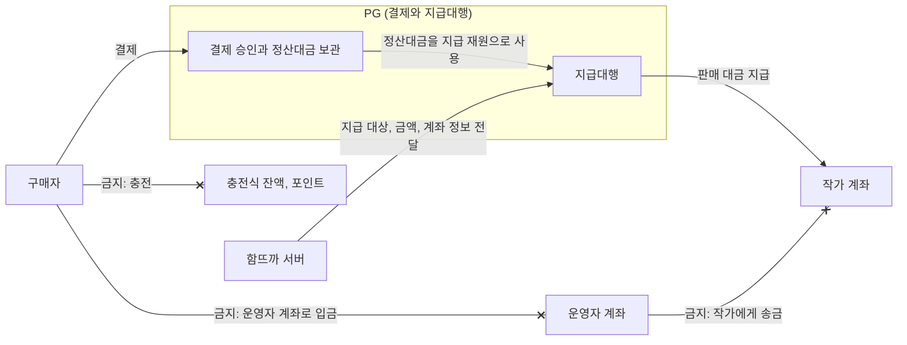

# ADR-0009: 판매 대금은 PG 지급대행으로만 정산

이 문서는 유료 판매(R4)에서 작가에게 판매 대금을 지급할 때 PG의 지급대행만 쓰고, 운영자 계좌를 거쳐 돈을 보내는 흐름은 만들지 않기로 한 결정을 설명한다. 독자는 허용하는 돈의 흐름과 금지하는 흐름, 그 근거가 된 법 규정, 아직 정하지 않은 거래 구조와 PG 선택이 이 결정과 어떻게 이어지는지 알 수 있다.

## 상태

| 항목 | 내용 |
|---|---|
| 상태 | 확정 (accepted) |
| 결정일 | 2026-11-18 |
| 결정자 | 프로젝트 소유자 |
| 이 ADR이 대신하는 이전 ADR | 없음 |
| 이 ADR을 대신하는 새 ADR | 없음 |

## 맥락

R4에서는 여러 작가가 올린 유료 도안을 판매하므로, 구매자가 낸 돈 가운데 작가 몫을 작가에게 지급해야 한다. 조사에서 확인한 사실은 다음과 같다([결제·법률 조사](../research/2026-11-18-payments-and-law.md)).

- 금융위원회는 플랫폼이 결제대금 정산을 대행하거나 매개하면 전자지급결제대행업(PG)으로 등록해야 하고, 외부 PG가 정산하면 등록하지 않아도 된다고 밝혔다. 미등록 영업은 3년 이하 징역 또는 2천만 원 이하 벌금 대상이다([금융위원회](https://www.fsc.go.kr/no010102/82523)).
- 같은 자료는 전문 PG사가 입점업체에 결제대금을 정산하고, 플랫폼은 계좌정보 등 정산에 필요한 정보만 제공하는 경우를 등록이 필요 없는 예로 들었다. 구매 대금을 운영자 계좌로 받아 작가에게 송금하면 안 된다는 판단은 이 자료에서 끌어낸 것이다(추정).
- PG로 직접 등록하려면 자본금 요건을 갖춰야 한다. 분기 결제대행 규모가 30억 원을 넘으면 자본금 10억 원 이상이 필요하고, 그 이하 구간도 2차 자료 기준 3억 원 이상이 필요하다([금융위원회](https://www.fsc.go.kr/no010101/85751)).
- 개정 전자금융거래법은 2026년 12월 17일에 시행되며, PG업 정의를 제3자 간 거래의 정산 대행으로 명확히 했다. 하위규정안은 자기 사업에 부수적으로 정산을 대행하는 경우를 PG업에서 제외하지만, 최종본은 확인하지 못했다([금융위원회](https://www.fsc.go.kr/po010106/87151)).
- 토스페이먼츠 지급대행은 가맹점(플랫폼)의 정산대금을 재원으로 토스페이먼츠가 셀러 계좌에 직접 지급하는 구조다([토스페이먼츠](https://www.tosspayments.com/blog/articles/30365)).
- PortOne V2는 파트너 정산 API를 제공하고, 실제 이체는 지급대행 PG를 거친다고 설명한다([PortOne 파트너 API](https://developers.portone.io/api/rest-v2/platform.partner)).
- 충전식 포인트나 지갑 기능을 만들면 선불전자지급수단 발행업 등록 문제가 생긴다. 여러 판매자에게 쓰이는 충전금은 단일 가맹점 예외에 해당하지 않을 가능성이 있다(추정, [금융위원회](https://www.fsc.go.kr/no010101/82339)).

## 결정

- 구매 대금을 운영자 계좌로 받아 작가에게 송금하는 흐름은 만들지 않는다.
- 작가에게 판매 대금을 지급할 때는 PG 지급대행 서비스를 쓰거나, PortOne 파트너 정산과 지급대행 PG를 함께 쓴다. 플랫폼은 지급 대상, 금액, 계좌 정보처럼 정산에 필요한 정보만 PG에 전달한다.
- 충전식 잔액이나 포인트처럼 돈을 미리 받아 두는 기능은 만들지 않는다. 할인은 가격 조정이나 쿠폰으로 처리한다.
- 거래 구조(OD-12)와 PG 선택(OD-14)은 R4 착수 전에 별도 ADR로 확정한다([미결정 항목](README.md#미결정-항목)).

범례: 실선 화살표는 허용하는 돈과 정보의 흐름이고, X로 끝나는 화살표는 만들지 않는 흐름이다.

돈은 구매자에게서 PG를 거쳐 작가 계좌로만 이동하고, 함뜨까 서버는 지급에 필요한 정보만 보낸다. 플랫폼 수수료를 받는 방식은 OD-12와 OD-14의 결정, PG 계약 조건에 따라 정한다.

## 검토한 대안

### 운영자 계좌로 받아 작가에게 송금한다

구매 대금을 운영자 계좌로 받고, 정산 주기마다 운영자가 작가에게 직접 송금하는 방안이다. PG 지급대행 비용이 들지 않는다.

그러나 이 흐름은 플랫폼이 결제대금 정산을 대행하는 구조이므로 PG 등록이 필요하고, 등록하지 않으면 형사 처벌 대상이다. 1인 운영자가 PG 등록의 자본금 요건을 갖추기는 어렵다. 이 방안은 금지한다.

### 플랫폼이 판매자가 된다 (판매형)

플랫폼이 통신판매업자로서 도안을 직접 팔고, 작가와는 수익 배분 계약을 맺는 방안이다. 마플샵은 이 방식으로 개인 크리에이터 수익에서 부가세와 원천징수세를 떼고 플랫폼이 대신 신고한다([마플샵 도움말](https://docs.channel.io/marppleshop_help/ko/articles/%EB%94%94%EC%A7%80%ED%84%B8-%EC%83%81%ED%92%88-%EC%A0%95%EC%82%B0-1de782a5)). 일반 PG 계약만으로 시작할 수 있어 지급대행 고정비가 들지 않을 수도 있다고 추정했다.

그러나 플랫폼이 모든 판매의 부가세 신고와 청약철회·환불 책임을 직접 진다. 자기 판매대금으로 작가에게 지급하는 것이 자기 사업 부수 정산 예외에 해당하는지도 하위규정 최종본으로 확인해야 한다.

이 방안은 이 ADR에서 기각하지 않고 OD-12에 남겨 둔다. OD-12에서 판매형을 고르면, 작가에게 수익을 배분하는 방식을 새 ADR로 정하고 그 ADR에 이 ADR과의 관계를 적는다.

### Stripe Connect

Stripe Connect는 마켓플레이스 분할 정산 기능을 제공한다. 그러나 Stripe의 아시아·태평양 지원국 목록에 한국이 없으므로, 국내 사업자는 가맹점 계정을 만들 수 없다([Stripe 지원국](https://stripe.com/global)). 해외 법인을 세워야만 쓸 수 있으므로 채택하지 않았다.

## 결과

### 좋은 점

- 플랫폼이 PG로 등록하지 않아도 작가에게 판매 대금을 지급할 수 있다.
- 일정 금액 이상을 지급할 때 필요한 셀러 본인확인(KYC)을 PG가 맡는다. 토스페이먼츠는 최근 7일 기준 1천만 원 이상 지급받는 셀러에게 KYC를 요구한다([토스페이먼츠](https://www.tosspayments.com/blog/articles/30417)).
- 충전금을 받지 않으므로 선불전자지급수단 발행업 등록 문제를 피한다.

### 감수할 점

- 지급대행에는 고정비가 든다. 토스페이먼츠 지급대행은 월 30만 원(부가세 별도, 월 1,000건 포함)이며, 최초 지급이 생긴 달부터는 지급이 없는 달에도 부과된다. 이 금액은 2024년 9월 공지 기준이므로 계약 시점에 다시 확인해야 한다([토스페이먼츠](https://www.tosspayments.com/blog/articles/30355)).
- 지급대행 재원이 결제 PG의 정산대금이므로, 결제 PG와 지급대행 PG의 조합은 OD-14에서 함께 정해야 한다.
- 사업자등록이 없는 개인 작가를 지원하는지는 PG마다 다르다. PortOne은 대부분의 PG 지급대행이 개인 파트너를 지원하지 않는다고 설명하지만, 토스페이먼츠와 KG이니시스 문서는 개인 셀러 등록을 허용한다([PortOne 블로그](https://blog.portone.io/ps_platform-payment-settlement/)). 이 문제는 OD-13에서 정한다.
- 포인트나 적립금을 쓰는 판촉은 할 수 없고, 할인은 가격 조정과 쿠폰으로만 한다.

## 관련 문서

- [결제·법률 조사](../research/2026-11-18-payments-and-law.md): PG, 지급대행, 전자금융거래법, 세금 조사 기록
- [시스템 구성](../architecture/system-context.md): R4에서 추가할 외부 결제 서비스
- [ADR-0006: DB 마이그레이션 소유권을 스키마별로 분리](0006-migration-ownership.md): 주문, 결제, 지급 테이블의 위치
- [ADR-0007: 판매에 대비한 데이터 원칙](0007-sales-ready-data-model.md)
