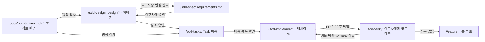

# ADR-0010: 카카오페이 흐름 기반 SDD와 다이어그램 중심 설계

이 문서는 카카오페이가 공개한 spec-kit 사용 흐름을 따르되, spec-kit을 설치하지 않고 다섯 개의 프로젝트 스킬로 명세 기반 개발(SDD)을 진행하기로 한 결정을 설명한다. 독자는 각 단계의 산출물과 승인 조건, 설계를 글 대신 Mermaid 다이어그램으로 쓰는 이유, spec-kit을 설치하지 않은 이유를 알 수 있다.

## 상태

| 항목 | 내용 |
|---|---|
| 상태 | 확정 (accepted) |
| 결정일 | 2026-11-18 |
| 결정자 | 프로젝트 소유자 |
| 이 ADR이 대신하는 이전 ADR | 없음 |
| 이 ADR을 대신하는 새 ADR | 없음 |

## 맥락

함뜨까는 한 사람이 AI 코딩 에이전트와 함께 개발한다. 함께 요구사항을 검토할 기획자나 리뷰어가 없으므로, 에이전트가 만든 결과를 단계마다 확인할 기준이 필요했다. 조사에서 확인한 내용은 다음과 같다([SDD 참고 자료 조사](../research/2026-11-18-sdd-references.md)).

- 카카오페이 AI Platform 팀은 개발 후반에 에이전트가 만든 코드가 산만해지고 리뷰 시간이 늘어나자 spec-kit을 도입했다. 명령은 constitution → specify ↔ clarify → plan → tasks → analyze → implement 순서로 실행했다([카카오페이 기술 블로그](https://tech.kakaopay.com/post/ifkakao-agentic-coding/)).
- 같은 글은 중간 산출물을 직접 고치지 않고 specify로 돌아가 다시 만드는 규칙을 소개한다. 또한 상위 문서의 내용이 tasks로 항상 전파되지는 않고, 에이전트가 constitution보다 tasks에 집중하는 경향이 있다고 밝힌다.
- 같은 글은 작은 변경을 이 흐름으로 처리할지 판단하는 기준이 불분명하다는 점을 단점으로 꼽았다. 카카오페이의 공개 사례에는 설계를 다이어그램 중심으로 기록한 근거가 없다.
- 카카오페이손해보험은 설계 문서를 쓰고 작업을 나눈 뒤 Jira 서브태스크와 PR로 잇는 흐름을 적용했고, PR당 변경 라인 중앙값이 246줄에서 158줄로 줄었다고 보고했다([카카오페이 기술 블로그](https://tech.kakaopay.com/post/kakaopayins-slow-pr-fast-dev/)).
- 카카오페이의 FE 하네스 사례는 반드시 지킬 규칙을 프롬프트가 아니라 스크립트로 강제하고, 에이전트의 검증 완료 보고를 그대로 믿지 말라고 권했다([카카오페이 기술 블로그](https://tech.kakaopay.com/post/ai-agent-2/)).
- spec-kit의 최신 버전은 2026-11-17에 배포된 1.4.2다([spec-kit 릴리스](https://github.com/github/spec-kit/releases)).

## 결정

- 카카오페이가 쓴 단계 순서를 따르고, 각 단계를 Claude Code 프로젝트 스킬 다섯 개로 구현한다.
- spec-kit은 설치하지 않는다. `spec.md`, `plan.md`, `tasks.md`는 만들지 않는다.
- 요구사항은 `docs/specs/NNN-name/requirements.md`에 쓰고, 설계는 같은 폴더의 `design/` 아래에 Mermaid 다이어그램 중심으로 쓴다.
- 작업은 파일 대신 GitHub의 Task 이슈로 만든다([ADR-0011](0011-github-issues-projects.md)).

| 스킬 | spec-kit 대응 단계 | 산출물 | 다음 단계로 가는 조건 |
|---|---|---|---|
| `/sdd-spec` | specify, clarify | `requirements.md` (사용자 스토리, 기능·비기능 요구사항, 수용 기준, 확인 질문) | 사용자가 요구사항을 승인 |
| `/sdd-design` | plan | `design/` 아래 `domain.md`, `erd.md`, `sequence.md`, `state.md`, `screens.md` | 사용자가 설계를 승인 |
| `/sdd-tasks` | tasks, analyze, taskstoissues | Feature 이슈 아래 Task 이슈, 정합성 분석 요약 댓글 | 사용자가 이슈 목록을 확인 |
| `/sdd-implement` | implement | 브랜치, 코드, 테스트, PR | 사용자가 PR을 리뷰 |
| `/sdd-verify` | converge | 빈틈을 메울 새 Task 이슈 또는 Feature 종료 | 없음 |

설계 문서는 다이어그램 유형을 아래처럼 정한다. `erd.md`에는 RLS 정책 표도 함께 쓴다([ADR-0004](0004-rls-authorization.md)).

| 문서 | 다이어그램 | 작성 조건 |
|---|---|---|
| `domain.md` | classDiagram | 항상 |
| `erd.md` | erDiagram과 RLS 정책 표 | 항상 |
| `sequence.md` | 시나리오별 sequenceDiagram | 항상 |
| `state.md` | stateDiagram-v2 | 상태가 바뀌는 대상이 있을 때만 |
| `screens.md` | 화면 이동 flowchart | 항상 |

진행 규칙은 다음과 같다. 세부 절차는 [SDD 진행 가이드](../sdd-guide.md)에서 관리한다.

- 상위 문서부터 고친다. 설계나 이슈를 요구사항과 다르게 고치지 않고, 요구사항이나 설계를 먼저 고친 뒤 아래 단계를 다시 만든다.
- 테이블이나 화면을 추가하거나 권한 규칙을 바꾸는 변경에만 SDD를 적용한다. 버그 수정, 문구 변경, 리팩터링은 이슈와 PR로 바로 처리한다.
- [프로젝트 헌법](../constitution.md)은 `/sdd-design`과 `/sdd-tasks`에서 검사한다.
- 완료 여부는 에이전트의 보고가 아니라 typecheck, lint, test 같은 실행 가능한 검사 결과로 판단한다.
- 모든 단계의 산출물은 한국어로 쓴다.

왼쪽에서 오른쪽으로 진행하며, 화살표의 라벨은 다음 단계로 넘어가는 조건이다. 설계 중에 요구사항을 바꿔야 하면 `/sdd-spec`으로 돌아가 요구사항을 먼저 고친다.

## 검토한 대안

### spec-kit 1.4.2를 설치하고 다이어그램 중심 프리셋을 만든다

spec-kit을 설치하고, 프리셋이나 프로젝트 로컬 오버라이드로 템플릿과 명령을 다이어그램 중심으로 바꾸는 방안이다. spec-kit은 프리셋으로 템플릿과 명령을 교체할 수 있다([spec-kit 프리셋](https://github.github.com/spec-kit/presets/api.html)).

그러나 spec-kit 명령은 `spec.md`와 `plan.md`를 필수로 요구한다. tasks는 두 파일이 없으면 중단하고, analyze는 `spec.md`, `plan.md`, `tasks.md` 가운데 하나라도 없으면 중단한다([tasks 명령](https://raw.githubusercontent.com/github/spec-kit/main/templates/commands/tasks.md), [analyze 명령](https://raw.githubusercontent.com/github/spec-kit/main/templates/commands/analyze.md)). 따라서 설계를 다이어그램으로 옮겨도 형식상의 텍스트 파일을 계속 유지해야 한다.

이슈 변환도 부족하다. 1.3.0부터 이슈 변환은 github 확장이 맡는데, 이 명령은 `T001: 설명` 형식의 이슈만 만든다. 명령 소스에는 라벨, 마일스톤, 하위 이슈, Projects 항목, 의존 관계를 만든다는 내용이 없다([github 확장 명령](https://raw.githubusercontent.com/github/spec-kit/main/extensions/github/commands/speckit.github.taskstoissues.md)). 이런 이유로 채택하지 않았다.

## 결과

### 좋은 점

- 카카오페이 사례와 같은 단계별 승인 조건을 유지하면서, 산출물이 GitHub 이슈 구조와 바로 이어진다.
- spec-kit의 버전 변경에 영향을 받지 않는다.
- GitHub는 Markdown 파일, 이슈, PR 안의 Mermaid 다이어그램을 렌더링하므로, 설계를 저장소에서 바로 검토할 수 있다([GitHub 다이어그램 문서](https://docs.github.com/en/get-started/writing-on-github/working-with-advanced-formatting/creating-diagrams)).

### 감수할 점

- 다섯 스킬을 직접 유지해야 하고, spec-kit에 새로 추가되는 기능을 받을 수 없다.
- 다이어그램 중심 설계는 카카오페이 사례에 없는 확장이므로 효과가 검증되지 않았다.
- GitHub는 지원하는 Mermaid 버전을 공개하지 않으므로, 베타 다이어그램 유형은 쓰지 않는다.
- 단계마다 문서가 생겨 토큰 소비가 늘어난다. 카카오페이도 이 점을 단점으로 꼽았다([카카오페이 기술 블로그](https://tech.kakaopay.com/post/ifkakao-agentic-coding/)).

## 관련 문서

- [SDD 진행 가이드](../sdd-guide.md): 단계별 절차와 게이트
- [프로젝트 헌법](../constitution.md): `/sdd-design`과 `/sdd-tasks`에서 검사하는 원칙
- [요구사항 템플릿](../specs/_template/requirements.md)
- [SDD 참고 자료 조사](../research/2026-11-18-sdd-references.md): 카카오페이 사례와 spec-kit 조사 기록
- [`/sdd-spec` 스킬](../../.claude/skills/sdd-spec/SKILL.md)
- [ADR-0011: GitHub Issues·Projects로 업무 관리](0011-github-issues-projects.md)
