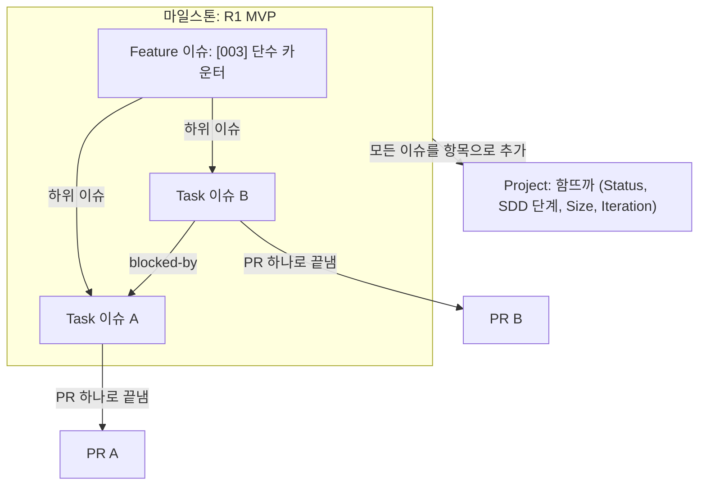

# ADR-0011: GitHub Issues·Projects로 업무 관리

이 문서는 함뜨까의 작업을 GitHub Issues와 GitHub Projects로 관리하고, Task 이슈 하나를 PR 하나로 끝내기로 한 결정을 설명한다. 독자는 마일스톤, Feature 이슈, Task 이슈, PR이 어떻게 이어지는지, Jira를 쓰지 않은 이유, 이 구성에서 감수할 제약을 알 수 있다.

## 상태

| 항목 | 내용 |
|---|---|
| 상태 | 확정 (accepted) |
| 결정일 | 2026-11-18 |
| 결정자 | 프로젝트 소유자 |
| 이 ADR이 대신하는 이전 ADR | 없음 |
| 이 ADR을 대신하는 새 ADR | 없음 |

## 맥락

함뜨까는 개인 사이드 프로젝트이며, 코드는 공개 저장소 [god3v/hamtteukka](https://github.com/god3v/hamtteukka)에 있다. `/sdd-tasks` 스킬은 설계를 작업 단위로 나눈 뒤 이슈를 자동으로 만들어야 하므로([ADR-0010](0010-sdd-diagram-first.md)), 작업 관리 도구는 명령줄에서 계층과 메타데이터를 함께 지정할 수 있어야 했다. 조사에서 확인한 내용은 다음과 같다.

- 카카오페이손해보험은 설계 문서에서 나눈 작업을 Jira 서브태스크로 등록하고 PR로 이었다. 서브태스크 하나를 PR 하나로 끝내는 규칙을 제안했고, 이 흐름을 적용한 뒤 PR당 변경 라인 중앙값이 246줄에서 158줄로 줄었다고 보고했다([카카오페이 기술 블로그](https://tech.kakaopay.com/post/kakaopayins-slow-pr-fast-dev/)).
- 2026-11-11부터 개인 계정이 소유한 저장소에서도 이슈 타입과 이슈 필드를 쓸 수 있다. 기본 이슈 타입은 Bug, Task, Feature다([GitHub changelog](https://github.blog/changelog/2026-11-11-issue-types-and-fields-are-available-for-personal-accounts/)).
- 부모 이슈 하나에는 하위 이슈를 최대 100개까지 둘 수 있고, 중첩은 8단계까지 가능하다([GitHub 문서](https://docs.github.com/en/issues/tracking-your-work-with-issues/using-issues/adding-sub-issues)).
- `gh issue create`는 `--type`, `--parent`, `--milestone`, `--label`, `--project`, `--blocked-by` 옵션을 지원한다([gh issue create](https://cli.github.com/manual/gh_issue_create)).

## 결정

- 작업은 GitHub Issues와 사용자 소유 Project `함뜨까`로 관리한다. Project는 저장소에 연결한다.
- 회사 Jira는 이 프로젝트에 쓰지 않는다.
- 작업은 마일스톤, Feature 이슈, Task 이슈, PR의 네 단계로 잇는다. Task 이슈 하나는 PR 하나로 끝낸다.

| 항목 | 규칙 |
|---|---|
| 마일스톤 | 릴리스마다 하나를 둔다: R0 기반, R1 MVP, R1+ 도구 보강, R2 무료 도안 배포, R3 커뮤니티, R4 유료 판매, A1 앱. Later로 분류한 기능은 마일스톤 없이 둔다. |
| 이슈 타입 | Feature는 명세 폴더 하나나 기능 묶음 하나에 대응하는 부모 이슈다. Task는 Feature의 하위 이슈이며 PR 하나에 대응한다. Bug는 결함을 기록한다. |
| 이슈 제목 | Feature `[001] 계정: 가입·로그인·약관 동의·탈퇴`, Task `[001] 요구사항 검토와 확인 질문 해결`, 인프라 Task `[R0] pnpm 모노레포 뼈대 구성`, 이후 릴리스 Feature `[R2] 도안 등록과 심사` |
| 라벨 | 영역 라벨만 쓴다: `area:infra`, `area:docs`, `area:account`, `area:project`, `area:counter`, `area:pattern-file`, `area:pattern-store`, `area:discovery`, `area:community`, `area:moderation`, `area:commerce`, `area:app` |
| Project 필드 | 기본 Status(Todo, In Progress, Done), `SDD 단계`(요구사항, 설계, 작업 분해, 구현, 검증), `Size`(S, M, L, XL), `Iteration`(1주) |
| 브랜치 | `feat/<이슈 번호>-<슬러그>`, `fix/<이슈 번호>-<슬러그>`, `docs/<이슈 번호>-<슬러그>`. 기본 브랜치는 `main`이다. |
| 커밋 | Conventional Commits 접두어와 한국어 요약을 쓴다. 예: `feat: 단수 카운터 리셋 확인 추가 (#12)` |
| PR | 본문에 `Closes #<Task 번호>`를 적는다. PR 템플릿은 카카오페이손해보험 사례의 8개 절(해결하려는 문제, 해야 하는 이유, 해결 방법, 한계와 트레이드오프, 기존 기능 영향, Edge Case와 실패 시나리오, 검토한 대안, 위험도별 리뷰 포인트)을 그대로 쓰고, 모든 절을 채운다. |

Feature와 Task는 모두 해당 릴리스의 마일스톤에 속하고, Task는 Feature의 하위 이슈로 등록한다. 먼저 끝나야 하는 Task는 `blocked-by`로 표시하며, PR이 병합되면 `Closes`로 연결된 Task 이슈가 닫힌다.

## 검토한 대안

### 회사 Jira

회사에서 쓰는 Jira에 이 프로젝트의 작업을 기록하는 방안이다. 이미 익숙한 도구이고, 참고한 카카오페이손해보험 사례도 Jira를 썼다.

그러나 함뜨까는 개인 프로젝트이므로 회사 도구에 작업을 기록하지 않는다. 이 방안은 채택하지 않았다.

### 개인 Jira 사이트

개인용 Jira 사이트를 따로 만들어 작업을 관리하는 방안이다. Epic, Story, 서브태스크 같은 계층과 보드를 쓸 수 있다.

그러나 코드와 PR은 GitHub에 있으므로 이슈와 PR을 잇는 연동을 따로 구성해야 하고, 확인할 도구가 하나 늘어난다. 지금은 GitHub도 개인 저장소에서 이슈 타입, 하위 이슈, Projects 필드를 제공하고, `gh` 명령 하나로 타입, 부모 이슈, 마일스톤, Project를 지정해 이슈를 만들 수 있다. 그래서 별도 도구를 두지 않기로 했다.

## 결과

### 좋은 점

- 코드, 이슈, PR, 설계 문서가 한 저장소에서 서로 연결된다.
- `/sdd-tasks`가 `gh` 명령으로 Task 이슈를 만들 때 타입, 부모 이슈, 마일스톤, 라벨, Project를 한 번에 지정한다.
- Project의 기본 자동화는 이슈가 닫히거나 PR이 병합되면 항목을 Done으로 옮긴다([GitHub 문서](https://docs.github.com/en/issues/planning-and-tracking-with-projects/automating-your-project/using-the-built-in-automations)).
- Task 하나를 PR 하나로 끝내므로 PR이 작아지고, 혼자서도 리뷰할 수 있는 크기를 유지하기 쉽다.

### 감수할 점

- `gh`에는 마일스톤 명령이 없으므로 REST API를 `gh api`로 호출해 마일스톤을 만든다([GitHub REST 마일스톤](https://docs.github.com/en/rest/issues/milestones)).
- `gh project field-create`는 TEXT, SINGLE_SELECT, DATE, NUMBER 필드만 만들 수 있다. `Iteration` 필드와 보드 뷰는 웹 UI에서 만든다([gh project field-create](https://cli.github.com/manual/gh_project_field-create)).
- `gh`로 Project를 다루려면 토큰에 `project` scope를 추가해야 한다([gh project](https://cli.github.com/manual/gh_project)).
- GitHub Free 계정은 자동 추가(auto-add) 워크플로를 하나만 쓸 수 있다([GitHub 문서](https://docs.github.com/en/issues/planning-and-tracking-with-projects/automating-your-project/adding-items-automatically)).
- 저장소가 공개되어 있으므로 이슈와 PR도 공개된다. 이슈와 PR에는 개인정보나 비밀 값을 쓰지 않는다.

## 관련 문서

- [SDD 진행 가이드](../sdd-guide.md): Task 이슈를 만들고 구현하는 절차
- [Feature 이슈 양식](../../.github/ISSUE_TEMPLATE/feature.yml)
- [Task 이슈 양식](../../.github/ISSUE_TEMPLATE/task.yml)
- [Bug 이슈 양식](../../.github/ISSUE_TEMPLATE/bug.yml)
- [PR 템플릿](../../.github/pull_request_template.md)
- [ADR-0010: 카카오페이 흐름 기반 SDD와 다이어그램 중심 설계](0010-sdd-diagram-first.md)
