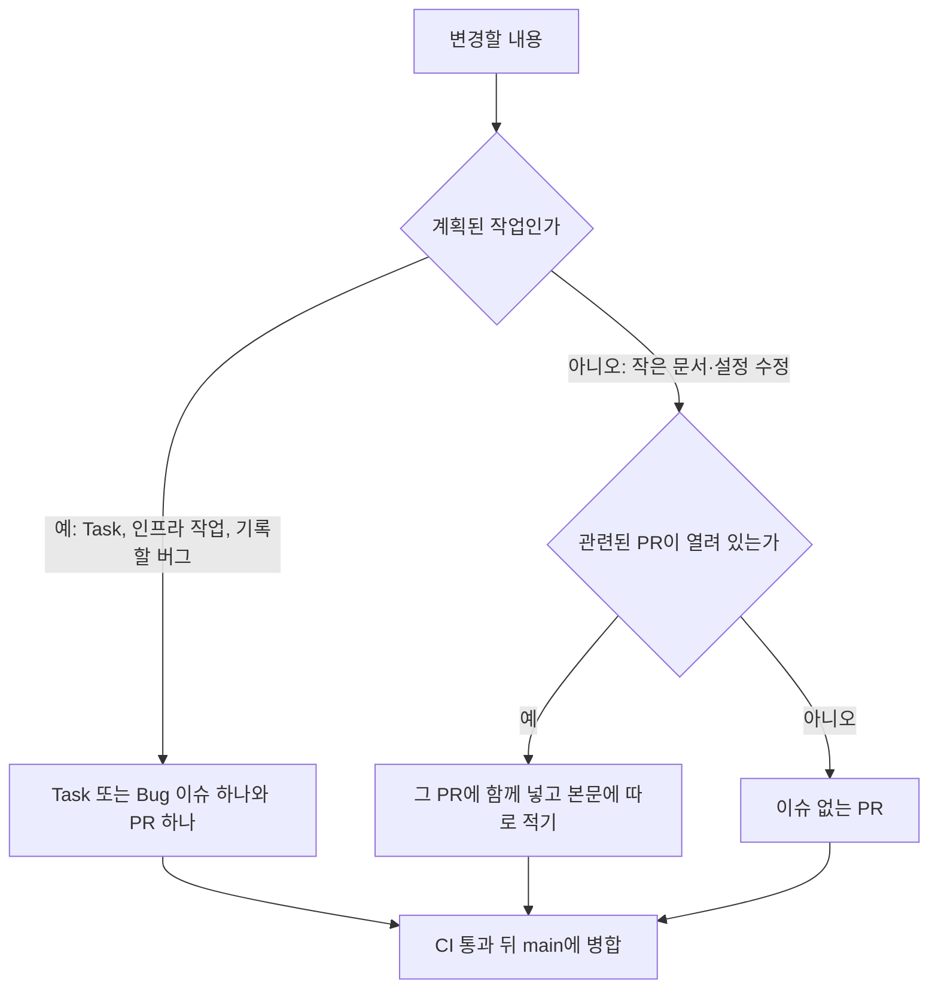

# ADR-0012: 계획된 작업만 이슈로 관리

이 문서는 모든 PR을 이슈와 연결하던 규칙을 줄여, 계획된 작업에만 이슈를 두기로 한 결정을 설명한다. 독자는 어떤 변경에 이슈가 필요한지, 이슈 없이 처리하는 작은 수정을 PR에 어떻게 남기는지 알 수 있다.

## 상태

| 항목 | 내용 |
|---|---|
| 상태 | 확정 (accepted) |
| 결정일 | 2026-11-18 |
| 결정자 | 프로젝트 소유자 |
| 이 ADR이 대신하는 이전 ADR | 없음. [ADR-0011](0011-github-issues-projects.md)의 Task와 PR 규칙은 유지하고, 이슈가 필요한 범위만 정한다 |
| 이 ADR을 대신하는 새 ADR | 없음 |

## 맥락

[ADR-0011](0011-github-issues-projects.md)과 [헌법](../constitution.md) P-13은 Task 이슈 하나를 PR 하나로 끝내고 PR 본문에 `Closes #이슈 번호`를 적게 했다. 이 규칙을 그대로 따르면 PR 템플릿 문구를 고치는 작은 일도 이슈와 PR을 따로 만들어야 한다.

2026-11-18에 PR 템플릿 수정을 이슈 #48과 PR #49로 따로 처리하자, 프로젝트 소유자는 이미 열려 있는 PR에 함께 넣는 편이 낫다고 판단했다. 1인 프로젝트에서는 작은 수정마다 이슈를 만드는 비용이 그 기록의 가치보다 크다.

## 결정

- 이슈를 두는 작업은 세 가지다. `/sdd-tasks`가 만드는 Task, 출시 단계 계획에 등록한 Feature와 Task(R0 인프라 작업 포함), 나중에 다시 확인할 가치가 있는 버그다.
- 문서 오타와 문구 수정, 템플릿과 설정의 작은 수정, 동작을 바꾸지 않는 작은 리팩터링은 이슈 없이 처리한다.
- 이슈 없는 변경은 관련된 PR이 열려 있으면 그 PR에 함께 넣고, PR 본문의 "어떻게 해결했나요?" 절에 따로 적는다. 관련된 PR이 없으면 이슈 없이 PR을 연다.
- 모든 변경은 PR을 거쳐 main에 들어간다. main에 직접 커밋하지 않으며, CI 검사가 생긴 뒤에는 검사를 통과해야 병합한다.
- 기능 변경, 다른 AC 구현, 큰 리팩터링은 지금처럼 Task 이슈 하나와 PR 하나로 처리한다.

그림은 변경을 시작할 때 이슈가 필요한지 판단하는 순서를 보여 준다. 어느 경로든 PR을 거쳐 main에 들어간다.

## 검토한 대안

### 모든 PR을 이슈와 연결

ADR-0011을 정할 때의 방식이다. 모든 변경이 Project 보드에 남지만, 작은 수정에도 이슈를 만들어야 해서 1인 프로젝트에는 부담이 크다. 이 방안은 채택하지 않았다.

### 작은 수정은 main에 직접 커밋

절차가 가장 짧다. 그러나 CI 검사를 거치지 않은 변경이 main에 들어가고, R0 작업 #5에서 걸 main 브랜치 보호와 맞지 않는다. 이 방안은 채택하지 않았다.

## 결과

### 좋은 점

- 작은 수정에 드는 절차가 줄어든다.
- 모든 변경이 PR을 거치므로 CI 검사와 변경 기록은 그대로 남는다.

### 감수할 점

- 이슈 없는 변경은 Project 보드에 나타나지 않으므로 PR 목록과 커밋 기록으로만 찾을 수 있다.
- 진행 중인 PR에 함께 넣은 변경은 PR 본문에 적지 않으면 리뷰에서 놓칠 수 있다.
- "작은 수정"의 경계는 판단이 필요하다. 동작이 바뀌거나 리뷰할 내용이 많아지면 이슈를 둔다.

## 관련 문서

- [ADR-0011: GitHub Issues·Projects로 업무 관리](0011-github-issues-projects.md)
- [함뜨까 프로젝트 헌법](../constitution.md) P-13
- [SDD 진행 가이드](../sdd-guide.md)의 SDD 적용 기준
- [PR 템플릿](../../.github/pull_request_template.md)
