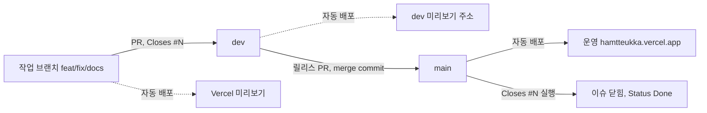
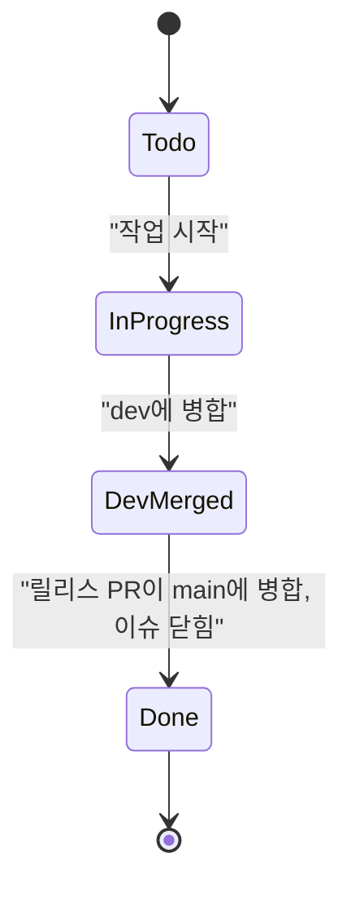

# ADR-0013: dev 브랜치에서 확인하고 main 병합으로 배포

이 문서는 작업 PR을 dev 브랜치에 병합해 확인한 뒤, dev를 main에 병합할 때만 운영 사이트에 배포하기로 한 결정을 설명한다. 독자는 PR을 어느 브랜치로 보내는지, 이슈가 언제 닫히는지, 릴리스 PR을 어떻게 만드는지 알 수 있다.

## 상태

| 항목 | 내용 |
|---|---|
| 상태 | 확정 (accepted) |
| 결정일 | 2026-11-18 |
| 결정자 | 프로젝트 소유자 |
| 이 ADR이 대신하는 이전 ADR | 없음. [ADR-0011](0011-github-issues-projects.md)과 [ADR-0012](0012-issue-for-planned-work-only.md)의 이슈와 PR 규칙은 유지하고, PR이 병합되는 브랜치와 이슈가 닫히는 시점을 정한다 |
| 이 ADR을 대신하는 새 ADR | 없음 |

## 맥락

R0 작업 #4에서 Vercel을 저장소에 연결했다. Vercel은 Production Branch(`main`)에 들어온 커밋을 운영 사이트(`hamtteukka.vercel.app`)에 배포하고, 다른 브랜치와 PR은 미리보기 주소에 배포한다([Vercel Git 배포 문서](https://vercel.com/docs/deployments/git)).

지금까지는 모든 PR을 main에 병합했으므로, PR을 병합하는 순간 운영 사이트가 바뀌었다. 여러 PR을 합친 상태를 운영 전에 확인할 곳이 없었다.

GitHub는 PR 본문의 `Closes #N`을 기본 브랜치에 병합될 때만 실행한다([GitHub 문서](https://docs.github.com/en/issues/tracking-your-work-with-issues/using-issues/linking-a-pull-request-to-an-issue)). 따라서 PR을 어느 브랜치로 보내는지가 이슈가 닫히는 시점과 Project 보드의 Done 시점을 함께 정한다.

## 결정

- `dev` 브랜치를 두고, 작업 브랜치는 `dev`에서 만들어 `dev`로 PR을 보낸다(`gh pr create --base dev`).
- `dev`와 `main`에는 직접 커밋하거나 푸시하지 않는다.
- `dev`에서 확인을 마친 변경은 `dev → main` 릴리스 PR로 `main`에 병합한다. `main` 병합만 운영 사이트에 배포된다.
- GitHub 기본 브랜치는 `main`으로 둔다. 이슈는 `main`에 병합될 때 닫히고, Project 보드의 Done은 운영에 배포된 상태를 뜻한다.
- 작업 PR은 본문에 `Closes #N`을 적어 이슈와 연결한다. `dev`에 병합해도 이슈는 닫히지 않으므로, 병합한 뒤 Project의 Status를 `dev 반영`으로 바꾼다.
- 릴리스 PR 본문에는 포함된 이슈를 모두 `Closes #N`으로 적는다. Status가 `dev 반영`인 항목이 그 목록이다.
- 릴리스 PR은 "Create a merge commit"으로 병합한다. Squash나 rebase로 병합하면 `dev`와 `main`의 커밋 기록이 갈라져 다음 릴리스 PR에서 충돌이 난다.
- Vercel 미리보기 배포는 유지한다. PR마다 미리보기 주소가 생기고, `dev` 브랜치에도 고정 미리보기 주소가 생긴다.

실선은 사람이 PR로 병합하는 흐름이고, 점선은 Vercel이 자동으로 배포하는 흐름이다.

`InProgress`는 Status `In Progress`, `DevMerged`는 Status `dev 반영`이다.

## 검토한 대안

### 지금처럼 main에만 병합

절차가 가장 짧다. 그러나 PR 하나를 병합할 때마다 운영 사이트가 바뀌고, 여러 PR을 합친 상태를 운영 전에 확인할 수 없다. 이 방안은 채택하지 않았다.

### 기본 브랜치를 dev로 변경

작업 PR이 기본으로 `dev`를 향하고, `Closes #N`이 `dev` 병합 때 바로 실행되어 이슈를 따로 모을 필요가 없다. 그러나 Done이 "개발 브랜치에 들어갔다"는 뜻이 되어, 보드만 보고는 무엇이 운영에 나갔는지 알 수 없다. 소유자는 이슈가 운영 배포 때 닫히는 흐름이 더 자연스럽다고 판단해 이 방안을 채택하지 않았다.

## 결과

### 좋은 점

- 여러 PR을 합친 상태를 `dev` 미리보기 주소에서 확인한 뒤 운영에 배포할 수 있다.
- Project 보드의 Done이 운영 배포와 일치한다.

### 감수할 점

- 기본 브랜치가 `main`이므로 GitHub 화면과 `gh pr create`가 병합 대상으로 `main`을 먼저 고른다. 작업 PR을 만들 때마다 `--base dev`를 지정해야 한다.
- `dev` 병합 뒤 Status를 `dev 반영`으로 바꾸는 일과 릴리스 PR에 이슈를 모으는 일은 지금 사람이 한다. 자동화는 R0 작업 #5(CI)에서 검토한다.
- 릴리스 PR이 하나 더 생기므로 배포까지 걸리는 단계가 늘어난다.
- 운영의 급한 문제도 `dev`를 거쳐 고친다. 이 규칙이 너무 느리다고 판단되면 새 ADR로 hotfix 흐름을 정한다.

## 관련 문서

- [ADR-0011: GitHub Issues·Projects로 업무 관리](0011-github-issues-projects.md)
- [ADR-0012: 계획된 작업만 이슈로 관리](0012-issue-for-planned-work-only.md)
- [배포 구조](../architecture/deployment.md)
- [SDD 진행 가이드](../sdd-guide.md)
