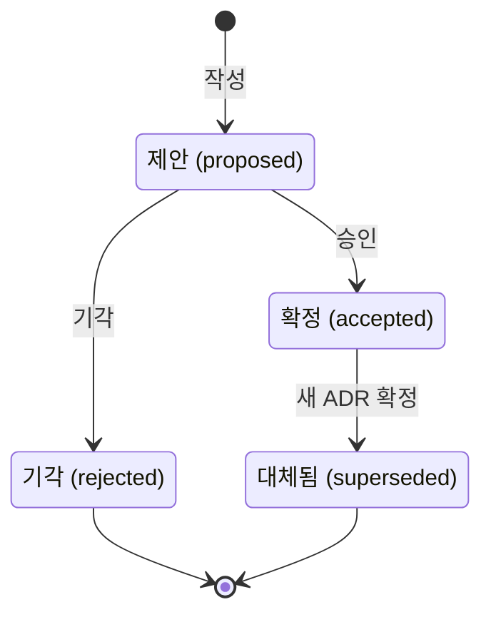

# 의사결정 기록

이 문서는 함뜨까 프로젝트의 아키텍처 결정 기록(ADR)을 쓰는 규칙과 지금까지 내린 결정의 목록을 정리한다. 독자는 이 문서에서 각 결정의 현재 상태를 확인하고, 아직 정하지 않은 항목을 어느 릴리스 전에 정해야 하는지 찾을 수 있다.

ADR은 여러 기능에 영향을 주거나 되돌리기 어려운 결정을 기록한다. 기능 하나의 요구사항과 설계는 `docs/specs/` 아래 명세 문서에 기록하고, 기능을 개발하는 절차는 [SDD 진행 가이드](../sdd-guide.md)에서 설명한다.

## 작성 규칙

### 파일과 번호

- 파일 이름은 `NNNN-<영문 소문자 슬러그>.md` 형식을 따른다. 번호는 네 자리이며 작성 순서대로 하나씩 늘린다.
- 다음에 쓸 ADR 번호는 0015다.
- 번호는 다시 쓰지 않는다. 기각되거나 대체된 ADR도 번호와 파일을 그대로 유지한다.
- ADR 파일은 삭제하지 않는다. 결정을 바꿀 때는 새 ADR을 쓰고, 기존 ADR은 대체됨 상태로 바꾼다.

### 상태 값

| frontmatter `status` | 본문 표기 | 뜻 |
|---|---|---|
| `proposed` | 제안 | 검토 중인 결정이며 아직 따르지 않는다. |
| `accepted` | 확정 | 현재 따르는 결정이다. |
| `rejected` | 기각 | 검토했지만 채택하지 않은 결정이다. 기각 사유를 남기려고 보관한다. |
| `superseded` | 대체됨 (→ ADR-NNNN) | 새 ADR이 이 결정을 대신한다. 본문 상태 절에 이 결정을 대신하는 새 ADR 번호를 적는다. |

### 결정을 바꾸는 순서

1. 새 ADR을 `proposed` 상태로 작성하고, 상태 절의 '이 ADR이 대신하는 이전 ADR' 칸에 기존 ADR 번호를 적는다.
2. 새 ADR이 확정되면 기존 ADR의 frontmatter `status`를 `superseded`로 바꾸고, 상태 절의 '이 ADR을 대신하는 새 ADR' 칸에 새 ADR 링크를 적는다.
3. 기존 ADR의 맥락, 결정, 검토한 대안, 결과 절은 고치지 않는다. 당시에 판단한 근거를 그대로 남기기 위해서다.
4. 아래 ADR 목록 표에서 두 ADR의 상태 칸을 함께 갱신한다.

### ADR을 쓸 때와 명세를 고칠 때

| 상황 | 기록하는 곳 |
|---|---|
| 여러 기능이나 앱에 걸치는 구조를 정한다 (스택, 저장소 구조, 데이터 접근 경계, 권한 검사 방식, 인증, 마이그레이션, 돈의 흐름, 작업 방식) | 새 ADR |
| 되돌리려면 데이터 이전이나 외부 계약 변경이 필요한 결정을 내린다 | 새 ADR |
| 변경하려는 내용이 확정된 ADR과 어긋난다 | 새 ADR을 먼저 확정한 뒤 명세를 고친다 |
| 기능 하나의 요구사항, 화면 흐름, 테이블, RLS 정책을 정한다 | 해당 기능의 `docs/specs/NNN-name/` 문서 |
| 버그를 고치거나 문구를 바꾸거나 리팩터링한다 | PR. 이슈가 필요한지는 [ADR-0012](0012-issue-for-planned-work-only.md)를 따른다 |

### 본문 구성

ADR은 아래 frontmatter로 시작한다. `decided`에는 확정이나 기각을 정한 날짜를 적고, 제안 상태에서는 생략한다.

```yaml
---
doc_type: explanation
status: accepted
updated: 2026-11-18
decided: 2026-11-18
---
```

H1은 `ADR-NNNN: <제목>` 형식으로 쓰고, 그 아래에 두 문장 이상의 리드를 둔다. 리드 다음에는 아래 절을 이 순서로 둔다.

| 절 | 쓰는 내용 |
|---|---|
| 상태 | 상태 표기, 결정일, 결정자, 이 ADR이 대신하는 이전 ADR, 이 ADR을 대신하는 새 ADR |
| 맥락 | 결정이 필요했던 상황과 제약, 근거로 삼은 조사 결과와 출처 |
| 결정 | 지금 따르는 규칙 |
| 검토한 대안 | 검토한 방법과 채택하지 않은 이유 |
| 결과 | 좋은 점과 감수할 점 |
| 관련 문서 | 이 결정을 구체화하거나 이 결정을 근거로 삼는 문서 |

조사 결과를 근거로 쓸 때는 출처 URL을 함께 적고, 확인하지 못한 내용에는 `(추정)`을 붙인다. 다이어그램은 Mermaid로 그리고, 다이어그램 아래에 읽는 방법을 한두 문장으로 적는다.

## 상태 흐름



모든 ADR은 제안 상태로 시작하고, 프로젝트 소유자가 승인하거나 기각한다. 확정된 ADR은 새 ADR이 확정될 때에만 대체됨으로 바뀌며, 기각이나 대체 뒤에도 파일은 남긴다.

## ADR 목록

| 번호 | 제목 | 상태 | 결정일 |
|---|---|---|---|
| ADR-0001 | [모노레포 구조와 앱의 단계적 추가](0001-monorepo-structure.md) | 확정 | 2026-11-18 |
| ADR-0002 | [Next.js·Supabase·Vercel 스택과 서울 리전](0002-stack-nextjs-supabase-vercel.md) | 확정 | 2026-11-18 |
| ADR-0003 | [Supabase 접근을 packages/shared로 제한](0003-data-access-boundary.md) | 확정 | 2026-11-18 |
| ADR-0004 | [RLS를 1차 권한 검사로 사용](0004-rls-authorization.md) | 확정 | 2026-11-18 |
| ADR-0005 | [Supabase Auth와 카카오·구글 로그인](0005-auth-supabase-social-login.md) | 확정 | 2026-11-18 |
| ADR-0006 | [DB 마이그레이션 소유권을 스키마별로 분리](0006-migration-ownership.md) | 확정 | 2026-11-18 |
| ADR-0007 | [판매에 대비한 데이터 원칙](0007-sales-ready-data-model.md) | 확정 | 2026-11-18 |
| ADR-0008 | [개인 뜨개 도구를 MVP로 정함](0008-mvp-personal-tools.md) | 확정 | 2026-11-18 |
| ADR-0009 | [판매 대금은 PG 지급대행으로만 정산](0009-payout-via-pg.md) | 확정 | 2026-11-18 |
| ADR-0010 | [카카오페이 흐름 기반 SDD와 다이어그램 중심 설계](0010-sdd-diagram-first.md) | 확정 | 2026-11-18 |
| ADR-0011 | [GitHub Issues·Projects로 업무 관리](0011-github-issues-projects.md) | 확정 | 2026-11-18 |
| ADR-0012 | [계획된 작업만 이슈로 관리](0012-issue-for-planned-work-only.md) | 확정 | 2026-11-18 |
| ADR-0013 | [dev 브랜치에서 확인하고 main 병합으로 배포](0013-dev-main-branch-flow.md) | 확정 | 2026-11-18 |
| ADR-0014 | [흰 바탕과 강조 색 하나, 하단 탭 구조로 화면을 만든다](0014-design-direction.md) | 확정 | 2026-11-19 |

## 미결정 항목

아래 표는 아직 정하지 않았지만 특정 릴리스를 시작하기 전에 정해야 하는 항목을 모은다. 결정 시점이 된 항목은 해당 릴리스를 시작하기 전에 결정하고, 결과를 ADR이나 기능 명세에 기록한다.

OD 번호도 다시 쓰지 않는다. 항목을 정하면 행을 지우지 않고, 결정 시점 칸을 `결정됨 (YYYY-MM-DD)`로 바꾼 뒤 결정을 기록한 문서를 관련 문서 칸에 추가한다. R4 진입 조건에 따라 OD-12(거래 구조)와 OD-14(PG 선택)는 ADR로 확정한다.

| ID | 질문 | 선택지 | 결정 시점 | 관련 문서 |
|---|---|---|---|---|
| OD-01 | 만 14세 미만의 가입을 어떻게 처리할까? | 가입 차단 / 법정대리인 동의 절차 (제안: 차단) | 결정됨 (2026-11-19) | [001 계정](../specs/001-account/requirements.md)의 Q-01 해결 기록, [앱스토어 정책 조사](../research/2026-11-18-app-store-policy.md), [계정 정책 확인](../research/2026-11-19-account-policy-facts.md) |
| OD-02 | 탈퇴한 회원의 데이터를 언제 삭제할까? | 즉시 삭제 / 유예 기간 뒤 삭제 | 결정됨 (2026-11-19) | [001 계정](../specs/001-account/requirements.md)의 Q-02 해결 기록, [계정 정책 확인](../research/2026-11-19-account-policy-facts.md) |
| OD-03 | 개인 PDF 업로드 용량을 얼마로 제한할까? | 파일당 한도와 회원당 한도의 값 | 결정됨 (2026-11-20) | [004 내 도안 파일 첨부](../specs/004-pattern-files/requirements.md)의 Q-01, Q-02 해결 기록(파일당 50MB, 회원당 200MB, 공개 출시 전 다시 판단), [ADR-0002](0002-stack-nextjs-supabase-vercel.md) |
| OD-04 | 사업자등록은 언제 할까? | R1 공개 출시 시점 / R4 유료 판매 직전 (Vercel Hobby 비상업 조건과 연결) | R1 공개 출시 전 | [ADR-0002](0002-stack-nextjs-supabase-vercel.md), [로드맵](../product/roadmap.md) |
| OD-05 | 내 도안함의 다운로드 기간을 둘까? | 무기한 / 12개월 | R2 착수 전 | [ADR-0007](0007-sales-ready-data-model.md), [참고 서비스 조사](../research/2026-11-18-reference-services.md) |
| OD-06 | 도안 영상은 어떻게 받을까? | 외부 URL만 허용 / 직접 호스팅 | R2 착수 전 | [기능 목록](../product/feature-catalog.md), [스택 조사](../research/2026-11-18-stack-options.md) |
| OD-07 | 비회원도 검색할 수 있게 할까? | 비회원 허용 / 회원 전용 | 결정됨 (2026-11-19) | [기능 목록](../product/feature-catalog.md)의 이용 대상별 분류. 비회원도 도안을 둘러보고 검색하며, 받기·찜·후기·문의 작성은 회원만 한다 |
| OD-08 | 한국어 검색 엔진은 무엇으로 할까? | PGroonga와 pg_trgm을 실측한 뒤 선택 / 품질이 부족하면 Meilisearch | R2 착수 전 | [스택 조사](../research/2026-11-18-stack-options.md) |
| OD-09 | 커뮤니티 작성자를 어떻게 표시할까? | 완전 익명 / 닉네임 | R3 착수 전 | [참고 서비스 조사](../research/2026-11-18-reference-services.md) |
| OD-10 | 탈퇴한 회원의 게시물을 어떻게 처리할까? | 모두 삭제 / 내용만 지우고 자리 표시 유지 | R3 착수 전 | [앱스토어 정책 조사](../research/2026-11-18-app-store-policy.md) |
| OD-11 | 결제를 붙이기 전의 수익 모델은 무엇으로 할까? | 광고 / 프리미엄 / 없음 | R3 착수 전 | [제품 방향](../product/vision.md) |
| OD-12 | 유료 판매의 거래 구조는 무엇으로 할까? | 중개형 (작가가 판매자) / 판매형 (플랫폼이 판매자) | R4 착수 전 | [ADR-0009](0009-payout-via-pg.md), [결제·법률 조사](../research/2026-11-18-payments-and-law.md) |
| OD-13 | 사업자등록이 없는 개인 작가도 판매할 수 있게 할까? | 허용 / 사업자 판매자만 허용 | R4 착수 전 | [결제·법률 조사](../research/2026-11-18-payments-and-law.md) |
| OD-14 | 결제와 지급대행에 어느 PG를 쓸까? | 토스페이먼츠 직접 연동 / PortOne과 지급대행 PG / KG이니시스 | R4 착수 전 | [ADR-0009](0009-payout-via-pg.md), [결제·법률 조사](../research/2026-11-18-payments-and-law.md) |
| OD-15 | 판매 수수료 정책은 무엇으로 할까? | 등급제 / 단일 요율 / 소액 구간 무료 | R4 착수 전 | [ADR-0007](0007-sales-ready-data-model.md) |
| OD-16 | 작가에게 지급하는 금액의 원천징수는 어떻게 처리할까? | 세무 자문을 받은 뒤 소득 구분과 처리 방식을 정한다 | R4 착수 전 | [결제·법률 조사](../research/2026-11-18-payments-and-law.md) |
| OD-17 | 첫 결제는 단건 결제로 시작할까? | 도안 1개씩 단건 결제 / 장바구니 다건 결제 | R4 착수 전 | [기능 목록](../product/feature-catalog.md) |
| OD-18 | 앱의 결제 전략과 번들 ID는 어떻게 정할까? | 열람 전용 / IAP 병행 / 한국 대체 결제 / 아웃링크 허용 대기, 별도 번들 ID 예약 여부 | A1 착수 전 | [앱스토어 정책 조사](../research/2026-11-18-app-store-policy.md) |
| OD-19 | 앱 개발은 언제 시작할까? | R3 완료 직후 / R4 유료 판매 이후 | A1 착수 전 | [로드맵](../product/roadmap.md) |
| OD-20 | 로고 심벌과 앱 아이콘(파비콘 포함)을 만들까? | 글자 워드마크만 쓴다 / 심벌을 만든다 | R1 공개 출시 전 | [브랜드와 말투](../design/brand.md), [ADR-0014](0014-design-direction.md) |
| OD-21 | 약관 변경 안내와 유출 통지 메일을 어느 메일 서비스로 보낼까? | Resend / Amazon SES / 그 밖의 트랜잭션 메일 서비스 | 001 메일 발송 Task 착수 전 | [001 계정](../specs/001-account/requirements.md) FR-30~FR-33, [001 시나리오 시퀀스](../specs/001-account/design/sequence.md) |

OD-19의 두 선택지는 모두 A1 진입 조건인 R3 완료를 충족한다. 로드맵은 한 번에 하나의 릴리스만 진행하므로, 앱 개발 시점은 R4와의 순서를 정하는 문제다.

## 관련 문서

- [문서 지도](../README.md): `docs/` 아래 문서의 위치와 역할
- [프로젝트 헌법](../constitution.md): ADR로 정한 결정 가운데 모든 작업이 지킬 원칙
- [SDD 진행 가이드](../sdd-guide.md): 기능 명세를 쓰고 고치는 절차
- [로드맵](../product/roadmap.md): 릴리스별 범위, 진입 조건, 종료 조건
