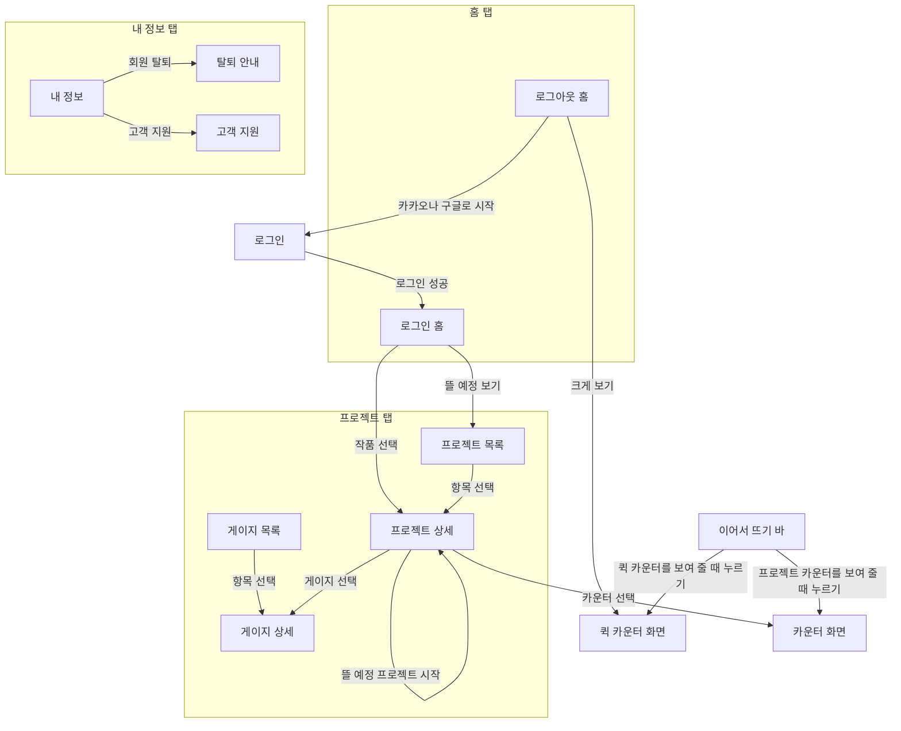

# 화면 구조

이 문서는 함뜨까의 하단 탭 구성, 화면 사이의 이동, 로그인 여부에 따른 화면 차이, 이어서 뜨기 바와 PC 화면의 배치 규칙을 정한다. 기능을 설계하는 사람은 새 화면을 어느 탭 아래에 둘지와, 로그인하지 않은 사용자에게 무엇을 보여 줄지 이 문서에서 확인할 수 있다. 화면 경로와 접근 조건은 기능별 `design/screens.md`가 정한다.

## 하단 탭

| 순서 | 탭 | 들어가는 화면 | 생기는 단계 |
|---|---|---|---|
| 1 | 홈 | 로그인 전 소개와 퀵 카운터, 로그인 후 진행 중인 작품과 다음에 뜰 작품 | R0 |
| 2 | 프로젝트 | 프로젝트 목록(뜰 예정 포함), 게이지 목록, 프로젝트 상세, 게이지 상세 | R1 |
| 3 | 도안 | 도안 둘러보기와 검색, 도안 상세, 내 도안함, 작가 프로필 | R2 |
| 4 | 커뮤니티 | 게시판, 글 상세, 후기와 문의 | R3 |
| 5 | 내 정보 | 계정, 설정, 도움말, 로그아웃, 탈퇴 | R0 |

- 탭은 위 표의 순서로 배치하고, 아직 출시하지 않은 탭은 비활성으로도 보여 주지 않는다. 따라서 R0에는 홈과 내 정보, R1에는 홈, 프로젝트, 내 정보가 보인다.
- 탭은 다섯 개를 넘기지 않는다. 새 기능은 기존 탭 안의 화면이나 위쪽 글자 탭으로 넣는다.
- 활성 탭을 다시 누르면 그 탭의 첫 화면으로 돌아간다.

R1+에서 추가하는 기능은 아래 자리에 넣는다.

| 기능 | 자리 |
|---|---|
| 실 보관함 | 프로젝트 탭의 위쪽 글자 탭 |
| 뜨개 계산기 | 홈의 도구 구역 |
| 작업 타이머 | 카운터 화면 |
| 서비스 안 PDF 뷰어 | 프로젝트 상세의 도안 자료 |

## 화면 이동

이 그림은 R1까지의 화면과 주요 이동을 탭별로 묶어 보여 준다. 탭 사이의 이동은 하단 탭으로 하므로 그림에서는 생략했고, 카운터 화면과 퀵 카운터 화면은 어느 탭에도 속하지 않는 시트로 열린다.

## 로그인 여부에 따른 차이

| 화면 | 로그인하지 않았을 때 | 로그인했을 때 |
|---|---|---|
| 홈 | 서비스 소개, 퀵 카운터, 카카오와 구글 시작 버튼 | 진행 중인 작품, 다음에 뜰 작품, 도구 |
| 프로젝트 탭 | 로그인 화면으로 보내고, 로그인하면 프로젝트 목록으로 돌아온다([002 요구사항](../specs/002-projects/requirements.md) AC-17) | 프로젝트 목록 |
| 내 정보 탭 | 프로필 자리에 로그인 버튼을 두고, 화면 모드와 고객 지원은 그대로 보여 준다 | 계정, 설정, 도움말, 로그아웃, 탈퇴 |
| 이어서 뜨기 바 | 퀵 카운터를 보여 준다 | 진행 중 프로젝트의 카운터와 퀵 카운터 가운데 마지막으로 센 카운터를 보여 준다 |

내 정보 탭은 [001 계정 요구사항](../specs/001-account/requirements.md)이 말하는 설정 화면 역할을 맡는다. 로그아웃(FR-19)과 탈퇴 시작(FR-21)이 이 탭에 있다. 광고성 정보 수신 동의는 R2에서 이 탭에 더한다.

## 프로젝트 탭

프로젝트 탭의 첫 화면 위쪽에는 `프로젝트`, `게이지` 글자 탭을 이 순서로 둔다. 하단 탭을 세 개로 유지하면서 R1의 기록 화면을 한곳에 모으기 위한 배치다. 다음에 뜰 작품은 따로 목록을 두지 않고 프로젝트의 '뜰 예정' 상태로 관리한다([002 요구사항](../specs/002-projects/requirements.md) Q-08). 프로젝트 목록의 상태 칩에서 뜰 예정을 고르면 다음에 뜰 작품이 직접 정한 순서대로 보인다.

## 이어서 뜨기 바

이어서 뜨기 바는 하단 탭 바로 위에 뜨는 작은 바다. 바에는 프로젝트 이름, 카운터 이름, 현재 값, +1 버튼을 보여 준다. 퀵 카운터를 보여 줄 때는 프로젝트 이름 자리에 `퀵 카운터`라고 쓴다.

- 바를 누르면 바에 보이는 카운터의 화면이 아래에서 올라온다. 프로젝트 카운터이면 카운터 화면이, 퀵 카운터이면 로그인 여부와 관계없이 퀵 카운터 화면이 열린다.
- +1 버튼을 누르면 카운터 화면을 열지 않고 그 카운터에 더하기를 적용한다. 저장, 연결된 보조 카운터, 소리와 진동은 카운터 화면에서 누를 때와 같은 규칙을 따른다.

| 상황 | 바 |
|---|---|
| 센 적이 있는 카운터가 있다 | 마지막으로 센 시각이 가장 늦은 카운터를 보여 준다. 프로젝트 카운터는 진행 중 프로젝트의 카운터만 후보로 삼는다 |
| 센 적이 있는 카운터가 없다 | 숨긴다 |
| 카운터 화면이나 로그아웃 홈처럼 같은 카운터를 이미 크게 보여 주는 화면이다 | 숨긴다 |
| 입력창에 글자를 입력하고 있어 화면 키보드가 열려 있다 | 숨긴다 |

이 바의 기능 요구사항과 수용 기준은 [003 단수 카운터 요구사항](../specs/003-row-counter/requirements.md)의 FR-37~FR-41과 AC-33~AC-36이 정한다.

## 카운터 화면

- 카운터 화면은 바텀 시트로 화면 전체 높이까지 올라온다. 열려 있는 동안 하단 탭과 이어서 뜨기 바를 숨긴다.
- 닫으면 카운터 화면을 열기 전의 화면으로 돌아간다.
- 카운터 화면도 고유한 주소를 가진다. 새로 고침을 하거나 브라우저의 뒤로 가기를 눌러도 같은 카운터를 다시 열거나 이전 화면으로 돌아갈 수 있어야 한다.

## PC 화면

- 넓은 화면에서도 휴대폰 화면 배치를 그대로 쓰고, 최대 너비 600px의 가운데 열에 둔다. 열 바깥은 `canvas` 색으로 칠한다.
- 하단 탭과 이어서 뜨기 바도 가운데 열 안에서 화면 아래쪽에 고정한다. PC 전용 메뉴는 따로 만들지 않는다.
- 휴대폰에서는 화면 아래쪽 안전 영역(`env(safe-area-inset-bottom)`)만큼 하단 탭 아래에 여백을 둔다.

## 관련 문서

- [브랜드와 말투](brand.md): 화면 문구와 용어
- [비주얼 시스템](visual-system.md): 하단 탭, 이어서 뜨기 바, 바텀 시트의 시각 규칙
- [R1 핵심 화면](r1-screens.md): 이 구조로 배치한 R1 화면
- [ADR-0014 흰 바탕과 강조 색 하나, 하단 탭 구조로 화면을 만든다](../decisions/0014-design-direction.md)
- [001 계정 요구사항](../specs/001-account/requirements.md), [002 뜨개 프로젝트 기록 요구사항](../specs/002-projects/requirements.md), [003 단수 카운터 요구사항](../specs/003-row-counter/requirements.md), [004 내 도안 파일 첨부 요구사항](../specs/004-pattern-files/requirements.md)
- [로드맵](../product/roadmap.md): 탭이 생기는 출시 단계
