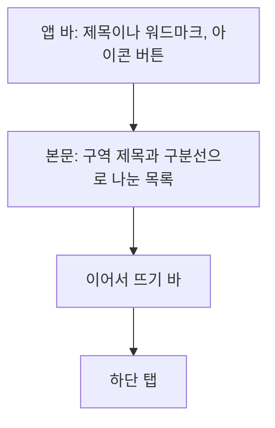

# R1 핵심 화면

이 문서는 R1 MVP의 핵심 화면 여섯 개가 위에서 아래로 어떤 요소를 어떤 순서로 보여 주는지 정한다. 기능별 `/sdd-design` 단계는 이 배치를 출발점으로 삼고, 각 기능의 `design/screens.md`에 화면 경로와 접근 조건을 정한다. 여기에 없는 화면(게이지, 로그인, 프로젝트 만들기 등)도 같은 [비주얼 시스템](visual-system.md)과 [화면 구조](information-architecture.md) 규칙으로 만든다.

## 공통 배치

탭의 화면은 위에서부터 앱 바, 본문, 이어서 뜨기 바, 하단 탭 순서로 쌓는다. 본문만 스크롤되고, 이어서 뜨기 바와 하단 탭은 화면 아래쪽에 고정한다.

## 로그아웃 홈

로그인하지 않은 방문자가 서비스를 소개받고, 가입하기 전에 퀵 카운터를 바로 써 보는 화면이다.

| 순서 | 구역 | 내용 | 근거 |
|---|---|---|---|
| 1 | 앱 바 | 왼쪽에 워드마크, 오른쪽에 `로그인` 글자 버튼 | |
| 2 | 소개 | `title-1` 두 줄 제목과 한 줄 설명 | |
| 3 | 퀵 카운터 | `counter-m` 값과 마지막으로 센 시각, 빼기 버튼과 `+1단` 주요 버튼, `크게 보기`, 이 브라우저에만 저장된다는 안내 | 003 FR-12~15 |
| 4 | 시작 버튼 | 카카오로 시작하기, 네이버로 시작하기, 구글로 시작하기 | 001 |
| 5 | 하단 탭 | 이어서 뜨기 바는 숨긴다 | |

브라우저 저장소를 쓸 수 없으면 저장 안내 문구를 '화면을 닫으면 값이 사라진다'는 안내로 바꾼다(003 NFR-11).

## 로그인 홈

로그인한 회원이 지금 뜨고 있는 작품과 다음에 뜰 작품을 한눈에 보는 화면이다.

| 순서 | 구역 | 내용 | 근거 |
|---|---|---|---|
| 1 | 앱 바 | 왼쪽에 워드마크, 오른쪽에 검색 버튼. R1의 검색 버튼은 프로젝트 검색을 연다 | 002 FR-19 |
| 2 | 진행 중 | 가로로 넘기는 작품 카드(대표 사진, 제목, 마지막으로 센 카운터 값)와 `전체 n ›` | 002 FR-08 |
| 3 | 다음에 뜰 작품 | 뜰 예정 프로젝트를 직접 정한 순서대로 앞쪽 몇 개 보여 준다. 행마다 제목, 완성 목표일, `시작` 버튼을 두고, 구역 제목 오른쪽에 `뜰 예정 ›`을 둔다 | 002 FR-20~22 |
| 4 | 도구 | 퀵 카운터 행 | 003 FR-12 |
| 5 | 이어서 뜨기 바와 하단 탭 | | |

진행 중인 작품이 없으면 진행 중 구역에 '아직 프로젝트가 없어요. 첫 작품을 기록해 보세요.' 안내와 `새 프로젝트` 주요 버튼을 둔다.

## 프로젝트 목록

회원이 자기 프로젝트를 상태별로 거르고 정렬해서 찾는 화면이다.

| 순서 | 구역 | 내용 | 근거 |
|---|---|---|---|
| 1 | 앱 바 | 왼쪽에 `프로젝트` 제목, 오른쪽에 검색 버튼과 새 프로젝트(+) 버튼 | 002 FR-03, FR-19 |
| 2 | 위쪽 글자 탭 | 프로젝트, 게이지 | |
| 3 | 상태 칩 | 전체, 뜰 예정, 진행 중, 완성, 휴면, 풀었음. 가로로 넘긴다 | 002 FR-04, FR-18 |
| 4 | 정렬과 개수 | 왼쪽에 정렬 방식 선택, 오른쪽에 항목 수 | 002 FR-15 |
| 5 | 목록 | 대표 사진, 제목, 날짜와 마지막 카운터 값, 상태 배지 | 002 FR-08 |
| 6 | 이어서 뜨기 바와 하단 탭 | | |

새 프로젝트 버튼은 화면 위에 떠 있는 버튼(FAB)으로 만들지 않고 앱 바에 둔다. 화면 아래쪽에는 이미 이어서 뜨기 바와 하단 탭이 있기 때문이다. 직접 정한 순서로 바꾸는 조작과 그 대체 수단(002 FR-16, NFR-09)은 002 설계에서 정한다.

## 프로젝트 상세

프로젝트 하나에 모은 기록을 보고, 카운터와 도안 자료로 이동하는 화면이다.

| 순서 | 구역 | 내용 | 근거 |
|---|---|---|---|
| 1 | 앱 바 | 뒤로 버튼, 더 보기 버튼(수정, 삭제) | 002 FR-03, FR-13 |
| 2 | 사진 | 가로 전체 너비로 넘겨 보며, 오른쪽 아래에 `n / N`을 표시한다 | 002 FR-08 |
| 3 | 제목과 상태 | `title-1` 제목, 누르면 상태를 바꾸는 상태 배지, 시작일. 완성 상태이면 완성일, 만족도, 후기를 함께 보여 준다 | 002 FR-04~07 |
| 4 | 바늘과 실 | 이름과 값의 두 줄 표 | 002 FR-09 |
| 5 | 단수 카운터 | 카운터 이름, 현재 값, 반복 위치, 마지막으로 센 시각. 구역 제목 오른쪽에 `+ 추가` | 003 FR-19~21, FR-25 |
| 6 | 도안 자료 | 종류 아이콘, 표시 이름, 종류와 파일 크기. 구역 제목 오른쪽에 `+ 추가` | 004 FR-01, FR-11 |
| 7 | 게이지 | 연결한 게이지의 세탁 전 값과 세탁 후 값 | 002 FR-29 |
| 8 | 메모 | 최근 메모부터 작성 시각과 함께 | 002 FR-10 |
| 9 | 이어서 뜨기 바와 하단 탭 | | |

카운터 행에는 +1 버튼을 두지 않는다. 행을 누르면 카운터 화면이 열리고, 바로 올리는 동작은 이어서 뜨기 바가 맡는다.

## 카운터 화면

뜨개를 하면서 단수를 세는 화면이다. 이어서 뜨기 바나 프로젝트 상세의 카운터 행을 누르면 바텀 시트로 화면 전체 높이까지 올라오며, 하단 탭과 이어서 뜨기 바는 숨긴다.

| 순서 | 구역 | 내용 | 근거 |
|---|---|---|---|
| 1 | 위쪽 줄 | 닫기 버튼, 가운데 프로젝트 이름, 더 보기 버튼(이력, 이름 바꾸기, 반복과 연결 설정, 소리·진동·화면 꺼짐 방지 설정, 삭제) | 003 FR-08~10, FR-22~23, FR-25~27 |
| 2 | 카운터 칩 | 같은 프로젝트의 카운터마다 이름, 현재 값, 마지막으로 센 시각을 한 칩에 보여 준다(예: `소매 12 · 어제`). 시각은 [브랜드와 말투](brand.md)의 지난 시각 표기를 따르고, 칩 줄은 가로로 넘긴다. 마지막에 새 카운터(+) 칩을 둔다 | 003 FR-19, FR-21 |
| 3 | 상태 줄 | 왼쪽에 화면 꺼짐 방지 표시, 오른쪽에 작은 `리셋` 글자 버튼. 리셋 직후에는 이 자리에 `되돌리기` 버튼을 보여 준다 | 003 FR-05~06, FR-10, NFR-06 |
| 4 | 현재 값 | `counter-xl` 값과 그 아래 `n세트 m단` | 003 FR-01, FR-25 |
| 5 | 보조 카운터 | 연결된 보조 카운터의 이름, 연결 방식, 값, 반복 횟수 | 003 FR-27~30 |
| 6 | 마지막으로 센 시각 | `caption` 글자 | 003 FR-04 |
| 7 | 조작 버튼 | 화면 맨 아래에 빼기 버튼과 `+1단` 주요 버튼. `+1단` 버튼은 남은 너비를 모두 쓰고 높이를 88px 이상으로 둔다 | 003 FR-01, NFR-05 |

- 값이 바뀌면 화면 읽기 프로그램이 새 값을 읽도록 알린다(003 NFR-08).
- 퀵 카운터 화면은 같은 배치를 쓰되 카운터 칩과 보조 카운터 구역이 없다. 위쪽 줄의 제목 자리에는 `퀵 카운터`를 쓰고, 로그인한 회원에게는 더 보기 메뉴에 `프로젝트로 옮기기`를 둔다(003 FR-14, FR-18).
- 퀵 카운터 화면은 보조 카운터 구역 자리에 '이 브라우저에만 저장돼요. 브라우저 데이터를 지우면 사라져요.' 안내를 보여 준다(003 FR-15). 브라우저 저장소를 쓸 수 없으면 이 안내를 '탭을 닫거나 새로 고침하면 값이 사라져요.'로 바꾼다(003 NFR-11). 이때도 같은 탭의 화면끼리는 값을 함께 쓰므로, 퀵 카운터 화면을 닫아도 값은 남는다. 이 안내는 어느 화면에서 열었든 퀵 카운터 화면에 항상 보여 준다.

## 내 정보

계정, 설정, 도움말을 한곳에 모은 화면이다. [001 계정 요구사항](../specs/001-account/requirements.md)이 말하는 설정 화면 역할을 맡는다.

| 순서 | 구역 | 내용 | 근거 |
|---|---|---|---|
| 1 | 앱 바 | 왼쪽에 `내 정보` 제목 | |
| 2 | 계정 | 로그인 수단(카카오, 네이버, 구글 가운데 하나)과, 로그인 제공자가 이메일을 주었으면 이메일 | 001 FR-02~03 |
| 3 | 설정 | 화면 모드(라이트, 다크, 시스템), 카운터 소리와 진동(이 기기에만 저장). 광고성 정보 수신 동의는 R2에서 더한다 | F-UX-02, 003 FR-11, 001 범위 밖 표 |
| 4 | 도움말 | 고객 지원, 이용약관과 개인정보 처리방침 | |
| 5 | 계정 관리 | 로그아웃, 회원 탈퇴. 탈퇴는 `muted` 글자로 작게 둔다 | 001 FR-19, FR-21 |
| 6 | 이어서 뜨기 바와 하단 탭 | | |

닉네임과 프로필 사진은 R1에서 보여 주지 않는다. 001 요구사항이 닉네임과 프로필 화면을 R2와 R3 범위로 정했기 때문이다. 로그인하지 않은 사용자에게는 계정 구역 자리에 로그인 버튼을 두고, 화면 모드와 도움말 구역은 그대로 보여 준다.

## 관련 문서

- [화면 구조](information-architecture.md): 탭, 화면 이동, 이어서 뜨기 바 규칙
- [비주얼 시스템](visual-system.md): 이 문서에 나오는 토큰과 컴포넌트 이름
- [브랜드와 말투](brand.md): 화면 문구 규칙
- [001 계정 요구사항](../specs/001-account/requirements.md), [002 뜨개 프로젝트 기록 요구사항](../specs/002-projects/requirements.md), [003 단수 카운터 요구사항](../specs/003-row-counter/requirements.md), [004 내 도안 파일 첨부 요구사항](../specs/004-pattern-files/requirements.md)
- [ADR-0014 흰 바탕과 강조 색 하나, 하단 탭 구조로 화면을 만든다](../decisions/0014-design-direction.md)
