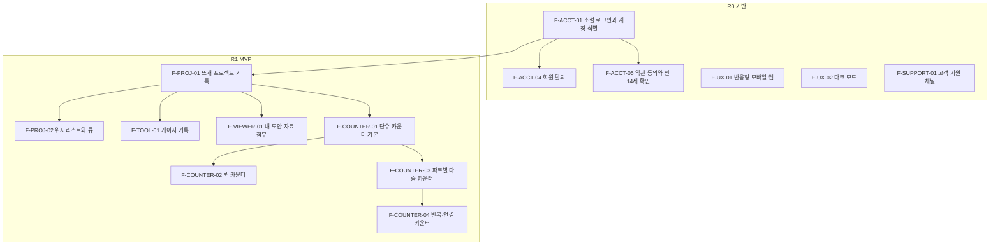

# 기능 카탈로그

이 문서는 함뜨까가 다루는 기능 86개를 ID, 설명, 복잡도, 출시 단계, 이용 대상, 참고 서비스, 선행 기능과 함께 정리한다. 독자는 어떤 기능이 어느 출시 단계에 들어가는지, 로그인하지 않은 사용자도 쓸 수 있는지, 어떤 기능을 먼저 만들어야 하는지 한곳에서 찾아볼 수 있다.

기능의 출시 단계는 이 문서의 값을 기준으로 한다. 조사 단계에서 제안한 배포 순서와 다를 때도 이 문서를 따르며, 단계별 진입 조건과 종료 조건은 [로드맵](roadmap.md)에서 다룬다.

## 읽는 방법

### 기능 ID

기능 ID는 `F-<영역>-NN` 형식이며, 영역 코드의 뜻은 아래 표와 같다. 요구사항 문서의 `features` 항목은 이 ID로 기능을 가리킨다. MOD와 ADMIN은 '검수와 운영' 카테고리에 함께 둔다.

| 영역 코드 | 뜻 |
|---|---|
| ACCT | 계정 |
| PROJ | 프로젝트 기록 |
| COUNTER | 단수 카운터 |
| VIEWER | 도안 보기 |
| STASH | 실 보관함 |
| TOOL | 도구와 계산기 |
| STORE | 도안 스토어 |
| DISC | 탐색과 검색 |
| COMM | 커뮤니티 |
| MOD | 신고와 제재 |
| ADMIN | 관리자 콘솔 |
| NOTI | 알림 |
| SELL | 작가 도구 |
| PAY | 결제 |
| SETTLE | 정산 |
| LEGAL | 법적 표시 |
| UX | 플랫폼과 화면 |
| SUPPORT | 고객 지원 |
| REV | 수익 모델 |
| APP | 네이티브 앱 |
| AUTHOR | 도안 작성 도구 |

### 출시 코드

출시 코드는 GitHub 마일스톤 이름과 짝을 이룬다. 한 번에 하나의 출시 단계만 진행하고, R1+ 기능은 R1 공개 출시와 R2 사이에 하나씩 끼워 낸다.

| 코드 | 마일스톤 | 범위 |
|---|---|---|
| R0 | R0 기반 | 모노레포 뼈대, 배포 환경, CI, 화면 틀, 지원 페이지, 계정(가입·로그인·약관 동의·탈퇴) |
| R1 | R1 MVP | 프로젝트 기록, 위시리스트와 큐, 게이지, 단수 카운터, 내 도안 파일 첨부 |
| R1+ | R1+ 도구 보강 | 피드백에 따라 하나씩 내는 도구 기능(타이머, 통계, 리마인더, 웹 PDF 뷰어·하이라이터·주석, 실 보관함, 계산기, 내보내기, 네이버 로그인) |
| R2 | R2 무료 도안 배포 | 작가 프로필, 도안 등록과 심사, 0원 가격 제약, 내 도안함, 파일 버전과 업데이트 알림, 카테고리·필터·검색·찜, 관리자 콘솔, 알림, 작가용 관리 화면 |
| R3 | R3 커뮤니티 | 게시판, 익명 표시, 신고·차단·금칙어, 임시조치 기록, 후기, 문의, 완성작 갤러리, 증정, 큐레이션 |
| R4 | R4 유료 판매 | apps/api 추가, 법적 표시, 결제, 주문, 환불, 정산 원장, 지급대행, 세무 보고, 판매자 신원 확인 |
| A1 | A1 앱 | apps/mobile(Expo), Sign in with Apple, 푸시, 네이티브 카운터 위젯 |
| Later | 마일스톤 없음 | 출시 시점을 정하지 않은 기능 |

### 이용 대상

이용 대상은 그 기능을 누가 쓸 수 있는지를 로그인 여부와 역할로 나타낸다. 로그인하지 않은 사용자(비회원)에게는 보기와 체험만 열고, 저장·받기·쓰기는 회원에게만 연다.

- 여기서 저장은 서버에 기록을 남기는 일을 말한다. 퀵 카운터(F-COUNTER-02)처럼 값을 그 브라우저에만 남기는 기능은 비회원도 쓰며, 서버에 저장하려면 로그인해야 한다.
- 이용 대상은 사용자가 화면에서 하는 일을 기준으로 정한다. 카테고리 변경이나 기획전 편성처럼 운영자가 관리하는 동작은 관리자 콘솔(F-ADMIN-01)에서 다루므로 각 기능의 이용 대상에 넣지 않는다.

| 값 | 뜻 |
|---|---|
| 모두 | 로그인하지 않아도 기능 전체를 쓴다. |
| 일부 비회원 | 비회원은 보기처럼 기능의 일부만 쓰고, 저장·받기·쓰기는 회원만 한다. 비회원이 하는 일은 [이용 대상별 분류](#이용-대상별-분류)에 있다. |
| 회원 | 로그인해야 쓴다. |
| 작가 | 도안 심사를 통과해 작가 자격을 얻은 회원만 쓴다. |
| 운영자 | 운영자만 쓴다. |
| 시스템 | 사용자 화면 없이 서버가 처리한다. |

### 복잡도

복잡도는 조사 시점에 기능끼리 비교한 상대 추정이며, 작업 기간을 약속하는 값이 아니다. GitHub Project의 `Size` 필드도 같은 네 값을 쓴다.

| 값 | 뜻 | 예 |
|---|---|---|
| S | 화면 하나나 테이블 하나 수준에서 끝나는 작은 작업 | F-TOOL-01 게이지 기록 |
| M | 여러 화면이나 테이블에 걸친 보통 작업 | F-PROJ-01 뜨개 프로젝트 기록 |
| L | 저장 형식, 외부 연동, 검수 체계처럼 설계 판단이 함께 필요한 큰 작업 | F-VIEWER-04 PDF 필기·형광펜 주석 |
| XL | 외부 계약과 여러 하위 기능이 겹쳐 더 작은 단위로 나눠야 하는 매우 큰 작업 | F-SETTLE-02 정산 배치와 지급대행 연동 |

### 열의 뜻

- 설명: 함뜨까에서 그 기능이 하는 일을 한 문장으로 적는다. 끝에 붙은 OD 번호는 [결정 기록 목록](../decisions/README.md)의 미결정 사항에서 정할 항목이다.
- 이용 대상: 위 [이용 대상](#이용-대상) 표의 값 가운데 하나를 적는다.
- 참고 서비스: 같은 기능을 제공하거나 관련 정책을 정한 서비스를 짧은 이름으로 적는다.
- 'Apple 정책'과 'Google 정책'은 App Store 심사 지침과 Google Play 정책을 뜻하고, '법령'은 국내 법률과 판례를 뜻한다.
- Supabase나 Vercel 같은 기술 문서와 PG사 문서는 참고 서비스 열에 적지 않는다.
- 선행 기능: 그 기능을 만들기 전에 있어야 하는 기능의 ID다.
- 참고 서비스나 선행 기능이 없으면 "없음"으로 적는다.

참고 서비스의 출처 URL은 [참고 서비스 조사](../research/2026-11-18-reference-services.md)에 있다. 법령, 앱스토어 정책, 기술 문서의 출처는 [결제와 법령 조사](../research/2026-11-18-payments-and-law.md), [앱스토어 정책 조사](../research/2026-11-18-app-store-policy.md), [스택 조사](../research/2026-11-18-stack-options.md)에서 확인한다.

## 출시 단계별 개수

| 출시 | 마일스톤 | 기능 수 | S | M | L | XL |
|---|---|---|---|---|---|---|
| R0 | R0 기반 | 6 | 5 | 1 | 0 | 0 |
| R1 | R1 MVP | 8 | 4 | 4 | 0 | 0 |
| R1+ | R1+ 도구 보강 | 10 | 3 | 6 | 1 | 0 |
| R2 | R2 무료 도안 배포 | 16 | 4 | 11 | 1 | 0 |
| R3 | R3 커뮤니티 | 15 | 8 | 6 | 1 | 0 |
| R4 | R4 유료 판매 | 11 | 1 | 6 | 3 | 1 |
| A1 | A1 앱 | 4 | 0 | 2 | 1 | 1 |
| Later | 마일스톤 없음 | 16 | 0 | 9 | 5 | 2 |
| 합계 | | 86 | 25 | 45 | 12 | 4 |

R0과 R1은 S와 M 기능만으로 구성되고, L과 XL 기능은 R1+ 이후에 놓인다.

## 이용 대상별 분류

아래 표는 출시 단계마다 이용 대상별 기능 수를 센 것이다. 비회원이 쓸 수 있는 기능(모두, 일부 비회원)은 29개이고, 나머지 57개는 로그인해야 쓰거나 사용자 화면이 없다.

| 출시 | 모두 | 일부 비회원 | 회원 | 작가 | 운영자 | 시스템 | 합계 |
|---|---|---|---|---|---|---|---|
| R0 | 4 | 1 | 1 | 0 | 0 | 0 | 6 |
| R1 | 1 | 1 | 6 | 0 | 0 | 0 | 8 |
| R1+ | 1 | 1 | 8 | 0 | 0 | 0 | 10 |
| R2 | 3 | 2 | 7 | 2 | 2 | 0 | 16 |
| R3 | 2 | 6 | 4 | 1 | 2 | 0 | 15 |
| R4 | 1 | 0 | 3 | 2 | 2 | 3 | 11 |
| A1 | 1 | 1 | 2 | 0 | 0 | 0 | 4 |
| Later | 1 | 3 | 8 | 4 | 0 | 0 | 16 |
| 합계 | 14 | 15 | 39 | 9 | 6 | 3 | 86 |

분류는 2026-11-19에 정한 아래 원칙을 따른다.

- R1에서 비회원이 쓰는 기록 도구는 퀵 카운터 하나다. 프로젝트, 게이지, 도안 자료처럼 서버에 저장하는 기록은 회원만 만든다.
- R2부터 도안 둘러보기, 검색, 도안 상세, 작가 프로필은 비회원도 본다. 받기, 찜, 후기 작성, 문의 작성은 회원만 한다. 이 원칙으로 [OD-07](../decisions/README.md)을 정했다.
- R3의 게시판과 자투리마켓 글은 비회원도 읽는다. 글쓰기, 댓글, 좋아요는 회원만 한다.

### 비회원이 쓸 수 있는 기능

| ID | 기능 | 출시 | 이용 대상 | 비회원이 하는 일 |
|---|---|---|---|---|
| F-ACCT-01 | 카카오·구글 소셜 로그인과 계정 식별 구조 | R0 | 모두 | 가입과 로그인을 시작한다. |
| F-ACCT-05 | 약관·개인정보 처리방침 버전 관리, 동의 기록, 만 14세 확인 | R0 | 일부 비회원 | 현재 시행 중인 약관과 처리방침을 읽는다. 동의는 가입할 때 한다. |
| F-UX-01 | 반응형 모바일 웹과 다운로드 환경 안내 | R0 | 모두 | 휴대폰과 PC에서 같은 화면을 쓴다. |
| F-UX-02 | 다크 모드 | R0 | 모두 | 화면 모드를 고른다. |
| F-SUPPORT-01 | 고객 지원 채널 | R0 | 모두 | 문의 방법, FAQ, 공지를 본다. |
| F-COUNTER-02 | 로그인 없이 쓰는 퀵 카운터 | R1 | 모두 | 단수를 세고 값을 브라우저에 저장한다. 로그인하면 프로젝트로 옮길 수 있다. |
| F-COUNTER-04 | 반복(세트)·연결 카운터 | R1 | 일부 비회원 | 퀵 카운터에서 'n세트 m단' 반복 표시를 쓴다. 연결 카운터는 회원만 쓴다. |
| F-ACCT-02 | 네이버 로그인 | R1+ | 모두 | 네이버로 가입과 로그인을 시작한다. |
| F-TOOL-02 | 뜨개 계산기 | R1+ | 일부 비회원 | 계산기를 쓴다. 결과를 프로젝트 메모로 복사하는 일은 회원만 한다. |
| F-STORE-01 | 작가 프로필과 스토어 페이지 | R2 | 일부 비회원 | 작가 프로필과 등록 도안 목록을 본다. |
| F-STORE-03 | 도안 구조화 메타데이터 | R2 | 일부 비회원 | 도안 상세에서 사이즈, 게이지, 실 소요량 같은 정보를 본다. |
| F-DISC-01 | 카테고리 체계 | R2 | 모두 | 카테고리로 도안을 둘러본다. |
| F-DISC-02 | 뜨개 특화 필터와 정렬 | R2 | 모두 | 필터와 정렬로 도안을 찾는다. |
| F-DISC-03 | 한국어 키워드 검색 | R2 | 모두 | 키워드로 도안을 검색한다. |
| F-STORE-09 | 후기(별점·명확도·난이도·사진)와 후기 피드 | R3 | 일부 비회원 | 후기와 후기 피드를 읽는다. |
| F-STORE-10 | 도안 문의(Q&A) | R3 | 일부 비회원 | 공개 문의와 답변을 읽는다. |
| F-STORE-11 | 도안별 완성작 갤러리 | R3 | 일부 비회원 | 도안에 연결된 공개 완성작을 본다. |
| F-DISC-05 | 홈 큐레이션과 기획전 | R3 | 모두 | 홈의 추천 도안과 기획전을 본다. |
| F-DISC-06 | 유사 도안 추천 | R3 | 모두 | 도안 상세에서 비슷한 도안을 본다. |
| F-COMM-01 | 게시판·게시글·댓글·좋아요 | R3 | 일부 비회원 | 게시글과 댓글을 읽는다. |
| F-COMM-04 | 자투리마켓(회원 간 거래 게시판) | R3 | 일부 비회원 | 거래 글을 읽는다. |
| F-MOD-05 | 이용 규칙 운영과 게시 전 약관 동의 | R3 | 일부 비회원 | 이용 규칙과 금지 게시물 공지를 읽는다. |
| F-LEGAL-01 | 법적 표시 요소 | R4 | 모두 | 사업자 정보, 환불 정책, 판매자 정보를 본다. |
| F-ACCT-03 | Sign in with Apple과 계정 변경 알림 수신 | A1 | 모두 | 앱에서 Apple로 가입과 로그인을 시작한다. |
| F-APP-01 | Expo 네이티브 앱 | A1 | 일부 비회원 | 웹과 같은 기준으로 퀵 카운터와 공개 화면을 쓴다. |
| F-STASH-02 | 국내 실 데이터베이스와 실 대체 검색 | Later | 일부 비회원 | 실 정보를 검색하고 대체 실을 찾는다. 내 보관함에 연결하는 일은 회원만 한다. |
| F-DISC-08 | 외부 도안 데이터베이스와 디렉터리 | Later | 일부 비회원 | 외부 도안과 디렉터리를 본다. 등록은 회원만 한다. |
| F-UX-04 | 다국어 지원 | Later | 모두 | 다른 언어 화면을 쓴다. |
| F-REV-01 | 광고와 사진 후기 보상 | Later | 일부 비회원 | 광고가 노출된다. 후기 보상은 회원만 받는다. |

## 카테고리별 목록

기능은 20개 카테고리로 나눈다. 참고 서비스의 출처 URL은 [참고 서비스 조사](../research/2026-11-18-reference-services.md)에 있다.

### 계정

| ID | 기능 | 설명 | 복잡도 | 출시 | 이용 대상 | 참고 서비스 | 선행 기능 |
|---|---|---|---|---|---|---|---|
| F-ACCT-01 | 카카오·구글 소셜 로그인과 계정 식별 구조 | 카카오와 구글 계정으로 가입·로그인하고, 회원은 이메일이 아닌 (provider, provider_user_id) 조합으로 식별한다. | M | R0 | 모두 | 도아니티 | 없음 |
| F-ACCT-02 | 네이버 로그인 | Supabase Auth의 Custom OAuth Provider로 네이버 로그인을 추가한다. | S | R1+ | 모두 | 없음 | F-ACCT-01 |
| F-ACCT-03 | Sign in with Apple과 계정 변경 알림 수신 | iOS 앱 출시에 맞춰 Sign in with Apple과 이메일 전달 변경·계정 삭제를 알리는 서버 알림 엔드포인트를 갖춘다. | M | A1 | 모두 | Apple 정책 | F-ACCT-01 |
| F-ACCT-04 | 회원 탈퇴와 데이터 삭제 | 회원이 설정 화면에서 직접 탈퇴하고, 삭제 상태와 법적 보존 데이터를 나눠 관리한다(처리 방식은 OD-02). | S | R0 | 회원 | 도아니티, Apple·Google 정책, 법령 | F-ACCT-01 |
| F-ACCT-05 | 약관·개인정보 처리방침 버전 관리, 동의 기록, 만 14세 확인 | 약관과 개인정보 처리방침을 버전별로 관리하고, 동의한 버전과 시각, 만 14세 이상 확인 결과를 기록한다(만 14세 미만 처리는 OD-01). | S | R0 | 일부 비회원 | 도아니티, 법령 | F-ACCT-01 |

### 프로젝트 기록

| ID | 기능 | 설명 | 복잡도 | 출시 | 이용 대상 | 참고 서비스 | 선행 기능 |
|---|---|---|---|---|---|---|---|
| F-PROJ-01 | 뜨개 프로젝트 기록 | 프로젝트별 상태, 시작일·완성일, 사진, 바늘·실, 연결 도안, 메모, 완성 후기, 만족도를 기록하고 정렬·검색한다. | M | R1 | 회원 | 실노트, 니트플로우, Ravelry | F-ACCT-01 |
| F-PROJ-02 | 위시리스트와 뜰 예정 목록(큐) | 앞으로 뜰 도안과 실을 순서·메모·목표일과 함께 모으고, 목록 항목에서 바로 프로젝트를 시작한다. | S | R1 | 회원 | 실노트, Ravelry | F-PROJ-01 |
| F-PROJ-03 | 작업 타이머와 시간 기록 | 프로젝트별 작업 시간을 타이머로 재고, 기록을 수정하거나 초기화한다. | M | R1+ | 회원 | 니트플로우, knitCompanion, YarnBuddy | F-PROJ-01 |
| F-PROJ-04 | 뜨개 통계·리포트와 연간 챌린지 | 연속 기록, 작업 시간, 완성 개수를 그래프로 보여 주고 이미지로 저장·공유하며, 연간 완성 목표를 정한다. | M | R1+ | 회원 | 니트플로우, Ravelry | F-PROJ-03, F-COUNTER-01 |

### 단수 카운터

| ID | 기능 | 설명 | 복잡도 | 출시 | 이용 대상 | 참고 서비스 | 선행 기능 |
|---|---|---|---|---|---|---|---|
| F-COUNTER-01 | 단수 카운터 기본 기능 | 더하기·빼기로 단수를 세어 즉시 저장하고, 마지막 카운트 시각, 리셋 확인과 실행 취소, 카운트 이력, 화면 꺼짐 방지를 제공한다. | S | R1 | 회원 | 니트플로우, 단수링, YarnBuddy | F-PROJ-01 |
| F-COUNTER-02 | 로그인 없이 쓰는 퀵 카운터 | 프로젝트 없이 바로 쓰는 카운터 값을 브라우저에 저장하고, 로그인하면 프로젝트로 옮겨 저장한다. | S | R1 | 모두 | 단수링, YarnBuddy, My Row Counter | F-COUNTER-01 |
| F-COUNTER-03 | 파트별 다중 카운터 | 한 프로젝트에 몸판, 요크, 소매처럼 부위별 카운터를 여러 개 만들고 전환한다. | M | R1 | 회원 | 니트플로우, My Row Counter | F-COUNTER-01 |
| F-COUNTER-04 | 반복(세트)·연결 카운터 | '1세트당 단수'로 'n세트 m단' 위치를 보여 주고, 보조 카운터를 N단마다 초기화하거나 전체 카운터와 연동한다. | M | R1 | 일부 비회원 | 니트플로우, 단수링, YarnBuddy, My Row Counter, BeeCount | F-COUNTER-03 |
| F-COUNTER-05 | 특정 단 리마인더 | 배색 변경, 코 줄이기, '동시에' 지시 같은 알림을 특정 단에 걸어 두고 그 단에 도달하면 알린다. | M | R1+ | 회원 | knitCompanion, YarnBuddy, My Row Counter, BeeCount | F-COUNTER-04 |
| F-COUNTER-06 | 위젯·잠금 화면·워치·음성 카운트 | 네이티브 앱에서 홈 화면 위젯, 잠금 화면, Apple Watch, 음성으로 카운트한다. | L | A1 | 회원 | 니트플로우, 단수링, YarnBuddy, My Row Counter | F-APP-01 |

### 도안 보기

| ID | 기능 | 설명 | 복잡도 | 출시 | 이용 대상 | 참고 서비스 | 선행 기능 |
|---|---|---|---|---|---|---|---|
| F-VIEWER-01 | 내 도안 자료 첨부(PDF·링크·영상) | 프로젝트에 PDF, 웹 링크, 유튜브 영상을 여러 개 연결하고, PDF는 비공개 저장소에 두어 본인만 짧은 만료 시간의 signed URL로 연다(용량 한도는 OD-03). | M | R1 | 회원 | 니트플로우 | F-PROJ-01 |
| F-VIEWER-02 | 웹 PDF 뷰어와 이어 보기 | 첨부한 PDF를 서비스 화면 안에서 열고, 다시 열면 마지막으로 읽던 위치를 복원한다. | M | R1+ | 회원 | 니트플로우 | F-VIEWER-01 |
| F-VIEWER-03 | 줄 하이라이터와 위치 마커 | 확대하거나 스크롤해도 위치가 유지되는 하이라이터 막대와 현재 위치 마커를 도안 위에 겹쳐 표시한다. | M | R1+ | 회원 | knitCompanion, YarnBuddy, My Row Counter | F-VIEWER-02 |
| F-VIEWER-04 | PDF 필기·형광펜 주석 | 도안 위에 손가락이나 펜으로 필기하고 형광펜을 칠하며, 주석을 기기 사이에 동기화한다. | L | R1+ | 회원 | 니트플로우, knitCompanion | F-VIEWER-02 |
| F-VIEWER-05 | 차트 하이라이터와 매직 마커 | 차트 영역과 행·열 수를 지정해 카운터와 연동된 현재 행과 코를 강조하고, 특정 기호를 다시 칠해 코 수를 센다. | L | Later | 회원 | knitCompanion, My Row Counter | F-VIEWER-03, F-COUNTER-04 |

### 실 보관함

| ID | 기능 | 설명 | 복잡도 | 출시 | 이용 대상 | 참고 서비스 | 선행 기능 |
|---|---|---|---|---|---|---|---|
| F-STASH-01 | 실 보관함(실장고)과 도구 보관함 | 보유 실을 사진, 브랜드, 색상, 단위, 메모, 상태와 함께 기록해 프로젝트 사용량에 반영하고, 바늘 같은 도구도 기록한다. | M | R1+ | 회원 | 실노트, 니트플로우, Ravelry | F-PROJ-01 |
| F-STASH-02 | 국내 실 데이터베이스와 실 대체 검색 | 실 브랜드, 굵기, 길이·무게, 권장 게이지, 섬유 구성을 데이터베이스로 구축하고 대체 실을 검색한다. | L | Later | 일부 비회원 | Ravelry, YarnBuddy | F-STASH-01, F-STORE-03 |

### 도구와 계산기

| ID | 기능 | 설명 | 복잡도 | 출시 | 이용 대상 | 참고 서비스 | 선행 기능 |
|---|---|---|---|---|---|---|---|
| F-TOOL-01 | 게이지 기록(세탁 전후) | 스와치 게이지를 세탁 전과 세탁 후로 나눠 메모와 함께 기록하고, 바늘은 표준 차트에서 고른다. | S | R1 | 회원 | 실노트, 니트플로우 | F-PROJ-01 |
| F-TOOL-02 | 뜨개 계산기 | 균등 늘림·줄임, 게이지 기반 코 수·단 수 환산, cm·인치 변환을 브라우저에서 계산하고 결과를 프로젝트 메모로 복사한다. | S | R1+ | 일부 비회원 | knitCompanion, YarnBuddy, Ribblr | 없음 |

### 도안 스토어

| ID | 기능 | 설명 | 복잡도 | 출시 | 이용 대상 | 참고 서비스 | 선행 기능 |
|---|---|---|---|---|---|---|---|
| F-STORE-01 | 작가 프로필과 스토어 페이지 | 회원과 분리된 작가 프로필에 사진, 자기소개, 외부 링크, 등록 도안 목록, 후기 수를 표시한다. | M | R2 | 일부 비회원 | 도아니티, Ravelry | F-ACCT-01 |
| F-STORE-02 | 도안 등록·수정 폼 | 이미지, 도안명, 설명, 카테고리, PDF 여러 개, 구조화 정보, 숨은 검색 키워드를 입력하고 임시 저장·미리보기·심사 제출을 지원한다(영상 처리는 OD-06). | L | R2 | 회원 | 도아니티 | F-STORE-01, F-STORE-03, F-STORE-04 |
| F-STORE-03 | 도안 구조화 메타데이터 | 구분, 언어, 참고 동영상, 사이즈, 실측, 게이지, 기법, 바늘, 실 소요량, 페이지 수, 난이도를 정해진 필드로 저장해 도안 상단 표로 보여 준다. | M | R2 | 일부 비회원 | 도아니티, Ravelry | 없음 |
| F-STORE-04 | 가격 필드와 0원 제약 | 원 단위 가격, 정가·판매가, 통화, 과세 구분 필드를 처음부터 두고, R4 전까지 CHECK 제약으로 0원만 허용한다. | S | R2 | 작가 | 도아니티 | F-STORE-03 |
| F-STORE-05 | 무료 도안 받기와 내 도안함 | 받기를 누르면 내 도안함(entitlements)에 출처와 받은 시각을 기록하고, 권한 확인 뒤 짧은 만료 시간의 signed URL로 내려받게 한다(다운로드 기간은 OD-05). | M | R2 | 회원 | 도아니티, Ravelry | F-STORE-02 |
| F-STORE-06 | 도안 파일 버전 관리와 업데이트 알림 | 작가가 파일을 교체하면 새 버전을 저장하고, 그 도안을 받은 모든 회원에게 사이트 알림과 이메일을 보낸다. | M | R2 | 회원 | 도아니티, Ravelry | F-STORE-05, F-NOTI-02 |
| F-STORE-07 | 도안 심사와 등록 정책 | 첫 도안 심사로 작가 자격을 주고 이후 도안도 심사 제출을 거치며, 결과와 사유를 이메일로 보내고 이의 신청을 받는다. | M | R2 | 운영자 | 도아니티 | F-STORE-02, F-ADMIN-01 |
| F-STORE-08 | 내 도안함에서 프로젝트 시작 | 내 도안함의 도안으로 바로 프로젝트를 만들고, 도안 PDF를 뷰어와 카운터에 연결한다. | S | R2 | 회원 | 니트플로우, Ravelry | F-STORE-05, F-PROJ-01, F-VIEWER-02 |
| F-STORE-09 | 후기(별점·명확도·난이도·사진)와 후기 피드 | 도안을 받은 회원이 별점, 명확도, 난이도, 글, 사진으로 후기를 남기고, 최신 후기를 한 페이지에 모아 보여 준다. | M | R3 | 일부 비회원 | 도아니티, Ravelry | F-STORE-05, F-MOD-01 |
| F-STORE-10 | 도안 문의(Q&A) | 도안 페이지에 공개 또는 비밀 문의를 남기고 답변 상태를 표시하며, 문의가 등록되면 작가에게 이메일로 알린다. | M | R3 | 일부 비회원 | 도아니티 | F-STORE-01, F-NOTI-02, F-MOD-01 |
| F-STORE-11 | 도안별 완성작 갤러리 | 도안에 연결된 회원의 공개 프로젝트와 사용 실을 도안 페이지 탭으로 모아 보여 준다. | M | R3 | 일부 비회원 | Ravelry | F-PROJ-01, F-STORE-05 |
| F-STORE-12 | 도안 증정(선물) | 작가가 회원 아이디를 입력해 도안을 증정하면 받는 회원의 도안함에 바로 나타난다. | S | R3 | 작가 | 도아니티, Ravelry | F-STORE-05 |
| F-STORE-13 | 테스트 니팅 테스터 모집 | 작가가 공개 전 도안을 테스터에게 무료로 제공하고 테스트 니팅을 진행한다. | M | Later | 작가 | 도아니티 | F-STORE-12, F-COMM-01 |
| F-STORE-14 | 인터랙티브 도안과 사이즈 선택형 도안 | 도안 본문을 구조화 데이터로 저장해 내 사이즈만 보기, 줄 단위 진행 추적, 단위 변환, 내장 카운터를 제공한다. | XL | Later | 회원 | knitCompanion, Ribblr | F-STORE-03, F-VIEWER-03, F-COUNTER-04 |

### 탐색과 검색

| ID | 기능 | 설명 | 복잡도 | 출시 | 이용 대상 | 참고 서비스 | 선행 기능 |
|---|---|---|---|---|---|---|---|
| F-DISC-01 | 카테고리 체계 | 도안을 상위·하위 카테고리로 분류하고, 잘못 고른 카테고리는 운영자가 바꿀 수 있게 한다. | S | R2 | 모두 | 도아니티 | F-STORE-03 |
| F-DISC-02 | 뜨개 특화 필터와 정렬 | 구분, 언어, 참고 동영상, 기법, 10cm 코 게이지 구간, 바늘 구간, 무료 여부로 거르고 최신·인기·평점 등으로 정렬한다. | M | R2 | 모두 | 도아니티, Ravelry | F-STORE-03, F-DISC-01 |
| F-DISC-03 | 한국어 키워드 검색 | 도안명, 설명, 숨은 키워드로 검색하고, 검색 엔진은 PGroonga·pg_trgm 실측 뒤 정한다(OD-07, OD-08). | M | R2 | 모두 | 도아니티 | F-STORE-03 |
| F-DISC-04 | 찜(좋아요)과 컬렉션 | 도안, 작가, 프로젝트를 찜하고, 찜한 항목을 컬렉션 보드로 묶는다. | S | R2 | 회원 | 도아니티, Ravelry | F-STORE-02 |
| F-DISC-05 | 홈 큐레이션과 기획전 | 홈에 신규·인기 도안, 카테고리별 베스트, 최신 후기, 운영자 추천 기획전을 배치한다. | M | R3 | 모두 | 도아니티 | F-DISC-02, F-ADMIN-01 |
| F-DISC-06 | 유사 도안 추천 | 도안 페이지 하단에 같은 하위 카테고리 등을 기준으로 비슷한 도안을 추천한다. | S | R3 | 모두 | 도아니티 | F-DISC-01 |
| F-DISC-07 | 작가 팔로우와 신작 피드 | 작가를 팔로우하고, 팔로우한 작가의 신작과 구독한 검색 조건의 새 도안을 피드와 알림으로 받는다. | M | Later | 회원 | 도아니티, Ravelry | F-STORE-01, F-NOTI-01 |
| F-DISC-08 | 외부 도안 데이터베이스와 디렉터리 | 책, 잡지, 웹사이트에 실린 외부 도안을 출처와 함께 등록하고 작가·출처·실 브랜드·뜨개샵 디렉터리를 제공한다. | L | Later | 일부 비회원 | Ravelry | F-STORE-03, F-DISC-03 |

### 커뮤니티

| ID | 기능 | 설명 | 복잡도 | 출시 | 이용 대상 | 참고 서비스 | 선행 기능 |
|---|---|---|---|---|---|---|---|
| F-COMM-01 | 게시판·게시글·댓글·좋아요 | 질문/답변, 잡담, 완성작품 같은 목적별 게시판을 두고, 글마다 좋아요, 댓글, 조회수, 공유를 제공한다. | L | R3 | 일부 비회원 | 도아니티, Ravelry | F-ACCT-01, F-ACCT-05, F-MOD-01, F-MOD-02, F-MOD-03 |
| F-COMM-02 | 익명 표시 모드 | 게시글과 댓글 작성자를 익명으로 표시하는 모드를 두고 활동 내역은 본인과 운영자만 본다(표시 방식은 OD-09). | S | R3 | 회원 | 도아니티, Apple 정책 | F-COMM-01 |
| F-COMM-03 | 완성작 공유와 프로젝트 연동 | 완료한 프로젝트를 완성작 게시판에 바로 공유하고, 게시글에 연결 도안과 사용 실을 보여 준다. | S | R3 | 회원 | 도아니티, Ravelry | F-COMM-01, F-PROJ-01 |
| F-COMM-04 | 자투리마켓(회원 간 거래 게시판) | 남은 실과 뜨개 용품을 회원끼리 거래하는 글을 올리는 게시판이며, 결제는 중개하지 않는다. | S | R3 | 일부 비회원 | 도아니티, Ravelry | F-COMM-01, F-MOD-01 |
| F-COMM-05 | 함뜨(KAL)·모임 모집과 그룹 | 온라인 함께 뜨기(KAL)와 오프라인 모임 모집, 주제별 그룹을 제공한다. | L | Later | 회원 | 도아니티, Ravelry | F-COMM-01 |
| F-COMM-06 | 회원 간 메시지 | 회원끼리 1:1 메시지를 주고받는다. | M | Later | 회원 | 도아니티, Ravelry, Google 정책 | F-COMM-01, F-MOD-02 |

### 검수와 운영

| ID | 기능 | 설명 | 복잡도 | 출시 | 이용 대상 | 참고 서비스 | 선행 기능 |
|---|---|---|---|---|---|---|---|
| F-MOD-01 | 신고와 처리 큐 | 게시글, 댓글, 후기, 사용자를 신고하고, 운영자가 처리 큐에서 확인한다. | M | R3 | 회원 | 도아니티, Apple·Google 정책 | F-ACCT-01, F-ADMIN-01 |
| F-MOD-02 | 사용자 차단 | 특정 사용자의 글과 댓글을 숨긴다. | S | R3 | 회원 | Ravelry, Apple 정책 | F-ACCT-01 |
| F-MOD-03 | 비공개 금칙어 필터 | 금칙어가 들어간 글과 댓글의 등록을 막고, 금칙어 목록은 공개하지 않는다. | S | R3 | 운영자 | 도아니티 | F-ACCT-01 |
| F-MOD-04 | 임시조치·제재 기록과 범위별 이용 제한 | 임시조치·삭제·복원의 근거, 기간, 통지 시각을 기록하고, 이용 제한은 커뮤니티나 도안 등록처럼 범위별로 적용한다. | M | R3 | 운영자 | 도아니티, 법령 | F-MOD-01 |
| F-MOD-05 | 이용 규칙 운영과 게시 전 약관 동의 | 이용 규칙과 금지 게시물을 공지로 고정하고, 회원이 처음 글을 쓰기 전에 커뮤니티 약관에 동의하게 한다. | S | R3 | 일부 비회원 | 도아니티, Google 정책 | F-ACCT-05, F-COMM-01 |
| F-ADMIN-01 | 관리자 콘솔 | 운영자가 회원, 작가, 도안 심사, 카테고리, 게시물, 신고를 한 화면에서 관리한다. | M | R2 | 운영자 | 도아니티 | F-ACCT-01 |

### 알림

| ID | 기능 | 설명 | 복잡도 | 출시 | 이용 대상 | 참고 서비스 | 선행 기능 |
|---|---|---|---|---|---|---|---|
| F-NOTI-01 | 사이트 내 알림함 | 도안 업데이트, 심사 결과, 댓글·답글, 문의 답변을 사이트 안 알림함으로 보여 준다. | M | R2 | 회원 | 도아니티, Ravelry | F-ACCT-01 |
| F-NOTI-02 | 트랜잭션 이메일과 수신 설정 | 도안 받기, 업데이트, 심사 결과, 문의 알림을 플랫폼 대표 주소로 보내고 종류별 수신 설정을 둔다. | M | R2 | 회원 | 도아니티 | F-ACCT-01 |
| F-NOTI-03 | 앱 푸시 알림 | Expo 앱에서 도안 업데이트, 댓글, 리마인더를 푸시로 보내고, 광고성 푸시는 수신 동의를 기록한다. | M | A1 | 회원 | 법령 | F-APP-01, F-NOTI-01 |

### 작가 도구

| ID | 기능 | 설명 | 복잡도 | 출시 | 이용 대상 | 참고 서비스 | 선행 기능 |
|---|---|---|---|---|---|---|---|
| F-SELL-01 | 작가용 도안 관리 화면 | 작가가 자기 도안의 심사 현황, 수정, 증정, 받은 회원 수, 업데이트 공지 발송 내역을 본다. | M | R2 | 작가 | 도아니티 | F-STORE-02, F-STORE-07 |
| F-SELL-02 | 매출·정산 대시보드와 출금 요청 | 월별 매출, 주문별 판매 내역, 출금 가능 금액, 정산 내역을 보여 주고 출금 요청을 받는다. | L | R4 | 작가 | 도아니티, LoveCrafts | F-SETTLE-02 |
| F-SELL-03 | 할인과 기간 예약 할인 | 정가와 판매가로 할인율을 계산하고, 할인 기간을 정하면 자동으로 시작·종료하며 남은 시간을 표시한다. | M | Later | 작가 | 도아니티 | F-PAY-01 |
| F-SELL-04 | 쿠폰 코드 | 작가가 자기 도안 전체나 일부에 적용되는 쿠폰 코드와 일회용 코드를 만든다. | M | Later | 작가 | 도아니티, Ravelry | F-PAY-01 |
| F-SELL-05 | 판매 수수료 정책과 적용 시작일 관리 | 중개수수료율, 결제수수료, 원천징수세율, 정산 주기를 적용 시작일이 있는 설정 테이블로 관리한다(수수료 정책은 OD-15). | M | R4 | 운영자 | 도아니티, Ravelry | F-SETTLE-01 |
| F-SELL-06 | 판매자 신원·세무 프로필과 정산 계좌 검증 | 판매자 유형, 사업자·통신판매업 정보, 원천징수 구분, PG 셀러 상태를 저장하고, 정산 계좌를 예금주 검증 이력과 함께 관리한다. | M | R4 | 작가 | 도아니티 | F-STORE-01 |
| F-SELL-07 | 묶음 상품과 외부 판매처 도안 가져오기 | 여러 도안을 묶음 상품으로 판매하고, 다른 판매처의 도안 PDF를 가져와 등록한다. | M | Later | 작가 | Ravelry, LoveCrafts | F-STORE-02, F-PAY-01 |

### 결제

| ID | 기능 | 설명 | 복잡도 | 출시 | 이용 대상 | 참고 서비스 | 선행 기능 |
|---|---|---|---|---|---|---|---|
| F-PAY-01 | 단건 결제와 서버 측 검증 | 도안 1개씩 결제하고 서버가 PG API로 결제를 재조회해 금액을 비교하며, 모든 요청에 멱등 키를 붙인다(단건 시작 여부는 OD-17). | L | R4 | 회원 | 도아니티 | F-STORE-05, F-PAY-02, F-PAY-03, F-LEGAL-01 |
| F-PAY-02 | 주문 모델과 청약철회 근거 기록 | 주문에 판매 시점의 가격, 수수료율, 약관 버전을 저장하고, 청약철회 제한 고지, 동의 시각, 첫 다운로드 시각을 기록한다. | M | R4 | 회원 | 법령 | F-STORE-04, F-STORE-05 |
| F-PAY-03 | 웹훅 수신함과 비동기 처리 | 웹훅은 서명 검증, 수신 기록, 빠른 응답까지만 처리하고, 결제 재조회와 상태 반영은 큐에서 처리한다. | M | R4 | 시스템 | 없음 | 없음 |
| F-PAY-04 | 환불 처리 | 같은 도안 중복 결제와 표시·광고와 다른 하자 도안의 환불을 처리하고, 지급 뒤 환불은 다음 정산에서 상계한다. | M | R4 | 회원 | 도아니티, 법령 | F-PAY-01, F-SETTLE-01 |
| F-PAY-05 | 장바구니와 다건 결제 | 여러 도안을 한 번에 결제한다. | M | Later | 회원 | 도아니티, Ravelry | F-PAY-01 |

### 정산

| ID | 기능 | 설명 | 복잡도 | 출시 | 이용 대상 | 참고 서비스 | 선행 기능 |
|---|---|---|---|---|---|---|---|
| F-SETTLE-01 | 정산 원장 | 판매, 수수료, 원천징수, 부가세, 환불, 지급을 추가만 가능한 복식부기 분개로 기록하고, 판매자 잔액은 합계로 계산한다. | L | R4 | 시스템 | 도아니티 | F-PAY-01 |
| F-SETTLE-02 | 정산 배치와 지급대행 연동 | 정해진 주기로 정산서를 만들어 PG 지급대행 API로 판매자 계좌에 지급하고, 매일 PG 정산 내역과 원장을 대조한다. | XL | R4 | 시스템 | 도아니티 | F-SETTLE-01, F-SELL-06 |
| F-SETTLE-03 | 세무 보고 집계 | 판매자별 월간 거래 집계로 판매 중개 명세 제출, 원천징수 신고, 수수료 세금계산서 발행을 준비한다. | M | R4 | 운영자 | 도아니티, 법령 | F-SETTLE-01 |

### 법적 표시

| ID | 기능 | 설명 | 복잡도 | 출시 | 이용 대상 | 참고 서비스 | 선행 기능 |
|---|---|---|---|---|---|---|---|
| F-LEGAL-01 | 법적 표시 요소 | 사이트 하단에 사업자 정보, 통신판매업 신고번호, 환불 정책을 표시하고, 도안 화면에 통신판매중개자 고지와 판매자 신원정보를 표시한다. | S | R4 | 모두 | 도아니티, 법령 | F-STORE-01 |

### 플랫폼과 화면

| ID | 기능 | 설명 | 복잡도 | 출시 | 이용 대상 | 참고 서비스 | 선행 기능 |
|---|---|---|---|---|---|---|---|
| F-UX-01 | 반응형 모바일 웹과 다운로드 환경 안내 | 휴대폰 브라우저를 기본 환경으로 설계하고, iPhone Safari와 앱 내부 브라우저에서 PDF를 저장하는 방법을 안내한다. | S | R0 | 모두 | 도아니티 | 없음 |
| F-UX-02 | 다크 모드 | 라이트, 다크, 시스템 설정 가운데 화면 모드를 고른다. | S | R0 | 모두 | 니트플로우, YarnBuddy, Ribblr | 없음 |
| F-UX-03 | 데이터 내보내기와 백업 | 프로젝트, 카운터, 실 보관함 데이터를 파일로 내려받아 백업한다. | S | R1+ | 회원 | 니트플로우, Ravelry, BeeCount | F-PROJ-01, F-STASH-01 |
| F-UX-04 | 다국어 지원 | 영어 등 다른 언어 화면을 제공한다. | M | Later | 모두 | 도아니티, 니트플로우, 단수링 | 없음 |

### 고객 지원

| ID | 기능 | 설명 | 복잡도 | 출시 | 이용 대상 | 참고 서비스 | 선행 기능 |
|---|---|---|---|---|---|---|---|
| F-SUPPORT-01 | 고객 지원 채널 | 문의 이메일, FAQ, 공지사항을 사이트와 앱 안에서 찾을 수 있게 한다. | S | R0 | 모두 | 도아니티, Apple 정책 | 없음 |

### 수익 모델

| ID | 기능 | 설명 | 복잡도 | 출시 | 이용 대상 | 참고 서비스 | 선행 기능 |
|---|---|---|---|---|---|---|---|
| F-REV-01 | 광고와 사진 후기 보상 | 커뮤니티와 목록에 광고를 노출하고, 유료 도안에 사진 후기를 남긴 회원에게 일정 기간 광고를 없애 준다(수익 모델은 OD-11). | M | Later | 일부 비회원 | 도아니티, 니트플로우, 단수링 | F-COMM-01, F-STORE-09 |
| F-REV-02 | 프리미엄 구독 | 카운터 개수, 형광펜, 저장 용량 같은 기능을 유료 구독으로 연다(수익 모델은 OD-11). | L | Later | 회원 | 니트플로우, Stitch Fiddle, Apple 정책 | F-ACCT-01 |

### 네이티브 앱

| ID | 기능 | 설명 | 복잡도 | 출시 | 이용 대상 | 참고 서비스 | 선행 기능 |
|---|---|---|---|---|---|---|---|
| F-APP-01 | Expo 네이티브 앱 | 웹과 같은 백엔드를 쓰는 Expo 앱으로 카운터, 오프라인 도안 열람, 진행 사진 업로드, 푸시 알림을 제공한다(결제 전략과 착수 시점은 OD-18, OD-19). | XL | A1 | 일부 비회원 | Apple·Google 정책 | F-ACCT-03, F-ACCT-04, F-MOD-01, F-MOD-02, F-MOD-05 |

### 도안 작성 도구

| ID | 기능 | 설명 | 복잡도 | 출시 | 이용 대상 | 참고 서비스 | 선행 기능 |
|---|---|---|---|---|---|---|---|
| F-AUTHOR-01 | 차트 메이커와 도안 작성 도구 | 웹에서 차트를 그리고 사진을 차트로 변환하며, 반복을 반영한 서술형 설명을 만들고 행별 코 수를 검증한다. | XL | Later | 회원 | Stitch Fiddle, Ribblr | 없음 |

## R0·R1 기능 의존 관계

R0과 R1에 들어가는 기능 14개의 선후 관계는 아래 그림과 같다. 다른 출시 단계의 기능은 이 그림에 넣지 않는다.

화살표는 먼저 있어야 하는 기능에서 그 기능을 선행 기능으로 두는 기능으로 향한다. F-ACCT-01이 전체의 출발점이고, F-PROJ-01을 뺀 R1 기능은 모두 F-PROJ-01에 직접 또는 간접으로 기댄다. F-UX-01, F-UX-02, F-SUPPORT-01은 선행 기능이 없어서 R0 기반 작업 안에서 따로 만든다.

R0과 R1 기능의 요구사항은 아래 스펙 폴더에서 다룬다. F-UX-01, F-UX-02, F-SUPPORT-01은 스펙 폴더 없이 R0 인프라 작업 안에서 다룬다.

| 스펙 폴더 | 기능 | 출시 |
|---|---|---|
| [001-account](../specs/001-account/requirements.md) | F-ACCT-01, F-ACCT-04, F-ACCT-05 | R0 |
| [002-projects](../specs/002-projects/requirements.md) | F-PROJ-01, F-PROJ-02, F-TOOL-01 | R1 |
| [003-row-counter](../specs/003-row-counter/requirements.md) | F-COUNTER-01, F-COUNTER-02, F-COUNTER-03, F-COUNTER-04 | R1 |
| [004-pattern-files](../specs/004-pattern-files/requirements.md) | F-VIEWER-01 | R1 |

## 관련 문서

- [제품 비전](vision.md): 함뜨까의 제품 방향
- [로드맵](roadmap.md): 출시 단계별 범위와 진입·종료 조건
- [참고 서비스 조사](../research/2026-11-18-reference-services.md): 참고 서비스의 기능과 출처 URL
- [ADR-0007 판매에 대비한 데이터 원칙](../decisions/0007-sales-ready-data-model.md): 가격 0원 제약과 내 도안함 기록의 근거
- [ADR-0008 개인 뜨개 도구를 MVP로 정함](../decisions/0008-mvp-personal-tools.md): R1 범위의 근거
- [결정 기록 목록](../decisions/README.md): ADR 목록과 OD 번호로 적은 미결정 사항
- [SDD 가이드](../sdd-guide.md): 기능을 요구사항, 설계, 작업으로 나누어 진행하는 절차
