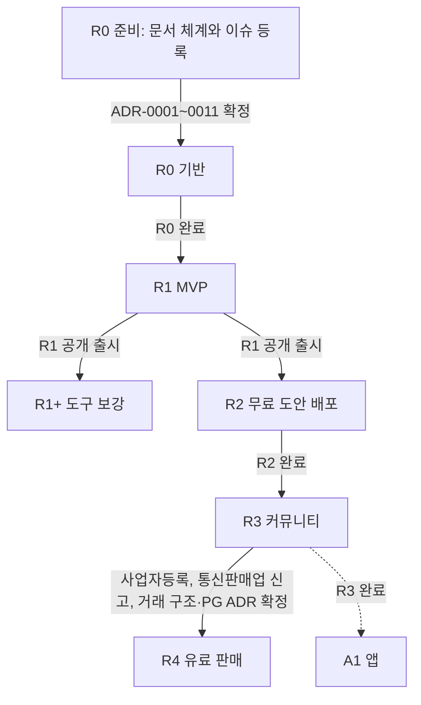

# 함뜨까 출시 로드맵

이 문서는 함뜨까의 출시 단계별 범위, 진입 조건과 완료 조건, 포함 기능, 착수 전에 정할 결정 항목을 정리한다. 독자는 지금 어느 단계에 있고 다음 단계로 넘어가려면 무엇을 갖춰야 하는지 이 문서에서 확인할 수 있다.

기능별 상세 설명은 [기능 목록](feature-catalog.md)에 있고, 제품 방향은 [제품 비전](vision.md)에서 설명한다. 출시 단계나 기능 배정이 바뀌면 이 문서, 기능 목록, GitHub 마일스톤을 함께 고친다.

## 전체 흐름

화살표 라벨은 도착하는 단계의 진입 조건이다. 점선은 착수 시점을 아직 정하지 않은 분기이며, A1의 착수 시점은 [OD-19](../decisions/README.md)에서 정한다.

- R1+와 R2의 진입 조건은 모두 R1 공개 출시다. R1+ 항목은 R1과 R2 사이에 끼워 넣어 배포하며, R1+ 완료는 R2의 진입 조건이 아니다.
- R4와 A1은 모두 R3 뒤에 오지만, 한 번에 한 단계만 진행하는 원칙에 따라 동시에 진행하지 않는다.

## 출시 단계 표

| 코드 | 마일스톤 이름 | 범위 | 스펙 폴더 | 기능 수 | 진입 조건 | 완료 조건 |
|---|---|---|---|---|---|---|
| R0 | R0 기반 | 모노레포 뼈대, Supabase·Vercel 서울 리전, CI, 화면 틀, 지원 페이지, 계정 | [001-account](../specs/001-account/requirements.md) | 6 | ADR-0001~0011 확정 | 운영 도메인에서 가입, 로그인, 탈퇴가 동작한다 |
| R1 | R1 MVP | 프로젝트 기록, 뜰 예정 프로젝트, 게이지, 단수 카운터(기본·퀵·다중·반복), 내 도안 파일 첨부 | [002-projects](../specs/002-projects/requirements.md), [003-row-counter](../specs/003-row-counter/requirements.md), [004-pattern-files](../specs/004-pattern-files/requirements.md) | 8 | R0 완료 | 2주 비공개 베타 뒤 공개 출시한다 |
| R1+ | R1+ 도구 보강 | 타이머, 통계, 웹 PDF 뷰어, 실 보관함, 계산기, 내보내기, 네이버 로그인 | 아직 없음 | 10 | R1 공개 출시 | 항목마다 따로 배포한다 |
| R2 | R2 무료 도안 배포 | 작가 프로필, 도안 등록·심사, 내 도안함, 업데이트 알림, 검색·필터, 관리자 콘솔 | 아직 없음 | 16 | R1 공개 출시 | 외부 작가의 무료 도안이 공개되고, 받기와 업데이트 알림이 동작한다 |
| R3 | R3 커뮤니티 | 게시판, 신고·차단·금칙어, 후기, Q&A, 완성작 갤러리, 큐레이션 | 아직 없음 | 15 | R2 완료 | 신고 처리 큐를 운영할 수 있다 |
| R4 | R4 유료 판매 | `apps/api` 추가, 결제·환불, 정산 원장, 지급대행, 세무 보고 | 아직 없음 | 11 | 사업자등록, 통신판매업 신고, 거래 구조 ADR과 PG ADR 확정 | 첫 실결제와 첫 지급을 마친다 |
| A1 | A1 앱 | `apps/mobile`(Expo), Sign in with Apple, 푸시, 네이티브 카운터 위젯 | 아직 없음 | 4 | R3 완료(웹에 신고·차단·탈퇴 기능이 있음) | 스토어 심사를 통과한다 |
| Later | 마일스톤 없음 | 출시 단계를 정하지 않은 기능 | 없음 | 16 | 정하지 않음 | 정하지 않음 |

범위 칸은 요약이며, 단계별 전체 기능은 아래 단계별 상세 표에서 확인한다. 기능 수는 기능 목록에 배정된 출시 단계를 기준으로 센 값이며, 합계는 86개다. R1+ 이후 단계의 스펙 폴더는 해당 단계에 착수할 때 `/sdd-spec`으로 만든다. SDD 적용 기준에 해당하지 않는 기능 항목은 스펙 폴더 없이 Task 이슈와 PR로 처리한다.

## 단계별 상세

### R0 기반

**목표**: 서비스 운영에 필요한 기반을 갖추고, 운영 도메인에서 가입, 로그인, 탈퇴가 동작하게 한다.

**포함 기능 (6개)**

| ID | 기능 | 담는 곳 |
|---|---|---|
| F-ACCT-01 | 카카오·구글 소셜 로그인과 계정 식별 구조 | [001-account](../specs/001-account/requirements.md) |
| F-ACCT-04 | 회원 탈퇴와 데이터 삭제 | [001-account](../specs/001-account/requirements.md) |
| F-ACCT-05 | 약관·개인정보 처리방침 버전 관리, 동의 기록, 만 14세 확인 | [001-account](../specs/001-account/requirements.md) |
| F-UX-01 | 반응형 모바일 웹과 다운로드 환경 안내 | R0 인프라 Feature |
| F-UX-02 | 다크 모드 | R0 인프라 Feature |
| F-SUPPORT-01 | 고객 지원 채널 | R0 인프라 Feature |

**R0 착수 전에 정할 결정**

- [OD-01](../decisions/README.md) 만 14세 미만 가입 처리: 가입 차단 또는 법정대리인 동의 중에서 고른다. 제안은 가입 차단이다.
- [OD-02](../decisions/README.md) 탈퇴 데이터 처리: 즉시 삭제 또는 유예 기간 중에서 고른다.

**참고**

- 인프라 작업은 pnpm 워크스페이스와 Turborepo로 `apps/web`, `packages/shared`, `supabase/`를 만든다([ADR-0001](../decisions/0001-monorepo-structure.md)).
- Supabase 프로젝트는 서울 리전(ap-northeast-2)에 만들고, Vercel 함수는 서울 리전(icn1)에 고정한다([ADR-0002](../decisions/0002-stack-nextjs-supabase-vercel.md)).
- F-UX-01, F-UX-02, F-SUPPORT-01은 스펙 폴더 없이 R0 인프라 Feature 안에서 처리한다.
- 로그인은 카카오와 구글만 제공한다. 회원은 이메일이 아니라 로그인 제공자와 제공자 사용자 ID의 조합으로 식별한다([ADR-0005](../decisions/0005-auth-supabase-social-login.md)).
- 개발 기간에는 Vercel Hobby와 Supabase Free를 써서 비용 없이 운영한다.

### R1 MVP

**목표**: 다른 사용자가 없어도 혼자 쓸 수 있는 개인 뜨개 도구를 공개한다([ADR-0008](../decisions/0008-mvp-personal-tools.md)).

**포함 기능 (8개)**

| ID | 기능 | 담는 곳 |
|---|---|---|
| F-PROJ-01 | 뜨개 프로젝트 기록 | [002-projects](../specs/002-projects/requirements.md) |
| F-PROJ-02 | 뜰 예정 프로젝트 | [002-projects](../specs/002-projects/requirements.md) |
| F-TOOL-01 | 게이지 기록(세탁 전후) | [002-projects](../specs/002-projects/requirements.md) |
| F-COUNTER-01 | 단수 카운터 기본 기능 | [003-row-counter](../specs/003-row-counter/requirements.md) |
| F-COUNTER-02 | 로그인 없이 쓰는 퀵 카운터 | [003-row-counter](../specs/003-row-counter/requirements.md) |
| F-COUNTER-03 | 파트별 다중 카운터 | [003-row-counter](../specs/003-row-counter/requirements.md) |
| F-COUNTER-04 | 반복(세트)·연결 카운터 | [003-row-counter](../specs/003-row-counter/requirements.md) |
| F-VIEWER-01 | 내 도안 자료 첨부(PDF·링크·영상) | [004-pattern-files](../specs/004-pattern-files/requirements.md) |

**정할 결정**

- [OD-03](../decisions/README.md) 개인 PDF 업로드 용량 한도: 2026-11-20에 [004 요구사항](../specs/004-pattern-files/requirements.md)의 Q-01, Q-02에서 파일당 50MB, 회원당 합계 200MB로 정했다. 회원당 한도는 공개 출시 전에 다시 정한다.
- [OD-04](../decisions/README.md) 사업자등록 시점: 공개 출시 때 할지 유료 판매 직전에 할지 R1 공개 출시 전에 정한다. 이 결정은 Vercel Hobby의 비상업 이용 조건과 연결된다.

**참고**

- 2주 동안 비공개 베타를 운영한 뒤 공개 출시한다.
- 공개 출시 때 Vercel Pro(월 $20)와 Supabase Pro(월 $25)로 바꾸며, 합계는 월 약 $45다.
- Vercel 이용약관은 Hobby 플랜을 개인·비상업 용도로만 허용한다([Vercel 이용약관](https://vercel.com/legal/terms)). Supabase Free는 1주 동안 활동이 없으면 프로젝트를 일시 중지한다([Supabase 요금](https://supabase.com/pricing)).
- 각 스펙의 설계는 그 스펙의 요구사항이 승인(`status: approved`)된 뒤에 작성한다. 스펙마다 승인 상태가 다르므로 각 요구사항 문서의 `status`를 확인한다.

### R1+ 도구 보강

**목표**: R1 사용자 피드백을 반영하여 개인 도구를 작은 배포로 보강한다.

**포함 기능 (10개)**

| ID | 기능 |
|---|---|
| F-ACCT-02 | 네이버 로그인 |
| F-PROJ-03 | 작업 타이머와 시간 기록 |
| F-PROJ-04 | 뜨개 통계·리포트와 연간 챌린지 |
| F-COUNTER-05 | 특정 단 리마인더 |
| F-VIEWER-02 | 웹 PDF 뷰어와 이어 보기 |
| F-VIEWER-03 | 줄 하이라이터와 위치 마커 |
| F-VIEWER-04 | PDF 필기·형광펜 주석 |
| F-STASH-01 | 실 보관함(실장고)과 도구 보관함 |
| F-TOOL-02 | 뜨개 계산기 |
| F-UX-03 | 데이터 내보내기와 백업 |

**정할 결정**: 이 단계에 배정된 미결정 항목은 없다.

**참고**

- 항목마다 따로 배포하며, R1과 R2 사이에 끼워 넣는다.
- 네이버 로그인(F-ACCT-02)은 Supabase Custom OAuth Provider로 연결한다([ADR-0005](../decisions/0005-auth-supabase-social-login.md)).
- R2의 내 도안함에서 프로젝트 시작(F-STORE-08)은 웹 PDF 뷰어(F-VIEWER-02)에 의존하므로, F-VIEWER-02를 먼저 배포한다.

### R2 무료 도안 배포

**목표**: 외부 작가가 무료 도안을 공개하고, 회원이 도안을 받아 업데이트 알림을 받을 수 있게 한다.

**포함 기능 (16개)**

| ID | 기능 |
|---|---|
| F-STORE-01 | 작가 프로필과 스토어 페이지 |
| F-STORE-02 | 도안 등록·수정 폼 |
| F-STORE-03 | 도안 구조화 메타데이터 |
| F-STORE-04 | 가격 필드와 0원 제약 |
| F-STORE-05 | 무료 도안 받기와 내 도안함 |
| F-STORE-06 | 도안 파일 버전 관리와 업데이트 알림 |
| F-STORE-07 | 도안 심사와 등록 정책 |
| F-STORE-08 | 내 도안함에서 프로젝트 시작 |
| F-DISC-01 | 카테고리 체계 |
| F-DISC-02 | 뜨개 특화 필터와 정렬 |
| F-DISC-03 | 한국어 키워드 검색 |
| F-DISC-04 | 찜(좋아요)과 컬렉션 |
| F-ADMIN-01 | 관리자 콘솔 |
| F-NOTI-01 | 사이트 내 알림함 |
| F-NOTI-02 | 트랜잭션 이메일과 수신 설정 |
| F-SELL-01 | 작가용 도안 관리 화면 |

**R2 착수 전에 정할 결정**

- [OD-05](../decisions/README.md) 내 도안함 다운로드 기간: 무기한 또는 12개월 중에서 고른다.
- [OD-06](../decisions/README.md) 도안 영상: 외부 URL만 받을지 직접 호스팅할지 정한다.
- [OD-07](../decisions/README.md) 검색의 비회원 허용 여부는 2026-11-19에 정했다. 비회원도 도안을 둘러보고 검색하며, 받기·찜·후기·문의 작성은 회원만 한다([기능 목록](feature-catalog.md#이용-대상별-분류)).
- [OD-08](../decisions/README.md) 한국어 검색 엔진: PGroonga와 pg_trgm을 실측한 뒤 정하고, 부족하면 Meilisearch를 검토한다.

**참고**

- 도안 가격 필드는 처음부터 두지만, CHECK 제약으로 0원만 허용한다([ADR-0007](../decisions/0007-sales-ready-data-model.md)).
- 무료 도안을 받을 때에도 내 도안함 기록을 남기고, 받은 경로, 받은 시각, 첫 다운로드 시각을 기록한다.

### R3 커뮤니티

**목표**: 게시판, 후기, 완성작 공유를 열고, 운영자가 신고를 처리할 수 있게 한다.

**포함 기능 (15개)**

| ID | 기능 |
|---|---|
| F-STORE-09 | 후기(별점·명확도·난이도·사진)와 후기 피드 |
| F-STORE-10 | 도안 문의(Q&A) |
| F-STORE-11 | 도안별 완성작 갤러리 |
| F-STORE-12 | 도안 증정(선물) |
| F-DISC-05 | 홈 큐레이션과 기획전 |
| F-DISC-06 | 유사 도안 추천 |
| F-COMM-01 | 게시판·게시글·댓글·좋아요 |
| F-COMM-02 | 익명 표시 모드 |
| F-COMM-03 | 완성작 공유와 프로젝트 연동 |
| F-COMM-04 | 자투리마켓(회원 간 거래 게시판) |
| F-MOD-01 | 신고와 처리 큐 |
| F-MOD-02 | 사용자 차단 |
| F-MOD-03 | 비공개 금칙어 필터 |
| F-MOD-04 | 임시조치·제재 기록과 범위별 이용 제한 |
| F-MOD-05 | 이용 규칙 운영과 게시 전 약관 동의 |

**R3 착수 전에 정할 결정**

- [OD-09](../decisions/README.md) 커뮤니티 작성자 표시: 완전 익명 또는 닉네임 중에서 고른다.
- [OD-10](../decisions/README.md) 탈퇴한 회원의 게시물 처리 방식을 정한다.
- [OD-11](../decisions/README.md) 결제 기능 전 수익 모델: 광고, 프리미엄, 수익 모델 없음 중에서 고른다.

**참고**

- 신고, 차단, 금칙어 필터는 게시판과 같은 배포에 넣는다. 사용자 생성 콘텐츠를 여는 기능과 동시에 갖춰야 하는 법적 요건이자 앱 심사 요건이기 때문이다.
- 자투리마켓은 게시판만 제공하고, 실물 거래의 결제를 중개하지 않는다.
- R3 완료는 A1의 진입 조건이다.

### R4 유료 판매

**목표**: 유료 도안을 판매하고, 판매 대금을 PG 지급대행으로 작가에게 정산한다.

**포함 기능 (11개)**

| ID | 기능 |
|---|---|
| F-SELL-02 | 매출·정산 대시보드와 출금 요청 |
| F-SELL-05 | 판매 수수료 정책과 적용 시작일 관리 |
| F-SELL-06 | 판매자 신원·세무 프로필과 정산 계좌 검증 |
| F-PAY-01 | 단건 결제와 서버 측 검증 |
| F-PAY-02 | 주문 모델과 청약철회 근거 기록 |
| F-PAY-03 | 웹훅 수신함과 비동기 처리 |
| F-PAY-04 | 환불 처리 |
| F-SETTLE-01 | 정산 원장 |
| F-SETTLE-02 | 정산 배치와 지급대행 연동 |
| F-SETTLE-03 | 세무 보고 집계 |
| F-LEGAL-01 | 법적 표시 요소 |

**R4 착수 전에 정할 결정**

- [OD-12](../decisions/README.md) 거래 구조: 중개형 또는 판매형 중에서 고른다.
- [OD-13](../decisions/README.md) 사업자등록이 없는 개인 작가의 판매 허용 여부를 정한다.
- [OD-14](../decisions/README.md) PG 선택: 토스페이먼츠 직접 연동, PortOne과 지급대행 PG, KG이니시스 중에서 고른다.
- [OD-15](../decisions/README.md) 판매 수수료 정책을 정한다.
- [OD-16](../decisions/README.md) 원천징수 처리 방식을 세무 자문을 받아 정한다.
- [OD-17](../decisions/README.md) 단건 결제로 시작할지 정한다.

**참고**

- 진입하려면 사업자등록과 통신판매업 신고를 마치고, 거래 구조 ADR과 PG ADR을 확정해야 한다.
- 이 단계에서 `apps/api`(Kotlin, Spring Boot, Gradle)를 추가한다. 주문, 결제, 원장, 지급을 담는 `commerce` 스키마는 Spring의 Flyway가 관리한다([ADR-0006](../decisions/0006-migration-ownership.md)).
- 구매 대금을 운영자 계좌로 받지 않는다. PG 지급대행 또는 PortOne 파트너 정산과 지급대행 PG로만 정산한다([ADR-0009](../decisions/0009-payout-via-pg.md)).
- Spring 서버는 Supabase JWT를 JWKS로 검증한다([ADR-0005](../decisions/0005-auth-supabase-social-login.md)).
- Spring 서버(예: Lightsail 서울 2GB, 월 약 $12)를 더해도 월 운영비를 10만 원 이하로 유지한다.

### A1 앱

**목표**: 웹과 같은 Supabase 백엔드를 쓰는 Expo 앱을 앱스토어에 출시한다.

**포함 기능 (4개)**

| ID | 기능 |
|---|---|
| F-ACCT-03 | Sign in with Apple과 계정 변경 알림 수신 |
| F-COUNTER-06 | 위젯·잠금 화면·워치·음성 카운트 |
| F-NOTI-03 | 앱 푸시 알림 |
| F-APP-01 | Expo 네이티브 앱 |

**A1 착수 전에 정할 결정**

- [OD-18](../decisions/README.md) 앱 결제 전략과 번들 ID: 열람 전용, IAP 병행, 한국 대체 결제, 아웃링크 허용 대기 중에서 고른다.
- [OD-19](../decisions/README.md) 앱 착수 시점을 정한다.

**참고**

- 이 단계에서 `apps/mobile`(Expo)을 추가한다([ADR-0001](../decisions/0001-monorepo-structure.md)).
- 진입 조건은 R3 완료다. 앱 심사가 요구하는 신고, 차단, 탈퇴 기능을 웹에서 먼저 갖추기 위해서다.
- 웹뷰만 감싼 앱이 아니라 카운터, 오프라인 도안 열람, 사진 업로드, 푸시 같은 네이티브 기능을 중심으로 만든다.

### Later

아래 16개 기능은 출시 단계를 정하지 않았으며, 연결된 마일스톤도 없다. 이 기능을 출시 단계에 넣으려면 이 문서, 기능 목록, GitHub 마일스톤을 함께 고친다.

| ID | 기능 |
|---|---|
| F-VIEWER-05 | 차트 하이라이터와 매직 마커 |
| F-STASH-02 | 국내 실 데이터베이스와 실 대체 검색 |
| F-STORE-13 | 테스트 니팅 테스터 모집 |
| F-STORE-14 | 인터랙티브 도안과 사이즈 선택형 도안 |
| F-DISC-07 | 작가 팔로우와 신작 피드 |
| F-DISC-08 | 외부 도안 데이터베이스와 디렉터리 |
| F-COMM-05 | 함뜨(KAL)·모임 모집과 그룹 |
| F-COMM-06 | 회원 간 메시지 |
| F-SELL-03 | 할인과 기간 예약 할인 |
| F-SELL-04 | 쿠폰 코드 |
| F-SELL-07 | 묶음 상품과 외부 판매처 도안 가져오기 |
| F-PAY-05 | 장바구니와 다건 결제 |
| F-UX-04 | 다국어 지원 |
| F-REV-01 | 광고와 사진 후기 보상 |
| F-REV-02 | 프리미엄 구독 |
| F-AUTHOR-01 | 차트 메이커와 도안 작성 도구 |

## 진행 원칙

- **한 번에 한 단계(WIP 1)**: 진행 중인 출시 단계는 항상 하나다. R1+ 항목은 R1과 R2 사이에 끼워 넣고, R4와 A1도 동시에 진행하지 않는다. 이 원칙은 설계와 구현에 적용하며, 다음 단계 기능의 요구사항 검토는 미리 할 수 있다.
- **요구사항 먼저**: 기능을 비회원과 회원 기준으로 나눈 [기능 목록](feature-catalog.md#이용-대상별-분류)의 이용 대상을 정한 뒤, 계정 기능(001)의 설계에 앞서 R1 요구사항(002~004)을 확정한다. 계정 설계가 뒤 단계 기능에 필요한 회원 구조와 비회원 흐름을 놓치지 않게 하려는 순서다.
- **SDD 적용 기준**: 새 테이블이나 새 화면을 추가하거나 권한 규칙을 바꾸는 작업은 SDD 절차를 따른다. 버그 수정, 문구 수정, 리팩터링은 SDD 없이 PR로 바로 처리한다. 단계별 산출물과 게이트는 [SDD 진행 가이드](../sdd-guide.md)에 있다.
- **Task 하나에 PR 하나**: 계획된 작업은 Task 이슈 하나를 PR 하나로 끝내고, PR 본문에 `Closes #번호`를 적는다. 문서 문구나 설정 같은 작은 수정은 이슈 없이 처리한다([ADR-0012](../decisions/0012-issue-for-planned-work-only.md)). Feature 이슈는 스펙 폴더나 기능 묶음 하나에 대응하고, Task 이슈는 Feature 이슈의 하위 이슈로 만든다.

## 진행 상황 보는 곳

| 위치 | 확인하는 내용 |
|---|---|
| [GitHub 마일스톤](https://github.com/god3v/hamtteukka/milestones) | 출시 단계별 이슈와 완료 비율 |
| Project 보드 `함뜨까` | 이슈별 진행 상태, SDD 단계, 작업 크기, 주간 반복 |

마일스톤 이름은 위 출시 단계 표의 이름과 같고, Later 항목에는 마일스톤이 없다. Project 보드는 저장소 소유자의 개인 계정에 속하며 이 저장소에 연결된다. 보드는 이 문서들과 함께 만들며, 저장소의 [Projects 탭](https://github.com/god3v/hamtteukka/projects)에서 열 수 있다. 보드 필드는 다음과 같다.

| 필드 | 값 |
|---|---|
| Status | Todo, In Progress, dev 반영, Done |
| SDD 단계 | 요구사항, 설계, 작업 분해, 구현, 검증 |
| Size | S, M, L, XL |
| Iteration | 1주 단위 |

보드의 보기 화면(뷰)은 GitHub 웹 화면에서 만든다. GitHub Issues와 Projects로 업무를 관리하기로 한 배경은 [ADR-0011](../decisions/0011-github-issues-projects.md)에 있다.

## 현재 위치

2026-11-19 기준으로 함뜨까는 R0 단계에 있다. 개발 기반 작업(R0 인프라)은 끝났고, 계정 기능(001)이 남아 있다.

- R0 진입 조건인 ADR-0001~0011은 2026-11-18에 확정되었다.
- 001 계정 요구사항은 2026-11-19에 승인되었고, 이때 [OD-01](../decisions/README.md)과 [OD-02](../decisions/README.md)도 정했다.
- 기능 86개의 이용 대상(비회원, 회원)은 2026-11-19에 정했다.
- 다음 작업은 R1 요구사항 3건(002~004)의 확인 질문을 해결하고 승인하는 것이다. 세 문서가 승인되면 001 설계를 시작한다.

## 관련 문서

- [제품 비전](vision.md): 함뜨까가 풀려는 문제와 하지 않을 일
- [기능 목록](feature-catalog.md): 기능 ID별 설명과 출시 단계
- [의사결정 기록과 미결정 항목](../decisions/README.md): ADR과 OD 목록
- [SDD 진행 가이드](../sdd-guide.md): 요구사항부터 검증까지의 절차
- [프로젝트 헌법](../constitution.md): 모든 작업이 지킬 원칙
- [모노레포 구조](../architecture/monorepo.md): 단계별로 추가하는 앱과 패키지
- [배포 구성](../architecture/deployment.md): 인프라, 리전, 비용 구성
