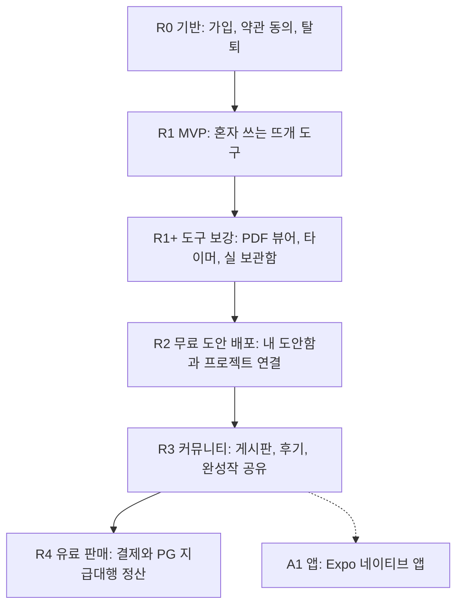

# 함뜨까 제품 비전

이 문서는 함뜨까가 풀려는 문제, 대상 사용자, 제공할 가치와 하지 않기로 한 일을 설명한다. 기능을 추가하거나 출시 범위를 바꿀 때 이 문서를 읽으면 그 변경이 제품 방향에 맞는지 판단할 수 있다.

함뜨까는 뜨개 프로젝트 기록 도구와 도안 배포를 하나의 웹 서비스로 잇는 1인 사이드 프로젝트다. 단계별 범위와 진입 조건은 [출시 로드맵](roadmap.md)에서 다룬다.

## 함뜨까가 해결하려는 문제

국내 뜨개 서비스는 개인 기록 도구와 도안 마켓으로 나뉘어 있다. 2026-11-18에 조사한 대표 서비스의 형태는 다음과 같다.

| 서비스 | 제공 형태 | 개인 기록 도구 | 웹 버전 |
|---|---|---|---|
| 실노트 | iOS·Android 앱 | 프로젝트, 위시리스트, 단수 카운터, 게이지, 실 보관함 | 확인되지 않음 |
| 니트플로우 | Apple 기기 전용 앱 | 프로젝트, 다중 카운터, 타이머, PDF 필기 | 없음 |
| 단수링 | iOS 앱 | 단수 카운터 | 확인되지 않음 |
| 도아니티 | 웹 서비스 | 없음 (도안 오픈마켓과 익명 커뮤니티) | 있음 |

조사한 서비스 가운데 개인 기록 도구를 제공하는 곳은 모두 모바일 앱이고, 웹으로 운영하는 도아니티에는 기록 도구가 없다.

개인 기록 도구는 모바일 앱, 그중에서도 Apple 기기를 중심으로 만들어져 있다. 니트플로우는 회원 계정 없이 사용자의 iCloud에만 데이터를 저장하므로 Apple 기기에서만 쓸 수 있다. 니트플로우 App Store 리뷰에는 웹 버전 계획을 묻는 글과 동기화 누락이나 프로젝트 소실을 호소하는 글이 있다. 실노트는 2026-11-18에 조회했을 때 두 스토어 모두에서 찾을 수 없었다.

도아니티는 웹에서 도안 오픈마켓과 익명 커뮤니티를 함께 운영하지만, 받은 도안으로 뜨개 과정을 기록하는 도구는 제공하지 않는다. 그래서 도안을 받고 진행 상황까지 기록하려는 사용자는 서로 다른 서비스를 함께 써야 한다. 함뜨까는 웹에서 쓰는 개인 기록 도구로 시작하고, 이후 도안 배포를 같은 계정과 데이터에 연결하여 두 일을 한 서비스에서 이어서 하게 한다.

서비스별 조사 내용과 전체 출처는 [참고 서비스 조사 기록](../research/2026-11-18-reference-services.md)에 있다. 이 절에서 사용한 주요 출처는 다음과 같다.

- 실노트: [Google Play 등록 페이지](https://play.google.com/store/apps/details?id=com.chbb.knit_schedule&hl=en_US), [iTunes Lookup 조회 결과](https://itunes.apple.com/lookup?id=6749874186&country=kr)
- 니트플로우: [공식 사이트](https://www.knitflow.io/ko/), [고객 지원 페이지](https://www.knitflow.io/support), [App Store 리뷰](https://apps.apple.com/kr/app/knitflow-%EB%8B%88%ED%8A%B8%ED%94%8C%EB%A1%9C%EC%9A%B0-%EB%9C%A8%EA%B0%9C-%EA%B8%B0%EB%A1%9D-%EB%8F%84%EA%B5%AC/id6740465748?see-all=reviews)
- 단수링: [App Store 페이지](https://apps.apple.com/kr/app/%EB%8B%A8%EC%88%98%EB%A7%81/id6737157418)
- 도아니티: [공식 사이트](https://www.doanity.com/)

## 대상 사용자

함뜨까는 세 사용자 집단을 대상으로 하며, 출시 단계마다 먼저 지원하는 집단이 다르다.

| 사용자 | 하려는 일 | 필요한 것 | 지원 시작 단계 |
|---|---|---|---|
| 기록하는 뜨개인 | 진행 중인 작품의 단수, 게이지, 도안 파일을 한곳에서 관리한다 | 어느 기기에서나 같은 기록, 로그인 없이 바로 쓰는 카운터 | R1 |
| 도안 작가 | 자기 도안을 공개하고, 수정본을 받은 사람에게 알린다 | 작가 프로필, 도안 등록과 심사, 파일 버전 관리와 업데이트 알림 | R2 |
| 커뮤니티 참여자 | 질문하고 완성작과 후기를 나눈다 | 게시판, 익명 표시, 신고·차단 같은 안전장치 | R3 |

기록하는 뜨개인은 첫 출시의 중심 사용자다. 개인 기록 도구는 다른 사용자가 없어도 혼자 쓸 수 있으므로, 사용자가 적은 초기에도 쓸모가 있다([ADR-0008](../decisions/0008-mvp-personal-tools.md)).

도안 작가에게는 오류를 고친 도안 파일을 받은 사람 모두에게 알리는 기능이 중요하다. 도아니티는 이 기능을 블로그나 스마트스토어 판매와 비교한 차별점으로 내세운다([도아니티 FAQ](https://doanity.notion.site/FAQ-5859c83e51f14ef49d76353fb95a8f2d)). 유료 판매는 R4에서 시작하므로, R2와 R3에서 작가는 무료 도안을 배포한다.

커뮤니티 참여자에게는 안전한 운영이 먼저 필요하다. Apple과 Google Play는 사용자 생성 콘텐츠를 다루는 앱에 신고, 차단, 필터링 기능을 요구한다([Apple 개발자 뉴스](https://developer.apple.com/news/?id=92th7e5i), [Google Play UGC 정책](https://support.google.com/googleplay/android-developer/answer/9876937?hl=en)). 함뜨까는 이 기능들을 커뮤니티를 여는 R3에 함께 넣는다.

## 제공할 가치

### 웹과 계정 동기화

함뜨까는 설치 없이 브라우저에서 쓰는 반응형 웹 서비스로 시작한다. 카카오나 구글 계정으로 로그인하면 기록을 서버에 저장하므로, 휴대폰과 PC에서 같은 기록을 볼 수 있다. 로그인하기 전에도 퀵 카운터를 쓸 수 있고, 로그인하면 그 값을 프로젝트로 옮겨 저장한다. 쌓인 기록을 파일로 받아 두는 내보내기 기능은 R1+에서 추가한다.

### 도안과 연결된 도구

R1에서는 사용자가 이미 가진 도안 PDF, 링크, 영상을 프로젝트에 첨부한다. 이 개인 PDF 첨부 기능으로 R2 내 도안함 다운로드에 쓸 저장 구조를 미리 검증한다.

R2부터는 내 도안함에 받은 도안으로 바로 프로젝트를 시작하고, 도안 PDF를 뷰어와 카운터에 연결한다. 작가가 도안 파일을 고치면 그 도안을 받은 회원에게 사이트 알림과 이메일이 간다. 개인 기록 앱인 니트플로우와 도안 마켓인 도아니티에는 받은 도안을 내 프로젝트로 잇는 흐름이 없다.

### 판매에 대비한 구조

유료 판매는 R4에서 시작하지만, 데이터는 처음부터 판매를 전제로 설계한다([ADR-0007](../decisions/0007-sales-ready-data-model.md)).

- 작가 프로필을 회원 정보와 분리한다.
- 무료 도안을 받을 때에도 내 도안함 기록을 남긴다. 기록에는 받은 경로(무료 받기, 구매, 선물, 관리자 지급), 받은 시각, 회수 시각, 첫 다운로드 시각이 들어간다.
- 도안 가격 필드를 처음부터 두고, R4 전까지는 0원만 허용한다.
- 첫 다운로드 시각과 동의 기록을 남겨 디지털 콘텐츠 청약철회 제한의 근거로 쓴다.
- 수수료율, 원천징수율, 정산 주기는 코드 상수가 아니라 적용 시작일이 있는 설정 테이블로 관리한다.

이렇게 설계하면 판매를 시작할 때 결제 완료 시점에 같은 내 도안함 기록을 만들고 가격 제약만 풀면 된다.

## 하지 않을 일

다음 일은 법적 위험이 크거나 1인 운영 초기에 감당하기 어렵기 때문에 하지 않는다. 이 방향을 바꾸려면 먼저 새 ADR로 결정을 기록한다.

1. **구매 대금을 운영자 계좌로 받지 않는다.** 플랫폼이 구매 대금을 받아 작가에게 정산하면 전자지급결제대행업(PG) 등록 대상이 되고, 등록하지 않고 영업하면 형사처벌을 받는다. 판매 대금은 PG 지급대행이나 PortOne 파트너 정산과 지급대행 PG로만 정산한다([ADR-0009](../decisions/0009-payout-via-pg.md), [금융위원회 보도설명](https://www.fsc.go.kr/no010102/82523)).
2. **충전식 포인트나 잔액을 만들지 않는다.** 여러 판매자에게 쓰이는 충전금은 선불전자지급수단 발행업 등록 문제를 일으킬 수 있다. 할인은 가격 할인이나 쿠폰으로 처리한다([ADR-0009](../decisions/0009-payout-via-pg.md), [금융위원회 자료](https://www.fsc.go.kr/no010101/82339)).
3. **초기에 차트 메이커를 만들지 않는다.** 차트 작성, 사진 변환, 서술형 설명 생성, 코 수 검증까지 포함하면 구현 범위가 커서 초기에는 외부 도구 링크로 대신한다. 이 기능(F-AUTHOR-01)은 출시 단계를 정하지 않은 Later 항목이다.
4. **초기에 해외 결제를 받지 않는다.** 국내 사용자 확보가 먼저이고, 다국어 지원(F-UX-04)도 해외 결제와 정산 구조가 정해진 뒤에 의미가 커지므로 Later 항목으로 둔다. R4에서 고를 PG 후보는 국내 PG이며, 토스페이먼츠 지급대행은 원화만 지원한다([토스페이먼츠 지급대행 기본 정책](https://www.tosspayments.com/blog/articles/30365)).
5. **웹뷰만 감싼 앱을 만들지 않는다.** Apple 심사 지침 4.2는 재포장된 웹사이트 수준의 앱을 거절 대상으로 정하고, Google Play 최소 기능 정책은 텍스트나 PDF만 보여 주는 앱을 위반 사례로 든다. A1 앱은 카운터, 오프라인 도안 열람, 사진 업로드, 푸시 같은 네이티브 기능을 중심으로 만든다([Apple 심사 지침](https://developer.apple.com/app-store/review/guidelines/), [Google Play 최소 기능 정책](https://support.google.com/googleplay/android-developer/answer/9898783?hl=en)).
6. **자투리마켓에서 실물 거래의 결제를 중개하지 않는다.** 자투리마켓은 남은 실과 뜨개 용품을 거래하려는 회원이 글을 올리는 게시판이고, 거래 조건은 회원끼리 정한다. 도아니티도 같은 게시판에서 게시 공간만 제공하고 거래 책임을 지지 않는다([도아니티 FAQ](https://doanity.notion.site/FAQ-5859c83e51f14ef49d76353fb95a8f2d)).

정산과 전자금융 규정의 상세 근거는 [결제와 법규 조사 기록](../research/2026-11-18-payments-and-law.md)에 있다. 앱 심사 규정의 상세 근거는 [앱스토어 정책 조사 기록](../research/2026-11-18-app-store-policy.md)에 있다.

## 단계별 모습

각 상자는 해당 단계에서 사용자가 새로 쓰게 되는 기능을 요약한다. 점선은 착수 시점을 아직 정하지 않은 연결이며, A1 앱의 착수 시점은 [OD-19](../decisions/README.md)에서 정한다. 단계별 범위, 진입 조건과 완료 조건은 [출시 로드맵](roadmap.md)에 있다.

## 관련 문서

- [출시 로드맵](roadmap.md): 단계별 범위, 진입 조건과 완료 조건
- [기능 목록](feature-catalog.md): 기능 ID별 설명과 출시 단계
- [참고 서비스 조사 기록](../research/2026-11-18-reference-services.md): 국내외 뜨개 서비스 비교
- [결제와 법규 조사 기록](../research/2026-11-18-payments-and-law.md): 정산, 전자금융, 청약철회 근거
- [앱스토어 정책 조사 기록](../research/2026-11-18-app-store-policy.md): 앱 심사와 앱 결제 근거
- [ADR-0007 판매에 대비한 데이터 원칙](../decisions/0007-sales-ready-data-model.md)
- [ADR-0008 개인 뜨개 도구를 MVP로 정함](../decisions/0008-mvp-personal-tools.md)
- [ADR-0009 판매 대금은 PG 지급대행으로만 정산](../decisions/0009-payout-via-pg.md)
- [의사결정 기록과 미결정 항목](../decisions/README.md)
