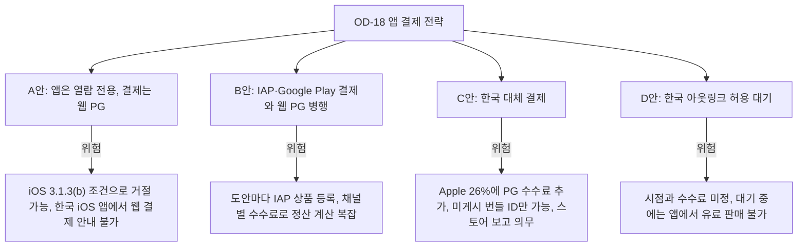

# 앱 스토어 정책과 국내 법령 조사

이 문서는 함뜨까가 A1에서 iOS·Android 앱을 출시할 때 적용되는 App Store·Google Play 심사 규정과, 계정·커뮤니티·개인정보에 관한 국내 법령을 2026-11-18 기준으로 조사한 기록이다. 앱 결제 전략(OD-18)을 고를 때 필요한 수수료와 조건, 그리고 R0·R3·A1 단계마다 미리 갖춰야 할 기능을 이 문서에서 확인할 수 있다.

## 범위

이 문서는 2026-11-18에 수행한 조사 결과를 그 시점 기준으로 고정한 기록이다. 이후에는 본문을 고치지 않으며, 정정할 내용이 생기면 문서 끝에 정정 기록을 덧붙인다.

앱 스토어 정책은 자주 바뀐다. Apple은 2026-10-16에 심사 가이드라인을 개정했고, Google은 2026-12-31까지 한국에 새 수수료 구조를 도입할 계획이다. 방송미디어통신위원회의 2026-10-28 시정명령도 이행 결과가 정해지지 않았으므로, A1 착수 전에 이 문서의 내용을 다시 확인한다.

이 문서를 읽을 때는 다음 사항을 참고한다.

- 이 문서는 법률 자문이 아니다. 개인정보 국외 이전처럼 해석이 필요한 항목은 법률 검토로 확정한다.
- 사실마다 출처 번호(S1 등)를 붙였고, 번호를 누르면 원문으로 이동한다. 전체 목록은 [출처](#출처)에 있다.
- 출처에서 직접 확인하지 못하고 추론한 내용에는 "(추정)"을 붙였다.
- 조사 뒤에 교차 검증한 세 주장(Apple 3.1.3(b), Apple 한국 대체 결제 entitlement, Google Play 한국 대체 결제)은 모두 확인됨으로 판정되었다. 검증에서 보충한 내용은 본문에 반영했다.
- PG, 정산, 전자상거래법, 세무는 [결제·정산 구조와 관련 법령 조사](2026-11-18-payments-and-law.md)에서 다룬다.
- 아직 정하지 않은 앱 결제 전략과 번들 ID(OD-18), 앱 착수 시점(OD-19)은 [결정 목록](../decisions/README.md)에서 관리한다.

## 디지털 도안 판매와 앱 결제

### Apple: 인앱결제와 외부 링크

- 3.1.1에 따라 앱 안에서 구독이나 프리미엄 콘텐츠 같은 기능·콘텐츠를 잠금 해제하려면 인앱결제(IAP)를 써야 한다([S1](https://developer.apple.com/app-store/review/guidelines/)).
- 라이선스 키나 QR 코드 같은 자체 잠금 해제 수단은 금지된다([S1](https://developer.apple.com/app-store/review/guidelines/)). 유료 도안 PDF를 앱 안에서 팔면 이 조항이 적용된다.
- 3.1.1(a)는 StoreKit External Purchase Link Entitlement가 있는 특정 지역에서만 외부 구매 링크를 허용한다([S1](https://developer.apple.com/app-store/review/guidelines/)).
- 그 밖의 스토어프론트에서는 미국을 제외하고 IAP 이외의 결제로 유도하는 버튼, 외부 링크, 행동 유도 문구가 금지된다([S1](https://developer.apple.com/app-store/review/guidelines/)).
- 한국용 entitlement 페이지는 앱 안의 대체 결제 처리만 설명하며, 법적으로 필요한 경우가 아니면 결제를 위해 앱 밖으로 나가는 흐름을 허용하지 않는다([S3](https://developer.apple.com/support/storekit-external-entitlement-kr/)).
- 2026-10-16 개정에서는 3.1.1(a)의 Music Streaming Services Entitlement 항목이 External Purchase Link 항목으로 합쳐졌다([S1](https://developer.apple.com/app-store/review/guidelines/)).

### Apple: 웹에서 산 콘텐츠의 앱 열람(3.1.3(b))

3.1.3(b)는 다른 플랫폼이나 웹사이트에서 얻은 콘텐츠를 앱에서 이용하게 허용한다. 다만 원문은 "provided those items are also available as in-app purchases within the app"이라는 조건을 붙인다([S1](https://developer.apple.com/app-store/review/guidelines/)).

3.1.3 서문은 미국 스토어프론트와 3.1.1(a), 3.1.3(a)의 경우를 빼고, 앱 안에서 IAP 이외의 구매 수단 이용을 권유하지 못하게 한다([S1](https://developer.apple.com/app-store/review/guidelines/)). 따라서 웹에서만 팔고 iOS 앱에서는 구매한 도안만 보여 주는 방식은 심사에서 거절될 위험이 있다.

### Apple: 리더 앱 예외(3.1.3(a))

- 리더 앱은 잡지, 신문, 책, 오디오, 음악, 동영상을 주 기능으로 제공하는 앱이며, IAP 없이 이전에 구매한 콘텐츠를 열람하게 할 수 있다([S2](https://developer.apple.com/support/reader-apps/)).
- External Link Account Entitlement는 App Store가 제공되는 모든 국가와 지역에서 쓸 수 있고, Apple 문서의 Info.plist 예시에도 KR 키가 있다([S2](https://developer.apple.com/support/reader-apps/)).
- 이 entitlement를 쓰는 앱은 IAP를 제공할 수 없다. 링크는 계정 생성·관리용 웹사이트로만 연결하고, 기본 브라우저로 열며, 가격 문구를 넣을 수 없다([S2](https://developer.apple.com/support/reader-apps/)).
- 콘텐츠가 부가 기능인 앱은 대상에서 제외된다([S2](https://developer.apple.com/support/reader-apps/)).
- 커뮤니티와 단수 카운터 같은 도구가 중심인 함뜨까 앱에서는 도안 열람이 부가 기능으로 판단될 가능성이 있다(추정, [S2](https://developer.apple.com/support/reader-apps/)). 뜨개 도안 PDF가 '책' 범주로 인정되는지도 확인하지 못했다.

### Apple: 한국 대체 결제 entitlement

StoreKit External Purchase Entitlement (South Korea)는 한국 스토어프론트에서 승인된 PSP로 앱 안 결제를 처리하게 하는 제도다. 조건은 다음과 같다([S3](https://developer.apple.com/support/storekit-external-entitlement-kr/)).

| 항목 | 조건 |
|---|---|
| 수수료 | 부가세 포함 결제 금액의 26% |
| 배포 | 한국 스토어프론트에만 배포하는 새 바이너리 |
| 번들 ID | App Store에 아직 게시하지 않은 번들 ID에만 부여 |
| IAP와의 관계 | 같은 앱에서 혼용할 수 없음 |
| 기존 앱 전환 | 기존 IAP 앱의 새 버전으로 쓰려면 한국 스토어에서 기존 앱을 내려야 승인 |
| PSP | KCP, 이니시스, 토스, NICE 가운데 entitlement당 하나 |
| 결제 화면 | 웹뷰가 아닌 네이티브 흐름, 결제 전마다 Apple이 정한 모달 시트 표시 |
| 보고와 지급 | Apple 회계월 종료 후 15일 안에 월간 판매 보고서 제출, 45일 안에 수수료 지급 |
| 환불 | 개발자가 환불과 결제 내역 관리를 맡음 |

- Apple 소규모 사업자 프로그램은 전년도 수익 100만 달러 이하 개발자와 신규 개발자에게 유료 앱과 IAP 수수료 15%를 적용한다([S4](https://developer.apple.com/app-store/small-business-program/)).
- 한국 entitlement 문서에는 26%만 있고 소규모 사업자 할인율은 없다([S3](https://developer.apple.com/support/storekit-external-entitlement-kr/)). 따라서 소규모 개발자에게는 대체 결제가 IAP보다 비쌀 수 있다.

### Apple: 미국 판결의 적용 범위

- Epic v. Apple 판결로 미국 스토어프론트에서는 외부 구매 링크가 허용되고, 지방법원이 새 요율을 승인할 때까지 링크 구매 수수료는 0%다([S11](https://9to5mac.com/2026/11/13/epic-formally-asks-scotus-to-uphold-contempt-ruling-against-apple/)).
- 대법원은 2026-06-30에 상고를 허가했고(25-1311), 구두변론은 2027-01-11로 보도되었다([S11](https://9to5mac.com/2026/11/13/epic-formally-asks-scotus-to-uphold-contempt-ruling-against-apple/)).
- 가이드라인 3.1.1(a)와 3.1.3은 이 예외를 미국 스토어프론트에만 적용하므로, 한국 스토어프론트에는 효과가 없다([S11](https://9to5mac.com/2026/11/13/epic-formally-asks-scotus-to-uphold-contempt-ruling-against-apple/)).

### Google Play: 한국 대체 결제

- 한국 사용자에게 Google Play 결제와 함께 대체 결제 시스템을 제공할 수 있고, 서비스 수수료가 4% 감면된다([S5](https://support.google.com/googleplay/android-developer/answer/11222040?hl=en)).
- 결제 수단별로 가격을 다르게 정할 수 있다. 2023-08-02부터는 대체 결제 API 사용이 의무다([S5](https://support.google.com/googleplay/android-developer/answer/11222040?hl=en)).
- 개발자는 PCI DSS 준수를 인증하고, 승인된 거래를 24시간 안에 Google Play에 보고해야 한다([S5](https://support.google.com/googleplay/android-developer/answer/11222040?hl=en)).
- 웹 결제로 연결하는 아웃링크는 앱 안의 임베디드 웹뷰로 표시해야 하며, 같은 4% 감면이 적용된다([S5](https://support.google.com/googleplay/android-developer/answer/11222040?hl=en)).
- 이 도움말에는 2026년 말 도입될 새 수수료 구조가 반영되어 있지 않으므로, 새 구조가 도입되면 감면 방식이 바뀔 수 있다([S5](https://support.google.com/googleplay/android-developer/answer/11222040?hl=en)).

### Google Play: 2026-12-31까지 도입할 새 구조

- 조사에 따르면 2026-03-04 Android 개발자 블로그는 신규 설치 IAP 서비스 수수료를 20%, 정기 구독을 10%로 낮춘다고 밝혔다([S6](https://blog.google/intl/ko-kr/products/android-play-hardware/play-developer-update-2026-kr/)).
- 같은 발표는 Google Play 결제 시스템 사용료를 서비스 수수료와 분리한다고 밝혔고, 한국·일본의 도입 시한은 2026-12-31이다([S6](https://blog.google/intl/ko-kr/products/android-play-hardware/play-developer-update-2026-kr/)).
- 구글코리아 블로그(2026-08-11)는 연 수익 첫 100만 달러까지 10% 시작 요율을 적용한다고 안내했다([S6](https://blog.google/intl/ko-kr/products/android-play-hardware/play-developer-update-2026-kr/)).
- 같은 글은 국내 Google Play 결제 거래에 5% 결제 수수료가 추가되고, 대체 결제와 외부 웹 링크 거래에는 결제 수수료가 없다고 안내했다([S6](https://blog.google/intl/ko-kr/products/android-play-hardware/play-developer-update-2026-kr/)).
- 다만 결제 선택 프로그램 도움말의 대상 시장 표에는 2026년 11월 현재 한국이 없다([S6](https://blog.google/intl/ko-kr/products/android-play-hardware/play-developer-update-2026-kr/), [S7](https://support.google.com/googleplay/android-developer/answer/17161464?hl=en)).
- 결제 선택 프로그램의 외부 웹 링크 수수료는 링크를 누른 뒤 24시간 안에 일어난 거래에만 부과되고, 신규 설치와 기존 설치의 요율이 다르다([S7](https://support.google.com/googleplay/android-developer/answer/17161464?hl=en)).
- 이 규칙이 한국에도 같은 방식으로 적용될지는 도움말에 한국이 아직 없어서 확인하지 못했다([S7](https://support.google.com/googleplay/android-developer/answer/17161464?hl=en)).

### Google Play: 열람 전용 앱

- Google Play는 앱 안에서 아무것도 판매하지 않는 열람 전용(consumption-only) 앱을 허용하며, 유료 서비스의 일부인 앱도 열람 전용이 될 수 있다([S8](https://support.google.com/googleplay/android-developer/answer/10281818?hl=en)).
- 열람 전용 앱은 직접 링크 없이 웹사이트에서 업그레이드하라는 식으로 구매 방법을 안내할 수 있다([S8](https://support.google.com/googleplay/android-developer/answer/10281818?hl=en)).
- 별도 프로그램에 등록하지 않은 앱이 Google Play 결제 이외의 결제 수단으로 유도하는 링크와 버튼을 두는 것은 금지된다([S8](https://support.google.com/googleplay/android-developer/answer/10281818?hl=en)).

### 방송미디어통신위원회 시정명령(2026-10-28)

- 방송미디어통신위원회는 구글과 애플에 과징금 637억 1,000만 원을 부과하고 외부 링크 결제 허용을 명령했다. 구글은 429억 원, 애플은 208억 1,000만 원이다([S9](https://zdnet.co.kr/view/?no=20261028163737)).
- 위반 행위는 자사 인앱결제와 제3자 결제만 허용하고 외부 링크 결제를 막은 것, 제3자 결제에도 26% 수수료를 부과한 것 등이다([S9](https://zdnet.co.kr/view/?no=20261028163737)).
- 애플이 제3자 결제용 별도 앱 제출을 요구한 것도 위반 행위에 포함되었다([S9](https://zdnet.co.kr/view/?no=20261028163737)).
- 두 회사는 시정명령을 받은 날부터 1개월 안에 이행계획을 내고 3개월 안에 개선을 마쳐야 한다([S9](https://zdnet.co.kr/view/?no=20261028163737)).
- 방미통위는 아웃링크 수수료의 부과 여부나 요율 자체는 규제하지 않는다고 설명했다([S9](https://zdnet.co.kr/view/?no=20261028163737)).
- 애플은 결정에 동의하지 않는다고 밝혔고, 두 회사 모두 법적 대응을 검토한다는 보도가 있다([S9](https://zdnet.co.kr/view/?no=20261028163737)).
- 이행 기한을 계산하면 2027년 초가 되지만, 애플의 불복과 소송 가능성 때문에 한국 iOS 앱의 아웃링크 결제 시점과 수수료는 정해지지 않았다(추정, [S10](https://www.news1.kr/it-science/internet-platform/6335442)).

### 프로젝트 초기 메모의 정정

프로젝트 초기 메모에는 "한국에서는 외부 결제도 허용된다"고 적혀 있었다. 이번 조사로 이 내용을 다음과 같이 정정한다.

- 현재 Apple은 한국에서 승인 PSP를 쓰는 앱 안 대체 결제(수수료 26%)만 허용하고, 외부 결제 페이지로 가는 링크는 금지한다([S1](https://developer.apple.com/app-store/review/guidelines/), [S3](https://developer.apple.com/support/storekit-external-entitlement-kr/)).
- 방미통위가 2026-10-28에 외부 링크 결제 허용을 명령했지만, 이행 시점과 수수료는 정해지지 않았다([S9](https://zdnet.co.kr/view/?no=20261028163737)).
- "결제는 웹에서만 받고 앱에서는 구매한 도안만 보여 준다"는 방식은 3.1.3(b)의 IAP 제공 조건 때문에 iOS 심사에서 거절될 위험이 있다([S1](https://developer.apple.com/app-store/review/guidelines/)).
- Google Play는 이런 열람 전용 앱을 허용한다([S8](https://support.google.com/googleplay/android-developer/answer/10281818?hl=en)).

### A1 앱 결제 전략 선택지

조사는 앱 결제 전략을 네 가지로 정리했다. 이 선택은 A1 착수 전에 OD-18에서 정하며, 아래 그림은 각 안과 대표 위험을 보여 준다.

각 안의 비용과 준비 부담은 다음 표와 같다. 비용과 준비 기간은 조사 시점의 정책을 기준으로 정리했다.

| 안 | 비용 | 준비 부담 |
|---|---|---|
| A | PG 수수료만 발생하고 스토어 수수료는 없음(추정) | 웹 결제 직후 적용할 수 있지만 iOS 심사 결과는 불확실함 |
| B | Apple 15%(소규모 사업자) 또는 표준 요율, Google은 2026-12 이후 서비스 수수료와 결제 수수료 5% | 유료 판매 시작 시 IAP 연동과 상품 등록이 추가됨 |
| C | Apple 26%와 PG 수수료, Google은 현재 4% 감면이며 2026-12 이후 서비스 수수료만 부과 예정 | 별도 번들 ID, entitlement 신청, PSP 연동, 보고 기능이 필요해 B안보다 오래 걸림(추정) |
| D | PG 수수료와 함께 애플·구글이 정할 아웃링크 수수료가 붙을 수 있으나 금액은 미정 | 무료 기능은 바로 출시할 수 있고, 유료 연결은 2027년 이후로 예상됨(추정) |

조사는 어느 안을 고르든 함께 적용할 전제도 제안했다.

- 1차 앱 출시는 무료 도안, 커뮤니티, 뜨개 도구만 제공하고 유료 구매 UI는 넣지 않는 방안을 우선 검토한다. 무료 콘텐츠는 IAP 대상이 아니므로 결제 규정 위험 없이 심사를 받을 수 있다(추정).
- 앱의 구매 UI와 외부 링크 노출 여부는 앱 코드에 고정하지 않고 서버 정책과 원격 설정으로 제어한다. 스토어프론트와 플랫폼마다 규정이 다르고, 한국 아웃링크 허용 여부가 2027년 초에 바뀔 수 있기 때문이다.
- Apple 한국 대체 결제를 쓸 가능성이 있으면 첫 출시 전에 별도 번들 ID를 예약해 둔다. 이 entitlement는 미게시 번들 ID에만 부여되고 IAP와 혼용할 수 없기 때문이다.
- 앱 결제 전략은 2027년 초에 Google 새 구조와 방미통위 시정명령의 실제 시행 내용을 확인한 뒤 확정한다.

### 결제 채널과 데이터 기록

- 조사는 어느 채널로 결제하든 다운로드 흐름이 같은 권한 기록만 확인하도록, 도안함 권한 기록을 결제 채널과 분리하라고 제안했다.
- 조사가 예로 든 채널 값은 WEB_PG, APPLE_IAP, GOOGLE_PLAY_BILLING, APPLE_KR_ALT, GOOGLE_ALT_BILLING, EXTERNAL_LINK다.
- 주문·결제에는 channel, storefront_country, 채널별 판매가, platform_fee_rate, pg_fee, 스토어 보고 상태(reported_at)를 처음부터 두라고 제안했다.
- Google 대체 결제는 24시간 안에, Apple 한국 대체 결제는 매월 거래를 보고해야 하므로 보고 작업은 비동기 큐로 처리한다.
- 외부 웹 링크 수수료가 링크 후 24시간 안의 거래에만 붙으므로, 앱에서 웹으로 넘어간 시각(link_click_at)과 귀속 정보를 저장할 수 있게 한다.
- 정산 계산은 Apple·Google 수수료를 먼저 공제한 뒤 판매자 몫을 계산하도록 만든다. 스토어를 거친 매출은 웹 PG 매출과 정산 기준이 다르기 때문이다.
- [ADR-0007](../decisions/0007-sales-ready-data-model.md)은 도안함 source를 FREE_CLAIM, PURCHASE, GIFT, ADMIN으로 정했다. 결제 채널 정보를 도안함과 주문 가운데 어디에 기록할지는 A1 설계에서 정한다.

## 로그인

### Apple 4.8: 소셜 로그인과 대체 로그인

- 제3자·소셜 로그인을 쓰는 앱은 개인정보 보호 요건을 갖춘 다른 로그인 방식을 동등한 선택지로 함께 제공해야 한다([S1](https://developer.apple.com/app-store/review/guidelines/)).
- 대체 로그인 방식은 이름과 이메일만 수집하고, 사용자가 이메일을 비공개로 할 수 있어야 한다([S1](https://developer.apple.com/app-store/review/guidelines/)).
- 대체 로그인 방식은 동의 없이 광고 목적으로 앱 안 상호작용을 수집하지 않아야 한다([S1](https://developer.apple.com/app-store/review/guidelines/)).
- 자사 계정 시스템만 쓰는 앱, 기존 교육·기업 계정이 필요한 앱, 정부·산업 인증 신원확인 시스템을 쓰는 앱 등은 예외다([S1](https://developer.apple.com/app-store/review/guidelines/)).
- 카카오와 구글 로그인을 제공하는 함뜨까 앱에는 이 조항이 적용된다.
- 4.8은 특정 서비스를 지정하지 않는다. 그러나 카카오·네이버·구글 로그인은 이메일 비공개 요건을 충족하지 않으므로 실무상 Sign in with Apple을 추가해야 할 가능성이 높다(추정, [S1](https://developer.apple.com/app-store/review/guidelines/)).
- 각 소셜 로그인이 이메일 비공개 옵션을 제공하는지는 이번 조사에서 확인하지 않았다.
- [ADR-0005](../decisions/0005-auth-supabase-social-login.md)는 Apple 로그인을 A1에서 추가하기로 정했다.

### 한국 개발자의 서버 간 알림 의무(2026-01-01부터)

- 2026-01-01부터 한국에 기반을 둔 개발자는 Sign in with Apple Services ID를 등록하거나 수정할 때 서버 간 알림 엔드포인트를 제공해야 한다([S12](https://developer.apple.com/news/?id=j9zukcr6)).
- 이 요건은 웹사이트를 Sign in with Apple 앱과 연결하는 Services ID에 적용되며, Apple은 2025-10-09에 이를 발표했다([S12](https://developer.apple.com/news/?id=j9zukcr6)).
- Apple은 이메일 전달 설정 변경, 앱 안 계정 삭제, Apple 계정 영구 삭제를 이 엔드포인트로 알린다([S12](https://developer.apple.com/news/?id=j9zukcr6)).
- 알림을 받으면 관련 데이터와 서버 인프라를 즉시 갱신해야 한다([S12](https://developer.apple.com/news/?id=j9zukcr6)).

### 인증 데이터에 주는 시사점

조사는 auth_identities에 provider, provider_user_id, email, is_private_relay_email을 저장하라고 제안했다. ADR-0005도 사용자를 (provider, provider_user_id)로 식별하고 이메일을 선택 항목으로 두므로, Apple의 비공개 릴레이 이메일을 받아도 식별 구조를 바꿀 필요가 없다.

## 계정 삭제

### Apple 5.1.1(v)

- 계정 생성을 지원하는 앱은 앱 안에서 계정 삭제를 시작할 수 있어야 한다([S13](https://developer.apple.com/support/offering-account-deletion-in-your-app/)).
- 계정 기록 전체와 관련 개인정보를 삭제해야 하며, 일시 비활성화만 제공하면 불충분하다([S13](https://developer.apple.com/support/offering-account-deletion-in-your-app/)).
- 사진, 게시글, 리뷰 같은 사용자 생성 콘텐츠도 삭제 대상으로 본다([S13](https://developer.apple.com/support/offering-account-deletion-in-your-app/)).
- 웹사이트에서 마무리해야 하면 해당 페이지로 바로 가는 링크를 둘 수 있다. 규제 산업이 아니면 전화, 이메일, 상담 채팅을 요구할 수 없다([S13](https://developer.apple.com/support/offering-account-deletion-in-your-app/)).
- 처리 기간을 안내하고 완료 확인을 보내야 한다. Sign in with Apple을 쓰면 REST API로 토큰을 폐기해야 한다([S13](https://developer.apple.com/support/offering-account-deletion-in-your-app/)).
- 법적 보존 의무가 있는 정보는 무엇을 남기는지 알려야 한다([S13](https://developer.apple.com/support/offering-account-deletion-in-your-app/)).
- 같은 조항은 계정 기능이 핵심이 아니면 로그인 없이 앱을 쓸 수 있게 하라고 요구한다([S13](https://developer.apple.com/support/offering-account-deletion-in-your-app/)). R1의 로그인 없이 쓰는 빠른 카운터는 이 요구와 방향이 같다.

### Google Play 계정 삭제 요건

- 계정 생성을 지원하는 앱은 앱 안 삭제 경로와 웹 삭제 요청 링크를 함께 제공해야 한다([S14](https://support.google.com/googleplay/android-developer/answer/13327111?hl=en)).
- 웹 링크는 Play Console 데이터 보안 양식에 입력하며, 그 페이지에는 앱 이름이나 개발자 이름을 표시해야 한다([S14](https://support.google.com/googleplay/android-developer/answer/13327111?hl=en)).
- 계정을 삭제하면 관련 사용자 데이터도 삭제해야 한다([S14](https://support.google.com/googleplay/android-developer/answer/13327111?hl=en)).
- 보안, 사기 방지, 법적 의무 때문에 남기는 데이터는 개인정보처리방침 등에 명확히 알려야 한다([S14](https://support.google.com/googleplay/android-developer/answer/13327111?hl=en)).
- 2024-05-31 이후 이 요건을 지키지 않은 앱은 삭제 등 제재를 받을 수 있다([S14](https://support.google.com/googleplay/android-developer/answer/13327111?hl=en)).

### 개인정보 보호법 제38조 제4항

- 열람·삭제·처리정지 요구의 방법과 절차를 마련해 공개해야 하며, 그 절차가 개인정보 수집 방법과 절차보다 어려우면 안 된다([S15](https://casenote.kr/법령/개인정보_보호법/제38조)).
- 이 조항은 회원 탈퇴 흐름을 소셜 로그인 가입 흐름보다 복잡하게 만들지 않아야 한다는 근거가 된다.
- 확인한 조문은 2023-09-15 시행본이며, 2026년 개정에서 바뀌었는지는 확인하지 못했다([S15](https://casenote.kr/법령/개인정보_보호법/제38조)).

### 조사가 제안한 삭제 설계

- 앱 설정에서 시작하는 삭제 흐름과, Google 양식에 등록할 웹 삭제 요청 페이지를 모두 만든다. 웹 페이지는 로그인 없이도 접근할 수 있게 한다.
- 삭제 상태(requested, scheduled, purged)를 관리하고, 법적 보존 데이터는 별도 테이블로 분리해 처리방침에 알린다.
- 탈퇴 데이터 처리(OD-02)는 R0 착수 전에, 탈퇴 회원 게시물 처리(OD-10)는 R3 착수 전에 정한다.
- R0의 탈퇴 요구사항은 [001 계정 요구사항](../specs/001-account/requirements.md)에 있다.

## 사용자 생성 콘텐츠

### Apple 1.2

- 사용자 생성 콘텐츠(UGC) 앱은 필터링, 신고와 신속한 대응, 사용자 차단, 공개된 연락처를 갖춰야 한다([S16](https://developer.apple.com/news/?id=92th7e5i)).
- 2026-10-16 개정으로 적용 대상에 소셜 미디어, UGC 플랫폼, AI 콘텐츠 생성 앱이 명시되었다([S16](https://developer.apple.com/news/?id=92th7e5i)).
- 같은 개정은 위반 콘텐츠 삭제 책임이 개발자에게 있다고 밝혔다. 적절한 안전장치를 갖추지 않거나 통지 후 시정하지 않으면 Developer Code of Conduct 위반으로 볼 수 있다는 문장도 추가했다([S16](https://developer.apple.com/news/?id=92th7e5i)).
- 익명 채팅이나 괴롭힘 위주로 쓰이는 앱은 예고 없이 삭제될 수 있다([S16](https://developer.apple.com/news/?id=92th7e5i)). 커뮤니티 작성자 표시 방식(OD-09)을 정할 때 이 조항을 함께 검토한다.

### Google Play UGC 정책

- 사용자는 UGC를 만들거나 올리기 전에 이용약관에 동의해야 하고, 앱은 금지 콘텐츠를 정의해야 한다([S17](https://support.google.com/googleplay/android-developer/answer/9876937?hl=en)).
- 앱 안에서 신고할 수 있어야 하고, 1:1 메시지나 태그 기능이 있으면 앱 안에서 사용자를 차단할 수 있어야 한다([S17](https://support.google.com/googleplay/android-developer/answer/9876937?hl=en)).
- 검수는 실효성 있게 계속되어야 하며, 사용자 신고를 계속 처리하지 않는 앱은 위반 사례로 제시된다([S17](https://support.google.com/googleplay/android-developer/answer/9876937?hl=en)).

### Google Play 아동 안전 기준(Social 카테고리)

- Social 또는 Dating 카테고리를 선택한 앱은 아동 안전 기준(Child Safety Standards) 정책을 따라야 한다([S18](https://support.google.com/googleplay/android-developer/answer/14747720?hl=en)).
- 아동 성착취(CSAE) 금지 기준을 공개 웹페이지로 게시해 Play Console에 연결하고, 앱 안에 개발자에게 연락할 수 있는 피드백 수단을 둬야 한다([S18](https://support.google.com/googleplay/android-developer/answer/14747720?hl=en)).
- CSAM 대응, 관련 법 준수, CSAM 담당자 지정도 필요하며, 아동 사용자가 있는지와 관계없이 적용된다([S18](https://support.google.com/googleplay/android-developer/answer/14747720?hl=en)).
- 이 정책의 준수 마감일은 확인하지 못했다. Android 앱의 카테고리를 정할 때 이 페이지 작성 여부를 출시 체크리스트에 넣는다.

### Apple 연령 등급

- Apple은 연령 등급에 13+, 16+, 18+를 추가했고, 2026-01-31까지 새 설문에 답하지 않으면 업데이트 제출이 중단될 수 있다고 안내했다([S19](https://developer.apple.com/news/?id=ks775ehf)).
- 새 설문은 앱 안 통제 기능, 기능(capabilities), 의료·웰니스 주제, 폭력적 주제를 다루며, 등급은 국가별로 다르게 지정될 수 있다([S19](https://developer.apple.com/news/?id=ks775ehf)).
- UGC 앱의 등급은 설문 답변에 따라 정해지므로, 설문에 UGC 기능을 정확히 반영한다([S19](https://developer.apple.com/news/?id=ks775ehf)).

## 최소 기능

### Apple 4.2

- 앱은 재포장된 웹사이트 이상의 기능, 콘텐츠, UI를 갖춰야 한다([S1](https://developer.apple.com/app-store/review/guidelines/)).
- 4.2.2는 웹 클리핑, 콘텐츠 모음, 링크 모음 위주의 앱을 금지한다([S1](https://developer.apple.com/app-store/review/guidelines/)).
- 단순한 책이나 게임 가이드인 앱은 Apple Books로 제출하라고 안내한다([S1](https://developer.apple.com/app-store/review/guidelines/)).
- 웹뷰 셸 위주의 앱은 4.2로 거절되는 사례가 많고, 푸시·카메라·오프라인 같은 네이티브 기능을 더하면 통과 가능성이 높아진다는 실무 보고가 있다(추정, [S20](https://capgo.app/blog/how-to-pass-app-store-review-2026/)).
- 위 실무 보고는 업체 블로그와 개발자 포럼에 근거하며, Apple의 공식 기준이 아니다. 결과는 심사자에 따라 달라질 수 있다.

### Google Play 최소 기능 정책

- Google은 기능과 콘텐츠가 제한된 앱을 허용하지 않으며, 텍스트나 PDF 파일만 보여 주는 앱을 위반 예시로 든다([S21](https://support.google.com/googleplay/android-developer/answer/9898783?hl=en)).
- 별도의 Webviews and Affiliate Spam 정책은 사이트 소유자 허가 없이 웹사이트를 웹뷰로 보여 주는 앱을 금지한다([S21](https://support.google.com/googleplay/android-developer/answer/9898783?hl=en)).
- 자사 웹사이트를 감싼 앱이라도 도안 PDF 열람만 제공하면 최소 기능 위반으로 볼 위험이 있다([S21](https://support.google.com/googleplay/android-developer/answer/9898783?hl=en)).

두 정책을 고려해 조사는 Expo 앱을 웹뷰 래퍼가 아니라 앱 고유 기능 중심으로 만들라고 제안했다. 단수 카운터, 오프라인 도안 열람, 진행 사진 업로드, 푸시 알림이 이에 해당하며, A1 범위의 네이티브 카운터 위젯과 푸시도 같은 방향이다.

## 국내 법령

### 게시물 임시조치(정보통신망법 제44조의2·제44조의3)

- 사생활 침해나 명예훼손 피해자는 서비스 제공자에게 삭제나 반박 내용 게재를 요청할 수 있다([S22](https://casenote.kr/법령/정보통신망_이용촉진_및_정보보호_등에_관한_법률/제44조의2)).
- 요청을 받은 서비스 제공자는 지체 없이 삭제나 임시조치 등을 하고, 신청인과 게시자에게 즉시 알려야 한다([S22](https://casenote.kr/법령/정보통신망_이용촉진_및_정보보호_등에_관한_법률/제44조의2)).
- 조치 사실은 게시판 공시 등의 방법으로 이용자에게 알려야 한다([S22](https://casenote.kr/법령/정보통신망_이용촉진_및_정보보호_등에_관한_법률/제44조의2)).
- 침해 여부를 판단하기 어렵거나 다툼이 예상되면 30일 이내로 접근을 임시 차단할 수 있다([S22](https://casenote.kr/법령/정보통신망_이용촉진_및_정보보호_등에_관한_법률/제44조의2)).
- 필요한 조치의 내용과 절차는 약관에 구체적으로 밝혀야 하며, 조치를 하면 배상책임을 줄이거나 면제받을 수 있다([S22](https://casenote.kr/법령/정보통신망_이용촉진_및_정보보호_등에_관한_법률/제44조의2)).
- 확인한 제44조의2 조문은 2023-07-04 시행본이다([S22](https://casenote.kr/법령/정보통신망_이용촉진_및_정보보호_등에_관한_법률/제44조의2)).
- 제44조의3에 따라 신고가 없어도 서비스 제공자가 임의로 임시조치를 할 수 있다([S23](https://casenote.kr/법령/정보통신망_이용촉진_및_정보보호_등에_관한_법률/제44조의3)).
- 임의 임시조치에도 제44조의2의 통지·공시, 30일 기간, 약관 명시 규정이 준용된다([S23](https://casenote.kr/법령/정보통신망_이용촉진_및_정보보호_등에_관한_법률/제44조의3)).
- 조사는 moderation_actions에 조치 유형(임시조치, 삭제, 복원), 법적 근거, 시작일, 30일 이내 만료일, 신청인과 게시자 통지 시각을 기록하라고 제안했다.

### 대규모 플랫폼 의무와 불법촬영물 유통방지

- 2026-07-07 시행된 허위조작정보 관련 개정의 신고 처리·투명성 보고 의무는 대규모 정보통신서비스 제공자에게만 적용된다([S24](https://news.mtn.co.kr/news-detail/2026070316241754920)).
- 보도에 따르면 적용 기준은 하루 평균 이용자 100만 명 이상이고, 개정법은 2025-12-24 국회를 통과했다([S24](https://news.mtn.co.kr/news-detail/2026070316241754920)).
- 대상자는 신고 접수 통지, 조치 사유와 이의신청 절차 안내, 자율 운영정책 마련, 6개월마다 투명성 보고서 공표 의무를 진다([S24](https://news.mtn.co.kr/news-detail/2026070316241754920)).
- 국가법령정보센터에는 그 뒤의 개정(법률 제21988호, 2026-10-02 시행)도 표시되지만, 내용과 제44조의2·제44조의3 변경 여부는 확인하지 못했다([S24](https://news.mtn.co.kr/news-detail/2026070316241754920)).
- 불법촬영물 유통방지 책임자 지정과 기술적 조치 의무는 2020년 시행령 개정 당시 일정 기준에 해당하는 사업자에게 적용되었다([S25](https://newstomato.com/ReadNews.aspx?no=985589)).
- 그 기준은 전년도 매출 10억 원 이상, 일평균 이용자 10만 명 이상, 최근 2년 내 방송통신심의위원회 시정요구 이력 가운데 하나다([S25](https://newstomato.com/ReadNews.aspx?no=985589)).
- 출시 초기의 소규모 커뮤니티는 대상이 아닐 가능성이 높지만, 현행 시행령 수치는 다시 확인해야 한다(추정, [S25](https://newstomato.com/ReadNews.aspx?no=985589)).

### 개인정보 처리방침(개인정보 보호법 제30조)

- 처리방침에는 처리 목적, 처리·보유 기간, 제3자 제공, 파기 절차와 방법, 처리 위탁을 담아 공개해야 한다([S26](https://casenote.kr/법령/개인정보_보호법/제30조)).
- 정보주체와 법정대리인의 권리 행사 방법, 보호책임자 성명이나 부서와 연락처, 쿠키 등 자동 수집 장치의 운영과 거부 방법도 필수 항목이다([S26](https://casenote.kr/법령/개인정보_보호법/제30조)).
- 처리방침과 계약 내용이 다르면 정보주체에게 유리한 쪽을 적용한다([S26](https://casenote.kr/법령/개인정보_보호법/제30조)).
- Apple 5.1.1(i)는 App Store Connect 메타데이터와 앱 안 모두에 처리방침 링크를 요구한다([S1](https://developer.apple.com/app-store/review/guidelines/)).
- 개인정보보호위원회는 2025년 4월과 2026년 4월에 처리방침 작성지침을 개정했다([S27](https://mobile.newsis.com/view/NISX20260424_0003604909)).
- 2025년 개정은 법령상 필수 사항과 정책상 권장 사항을 구분하고, 계약 이행에 필요한 처리는 동의 없이 가능하다는 예시와 행태정보 거부 방법 안내를 다룬다([S27](https://mobile.newsis.com/view/NISX20260424_0003604909)).
- 2026년 개정은 생성형 AI 서비스에서 이용자 입력 데이터의 학습 활용 여부와 거부 절차를 알리는 부록을 추가했다([S27](https://mobile.newsis.com/view/NISX20260424_0003604909)).

### 만 14세 미만 아동(개인정보 보호법 제22조의2)

- 만 14세 미만 아동의 개인정보를 동의에 근거해 처리하려면 법정대리인 동의를 받고 그 동의를 확인해야 한다([S28](https://casenote.kr/법령/개인정보_보호법/제22조의2)).
- 동의를 받기 위한 최소 정보는 아동에게서 직접 수집할 수 있고, 아동에게는 이해하기 쉬운 방식으로 알려야 한다([S28](https://casenote.kr/법령/개인정보_보호법/제22조의2)).
- 시행령 제17조의2는 확인 방법으로 문자메시지 통지, 신용카드·직불카드 정보, 휴대전화 본인인증, 서면, 이메일, 전화 등을 열거한다([S28](https://casenote.kr/법령/개인정보_보호법/제22조의2)).
- 아동에게서 직접 받을 수 있는 정보는 법정대리인의 성명과 연락처다. 확인한 조문은 2023년 9월 시행본이다([S28](https://casenote.kr/법령/개인정보_보호법/제22조의2)).
- 만 14세 미만 회원을 계약 이행 근거로 처리할 때도 법정대리인 동의가 필요한지는 확인하지 못했다. 이 질문은 개인정보보호위원회 해설로 확인해야 한다.
- 만 14세 미만 가입 처리 방식은 R0 착수 전에 OD-01에서 정한다.

### 2026-09-11 시행 개정 개인정보 보호법

- 법률 제21445호(2026-03-10 공포)는 과징금 상한을 원칙적으로 전체 매출액의 3%, 반복·중대 위반 시 10%로 정했다([S29](https://www.lawtimes.co.kr/news/articleView.html?idxno=226177)).
- 사업주나 대표자를 개인정보 보호의 최종 책임자로 규정했다([S29](https://www.lawtimes.co.kr/news/articleView.html?idxno=226177)).
- 유출이 확인되기 전이라도 유출 가능성을 알면 지체 없이 정보주체에게 알리도록 했다([S29](https://www.lawtimes.co.kr/news/articleView.html?idxno=226177)).
- 시행령 개정안은 통지 시한을 인지 후 72시간으로 제시했으며, 이 시한이 확정되었는지는 확인하지 못했다([S29](https://www.lawtimes.co.kr/news/articleView.html?idxno=226177)).
- 기준에 해당하지 않는 소규모 사업자는 대표자가 보호책임자가 된다([S29](https://www.lawtimes.co.kr/news/articleView.html?idxno=226177)). 1인 운영인 함뜨까에서는 운영자 본인이 보호책임자가 된다.
- 조사는 회원 연락처 일괄 조회와 통지 절차를 운영 문서에 미리 정해 두라고 제안했다.

### 2026-10-01 시행 개정 정보통신망법

- 법률 제21500호는 일정한 침해사고가 나면 이용자에게 지체 없이 알리도록 했다([S29](https://www.lawtimes.co.kr/news/articleView.html?idxno=226177)).
- 광고성 정보 전송 제한은 '누구든지'에게 적용되므로 문자, 이메일, 앱 푸시 광고에도 해당한다([S29](https://www.lawtimes.co.kr/news/articleView.html?idxno=226177)).
- 위반하면 관련 매출액의 6% 이하 과징금을 부과할 수 있다([S29](https://www.lawtimes.co.kr/news/articleView.html?idxno=226177)).
- 조사는 광고 수신 동의를 채널별로 기록하고, 거래 알림과 광고성 알림을 구분해 보내라고 제안했다.

### 개인정보 국외 이전(추정)

- 해외 클라우드에 국내 이용자 개인정보를 저장하면 개인정보 보호법상 국외 이전에 해당할 수 있다(추정, [S30](https://pipc.go.kr/np/default/page.do?mCode=D060040000)).
- 함뜨까는 Vercel 함수를 icn1(서울)에, Supabase 프로젝트를 ap-northeast-2(서울)에 둔다. 서울 리전을 쓰더라도 미국 회사가 처리하는 경우의 해석은 법률 검토가 필요하다(추정, [S30](https://pipc.go.kr/np/default/page.do?mCode=D060040000)).
- 처리방침에 국외 이전(처리위탁·보관) 항목을 적을 준비를 하고, 정확한 범위는 법률 검토로 확정한다.

### 부가통신사업 신고(추정)

조사는 자본금 1억 원 이하인 소규모 부가통신사업자가 부가통신사업 신고를 면제받는다고 보았다(추정, [S31](https://www.findsemusa.com/service/consult/consultView.do?qidx=22572)). 근거는 세무 상담 답변과 커뮤니티 글이며, 전기통신사업법 시행령 원문은 확인하지 못했다.

## 출시 단계별 영향

아래 표는 조사 결과를 함뜨까의 출시 단계에 대응시킨 것이다. A1 진입 조건은 R3 완료이며 웹에 신고·차단·탈퇴 기능이 있어야 하므로, 앱 심사에 필요한 안전장치는 웹에서 먼저 완성한다. 단계별 범위와 진입 조건은 [로드맵](../product/roadmap.md)에 있다.

| 단계 | 갖춰야 할 것 | 근거 |
|---|---|---|
| R0 기반 | 가입 단계의 만 14세 이상 확인과 14세 미만 처리 방식(OD-01) | 개인정보 보호법 제22조의2 |
| R0 기반 | 가입 흐름보다 복잡하지 않은 탈퇴 흐름 | 개인정보 보호법 제38조 제4항 |
| R0 기반 | 탈퇴 데이터 처리 방식(OD-02)과 법적 보존 데이터의 분리 | Apple 5.1.1(v), Google 계정 삭제 요건 |
| R0 기반 | 버전 관리하는 처리방침과 약관, 웹·앱·스토어가 함께 쓸 고정 URL | 개인정보 보호법 제30조, Apple 5.1.1(i) |
| R0 기반 | (provider, provider_user_id)로 식별하고 이메일은 선택 항목으로 두는 인증 기록 | Apple 4.8, ADR-0005 |
| R0 기반 | 유출 통지 절차와 회원 연락처 일괄 조회 방법 | 개정 개인정보 보호법(2026-09-11 시행) |
| R3 커뮤니티 | 신고, 사용자 차단, 금칙어 필터, 공개된 운영자 연락처 | Apple 1.2, Google UGC 정책 |
| R3 커뮤니티 | 첫 게시 전 커뮤니티 약관 동의의 버전별 기록과 금지 콘텐츠 정의 | Google UGC 정책 |
| R3 커뮤니티 | 임시조치 기록(조치 유형, 법적 근거, 만료일, 통지 시각)과 공시 문구 | 정보통신망법 제44조의2, 제44조의3 |
| R3 커뮤니티 | 탈퇴 회원 게시물 처리 방식(OD-10)과 약관 명시 | Apple 5.1.1(v) |
| A1 앱 | Sign in with Apple과 한국 개발자용 서버 간 알림 엔드포인트 | Apple 4.8, 2026-01-01 요건 |
| A1 앱 | 앱 안에서 시작하는 계정 삭제와 Apple 토큰 폐기 | Apple 5.1.1(v) |
| A1 앱 | Play Console 데이터 보안 양식에 등록할 웹 삭제 요청 링크 | Google 계정 삭제 요건 |
| A1 앱 | 카운터 위젯, 오프라인 도안 열람, 사진 업로드, 푸시 같은 네이티브 기능 | Apple 4.2, Google 최소 기능 정책 |
| A1 앱 | 결제 전략과 번들 ID 결정(OD-18), 서버에서 제어하는 구매 UI와 외부 링크 노출 | Apple 3.1.1, 3.1.3(b), 한국 entitlement |
| A1 앱 | 앱 안과 스토어 메타데이터의 처리방침 링크, Apple 연령 등급 설문 응답 | Apple 5.1.1(i), 연령 등급 개편 |
| A1 앱 | Social 카테고리를 고를 경우 아동 안전 기준 페이지와 CSAM 담당자 | Google 아동 안전 기준 |
| A1 앱 | 앱 푸시 광고를 보낼 경우 채널별 광고 수신 동의 기록 | 개정 정보통신망법(2026-10-01 시행) |

## 출처

번호는 본문의 인용 번호와 같다. 날짜는 자료의 게시일이나 수정일이며, 날짜가 없는 문서는 2026-11-18에 조회했다.

- S1. Apple App Review Guidelines(2026-10-16 수정): https://developer.apple.com/app-store/review/guidelines/
- S2. Apple 리더 앱 안내: https://developer.apple.com/support/reader-apps/
- S3. Apple StoreKit External Purchase Entitlement (South Korea): https://developer.apple.com/support/storekit-external-entitlement-kr/
- S4. Apple App Store Small Business Program: https://developer.apple.com/app-store/small-business-program/
- S5. Google Play 한국 대체 결제 도움말: https://support.google.com/googleplay/android-developer/answer/11222040?hl=en
- S6. 구글코리아 블로그, Play 개발자 업데이트(2026-08-11): https://blog.google/intl/ko-kr/products/android-play-hardware/play-developer-update-2026-kr/
- S7. Google Play 결제 선택 프로그램 도움말: https://support.google.com/googleplay/android-developer/answer/17161464?hl=en
- S8. Google Play 결제 정책 FAQ: https://support.google.com/googleplay/android-developer/answer/10281818?hl=en
- S9. 지디넷코리아, 방미통위 과징금 보도(2026-10-28): https://zdnet.co.kr/view/?no=20261028163737
- S10. 뉴스1, 아웃링크 결제 시점 보도(추정 근거): https://www.news1.kr/it-science/internet-platform/6335442
- S11. 9to5Mac, Epic v. Apple 상고심 보도(2026-11-13): https://9to5mac.com/2026/11/13/epic-formally-asks-scotus-to-uphold-contempt-ruling-against-apple/
- S12. Apple 개발자 뉴스, Sign in with Apple 서버 간 알림(2025-10-09): https://developer.apple.com/news/?id=j9zukcr6
- S13. Apple 앱 안 계정 삭제 안내: https://developer.apple.com/support/offering-account-deletion-in-your-app/
- S14. Google Play 계정 삭제 요건 도움말: https://support.google.com/googleplay/android-developer/answer/13327111?hl=en
- S15. 케이스노트, 개인정보 보호법 제38조: https://casenote.kr/법령/개인정보_보호법/제38조
- S16. Apple 개발자 뉴스, 가이드라인 개정(2026-10-16): https://developer.apple.com/news/?id=92th7e5i
- S17. Google Play UGC 정책 도움말: https://support.google.com/googleplay/android-developer/answer/9876937?hl=en
- S18. Google Play 아동 안전 기준 도움말: https://support.google.com/googleplay/android-developer/answer/14747720?hl=en
- S19. Apple 개발자 뉴스, 연령 등급 개편(2025-07-24): https://developer.apple.com/news/?id=ks775ehf
- S20. Capgo 블로그, 앱 심사 통과 사례(추정 근거): https://capgo.app/blog/how-to-pass-app-store-review-2026/
- S21. Google Play 최소 기능 정책 도움말: https://support.google.com/googleplay/android-developer/answer/9898783?hl=en
- S22. 케이스노트, 정보통신망법 제44조의2: https://casenote.kr/법령/정보통신망_이용촉진_및_정보보호_등에_관한_법률/제44조의2
- S23. 케이스노트, 정보통신망법 제44조의3: https://casenote.kr/법령/정보통신망_이용촉진_및_정보보호_등에_관한_법률/제44조의3
- S24. MTN 뉴스, 허위조작정보 개정법 시행 보도(2026-07-03): https://news.mtn.co.kr/news-detail/2026070316241754920
- S25. 뉴스토마토, 불법촬영물 유통방지 시행령 보도(2020-07-22): https://newstomato.com/ReadNews.aspx?no=985589
- S26. 케이스노트, 개인정보 보호법 제30조: https://casenote.kr/법령/개인정보_보호법/제30조
- S27. 뉴시스, 처리방침 작성지침 개정 보도(2026-04-24): https://mobile.newsis.com/view/NISX20260424_0003604909
- S28. 케이스노트, 개인정보 보호법 제22조의2: https://casenote.kr/법령/개인정보_보호법/제22조의2
- S29. 법률신문, 개인정보 보호법·정보통신망법 개정 보도: https://www.lawtimes.co.kr/news/articleView.html?idxno=226177
- S30. 개인정보보호위원회, 국외 이전 안내(추정 근거): https://pipc.go.kr/np/default/page.do?mCode=D060040000
- S31. findsemusa.com 세무 상담 답변, 부가통신사업 신고 면제(추정 근거): https://www.findsemusa.com/service/consult/consultView.do?qidx=22572
