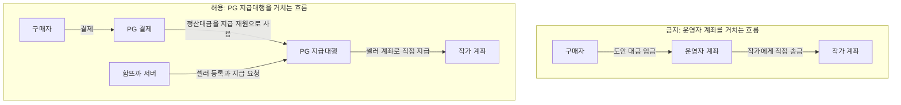
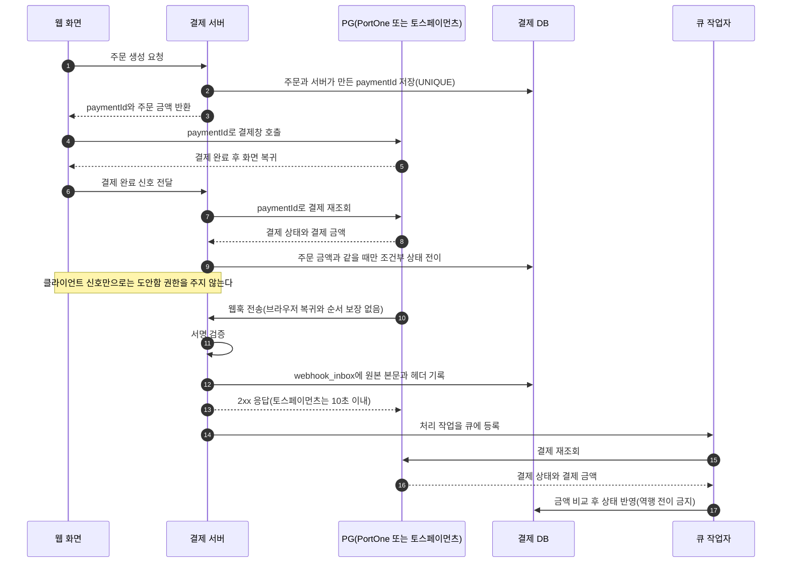

# 결제·정산 구조와 관련 법령 조사

이 문서는 함뜨까가 R4에서 유료 도안 판매와 작가 정산을 시작할 때 적용되는 결제 구조, PG 선택지, 전자금융·전자상거래·세무 요건을 2026-11-18 기준으로 조사한 기록이다. 판매 기능을 설계할 때 허용되는 돈의 흐름, PG별 비용과 기능, 데이터 모델에 반영할 항목, 아직 확인하지 못한 질문을 이 문서에서 함께 확인할 수 있다.

## 이 기록의 범위

이 문서는 2026-11-18에 수행한 조사 결과를 그 시점 기준으로 고정한 기록이다. 이후에는 본문을 고치지 않으며, 정정할 내용이 생기면 문서 끝에 정정 기록을 덧붙인다.

이 문서는 법률 자문이나 세무 자문이 아니다. 조사 자체도 거래 구조, 원천징수, 부가가치세 처리는 세무사와 변호사의 확인을 거쳐야 확정할 수 있다고 결론지었다. 따라서 R4 착수 전에 세무사와 변호사에게 확인한 뒤 최종 결정을 내린다.

이 문서를 읽을 때는 다음 표시를 참고한다.

- 사실마다 출처 번호(S1 등)를 붙였고, 번호를 누르면 원문으로 이동한다. 전체 목록은 [출처](#출처)에 있다.
- 출처에서 직접 확인하지 못하고 추론한 내용에는 "(추정)"을 붙였다.
- 조사 뒤에 따로 교차 검증한 주장과 그 정정 내용은 [검증 결과](#검증-결과)에 있다.
- 이 조사를 근거로 확정한 결정은 [ADR-0009](../decisions/0009-payout-via-pg.md)와 [ADR-0007](../decisions/0007-sales-ready-data-model.md)에 있다.
- 아직 정하지 않은 거래 구조(OD-12), 개인 작가 허용(OD-13), PG 선택(OD-14), 수수료 정책(OD-15), 원천징수 처리(OD-16), 단건 결제(OD-17)는 [결정 목록](../decisions/README.md)에서 관리한다.

## 돈의 흐름: 허용되는 구조와 금지되는 구조

판매 대금이 어떤 경로로 작가에게 가는지에 따라 전자금융거래법상 PG 등록 의무가 생기는지가 갈린다. 아래 그림은 함뜨까가 만들지 않는 흐름과 따르는 흐름을 나란히 보여 준다.

위쪽 흐름에서는 운영자가 구매 대금을 받아 작가에게 정산하므로, PG로 등록하지 않으면 위법이 된다. 아래쪽 흐름에서는 PG가 보유한 정산대금으로 작가에게 직접 지급하고, 함뜨까 서버는 셀러 정보와 지급 요청만 PG에 전달한다.

### PG 등록 의무

- 금융위원회는 플랫폼이 결제대금 정산을 대행하거나 매개하면 전자지급결제대행업(PG) 등록 대상이라고 밝혔다([S1](https://www.fsc.go.kr/no010102/82523)).
- 전문 PG사가 입점업체에 결제대금을 정산하고 플랫폼은 계좌정보처럼 정산에 필요한 정보만 제공하면 등록하지 않아도 된다([S1](https://www.fsc.go.kr/no010102/82523)).
- 등록하지 않고 영업하면 3년 이하 징역 또는 2천만 원 이하 벌금 대상이다([S1](https://www.fsc.go.kr/no010102/82523)).
- "운영자 계좌로 받아 작가에게 직접 송금하면 안 된다"는 결론은 이 자료에서 추론한 것이다. 함뜨까는 이 추론을 ADR-0009의 결정으로 채택했다.

### PG로 직접 등록하기 어려운 이유

- 현행 기준에서 분기별 결제대행 규모가 30억 원을 넘으면 자본금 10억 원 이상이 필요하다([S2](https://www.fsc.go.kr/no010101/85751)).
- 30억 원 이하 구간은 2차 자료 기준으로 자본금 3억 원 이상과 인력·설비 요건을 갖춰야 하지만, 해당 조문 원문은 확인하지 못했다([S2](https://www.fsc.go.kr/no010101/85751)).
- 토스페이먼츠 설명에 따르면 셀러나 크리에이터에게 재정산하는 쇼핑몰과 강의 플랫폼도 등록 대상이며, 2025년 3월까지 등록을 마쳐야 했다([S4](https://www.tosspayments.com/blog/articles/amendment)).
- 1인 운영자가 이 요건을 갖추기는 어려우므로, 외부 PG의 지급대행을 쓰는 것이 현실적인 방법이다.

### 2026-12-17 시행 개정 전자금융거래법

개정법은 PG업의 정의와 PG업자의 정산자금 관리 방식을 바꾼다. 확인한 내용은 다음과 같다.

| 항목 | 내용 | 출처 |
|---|---|---|
| 국회 통과 | 2025-11-27 | [S2](https://www.fsc.go.kr/no010101/85751) |
| 공포 | 2025-12-16 | [S3](https://www.fsc.go.kr/po010106/87151) |
| 시행 | 2026-12-17 | [S3](https://www.fsc.go.kr/po010106/87151) |
| PG업 정의 | '제3자 간 거래의 정산 대행'으로 명확히 함 | [S3](https://www.fsc.go.kr/po010106/87151) |
| 정산자금 외부관리 | 1년차 60%, 2년차 80%, 3년차부터 100% | [S3](https://www.fsc.go.kr/po010106/87151) |
| 외부관리 방법 | 예치, 신탁, 지급보증보험만 허용 | [S3](https://www.fsc.go.kr/po010106/87151) |
| 자본금 상향 | 분기 결제대행 규모 300억 원 초과 구간은 20억 원 | [S3](https://www.fsc.go.kr/po010106/87151) |
| 하위규정 | 2026-07-29까지 의견을 받은 입법예고 단계, 최종본 미확인 | [S3](https://www.fsc.go.kr/po010106/87151) |

- 외부관리 의무는 PG업자에게 부과되므로, 지급대행을 이용하는 플랫폼에는 이 의무가 직접 적용되지 않을 가능성이 높다(추정, [S3](https://www.fsc.go.kr/po010106/87151)).
- 최종 하위규정이 지급대행을 이용하는 플랫폼에 정산기한이나 고지 같은 추가 의무를 두는지는 확인하지 못했다. R4 착수 전에 최종본으로 확인하고, 정산 주기는 설정값으로 관리한다.

### '자기 사업 부수 정산' 예외

입법예고된 하위규정은 자기 사업을 영위하는 과정에서 부수적으로 정산을 대행하는 경우를 PG업에서 제외하되, 대상 법률을 구체적으로 열거한다([S3](https://www.fsc.go.kr/po010106/87151)). 플랫폼이 판매자가 되어 작가에게 수익을 배분하는 판매형 구조(E안)가 이 예외에 해당하는지는 확인하지 못했다([S1](https://www.fsc.go.kr/no010102/82523), [S3](https://www.fsc.go.kr/po010106/87151)).

이 질문은 해결되지 않은 상태로 남아 있다. 거래 구조를 정하는 OD-12에서 최종 하위규정과 법률 검토를 근거로 판단한다.

### 충전식 잔액과 선불전자지급수단

- 충전식 포인트나 지갑 잔액을 도입하면 선불전자지급수단 발행업 등록 문제가 생길 수 있다(추정, [S5](https://www.fsc.go.kr/no010101/82339)).
- 금융위 자료에 따르면 연간 발행액 500억 원 미만이고 발행잔액 30억 원 미만이거나 하나의 가맹점에서만 쓰이는 경우에는 등록 대상에서 제외된다([S5](https://www.fsc.go.kr/no010101/82339)).
- 여러 판매자에게 쓰이는 오픈마켓 충전금은 단일 가맹점 예외에 해당하지 않을 가능성이 있다(추정, [S5](https://www.fsc.go.kr/no010101/82339)).
- ADR-0009는 이 이유로 충전식 잔액을 두지 않고, 할인은 가격 조정이나 쿠폰으로 처리한다.

### 참고: 온라인 중개 플랫폼 정산기한 규제

공정위가 2024년 10월 발표한 대규모유통업법 개정 방안은 중개수익 100억 원 이상이거나 중개거래 규모 1,000억 원 이상인 온라인 중개 플랫폼을 대상으로 한다([S6](https://www.korea.kr/news/policyNewsView.do?newsId=148935237)). 대상 플랫폼은 구매확정 후 20일 이내에 정산하고 판매대금의 50%를 별도로 관리해야 한다([S6](https://www.korea.kr/news/policyNewsView.do?newsId=148935237)).

2026년 9월 국회를 통과한 개정안은 직매입·특약매입 지급기한 단축이 중심이며, 온라인 중개 조항의 최종 입법 여부는 확인하지 못했다([S6](https://www.korea.kr/news/policyNewsView.do?newsId=148935237)). 함뜨까 규모에는 해당하지 않지만, 정산 주기를 설정값으로 두면 이후 규제에 대응하기 쉽다.

## PG 선택지 비교

조사는 국내 1인 운영자가 검토할 수 있는 결제·정산 구성을 A안부터 F안까지 여섯 가지로 비교했다. 어느 안을 쓸지는 OD-14에서 정하며, 개인 작가를 받을지(OD-13)를 먼저 정해야 PG를 고를 수 있다. 지급대행 재원은 해당 PG의 정산대금이므로 결제 PG와 지급대행 PG는 같은 회사로 맞춘다([S8](https://www.tosspayments.com/blog/articles/30365)).

### 비용

| 안 | 구성 | 결제 수수료 | 지급대행 요금 |
|---|---|---|---|
| A | 토스페이먼츠 결제와 지급대행 | 가입비 22만 원, 연관리비 11만 원, 카드 3.4%, 계좌이체 2.0%(최저 200원), 가상계좌 건당 400원 ([S12](https://www.tosspayments.com/about/fee)) | 월 30만 원, 월 1,000건 포함, 초과 건당 100원(2024-09 공지 기준, [S9](https://www.tosspayments.com/blog/articles/30355)) |
| B | PortOne V2 결제, 파트너 정산 자동화, 지급대행 PG | 월 순 거래액 5,000만 원 미만이면 PortOne 결제 인프라 무료, 하위 PG 수수료 별도 ([S19](https://blog.portone.io/pricing-plan-updates/)) | 파트너 정산 요금 미공개, 지급대행 PG 요금 별도 ([S19](https://blog.portone.io/pricing-plan-updates/)) |
| C | KG이니시스 결제와 지급대행 | 확인하지 못함 | 월 10만 원 정액(551건부터 건당 200원) 또는 건당 300원(2022년 기준, [S22](https://inicis-service.inicis.com/wp-content/uploads/2023/download/payment-agency/%5BKG이니시스%5D지급대행서비스_소개서_ver9.0_220809.pdf)) |
| D | 나이스페이 결제와 지급대행 | 베이직 등록비 33만 원(부가세 포함), 카드 3.5%(D+7), 계좌이체 2.5%, 가상계좌 건당 300원 ([S24](https://www.nicepay.co.kr/apply/guide/fee.do)) | 미공개 ([S24](https://www.nicepay.co.kr/apply/guide/fee.do)) |
| E | 플랫폼 판매형(작가에게 수익 배분) | 일반 PG 수수료(카드 3.4~3.5% 수준)와 세무 대리 비용 | 들지 않을 수 있음(추정) |
| F | Stripe Connect | 한국 사업자 미지원 ([S7](https://stripe.com/global)) | 해당 없음 |

- 따로 표시하지 않은 금액은 부가세 별도다. 토스페이먼츠 계좌 유효성 인증은 건당 50원이다([S12](https://www.tosspayments.com/about/fee)).
- 휴대폰 결제는 디지털 콘텐츠에 더 높은 요율이 붙는다. 토스페이먼츠는 7.0%(실물 3.5%), 나이스페이 베이직은 9%다([S12](https://www.tosspayments.com/about/fee), [S24](https://www.nicepay.co.kr/apply/guide/fee.do)).
- 나이스페이 스페셜 요금제는 등록비 55만 원, 카드 2.9%(D+3)다([S24](https://www.nicepay.co.kr/apply/guide/fee.do)).
- 토스페이먼츠 요금 페이지에는 기준일이 없고, 지급대행 요금도 표시되어 있지 않다([S12](https://www.tosspayments.com/about/fee)). 지급대행 요금은 계약 시점에 다시 확인한다.

### 기능과 준비 기간

| 안 | 개인 작가 지급 | 웹훅 | 준비 기간 |
|---|---|---|---|
| A | 개인 셀러 등록 가능(INDIVIDUAL) ([S10](https://docs.tosspayments.com/en/integration-payouts)) | 결제 웹훅, seller.changed, payout.changed ([S10](https://docs.tosspayments.com/en/integration-payouts)) | 3~5주(추정) |
| B | 원천징수 대상자 파트너 유형 있음, 실제 지급은 지급대행 PG 조건을 따름 ([S17](https://developers.portone.io/api/rest-v2/platform.partner)) | Standard Webhooks 서명 ([S20](https://developers.portone.io/opi/ko/integration/webhook/readme-v2)) | 4~6주(추정) |
| C | 사업자번호를 비워 두고 등록 가능 ([S22](https://inicis-service.inicis.com/wp-content/uploads/2023/download/payment-agency/%5BKG이니시스%5D지급대행서비스_소개서_ver9.0_220809.pdf)) | 확인하지 못함 | 4~6주(추정) |
| D | 서브몰 사업자번호 필수 표기로 불분명 ([S23](https://developers.nicepay.co.kr/docs/pg/add/payout/)) | 없음, 결과조회 API 폴링 필요 ([S23](https://developers.nicepay.co.kr/docs/pg/add/payout/)) | 5~8주(추정) |
| E | 사업자등록 없이 원천징수 후 수익 배분 | 선택한 PG를 따름 | 3~4주(추정) |
| F | 해당 없음 | 해당 없음 | 해당 없음 |

- 준비 기간은 카드사 심사, 지급대행 계약, 개발 기간을 더해 조사에서 추정한 값이다.
- 개인 작가 지급 가능 여부는 PG마다 다르다. PortOne 블로그는 대부분의 PG 지급대행이 개인(비사업자) 파트너를 지원하지 않는다고 설명한다([S25](https://blog.portone.io/ps_platform-payment-settlement/)).
- 반면 토스페이먼츠와 KG이니시스 문서는 개인 셀러 등록을 허용하므로, 개인 작가를 받으려면 PG별 계약 조건을 직접 확인해야 한다([S10](https://docs.tosspayments.com/en/integration-payouts), [S25](https://blog.portone.io/ps_platform-payment-settlement/)).
- 프로젝트 소유자가 토스페이먼츠와 PortOne V2 연동 경험이 있다는 점은 조사에서 A안과 B안의 장점으로 꼽았다.

### A안: 토스페이먼츠 결제와 지급대행

- 지급대행은 가맹점(플랫폼)의 정산대금을 재원으로 토스페이먼츠가 셀러 계좌에 직접 지급하는 구조다([S8](https://www.tosspayments.com/blog/articles/30365)).
- 바로지급(당일)과 예약지급(D+1부터 최대 1년, D-1까지 취소 가능)이 있다([S8](https://www.tosspayments.com/blog/articles/30365)).
- 1회 요청은 최대 100건, 10억 원 미만이고 원화만 지원하며, 이체는 영업일 08:00~15:00에 처리된다([S8](https://www.tosspayments.com/blog/articles/30365)).
- 이용료는 최초 셀러 지급이 발생한 달부터 부과되고, 그 뒤에는 지급이 없는 달에도 매월 부과된다([S8](https://www.tosspayments.com/blog/articles/30365)). 이용 신청 후 심사와 계약에 1~3영업일이 걸린다([S9](https://www.tosspayments.com/blog/articles/30355)).
- 셀러 등록에는 refSellerId(7~20자, 재사용 불가), businessType(INDIVIDUAL, INDIVIDUAL_BUSINESS, CORPORATE), 계좌 정보가 필요하다([S10](https://docs.tosspayments.com/en/integration-payouts)).
- 개인과 개인사업자 셀러는 APPROVAL_REQUIRED(본인확인 전, 지급 불가)에서 시작해 PARTIALLY_APPROVED(주 1천만 원까지)로 바뀐다([S10](https://docs.tosspayments.com/en/integration-payouts)). 법인 셀러의 초기 상태는 확인하지 못했다.
- 7일 안에 1천만 원을 넘으면 KYC_REQUIRED가 되고 해당 요청은 취소된다([S10](https://docs.tosspayments.com/en/integration-payouts)). 이 7일이 이동 구간인지 고정 주간인지는 문서에 없다.
- KYC 서류는 온라인으로만 접수하고, 조건에 맞으면 2영업일 안에 심사가 끝나며, 대상이 되기 전에는 미리 접수할 수 없다([S11](https://www.tosspayments.com/blog/articles/30417)).
- KYC를 마치면 APPROVED가 되고, 위험도에 따라 1년 또는 3년마다 KYC를 다시 받는다([S10](https://docs.tosspayments.com/en/integration-payouts)).
- 셀러 등록과 지급 요청 본문은 보안 키로 JWE(dir, A256GCM) 암호화해야 한다([S10](https://docs.tosspayments.com/en/integration-payouts)).
- 한 요청에서 한 건이 실패하면 전체가 실패하고, 성공한 요청도 나중에 FAILED가 될 수 있다([S10](https://docs.tosspayments.com/en/integration-payouts)).
- EXPRESS 지급은 취소할 수 없고, 라이브 모드에서 테스트 지급을 해도 요금이 부과된다([S10](https://docs.tosspayments.com/en/integration-payouts)).
- 매출이 적은 초기에는 월 고정비가 매출보다 클 수 있으므로, 판매 개시 시점과 지급 주기를 이 비용을 기준으로 정한다([S9](https://www.tosspayments.com/blog/articles/30355)).

### B안: PortOne V2와 파트너 정산 자동화

- 파트너 유형은 BUSINESS(사업자), WHT_PAYER(원천징수 대상자), NON_WHT_PAYER(원천징수 비대상자)다([S17](https://developers.portone.io/api/rest-v2/platform.partner)).
- 원천징수 대상자는 주민등록번호가 아니라 생년월일을 받는다([S17](https://developers.portone.io/api/rest-v2/platform.partner)).
- 원화 계좌는 예금주 조회로 검증하며, 검증 상태는 VERIFIED, VERIFY_FAILED, VERIFY_ERROR 등이다([S17](https://developers.portone.io/api/rest-v2/platform.partner)).
- 지급 방식 enum에는 DIRECT와 AGENCY가 있지만 문서에 정의가 없고, 일부 API는 UNSTABLE로 표시되어 있다([S17](https://developers.portone.io/api/rest-v2/platform.partner)).
- 개요 문서는 주문별 중개수수료, 부가세, 할인 분담금을 자동 계산하고, 이체는 뱅킹앱 엑셀이나 지급대행으로 자동화한다고 설명한다([S17](https://developers.portone.io/api/rest-v2/platform.partner)).
- 원천징수 대상 파트너에게 3.3%를 자동 차감하는 기능과 세금계산서 역발행 기능은 홍보 글로만 확인했다(추정, [S18](https://blog.portone.io/ps_inflab/)).
- PortOne 블로그는 PG 지급대행을 쓰더라도 정산 금액은 플랫폼이 계산해야 하고, PG를 여러 개 쓰면 계약도 따로 해야 한다고 지적한다([S25](https://blog.portone.io/ps_platform-payment-settlement/)).
- 5,000만 원 이상 구간의 Growth 요금은 이미지로만 제공되어 확인하지 못했고, 2026년 11월 현재 같은 요금제인지도 확인하지 못했다([S19](https://blog.portone.io/pricing-plan-updates/)).

### C안: KG이니시스 결제와 지급대행

- 2022년 8월 소개서(ver9.0)에 따르면 서브몰 계좌를 계좌성명조회로 검증하고, 개인 판매자는 사업자번호를 비워 두고 등록할 수 있다([S22](https://inicis-service.inicis.com/wp-content/uploads/2023/download/payment-agency/%5BKG이니시스%5D지급대행서비스_소개서_ver9.0_220809.pdf)).
- 이니시스가 오픈마켓 대신 거래금액을 보유하고 이체하며, 잔액이 부족하면 지급일 전날 18시까지 현금을 입금해 채울 수 있다([S22](https://inicis-service.inicis.com/wp-content/uploads/2023/download/payment-agency/%5BKG이니시스%5D지급대행서비스_소개서_ver9.0_220809.pdf)).
- 매출전표와 현금영수증의 발행 주체는 가맹점(오픈마켓)이므로, 부가세 처리를 세무사와 정리해야 한다([S22](https://inicis-service.inicis.com/wp-content/uploads/2023/download/payment-agency/%5BKG이니시스%5D지급대행서비스_소개서_ver9.0_220809.pdf)).
- 공개 자료가 2022년 소개서뿐이어서 현행 요금, API 방식, 웹훅 지원 여부를 다시 확인해야 한다.

### D안: 나이스페이 결제와 지급대행

- 서브몰 등록 때 예금주를 검증하지만, 사업자번호(subCoNo)가 필수 항목이고 등록 후 수정할 수 없다([S23](https://developers.nicepay.co.kr/docs/pg/add/payout/)). 개인 판매자 지원 여부는 문서에 없다.
- 지급 요청과 취소는 지급일 10:30에 마감되고, 지급은 11:00~14:00에 처리되며, 결과는 16:00 이후 조회할 수 있다([S23](https://developers.nicepay.co.kr/docs/pg/add/payout/)).
- 요청 시 잔액을 검증하지 않으므로 잔액조회 API로 미리 확인해야 한다([S23](https://developers.nicepay.co.kr/docs/pg/add/payout/)).
- 테스트 계정은 영업 협의 후에 받을 수 있다([S23](https://developers.nicepay.co.kr/docs/pg/add/payout/)).

### E안: 플랫폼 판매형

- 플랫폼이 통신판매업자로서 도안을 직접 팔고, 작가와는 라이선스·수익 배분 계약을 맺는 방식이다. 마플샵이 이 방식을 쓴다([S40](https://docs.channel.io/marppleshop_help/ko/articles/%EB%94%94%EC%A7%80%ED%84%B8-%EC%83%81%ED%92%88-%EC%A0%95%EC%82%B0-1de782a5)).
- 마플샵은 디지털·전자책 상품에서 판매 수수료 13.75%와 결제 수수료 3.52%(부가세 포함)를 떼고, 구매 완료 즉시 구매를 확정한다([S40](https://docs.channel.io/marppleshop_help/ko/articles/%EB%94%94%EC%A7%80%ED%84%B8-%EC%83%81%ED%92%88-%EC%A0%95%EC%82%B0-1de782a5)).
- 판매자 신원정보 표시와 중개자 고지 같은 중개형 의무는 줄어들지만, 플랫폼이 모든 판매의 부가세 신고 주체가 되고 청약철회와 환불 책임을 직접 진다.
- 작가별 원천징수 신고와 지급명세서 제출 부담이 생기고, 누구나 판매자로 등록하는 오픈마켓 구조와는 다르다.
- 자기 판매대금으로 작가에게 비용을 지급하는 것이 '제3자 간 정산 대행'에 해당하지 않는지 법률 확인이 필요하다([S3](https://www.fsc.go.kr/po010106/87151)).

### F안: Stripe Connect

Stripe 글로벌 지원국 목록의 아시아·태평양 국가에 한국이 없고, Preview나 초청 목록에도 없다([S7](https://stripe.com/global)). 해외 법인을 세워야만 쓸 수 있으므로 국내 1인 운영자의 선택지에서 제외한다.

## 결제 확인과 웹훅 처리

조사는 결제 완료를 클라이언트 신호가 아니라 서버의 PG 재조회로 확정하고, 웹훅은 기록과 응답만 한 뒤 큐에서 처리하는 흐름을 제안했다. [ADR-0001](../decisions/0001-monorepo-structure.md)에 따라 R4에서 추가하는 apps/api(Spring)가 아래 그림의 결제 서버 역할을 맡는다.

1~9단계는 브라우저 경로이고, 10~17단계는 웹훅 경로다. 두 경로 모두 PG 재조회와 금액 비교를 거쳐야 상태를 바꾸며, 어느 쪽이 먼저 도착해도 같은 결과가 나오도록 조건부 UPDATE를 쓴다.

### 결제 ID와 금액 검증

- PortOne V2에서는 고객사가 paymentId를 직접 만들고, 같은 paymentId로는 결제가 한 번만 성공한다([S21](https://developers.portone.io/opi/ko/integration/start/v2/checkout)).
- 결제 후 서버가 /payments/{paymentId}를 조회해 amount.total을 주문 금액과 비교하는 절차가 필수로 안내된다([S21](https://developers.portone.io/opi/ko/integration/start/v2/checkout)).
- 따라서 결제 ID는 서버에서 만들어 UNIQUE로 저장하고, 클라이언트가 보낸 결제 완료 신호만으로 도안함 권한을 주지 않는다.

### PG별 웹훅 규격

| 항목 | 토스페이먼츠 | PortOne V2 |
|---|---|---|
| 성공 조건 | 10초 안에 200 응답 ([S15](https://docs.tosspayments.com/guides/v2/webhook)) | 연결·읽기 타임아웃 각 30초 ([S20](https://developers.portone.io/opi/ko/integration/webhook/readme-v2)) |
| 재전송 | 최대 7회, 1·4·16·64·256·1024·4096분 간격 ([S14](https://docs.tosspayments.com/en/webhooks)) | 최대 5회, 0·1·4·16·64·256분 간격에 무작위 지연 추가 ([S20](https://developers.portone.io/opi/ko/integration/webhook/readme-v2)) |
| 서명 | 문서에 서명 헤더 설명 없음 ([S14](https://docs.tosspayments.com/en/webhooks)) | Standard Webhooks 규격 ([S20](https://developers.portone.io/opi/ko/integration/webhook/readme-v2)) |
| 중복 제거 키 | 지급 웹훅은 재전송에도 같은 eventId, PAYMENT_STATUS_CHANGED는 eventId 없음 ([S14](https://docs.tosspayments.com/en/webhooks)) | 조사에서 따로 확인하지 않음 |
| 멱등 키 | 모든 POST에 Idempotency-Key, 최대 300자, 15일 유효 ([S16](https://docs.tosspayments.com/reference/using-api/idempotency-key)) | Idempotency-Key, 16~256자의 영문·숫자·`-`·`_` ([S21](https://developers.portone.io/opi/ko/integration/start/v2/checkout)) |

- 토스페이먼츠는 가상계좌 `DEPOSIT_CALLBACK` 웹훅을 받은 서버가 본문의 `secret` 값을 결제 객체의 `secret` 값과 비교하도록 안내한다([S14](https://docs.tosspayments.com/en/webhooks)).
- 토스페이먼츠 결제 웹훅에는 eventId가 없으므로, webhook_inbox에서는 본문 해시나 결제 ID와 상태 조합 같은 별도 키로 중복을 거른다([S14](https://docs.tosspayments.com/en/webhooks)).
- 토스페이먼츠에서 첫 요청이 아직 처리 중일 때 같은 Idempotency-Key로 다시 요청하면 409 IDEMPOTENT_REQUEST_PROCESSING을 반환한다([S16](https://docs.tosspayments.com/reference/using-api/idempotency-key)).
- PortOne 웹훅 시크릿은 환경별로 2개까지 동시에 발급할 수 있어 무중단 교체가 가능하다([S20](https://developers.portone.io/opi/ko/integration/webhook/readme-v2)).
- PortOne은 IP 필터를 쓸 경우 52.78.5.241을 허용하라고 안내한다. 웹훅 내용을 그대로 믿지 말고 서명을 검증하거나 결제 조회 API로 다시 확인하라고도 안내한다([S20](https://developers.portone.io/opi/ko/integration/webhook/readme-v2)).
- PortOne 웹훅에서 알 수 없는 type과 필드는 무시해야 한다([S20](https://developers.portone.io/opi/ko/integration/webhook/readme-v2)).
- PortOne은 TypeScript 서버 SDK(npm 0.19.0)와 JVM 서버 SDK(io.portone:server-sdk 0.24.0)를 모두 제공하므로, Spring 서버에서도 SDK로 웹훅을 검증할 수 있다([S26](https://repo1.maven.org/maven2/io/portone/server-sdk/maven-metadata.xml)).
- 각 PG의 결제·지급 API가 호출 서버의 고정 IP 등록을 요구하는지는 확인하지 못했다. 이 결과에 따라 고정 출구 IP를 어떻게 마련할지가 정해진다.

## 전자상거래법과 청약철회

### 통신판매중개자의 의무

- 전자상거래법 제20조의2는 통신판매중개자에게 '통신판매의 당사자가 아니라는 사실'을 미리 고지하고, 사업자 판매자의 신원정보를 확인해 청약 전에 제공하도록 요구한다([S28](https://casenote.kr/법령/전자상거래_등에서의_소비자보호에_관한_법률/제20조의2)).
- 고지를 하지 않으면 판매자의 고의·과실로 생긴 소비자 손해를 연대 배상해야 한다([S28](https://casenote.kr/법령/전자상거래_등에서의_소비자보호에_관한_법률/제20조의2)).
- 신원정보를 제공하지 않거나 사실과 다르면 연대 배상하되, 상당한 주의를 기울였다면 면책된다([S28](https://casenote.kr/법령/전자상거래_등에서의_소비자보호에_관한_법률/제20조의2)).
- 중개자가 통신판매업자를 겸하면 제12조~제15조, 제17조, 제18조에 따른 판매자 책임도 진다([S28](https://casenote.kr/법령/전자상거래_등에서의_소비자보호에_관한_법률/제20조의2)).
- 현행본은 법률 제21312호(2026-01-20 공포, 2026-07-21 시행)다([S27](https://www.law.go.kr/법령/전자상거래등에서의소비자보호에관한법률/제20조의2)).
- 다만 고지, 신원정보 제공, 연대 배상 의무는 2012년 2월 신설된 조항이며 2026년 개정으로 새로 생긴 의무가 아니다. 2026년 개정이 이 조문에서 무엇을 바꿨는지는 확인하지 못했다([S27](https://www.law.go.kr/법령/전자상거래등에서의소비자보호에관한법률/제20조의2)).

### 개인 판매자 신원정보 축소(2026-07-21)

- 중개자가 개인 판매자에 대해 확인할 신원정보는 전화번호와 전자우편주소 두 가지로 줄었다([S29](https://eiec.kdi.re.kr/policy/materialView.do?num=284229)).
- 본인확인기관으로 확인한 신원정보를 이미 보유하면 전화번호만 확인해도 된다([S29](https://eiec.kdi.re.kr/policy/materialView.do?num=284229)).
- 이 변경의 시행일(2026-07-21)은 공정위 자료가 아니라 언론 보도로 확인했다.
- 다음 세부 내용은 블로그 자료에만 있고 1차 출처로 확인하지 못했다([S30](https://thecodit.com/blog/e-commerce-act-amendment-kr)).
  - 분쟁이 생기면 분쟁조정기구나 법원에 개인 판매자 정보와 거래내역을 제공하고, 소비자 요청에 따른 제공은 판매자가 동의한 경우에만 가능하다.
  - 개인 판매자와 사업자 판매자가 섞여 있으면 둘을 구분해 표시해야 한다.
  - 결제대금예치(에스크로)를 쓸 수 있으면 개인 판매자와 소비자에게 알리고 이용을 권고해야 한다.
- 조사는 선지급식 통신판매의 에스크로 의무가 신용카드 결제와 정보통신망으로 전송되는 재화에는 적용되지 않는다고 보았다(추정, [S31](https://thecheck.co.kr/online-store-escrow-consumer-protection/)). 제24조 제3항 원문은 확인하지 못했다.

### 디지털콘텐츠 청약철회

| 근거 | 내용 | 함뜨까에 주는 영향 |
|---|---|---|
| 제17조 제2항 제5호 | 디지털콘텐츠는 제공이 시작되면 청약철회가 제한된다. 가분적 콘텐츠는 제공이 시작되지 않은 부분을 철회할 수 있다 | 첫 다운로드 시각이 제공 개시 시점이 된다 |
| 제17조 제6항 | 사업자가 표시와 시험사용 조치를 하지 않으면 소비자는 철회할 수 있다 | "디지털 도안 환불 불가" 고지만으로는 부족하다 |
| 시행령 제21조의2 | 일부 이용(미리보기), 한시적 이용, 체험용 콘텐츠 제공 가운데 하나를 요구하고, 곤란하면 콘텐츠 정보를 제공하게 한다 | 유료 도안에 미리보기와 상세 정보(난이도, 게이지, 필요 실)를 필수로 받는다 |
| 3개월·30일 특례 | 표시·광고나 계약 내용과 다르면 공급받은 날부터 3개월, 그 사실을 안 날부터 30일 안에 철회할 수 있고, 이 특례는 일반 제한보다 우선한다 | 단수나 콧수 오류가 있는 도안은 다운로드 후에도 환불 대상이 될 수 있다 |
| 대법원 2018다214746 | 철회 제한 사유와 표시 의무를 이행했다는 사실은 사업자가 증명해야 한다 | 결제 화면 문구, 약관 버전, 동의 시각, 첫 다운로드 시각을 기록한다 |

- 제17조와 시행령 제21조의2의 내용은 법제처 찾기쉬운 생활법령정보로 확인했으며, 이 페이지에는 기준일이 표시되어 있지 않다([S32](https://www.easylaw.go.kr/CSP/CnpClsMainBtr.laf?ccfNo=4&cciNo=1&cnpClsNo=2&csmSeq=835&menuType=onhunqna)).
- 3개월·30일 특례는 [S33](https://korea.legal/wiki/%ec%a0%84%ec%9e%90%ec%83%81%ea%b1%b0%eb%9e%98-%eb%93%b1%ec%97%90%ec%84%9c%ec%9d%98-%ec%86%8c%eb%b9%84%ec%9e%90%eb%b3%b4%ed%98%b8%ec%97%90-%ea%b4%80%ed%95%9c-%eb%b2%95%eb%a5%a0/), 대법원 판단은 [S34](https://korea.legal/wiki/2018%eb%8b%a4214746/)에서 확인했다.
- 판매자에게 지급한 뒤에도 환불이 생길 수 있으므로, 원장에서 판매자 잔액이 음수가 되는 경우를 허용하고 다음 정산에서 상계하는 구조가 필요하다([S33](https://korea.legal/wiki/%ec%a0%84%ec%9e%90%ec%83%81%ea%b1%b0%eb%9e%98-%eb%93%b1%ec%97%90%ec%84%9c%ec%9d%98-%ec%86%8c%eb%b9%84%ec%9e%90%eb%b3%b4%ed%98%b8%ec%97%90-%ea%b4%80%ed%95%9c-%eb%b2%95%eb%a5%a0/)).
- ADR-0007은 무료 배포 단계부터 첫 다운로드 시각과 동의 기록을 남기도록 정했으므로, 판매로 전환할 때 이 기록을 그대로 쓴다.
- 공정위 디지털콘텐츠 표준약관의 청약철회 조항은 원문으로 확인하지 못했다.

## 세무

이 절의 내용은 세무 판단의 근거를 모은 것이며, 실제 처리 방식은 OD-16에서 세무사 확인을 거쳐 정한다.

### 부가가치세 과세 여부(추정)

- 디지털 뜨개 도안 판매는 원칙적으로 부가가치세 10% 과세 대상일 가능성이 높다(추정, [S37](https://ai.bznav.com/contents/3346905)).
- 도서 면세에는 전자출판물이 포함되지만, 신고한 출판사가 발행하고 ISBN 등 식별번호와 문화체육관광부 기준을 갖춘 경우로 한정된다([S37](https://ai.bznav.com/contents/3346905)).
- 개인 작가의 PDF 도안은 이 요건을 갖추지 못하는 경우가 많다고 추정한다([S37](https://ai.bznav.com/contents/3346905)).
- 조세심판원이 웹툰 파일 공급을 전자출판물로 본 사례도 있으므로, 상품별 판단은 세무사 확인이 필요하다([S37](https://ai.bznav.com/contents/3346905)).
- 지급대행 구조에서 매출전표와 현금영수증의 발행 주체가 플랫폼이면, 플랫폼의 과세표준을 판매 총액으로 볼지 수수료로 볼지 세무사와 PG에 확인해야 한다.

### 판매 중개 명세 제출(부가가치세법 제75조)

- 현행 제75조(법률 제20776호, 2025-07-01 시행)는 부가통신사업자로서 통신판매업자의 판매를 대행·중개하는 자에게 관련 명세 제출 의무를 지운다([S35](https://casenote.kr/법령/부가가치세법/제75조)).
- 결제대행업체와 전자금융업자 등도 제출 대상이며, 제출 기한은 매 분기 말일의 다음 달 15일이다([S35](https://casenote.kr/법령/부가가치세법/제75조)).
- 2025년 개정으로 제출 대상이 넓어졌고, 명세는 국세청에 전자로 제출한다([S36](https://www.taxnet.co.kr/contents/taxnetpost/post-detail?id=4752)).
- 조문에는 '월별' 명세라는 표현이 없다. 월별 정리는 시행령 위임 사항으로 보이지만 시행령 원문은 확인하지 못했다([S35](https://casenote.kr/법령/부가가치세법/제75조)).
- 열린 질문: 조문이 '부가통신사업자로서'라는 요건을 두므로, 부가통신사업 신고 면제 대상인 소규모 운영자도 제출 대상인지 확인해야 한다([S35](https://casenote.kr/법령/부가가치세법/제75조)).
- 자본금 1억 원 이하 소규모 부가통신사업자는 신고가 면제되는 것으로 보이지만, 전기통신사업법 시행령 원문은 확인하지 못했다(추정, [S45](https://www.findsemusa.com/service/consult/consultView.do?qidx=22572)).
- 소규모 면제 기준이 있는지도 확인하지 못했으므로, 판매자별 월간 거래 집계를 미리 만들어 두고 제출 의무는 세무사에게 확인한다.

### 작가 소득의 원천징수: 3.3%와 8.8%

| 구분 | 원천징수 방식 | 적용 대상 |
|---|---|---|
| 사업소득(인적용역) | 지급액의 3.3% | 계속·반복적인 소득 |
| 기타소득 | 필요경비 60%를 뺀 금액에 20%와 지방소득세, 실효 8.8% | 원고료나 인세처럼 원작자로서 받는 일시적 창작 소득 |

- 기타소득금액이 건별 5만 원 이하이면 소득세를 과세하지 않는다([S38](https://www.watax.kr/employment/other-income-withholding-tax-guide)).
- 원천징수한 세액은 다음 해 5월 종합소득세 신고에서 정산된다([S38](https://www.watax.kr/employment/other-income-withholding-tax-guide)).
- 도아니티는 판매자 정산을 개인 사업소득으로 처리하고, 출금 시 3.3%를 원천징수하며, 매월 1회 다음 달 15일에 지급한다([S43](https://doanity.notion.site/c6f0e716dc74489184aab1ea2f021d9e), [S44](https://doanity.notion.site/55f67d68f04b4fd6aba2a3fb4f78c7ef)).
- 판매형인 마플샵은 개인 크리에이터의 출금 신청 시점에 부가가치세와 원천징수세를 계산하고 플랫폼이 대신 신고·납부한다. 사업자 크리에이터는 세금계산서를 발행한 뒤 출금한다([S40](https://docs.channel.io/marppleshop_help/ko/articles/%EB%94%94%EC%A7%80%ED%84%B8-%EC%83%81%ED%92%88-%EC%A0%95%EC%82%B0-1de782a5)).
- 열린 질문: 중개형에서 플랫폼이 판매대금을 전달할 때 원천징수 의무가 생기는지는 공식 근거를 찾지 못했다.
- 열린 질문: 도안 판매 대금을 사업소득, 기타소득, 원천징수 비대상 가운데 무엇으로 처리할지 세무사에게 확인해야 한다.

### 2027년 원천징수세율 인하안(미확정)

- 정부의 2026년 세제개편안(2026-08-03 발표)은 인적용역 사업소득 원천징수세율을 3%에서 2%로 낮춘다. 지방세를 포함하면 3.3%에서 2.2%가 된다([S39](https://www.sejungilbo.com/news/articleView.html?idxno=59503)).
- 여러 보도는 2027-01-01 이후 지급분부터 적용될 예정이라고 전하지만, 국회 통과 여부는 확인하지 못했다([S39](https://www.sejungilbo.com/news/articleView.html?idxno=59503)).
- 따라서 원천징수세율은 코드 상수로 넣지 않고, ADR-0007에 따라 적용 시작일이 있는 설정 테이블로 관리한다.

### 현금영수증

- 현금영수증 의무발행업종은 2026년에 4개가 추가되어 142개가 되었다([S41](https://www.heraldk.com/article/2025121818403758188)).
- 의무발행업종은 건당 10만 원 이상 현금 거래에서 요청이 없어도 5일 안에 발급해야 하며, 미발급 시 미발급 금액의 20%가 가산세로 부과된다([S41](https://www.heraldk.com/article/2025121818403758188)).
- 도안 중개·판매 업종이 의무발행업종에 해당하는지는 확인하지 못했다. 계좌이체와 가상계좌의 현금영수증은 PG가 발급해 주는 경우가 많다([S41](https://www.heraldk.com/article/2025121818403758188)).

### 통신판매업 신고와 사업자등록

- 통신판매업 신고는 직전년도 거래 50회 미만이거나 간이과세자이면 면제된다는 2차 자료가 있다(추정, [S42](https://thecheck.co.kr/mail-order-business-report-exemption/)). 공정위 고시 원문은 확인하지 못했다.
- 면제 대상이어도 PG 심사에서 신고번호를 요구할 수 있고, 신고번호가 없으면 국민카드 심사에서 제외된다([S13](https://www.tosspayments.com/blog/articles/53711)). 따라서 유료 판매 전에 신고를 마치는 일정으로 계획한다.
- 통신판매중개업자 자체가 통신판매업 신고 대상인지는 공식 해석을 찾지 못했다. 사업자등록 업종 코드와 함께 관할 구청과 세무서에 확인한다.
- Vercel 이용약관 제4조는 Hobby 플랜을 개인적이거나 비상업적인 용도로만 쓰게 한다([S46](https://vercel.com/legal/terms)). 사업자등록 시점(OD-04)은 이 조건과 함께 정한다.

## PG 심사 준비물

PG 계약 뒤에는 카드사 심사를 통과해야 결제를 받을 수 있다. 아래 항목은 토스페이먼츠 체크리스트(2026-10-06) 기준이며, 이 글에는 디지털 콘텐츠나 무형상품을 따로 다루는 심사 항목이 없다([S13](https://www.tosspayments.com/blog/articles/53711)).

| 준비물 | 내용 |
|---|---|
| 사이트 하단 표시 | 사업자등록번호, 고객센터 연락처, 이메일, 통신판매업 신고번호 |
| 환불 정책 | 사이트에 게시 |
| 판매 상품 | 바로 구매할 수 있는 상품 1개 이상 |
| 금액 일치 | 상품 금액과 결제 금액이 같아야 함 |
| 통신판매업 신고번호 | 없으면 국민카드 심사에서 제외(간이과세자 등은 예외) |
| 심사 기간 | 계약 후 최대 10~14영업일 |
| 지급대행 신청 | 토스페이먼츠 기준 심사와 계약에 1~3영업일([S9](https://www.tosspayments.com/blog/articles/30355)) |

조사는 유료 판매 준비 순서를 다음과 같이 제안했다.

1. 사업자등록을 한다.
2. 통신판매업 신고를 한다.
3. 사이트 하단 사업자 정보, 중개자 고지, 환불 정책 같은 법적 표시 요소를 구현한다.
4. PG 계약을 맺고 카드사 심사를 받는다(최대 10~14영업일).
5. 지급대행을 신청한다(1~3영업일).
6. 세무 자문을 받는다.

초기에는 판매자를 사업자로 한정하는 단계를 두면 세무 처리의 복잡도를 줄일 수 있다고 조사는 덧붙였다. R4 진입 조건(사업자등록, 통신판매업 신고, 거래 구조 ADR과 PG ADR 확정)은 [로드맵](../product/roadmap.md)에 있다.

## 데이터 모델에 주는 시사점

조사는 판매 기능을 붙일 때 데이터를 다시 옮기지 않도록 아래 항목을 제안했다. 판매자 프로필 분리, 도안함 기록, 가격 0원 제약, 첫 다운로드 시각, 동의 기록, 적용일이 있는 요율 설정은 [ADR-0007](../decisions/0007-sales-ready-data-model.md)에서 확정했다. PG 지급대행으로만 정산하고 충전식 잔액을 두지 않는 원칙은 [ADR-0009](../decisions/0009-payout-via-pg.md)에서 확정했다.

나머지 항목은 R4 설계 단계에서 다시 검토한다. 주문, 결제, 원장, 지급 테이블이 들어갈 commerce 스키마는 [ADR-0006](../decisions/0006-migration-ownership.md)에 따라 Spring Flyway가 소유한다.

- 거래 구조: order_items에 seller_of_record(PLATFORM 또는 DESIGNER)를 두어 중개형과 판매형을 모두 수용한다. 이 선택에 따라 부가세 신고 주체, 원천징수, 영수증 발행 주체, 전자상거래법상 책임이 달라진다.
- 판매자 프로필: users와 seller_profiles를 분리한다. seller_profiles에는 legal_type(INDIVIDUAL, INDIVIDUAL_BUSINESS, CORPORATE), 사업자등록번호, 과세유형(일반, 간이), 통신판매업 신고번호를 저장한다.
- 판매자 확인 정보: seller_profiles에 원천징수 구분(BUSINESS, WHT_PAYER, NON_WHT_PAYER), 전화번호와 이메일, 본인확인 여부와 수단, 개인·사업자 구분 표시 여부를 함께 둔다.
- PG 셀러 상태: seller_profiles에 PG 셀러 ID(refSellerId)와 PG 셀러 상태(APPROVAL_REQUIRED, PARTIALLY_APPROVED, KYC_REQUIRED, APPROVED)를 저장한다.
- 정산 계좌: seller_payout_accounts에 은행 코드, 암호화한 계좌번호, 예금주, 검증 시각, 검증 수단, 검증 결과를 이력으로 쌓고 기존 행을 덮어쓰지 않는다.
- 주민등록번호: 저장하지 않는다. 원천징수 대상자는 PortOne처럼 생년월일만 받는다.
- 도안: patterns에 price(R4 전까지 0만 허용하는 CHECK 제약), currency(KRW), 부가세 포함 여부, 과세 구분, 미리보기 자산, 상세 정보, 환불 정책 버전을 둔다. 유료 판매를 시작하면 미리보기 등록을 필수로 바꾼다.
- 내 도안함: entitlements에 source(FREE_CLAIM, PURCHASE, GIFT, ADMIN), order_item_id(nullable), granted_at, revoked_at, first_download_at을 둔다.
- 다운로드: 권한이 있는 사용자에게만 서명된 URL로 제공하고 download_logs를 남긴다. first_download_at은 청약철회 판단 근거로 쓴다.
- 주문: orders와 order_items에 판매 시점의 판매자 ID, 가격, 수수료율, 부가세 금액, 약관 버전을 스냅샷으로 저장한다.
- 주문 상태: PENDING, PAID, FULFILLED, PARTIALLY_REFUNDED, REFUNDED, CANCELLED 사이의 전이는 조건부 UPDATE로만 일으킨다.
- 동의 기록: 결제 화면에 표시한 청약철회 제한 문구, 동의 시각, 약관 버전을 consent_records에 기록한다.
- 결제: payments에 provider, 서버가 만든 provider_payment_id(UNIQUE), 금액, 수단, 상태, 원본 응답을 저장한다. PG에 보내는 모든 POST 요청에 Idempotency-Key를 붙이고 키도 저장한다.
- 웹훅 수신함: webhook_inbox에 원본 본문, 헤더, 수신 시각, 처리 상태를 저장하고 (provider, event_id 또는 본문 해시)에 UNIQUE를 건다.
- 원장: 정산은 append-only 복식부기 원장(ledger_entries)으로 기록한다. 판매, 수수료, PG 수수료, 원천징수, 환불 역분개, 지급을 모두 분개로 남긴다.
- 원장 계정: 구매자 결제 대기, 플랫폼 수수료 수익, 판매자별 미지급금, 원천징수 예수금, 부가세 예수금, PG 수수료 등으로 나눈다. 판매자 잔액은 분개 합계로 계산한다.
- 지급 후 환불: 판매자 잔액이 음수가 되는 경우를 허용하고 다음 정산에서 상계한다.
- 정산과 지급: settlements(기간, 판매자, 총매출, 수수료, PG 수수료, 원천징수, 순지급액, 상태)와 payouts를 분리한다.
- 지급 기록: payouts에 settlement_id, provider, ref_payout_id(UNIQUE), 지급 방식(EXPRESS 또는 SCHEDULED), 상태, 실패 사유를 둔다. 실패한 지급은 새 ref_payout_id로 다시 요청한다.
- 지급 전 확인: PG 셀러 상태와 KYC를 확인하고, 토스페이먼츠 기준으로 한 요청을 100건 이하로 나눈다.
- 정책 설정: 지급 보류 기간(예: 구매 후 7일과 구매확정), 수수료율, 원천징수세율, 정산 주기, PG 요율을 적용 시작일이 있는 설정 테이블로 관리한다.
- 세무 집계: 판매자별 월간 거래 집계 뷰를 만들어 제75조 명세 제출, 원천징수 지급명세서, 사업자 판매자 수수료 세금계산서 발행에 쓴다.
- 대사: 매일 PG 정산 내역과 원장을 대조하는 작업을 둔다.
- 화면 표시: 사이트 하단의 사업자 정보와 통신판매업 신고번호, 상품 화면의 중개자 고지와 판매자 신원정보, 결제 화면의 청약철회 제한 안내를 화면 설계에 포함한다.

## 검증 결과

조사가 끝난 뒤 결제·법령 분야의 주요 주장을 1차 출처로 다시 확인했다. 판정 값은 확인됨(supported), 반박됨(refuted), 불분명(unclear) 가운데 하나이며, 이 분야에서는 불분명 판정이 없었다.

| 주장 | 판정 | 정정과 보충 | 출처 |
|---|---|---|---|
| 플랫폼이 정산을 대행·매개하면 PG 등록 대상이고, 외부 PG가 정산하면 불필요하며, 미등록 영업은 처벌 대상이다 | 확인됨 | 직접 송금 금지는 추론한 결론이다. 판매형의 '자기 사업 부수 정산' 예외 해당 여부는 최종 하위규정으로 확인해야 한다 | [S1](https://www.fsc.go.kr/no010102/82523) |
| 개정 전자금융거래법은 2026-12-17 시행되고 외부관리 비율은 60·80·100%다 | 확인됨 | 국회 통과일은 2025-11-27 보도자료로 확인했다. 하위규정 최종본은 확인하지 못했다 | [S2](https://www.fsc.go.kr/no010101/85751), [S3](https://www.fsc.go.kr/po010106/87151) |
| PG 직접 등록에는 자본금 10억 원 이상, 부채비율 200% 이내, 전산 인력 5인 이상이 필요하다 | 반박됨 | 10억 원은 분기 결제대행 규모 30억 원 초과 구간의 요건이다. 30억 원 이하는 2차 자료 기준 3억 원이며, 직접 등록이 어렵다는 결론은 유지한다 | [S2](https://www.fsc.go.kr/no010101/85751) |
| 토스페이먼츠 지급대행 API는 세 가지 셀러 유형을 받고 상태별로 지급 한도가 다르다 | 확인됨 | APPROVAL_REQUIRED 시작은 개인·개인사업자만 명시되어 있다. 7일 기준이 이동 구간인지는 문서에 없다 | [S10](https://docs.tosspayments.com/en/integration-payouts) |
| 토스페이먼츠 지급대행은 월 30만 원이고 최초 지급 달부터 매월 부과된다 | 확인됨 | 2024년 9월 공지 기준이며 현재 요금 페이지에는 없다. 계약 시점에 다시 확인한다 | [S9](https://www.tosspayments.com/blog/articles/30355), [S8](https://www.tosspayments.com/blog/articles/30365) |
| PortOne은 월 순 거래액 5,000만 원 미만에 결제 인프라를 무료로 제공한다 | 확인됨 | Growth 요율은 이미지로만 제공되어 확인하지 못했다. 현재도 같은 요금제인지 확인하지 못했다 | [S19](https://blog.portone.io/pricing-plan-updates/) |
| Stripe에서는 한국 사업자가 가맹점 계정을 만들 수 없다 | 확인됨 | 아시아·태평양 목록과 Preview·초청 목록 모두에 한국이 없다 | [S7](https://stripe.com/global) |
| 2026-07-21 시행 개정법은 중개자 고지, 신원정보 제공, 연대 배상을 요구한다 | 확인됨 | 현행본은 법률 제21312호다. 이 의무들은 2012년 신설된 조항이며 2026년 개정으로 생긴 것이 아니다 | [S27](https://www.law.go.kr/법령/전자상거래등에서의소비자보호에관한법률/제20조의2) |
| 개인 판매자 신원정보가 전화번호와 전자우편주소로 줄었다 | 확인됨 | 근거를 블로그에서 공정위 자료로 바꿨다. 분쟁 시 정보 제공, 구분 표시, 에스크로 권고는 1차 출처로 확인하지 못했다 | [S29](https://eiec.kdi.re.kr/policy/materialView.do?num=284229) |
| 부가가치세법 제75조에 따라 중개자는 분기별로 명세를 제출한다 | 확인됨 | 조문에 '월별' 표현은 없다. 부가통신사업 신고 면제 대상도 제출 대상인지 확인해야 한다 | [S35](https://casenote.kr/법령/부가가치세법/제75조) |
| 디지털콘텐츠 철회 제한과 시행령 제21조의2의 시험사용 조치 | 확인됨 | 생활법령정보가 네 가지 조치 유형을 모두 확인한다. 페이지 기준일은 표시되어 있지 않다 | [S32](https://www.easylaw.go.kr/CSP/CnpClsMainBtr.laf?ccfNo=4&cciNo=1&cnpClsNo=2&csmSeq=835&menuType=onhunqna) |
| Vercel Hobby는 비상업적 개인 용도로 제한되어 결제를 받으려면 Pro가 필요하다 | 확인됨 | 처음에는 추정이었으나 이용약관(2026-10-19 개정) 제4조로 확인했다. 사업자가 운영하면 결제 전에도 위반으로 해석될 수 있다(추정) | [S46](https://vercel.com/legal/terms) |

## 출처

번호는 본문의 인용 번호와 같다. 날짜는 자료의 게시일이며, 게시일이 없는 문서는 2026-11-18에 조회했다.

- S1. 금융위원회 보도설명(2024-06-24): https://www.fsc.go.kr/no010102/82523
- S2. 금융위원회 보도자료(2025-11-27): https://www.fsc.go.kr/no010101/85751
- S3. 금융위원회 하위규정 입법예고(2026-06-19): https://www.fsc.go.kr/po010106/87151
- S4. 토스페이먼츠 블로그, 전자금융거래법 개정 설명(2024-09-25): https://www.tosspayments.com/blog/articles/amendment
- S5. 금융위원회 선불전자지급수단 자료(2025-03): https://www.fsc.go.kr/no010101/82339
- S6. 정책브리핑, 공정위 대규모유통업법 개정 방안(2024-10-18): https://www.korea.kr/news/policyNewsView.do?newsId=148935237
- S7. Stripe 글로벌 지원국: https://stripe.com/global
- S8. 토스페이먼츠 블로그, 지급대행 기본 정책(2024-09-23): https://www.tosspayments.com/blog/articles/30365
- S9. 토스페이먼츠 블로그, 지급대행 이용 신청(2024-09-23): https://www.tosspayments.com/blog/articles/30355
- S10. 토스페이먼츠 지급대행 API 문서: https://docs.tosspayments.com/en/integration-payouts
- S11. 토스페이먼츠 블로그, 지급대행 KYC(2024-09-24): https://www.tosspayments.com/blog/articles/30417
- S12. 토스페이먼츠 요금 안내: https://www.tosspayments.com/about/fee
- S13. 토스페이먼츠 블로그, PG 심사 체크리스트(2026-10-06): https://www.tosspayments.com/blog/articles/53711
- S14. 토스페이먼츠 웹훅 문서: https://docs.tosspayments.com/en/webhooks
- S15. 토스페이먼츠 웹훅 가이드(v2): https://docs.tosspayments.com/guides/v2/webhook
- S16. 토스페이먼츠 멱등키 문서: https://docs.tosspayments.com/reference/using-api/idempotency-key
- S17. PortOne V2 파트너 정산 API 문서: https://developers.portone.io/api/rest-v2/platform.partner
- S18. PortOne 블로그, 파트너 정산 도입 사례(추정 근거): https://blog.portone.io/ps_inflab/
- S19. PortOne 블로그, 요금제 변경 공지(2025-01-02): https://blog.portone.io/pricing-plan-updates/
- S20. PortOne V2 웹훅 문서: https://developers.portone.io/opi/ko/integration/webhook/readme-v2
- S21. PortOne V2 결제 연동 문서: https://developers.portone.io/opi/ko/integration/start/v2/checkout
- S22. KG이니시스 지급대행 서비스 소개서 ver9.0(2022-08-09): https://inicis-service.inicis.com/wp-content/uploads/2023/download/payment-agency/%5BKG이니시스%5D지급대행서비스_소개서_ver9.0_220809.pdf
- S23. 나이스페이 지급대행 API 문서: https://developers.nicepay.co.kr/docs/pg/add/payout/
- S24. 나이스페이 요금 안내: https://www.nicepay.co.kr/apply/guide/fee.do
- S25. PortOne 블로그, 플랫폼 결제와 정산(2026-06-16): https://blog.portone.io/ps_platform-payment-settlement/
- S26. Maven 중앙 저장소, PortOne JVM 서버 SDK: https://repo1.maven.org/maven2/io/portone/server-sdk/maven-metadata.xml
- S27. 국가법령정보센터, 전자상거래법 제20조의2: https://www.law.go.kr/법령/전자상거래등에서의소비자보호에관한법률/제20조의2
- S28. 케이스노트, 전자상거래법 제20조의2 전문: https://casenote.kr/법령/전자상거래_등에서의_소비자보호에_관한_법률/제20조의2
- S29. KDI 경제정보센터 게재 공정거래위원회 자료(2026-07-14): https://eiec.kdi.re.kr/policy/materialView.do?num=284229
- S30. thecodit 블로그, 전자상거래법 개정 해설(1차 출처로 교체됨): https://thecodit.com/blog/e-commerce-act-amendment-kr
- S31. thecheck.co.kr, 결제대금예치 해설(추정 근거): https://thecheck.co.kr/online-store-escrow-consumer-protection/
- S32. 법제처 찾기쉬운 생활법령정보, 디지털콘텐츠 청약철회: https://www.easylaw.go.kr/CSP/CnpClsMainBtr.laf?ccfNo=4&cciNo=1&cnpClsNo=2&csmSeq=835&menuType=onhunqna
- S33. korea.legal, 전자상거래법 해설: https://korea.legal/wiki/%ec%a0%84%ec%9e%90%ec%83%81%ea%b1%b0%eb%9e%98-%eb%93%b1%ec%97%90%ec%84%9c%ec%9d%98-%ec%86%8c%eb%b9%84%ec%9e%90%eb%b3%b4%ed%98%b8%ec%97%90-%ea%b4%80%ed%95%9c-%eb%b2%95%eb%a5%a0/
- S34. korea.legal, 대법원 2018다214746: https://korea.legal/wiki/2018%eb%8b%a4214746/
- S35. 케이스노트, 부가가치세법 제75조 전문: https://casenote.kr/법령/부가가치세법/제75조
- S36. taxnet.co.kr, 판매 중개 명세 제출 해설(2026-08-03): https://www.taxnet.co.kr/contents/taxnetpost/post-detail?id=4752
- S37. bznav, 전자출판물 면세 해설(추정 근거): https://ai.bznav.com/contents/3346905
- S38. watax.kr, 기타소득 원천징수 안내: https://www.watax.kr/employment/other-income-withholding-tax-guide
- S39. 세정일보, 2026년 세제개편안 보도(2026-08-03): https://www.sejungilbo.com/news/articleView.html?idxno=59503
- S40. 마플샵 도움말, 디지털 상품 정산: https://docs.channel.io/marppleshop_help/ko/articles/%EB%94%94%EC%A7%80%ED%84%B8-%EC%83%81%ED%92%88-%EC%A0%95%EC%82%B0-1de782a5
- S41. heraldk.com 기사, 현금영수증 의무발행업종 추가(2025-12-18): https://www.heraldk.com/article/2025121818403758188
- S42. thecheck.co.kr, 통신판매업 신고 면제 해설(추정 근거): https://thecheck.co.kr/mail-order-business-report-exemption/
- S43. 도아니티 판매 안내 1: https://doanity.notion.site/c6f0e716dc74489184aab1ea2f021d9e
- S44. 도아니티 판매 안내 2: https://doanity.notion.site/55f67d68f04b4fd6aba2a3fb4f78c7ef
- S45. findsemusa.com 세무 상담 답변, 부가통신사업 신고 면제(추정 근거): https://www.findsemusa.com/service/consult/consultView.do?qidx=22572
- S46. Vercel 이용약관(2026-10-19 개정): https://vercel.com/legal/terms
