# 참고 서비스 조사 기록

이 문서는 함뜨까를 설계하기 위해 2026년 11월 18일에 조사한 국내외 뜨개 서비스의 구조, 기능, 운영 정책, 수익 모델을 기록한다. 독자는 서비스마다 무엇을 제공하고 어디에 공백이 있는지, 그리고 함뜨까가 그 사이에서 어느 자리를 맡는지 출처와 함께 확인할 수 있다.

이 문서는 2026-11-18 기준의 기록이므로, 이후 서비스가 바뀌어도 본문을 고치지 않는다. 정정이 필요하면 본문은 그대로 두고 문서 끝에 정정 내용을 덧붙인다. 함뜨까 기능별 출시 단계는 [기능 카탈로그](../product/feature-catalog.md)에서 다룬다.

## 조사 범위와 기준

| 항목 | 기준 |
|---|---|
| 기준일 | 2026-11-18 |
| 국내 대상 | 도아니티, 실노트, 니트플로우, 단수링 |
| 글로벌 대상 | Ravelry, knitCompanion, Stitch Fiddle, My Row Counter, YarnBuddy, BeeCount, Ribblr, LoveCrafts |
| 출처 원칙 | 로그인 없이 볼 수 있는 공식 페이지, 스토어 페이지, 공식 문서를 우선한다 |
| 추정 표시 | 원 자료가 추론으로 분류했거나 한 곳에서만 확인한 내용에 "(추정)"을 붙인다 |
| 가격 | 조사일의 스토어와 공식 페이지 표시 값이며, 국가별로 다르다 |

조사 방법과 한계는 다음과 같다.

- 도아니티는 Vercel 보안 체크포인트 때문에 자동 요청이 HTTP 429로 막혀서, 공개 페이지를 브라우저에서 로그인하지 않은 상태로 열람했다.
- 도아니티가 Notion으로 공개한 판매자 가이드, FAQ, 이용약관, 개인정보 처리방침은 전문을 확인했다.
- 도아니티에서 로그인이 필요한 화면(검색, 주문내역, 판매 관리, 알림함, 신고 버튼)은 가이드와 FAQ의 설명을 근거로 적었다.
- 실노트는 두 스토어 페이지가 조사일에 HTTP 404를 반환해서, 검색 엔진 색인에 남은 소개문과 업데이트 노트를 근거로 삼았다.
- 니트플로우와 단수링은 앱을 설치하지 않고 스토어 페이지와 공식 사이트만 확인했다.
- 단수링의 화면 구성은 독립 앱 정보 사이트 MWM이 정리한 스크린샷 설명에 근거한다.
- Ravelry 도움말, 판매 위키, API 문서는 로그인 화면으로 이동해서 현재 판매 수수료와 결제 수단을 공식 문서로 확인하지 못했다.
- Ravelry 블로그 글 상당수는 2009~2021년에 작성되어, 현재 화면이나 메뉴 이름과 다를 수 있다.
- 운영자나 개발자의 개인 이름과 연락처는 이 문서에 옮기지 않는다.

## 한눈에 보기

아래 표는 서비스별 절을 한 줄씩 줄인 것이며, 각 칸의 근거 출처는 해당 서비스 절에 링크로 달았다.

| 서비스 | 형태 | 플랫폼 | 핵심 기능 | 수익 모델 | 함뜨까가 참고할 점 |
|---|---|---|---|---|---|
| 도아니티 | 도안 오픈마켓과 익명 커뮤니티 | 반응형 웹, 전용 앱 없음 | PDF 도안 판매, 구조화된 도안 정보, 업데이트 공지, 목적별 게시판 | 등급별 중개수수료 5~15%, 광고 | 도안함 기록, 업데이트 알림, 심사 기준, 커뮤니티 규칙 |
| 실노트 | 개인 기록 앱 | iOS·Android, 웹 없음, 스토어에서 내려감(추정) | 프로젝트, 위시리스트, 카운터, 세탁 전후 게이지, 실장고 | 앱 내 구독, 광고(추정) | 세탁 전후 게이지, 실장고 사진, 완성작 후기 필드 |
| 니트플로우 | 개인 기록 앱 | iPhone·iPad·Mac·visionOS, Android와 웹 없음 | 프로젝트, 다중 카운터, 타이머와 리포트, PDF 필기, 실 보관함 | 인앱 구독, AdMob 광고 | 검증된 기록 기능 구성, 웹과 계정 동기화의 공백 |
| 단수링 | 단수 카운터 앱 | iPhone·iPad·Apple Watch | 'n세트 m단' 반복 카운트, 자동 저장, 마지막 카운트 시각 | 무료, 배너 광고 | 리셋 확인과 카운트 이력 요구 |
| Ravelry | 도안 DB, 스토어, 커뮤니티 | 웹, 공식 앱 없음 | 약 50만 개 도안 DB, 프로젝트, 스태시, 큐, 라이브러리, 포럼 | 광고, 도안 판매 수수료, 후원 등 | 무료·구매 도안 통합 라이브러리, 정정판 배포 |
| knitCompanion | PDF 도안 추적 앱 | iOS·macOS·Android·Fire OS | PDF 가져오기, 마커, 스마트 카운터, 계산기 | 연 구독, 사전 설정 도안 판매 | 줄 마커, 뜨개 계산기 |
| Stitch Fiddle | 차트 제작 서비스 | 웹, Android·iOS 앱 | 차트 메이커, 서술형 설명 생성, 차트 검사, 진행 추적기 | 무료 플랜과 프리미엄 | 사용자별 진행 상태 저장 구조 |
| My Row Counter, YarnBuddy, BeeCount | 단수 카운터 앱 | iOS·Android·Apple Watch | 연결·반복 카운터, 단 리마인더, 하이라이터, 위젯 | 구독과 광고 제거 판매, BeeCount는 오픈소스 | 연결 카운터와 단 리마인더 |
| Ribblr | 인터랙티브 도안 마켓 | 웹, iOS·Android 앱 | 내 사이즈만 보기, 줄 단위 추적, 자동 번역 | 마켓 거래 수수료(요율 미확인) | 장기 차별화 방향 |
| LoveCrafts | 디자이너 도안 판매 프로그램 | 웹 | Ravelry PDF 가져오기, 월 정산 | 거래·판매 수수료(요율 미확인) | 명확한 월 정산 일정 |

## 도아니티

도아니티는 도아니티 주식회사가 운영하는 웹 서비스로, 뜨개 도안 오픈마켓과 익명 커뮤니티를 함께 제공한다([홈][dn-home]). 도아니티는 판매자를 '도아너'라고 부른다([판매자 가이드][dn-seller]). 2023년 12월 28일에 게시된 커뮤니티 이용 규칙은 도안 거래를 '추후 오픈 예정'으로 소개한다([이용 규칙][dn-rules]). 따라서 커뮤니티가 먼저 열렸고, 도안 마켓은 2024년 3월 무렵(추정)에 열렸다. 근거는 판매자 가이드가 2024년 3월에 작성되었고 통신판매업 신고번호가 2024년으로 시작한다는 점이다.

### 서비스 구조

- 사이트 푸터는 회사가 통신판매중개자로서 중개 거래에 책임을 지지 않는다고 고지한다([홈][dn-home]).
- 2025년 2월 공지 기준 회원은 약 55,000명이다([금칙어 공지][dn-banned]).
- 전용 iOS·Android 앱은 확인되지 않았고, 웹으로만 이용한다([FoxCG][foxcg]).
- FAQ는 iPhone Safari에서 PDF를 저장하는 방법과 앱 내부 브라우저에서 다운로드가 실패할 때의 대처법을 안내한다([FAQ][dn-faq]).
- 홈은 Best Sellers, New & Popular, Categories, Today's Deals, Real-Time Reviews, All Patterns 섹션으로 구성된다([베스트셀러][dn-best]).
- 상위 카테고리는 의류, 가방, 모자/장갑/양말, 파우치/지갑, 목도리/숄/블랭킷, 기타, 비도안상품의 7개다([카테고리][dn-cat]).
- 회원가입은 휴대폰 번호, 이메일, 비밀번호로 하고, 로그인 화면에 소셜 로그인 버튼은 보이지 않았다([회원가입][dn-signup]).
- 탈퇴하면 회원 정보는 즉시 말소되지만 글과 댓글은 남고, 구매 내역은 복원되지 않는다([FAQ][dn-faq]).
- 수익원은 판매 중개수수료와 광고이며, 광고는 구글 애드센스, 'AD' 도안 광고, '(광고)' 제휴 게시물로 노출된다([수수료 안내][dn-fee], [커뮤니티][dn-topics]).
- 유료 도안에 사진 후기를 1개 남기면 1개월 동안 커뮤니티 광고가 사라지는 '도아니티 프리미엄' 제도가 있다([프리미엄 안내][dn-premium]).
- 홈 화면에 Vercel 보안 체크포인트와 next-size-adjust 메타 태그가 있으므로, Next.js로 만들어 Vercel에 배포했을 가능성이 높다(추정, [홈][dn-home]).

### 스토어 정책

#### 판매자 등록과 심사

- 누구나 '내 도안 판매하기'로 신청할 수 있지만, 서술 방식을 확인할 도안 1개의 심사를 통과해야 판매자가 된다([판매자 가이드][dn-seller]).
- 이후 상품도 '심사 제출' 절차를 거치고, 승인·거절 결과와 사유가 이메일로 오며, 판매자는 이의를 신청할 수 있다([판매자 가이드][dn-seller]).
- 판매할 수 없는 도안은 미완결, 손글씨나 판독 불가, 번역·변형을 포함한 비창작, 테스터 모집, 제3자 권리 침해, 3사이즈 미만 유료 의류 도안이다([업로드 가이드][dn-upload]).
- 유료 의류 도안의 3사이즈 기준은 2024년 3월 31일에 추가되었다([업로드 가이드][dn-upload]).
- 상품 이미지에 생성형 AI를 쓰면 사진 정중앙에 사용 내용을 표기해야 하고, 어기면 판매가 중단될 수 있다(2026년 10월 공지, [AI 이미지 공지][dn-ai]).
- 같은 도안을 다른 플랫폼에서도 팔 수 있지만, 같은 구성의 도안은 가격을 동일하게 맞춰야 한다([FAQ][dn-faq]).

#### 수수료 등급

판매 시점의 등급에 따라 중개수수료가 정해진다([수수료 안내][dn-fee]).

| 등급 | 중개수수료 | 승급 조건 |
|---|---|---|
| Lace | 15% | 기본 등급 |
| DK | 10% | 한국손뜨개협회 편물기술자격 보유, 판매 상품 3개 이상이면서 누적매출 100만 원 이상, 무료 도안 등록 가운데 하나 |
| Aran | 5% | 협회 소속 강사·디자이너·이사, 또는 판매 상품 5개 이상이면서 누적매출 500만 원 이상 |

- 승급은 이메일로 신청하고, 승급한 뒤에는 유지 조건이 없으며, 등급은 본인에게만 보인다([수수료 안내][dn-fee]).
- 정산금은 매출에서 결제수수료 3.63%, 세금 및 공과 10%, 중개수수료를 뺀 금액이다([수수료 안내][dn-fee]).
- 출금할 때 소득세와 지방소득세 3.3%를 추가로 원천징수한다([수수료 안내][dn-fee]).
- 매출 100,000원 기준 예상 지급액은 Aran 78,684원, DK 73,849원, Lace 69,014원이다([수수료 안내][dn-fee]).
- 판매자는 실명, 주민등록번호, 본인 명의 계좌를 입력하고, 법인이나 사업자 명의로는 정산받을 수 없다([판매자 가이드][dn-seller]).
- 도아니티가 3.3% 원천징수와 소득 신고를 대신 처리하므로, 판매자는 사업자등록 없이 판매를 시작할 수 있다([판매자 가이드][dn-seller]).

#### 정산 주기

- 판매자는 '판매 관리 > 수익 관리'에서 출금 가능 금액 전액을 출금 요청하며, 부분 출금은 할 수 없다([정산 가이드][dn-settle]).
- 출금 요청은 매월 1일부터 말일까지 여러 번 할 수 있다([정산 가이드][dn-settle]).
- 한 달 동안 요청한 금액은 다음 달 15일(휴일이면 다음 영업일)에 한 번에 입금된다([정산 가이드][dn-settle]).
- 판매자에게는 구매자의 닉네임, 도안명, 판매 일시만 보이고 구매자 개인정보는 보이지 않는다([정산 가이드][dn-settle]).

#### 단건 결제

- 착오로 인한 중복 결제를 막기 위해 여러 도안을 한 번에 구매할 수 없고, 하나씩 따로 결제해야 한다([FAQ][dn-faq]).
- 상품 페이지에는 '구매하기' 버튼만 있고 장바구니 버튼은 보이지 않았다([상품 페이지][dn-product]).
- 결제 수단은 신용·체크카드, 네이버페이, 카카오페이, 토스페이, 페이코, 퀵계좌이체, 가상계좌다([FAQ][dn-faq]).
- 휴대전화 소액결제와 상품권 결제는 판매자 세금 처리가 불가능하다는 이유로 지원하지 않는다([FAQ][dn-faq]).
- 개인정보 처리방침은 결제 수탁자를 여러 곳 나열하므로, 실제 PG 계약 구조는 특정하지 못했다([개인정보 처리방침][dn-privacy]).
- 조사일에 무료, 500원, 1,000원부터 10,000원까지의 도안이 보였고, 의류 도안 가운데 11,000원과 12,000원짜리도 있었다([상품 페이지][dn-product]).

#### 12개월 다운로드

- 구매자는 '마이페이지 > 주문내역(다운로드)'에서 구매일로부터 12개월 동안 횟수 제한 없이 파일을 내려받는다([FAQ][dn-faq]).
- 구매 직후에는 다운로드 링크가 이메일로도 발송된다([FAQ][dn-faq]).
- 상품 페이지에는 '제공 기간: 12개월'이 표기된다([상품 페이지][dn-product]).
- 다운로드 기한이 지나도 구매 기록은 남아서 업데이트 알림을 계속 받고, 요청하면 운영팀이 업데이트본을 메일로 보낸다([FAQ][dn-faq]).
- 탈퇴한 회원은 다운로드 기간이 남아 있어도 다시 받을 수 없다([FAQ][dn-faq]).
- 한 상품에 PDF 여러 개를 올릴 수 있고, 구매자는 한 번 결제로 모두 받는다([FAQ][dn-faq]).

#### 환불 정책

- PDF 도안은 교환과 환불이 불가하고, 같은 도안을 착오로 두 번 이상 결제한 경우에만 첫 결제를 뺀 나머지를 환불한다([이용약관][dn-terms]).
- 약관은 PDF와 전자책은 구매와 동시에 제공이 시작되므로 구매 후 환불이 불가하다고 규정한다([이용약관][dn-terms]).
- 약관은 표시·광고 내용과 다르면 공급일로부터 3개월 이내에 청약철회를 할 수 있다는 조항도 둔다([이용약관][dn-terms]).
- 모든 상품 페이지 하단에 '교환/환불 안내'와 '전체 환불 정책 보기' 링크가 있다([이용약관][dn-terms]).

#### 구조화된 도안 정보

- 상품 상단 표에 카테고리, 구분(대바늘/코바늘), 언어, 참고 동영상(전체/부분/없음), 사이즈, 실측, 게이지, 기법, 사용 바늘, 실 소요량, 도안 페이지 수, 등록일이 표시된다([상품 페이지][dn-product]).
- 판매자가 '표기 정보' 항목에 입력한 값이 이 표가 되며, 심사 지침은 실 소요량에 제품명, 색상명, 수량을 함께 적도록 요구한다([상품 페이지][dn-product]).
- 목록 필터는 구분, 언어, 참고 동영상, 기법, 10cm 코 게이지 9구간, 주 사용 바늘 8구간, 가격, 가격 범위를 제공한다([카테고리][dn-cat]).
- 검색은 로그인한 회원만 쓸 수 있다([FAQ][dn-faq]).
- 판매자는 구매자에게 보이지 않는 검색 노출 키워드를 상품마다 최대 15개 입력한다([FAQ][dn-faq]).
- 영상은 상품 설명 편집기에 YouTube, Vimeo 같은 URL로 첨부하며, 영상 파일을 직접 호스팅하는지는 확인하지 못했다([업로드 가이드][dn-upload]).

#### 업데이트 공지

- 판매자가 상품 파일을 바꾸고 저장하면 안내 메시지 발송 화면이 이어서 열린다([FAQ][dn-faq]).
- 변경 내용을 적고 'N명에게 발송하기'를 누르면 해당 도안의 모든 구매자에게 사이트 알림과 이메일이 간다([FAQ][dn-faq]).
- 다운로드 기간이 지난 구매자도 공지를 받는다([FAQ][dn-faq]).
- 메일은 도아니티 대표 메일로 발송되므로 판매자와 구매자의 이메일은 서로 노출되지 않는다([FAQ][dn-faq]).
- 발송 횟수에 제한이 없고, 수정이 잦다고 해서 불이익을 받지 않는다([FAQ][dn-faq]).
- 판매자는 회원 아이디를 입력해 도안을 결제 없이 증정할 수 있고, 받은 회원의 주문내역에 바로 나타난다([FAQ][dn-faq]).

### 커뮤니티 규칙

- 게시판은 전체, 질문/답변, 뜨개잡담, 도아니티(운영 공지·콘텐츠), 완성작품, 자투리마켓, 구인/외주, 공방/뜨개샵, 토론글, 인기 글 모음인 HOT으로 구성된다([커뮤니티][dn-topics]).
- 질문/답변 게시판의 질문글은 함께 쌓는 데이터로 보고 삭제를 금지한다([커뮤니티][dn-topics]).
- 모든 게시글과 댓글은 작성자를 '익명의 털실'로 표시하고, 활동 내역은 본인만 마이페이지에서 본다([이용 규칙][dn-rules]).
- 스스로를 지속적으로 드러내는 행위는 제재 대상이고, 관리자는 필요할 때 회원 활동 내역을 조회할 수 있다([이용 규칙][dn-rules]).
- 2025년 4월 개정한 이용 규칙은 1인 1계정 원칙과 금지 게시물 목록을 둔다([이용 규칙][dn-rules]).
- 금지 대상에는 개인정보, 명예훼손, 홍보성 글, 모금, 단체 오픈채팅 링크, 운영 관련 부정적 글, 저격·중계·논란성 글이 포함된다([이용 규칙][dn-rules]).
- 질문에 '검색해 보세요'라고만 답하는 댓글처럼 진입 장벽을 높이는 댓글도 제재 대상이다([이용 규칙][dn-rules]).
- 로그아웃 상태에서는 댓글이 보이지 않는다([이용 규칙][dn-rules]).
- 금칙어가 들어간 게시글과 댓글은 등록되지 않고, 악용을 막기 위해 금칙어 목록은 공개하지 않는다([금칙어 공지][dn-banned]).
- 2025년 2월 공지로 '뜨린이'와 파생어가 금칙어에 추가되었다([금칙어 공지][dn-banned]).
- 신고가 20건 이상 누적된 게시물과 댓글은 삭제될 수 있다([이용 규칙][dn-rules]).
- 규칙을 위반하면 계정 이용이 영구 제한되지만, 제한은 '커뮤니티' 탭에만 적용된다([이용 제한 공지][dn-restrict]).
- 제한된 회원도 로그인, 알림 확인, 도안 구매와 판매, 정산, 자기 글 삭제, 탈퇴는 할 수 있다([이용 제한 공지][dn-restrict]).
- 자투리마켓에서 도아니티는 게시 공간만 제공하고 거래에 책임지지 않으며, 회원 간 연락은 이메일과 1:1 오픈채팅 링크만 허용한다([FAQ][dn-faq]).
- 익명성을 해치지 않는 범위에서 오프라인 벙개와 온라인 함뜨를 모집할 수 있고, 모집 글에는 장소와 시간을 명시해야 한다([FAQ][dn-faq]).
- 모임 뒤 참여자끼리만 아는 사진이나 후기를 공유하는 것과 친목은 금지된다([FAQ][dn-faq]).

### 확인하지 못한 사항

- PDF 워터마크나 구매자 이름 삽입은 판매자 가이드, FAQ, 약관, 상품 페이지 어디에서도 언급을 찾지 못했다(추정: 기능 없음).
- 디자이너 팔로우 버튼이나 팔로워 수는 스토어 페이지와 상품 페이지에서 찾지 못했다(추정: 기능 없음, [스토어 페이지][dn-store]).
- 할인쿠폰(약관 제18조)과 포인트(약관 제3조)는 약관에만 있고, 실제 화면은 확인하지 못했다([이용약관][dn-terms]).
- 비회원 주문은 개인정보 처리방침에 수집 항목만 있고, 실제로 가능한지는 확인하지 못했다([개인정보 처리방침][dn-privacy]).
- FAQ는 첨부 파일 용량 제한을 한 곳에 50MB, 다른 곳에 20MB로 서로 다르게 적었다([FAQ][dn-faq]).
- 상품 이미지 표시 비율은 업로드 가이드에 정방형, FAQ에 3:4로 적혀 있어 서로 다르다([업로드 가이드][dn-upload], [FAQ][dn-faq]).

## 실노트

실노트는 한국 개인 개발자가 만든 뜨개 프로젝트 관리 앱이다. App Store에는 iPhone 전용 앱으로, Google Play에는 Android 앱으로 등록되어 있었다([App Store][sn-as], [Google Play][sn-play]). 웹 버전은 확인되지 않았고, App Store ID 대역으로 보아 출시 연도는 2025년(추정)이다.

2026-11-18에 두 스토어 페이지를 직접 조회했을 때 모두 HTTP 404를 반환했고, iTunes Lookup API도 결과 0건을 반환했다([iTunes Lookup][sn-lookup], [iTunes Search][sn-search]). 같은 도구로 다른 앱은 정상 조회되었으므로, 조사는 실노트가 현재 스토어에서 내려간 상태(추정)라고 판단했다. 그래서 아래 내용은 검색 엔진 색인에 남은 스토어 소개문과 업데이트 노트에 근거한다.

### 기능

| 기능 | 내용 | 출처 |
|---|---|---|
| 프로젝트 관리 | 진행 중인 작품과 위시리스트를 정리하는 기능을 첫 핵심 기능으로 소개한다. | [Google Play][sn-play] |
| 위시리스트 | 만들고 싶은 작품을 따로 기록하며, 업데이트 노트에 등록 편의성 개선이 있다. | [App Store][sn-as-gb] |
| Row 카운터 | 현재 뜨는 단을 기록하며, 다중·반복 카운터 지원 여부는 확인하지 못했다. | [App Store][sn-as] |
| 세탁 전후 게이지 | 스와치 게이지를 세탁 전과 세탁 후로 나눠 저장하고, 게이지 메모를 남긴다. | [Google Play][sn-play], [App Store][sn-as-gb] |
| 완성작 후기 | 완성 작품에 후기를 남기는 입력란이 있으며, 다른 사용자에게 공개하는 기능은 확인하지 못했다. | [App Store][sn-as-gb] |
| 실장고 | 보유 실을 정리하고 필요한 양을 미리 파악하며, 실에 사진을 첨부한다. | [Google Play][sn-play], [App Store][sn-as] |
| 이미지 확대 보기 | 등록한 이미지를 확대해서 본다. | [App Store][sn-as-gb] |
| 도안 PDF 저장 | 도안 PDF를 앱에 저장하고 내려받는다(추정). | [App Store][sn-as] |

### 수익 모델과 확인 범위

- App Store 검색 색인에 앱 내 구입(자동 갱신 구독)이 있다고 표시되어 있다([App Store][sn-as]).
- 한 검색 색인 스니펫은 프리미엄 구독을 1개월 1,000원, 광고 제거와 도안 PDF 무제한 저장으로 소개했지만 다시 확인하지 못했다(추정, [App Store][sn-as]).
- 무료 버전에는 광고가 노출될 가능성이 높다(추정, [App Store][sn-as-gb]).
- 검색 색인 기준 평점은 4.8점이고 평가 수는 6개다([App Store][sn-as]).
- 로그인, 클라우드 동기화, 백업, 데이터 내보내기, 커뮤니티, 공유, 도안 스토어, 알림 기능은 어떤 자료에서도 확인되지 않았다.
- 두 스토어의 판매자 표기가 서로 달라서 같은 운영자인지는 확인하지 못했다(추정).
- '실노트'라는 이름은 실 제본 노트 문구 제품과 메모 앱에도 쓰이므로, 이 조사는 뜨개 앱만 다룬다([문구 제품 1][sn-istyle], [문구 제품 2][sn-wedesign], [메모 앱][sn-silinote]).

## 니트플로우

니트플로우(Knitflow)는 뜨개와 코바늘 작업을 기록하는 iOS 앱이며, knitflow.io는 앱을 소개하는 페이지다([공식 사이트][kf-site], [App Store][kf-as]). iPhone과 iPad(17.6 이상)용이고, Apple 실리콘 Mac과 visionOS에도 설치할 수 있다고 표시된다([App Store][kf-as]). Android 버전은 없고, 출시 알림을 받을 대기자 명단만 운영한다([고객지원][kf-support]). 개발자는 2025년 5월 리뷰 답변에서 이 앱을 혼자 진행하는 프로젝트라고 설명했다([미국 리뷰][kf-rev-us]).

### 기능

| 기능 | 내용 | 출처 |
|---|---|---|
| 프로젝트 관리 | 여러 프로젝트를 등록하고, 생성일·시작일·완성일·제목 순 정렬, 드래그 순서 변경, 검색을 지원한다. | [App Store][kf-as], [버전 기록][kf-ver] |
| 파트별 다중 카운터 | 몸판, 요크, 소매처럼 부위별 카운터를 만들고, 카운터마다 마지막 기록 시점을 표시한다. | [공식 사이트][kf-site] |
| 카운터 조작 | 간단 보기와 상세 보기, 더하기·빼기·초기화 버튼, 진동과 소리 피드백을 제공한다. | [버전 기록][kf-ver] |
| 반복 처리 | 반복 전용 옵션 없이 카운터 두 개를 함께 쓰도록 의도적으로 설계했다고 개발자가 답했다. | [미국 리뷰][kf-rev-us] |
| 타이머 | 프로젝트별 작업 시간을 재고 기록을 수정·초기화하며, 잠금 화면 라이브 액티비티와 위젯에 표시한다. | [App Store][kf-as], [버전 기록][kf-ver] |
| 리포트와 통계 | 연속 기록, 하루 작업 시간, 프로젝트별 시간을 보여 주고, 통계를 이미지로 저장하거나 공유한다. | [공식 사이트][kf-site] |
| 도안 저장 | PDF, 웹 링크, 유튜브 영상을 프로젝트에 연결하고, 영상은 여러 개 붙일 수 있다. | [App Store][kf-as], [미국 App Store][kf-us] |
| PDF 필기와 형광펜 | 손가락이나 Apple Pencil로 필기하며, 필기는 무료이고 형광펜은 프리미엄 기능이다. | [한국 리뷰][kf-rev-kr] |
| 이어 보기 | 도안을 다시 열면 마지막 위치를 복원하고, 유튜브 영상도 멈춘 지점부터 재생한다. | [App Store][kf-as] |
| 실 보관함 | 실을 직접 입력하거나 Ravelry에서 검색해 등록하고, 무게와 길이 단위를 설정한다. | [App Store][kf-as] |
| 게이지 도구 | 스와치를 기록하고, 바늘을 표준 차트에서 고른다. | [버전 기록][kf-ver] |
| 메모 | 텍스트와 이미지 메모를 남긴다. | [블로그][kf-blog] |
| 아틀리에 탭 | 앱 사용법 안내와 유튜브 뜨개 기법 영상을 제공한다. | [이용약관][kf-terms] |
| iCloud 동기화 | 회원 계정 없이 사용자 iCloud에 저장해 같은 Apple ID 기기 사이에서 동기화한다. | [고객지원][kf-support] |
| 다크 모드와 다국어 | 화면 모드를 고르고, 한국어·영어·일본어·프랑스어를 지원한다. | [버전 기록][kf-ver], [App Store][kf-as] |

### 수익 모델과 운영

- 앱은 무료이고, 무료 버전에는 Google AdMob 광고가 붙는다([개인정보처리방침][kf-privacy]).
- 유료 기능은 Apple 인앱 구독으로 팔고, 구독 상태는 RevenueCat으로 관리한다([이용약관][kf-terms]).
- 한국 App Store 가격은 월간 4,400원과 7,700원, 연간 33,000원, 평생 이용 129,000원이다([App Store][kf-as]).
- 미국 App Store 가격은 월 2.99달러와 4.99달러, 연 24.99달러, 평생 79.99달러다([미국 App Store][kf-us]).
- 한 사용자 리뷰는 무료 버전에서 카운터를 2개까지만 쓸 수 있다고 적었고, 공식 문서로는 확인하지 못했다(추정, [미국 리뷰][kf-rev-us]).
- 공식 사이트는 '커머스도, 피드도 없이'라는 문구로 커머스와 피드를 배제한다고 밝힌다([공식 사이트][kf-site]).
- 운영자는 151개국 App Store의 '오늘의 앱' 선정과 사용자 34,000명 이상을 밝히지만, 제3자 자료로는 확인하지 못했다([공식 사이트][kf-site]).
- 동기화가 일부 기기에서 반영되지 않거나 프로젝트가 사라졌다는 사용자 리뷰가 있다([고객지원][kf-support]).
- 개인정보처리방침에는 선택형 로그인과 자체 동기화 서버가 계획 단계라고 적혀 있다([개인정보처리방침][kf-privacy]).
- 한국 리뷰에서 한 사용자가 웹 버전 계획을 물었지만 개발자 답변은 표시되지 않았다([한국 리뷰][kf-rev-kr]).
- AI 단수 세기를 만들기 위해 편물 사진과 직접 센 코 수를 받는 Scan to Count 프로그램을 운영한다([개인정보처리방침][kf-privacy]).
- Scan to Count 참여 대상은 만 18세 이상이고, 사진은 Supabase 서울 리전으로 전송된다([개인정보처리방침][kf-privacy]).
- 평점은 한국 App Store 4.1점(90개), 미국 App Store 4.8점(14개)이다([App Store][kf-as], [미국 App Store][kf-us]).

## 단수링

단수링은 개인 개발자가 2024년 10월 22일 App Store에 출시한 iOS용 뜨개 단수 카운터 앱이다([App Store][ds-as]). 영문 이름은 Row Counter for Knitting이다([미국 App Store][ds-us]). iPhone과 iPad(16.0 이상)를 지원하고, 버전 1.1부터 Apple Watch(watchOS 10.0 이상)를 지원한다([미국 App Store][ds-us]). 웹 버전은 확인되지 않았다. Google Play 검색에서도 같은 앱은 보이지 않았지만, 결과가 잘려 있어 Android 버전이 없다고 단정하지는 않는다([Google Play 검색][ds-play]).

### 기능

| 기능 | 내용 | 출처 |
|---|---|---|
| 증감 버튼 카운터 | 더하기·빼기 버튼으로 단수를 올리거나 내리는 단일 카운터다. | [MWM][ds-mwm] |
| 세트 기반 카운트 | '1세트에 몇 단'을 설정하면 'n세트 m단' 형태로 진행 위치를 보여 준다. | [App Store][ds-as] |
| 실시간 자동 저장 | 앱이 갑자기 종료되어도 카운트가 유지된다. | [App Store][ds-as] |
| 최근 업데이트 시각 | 마지막 카운트 시각을 보여 주고, 설정에서 표시 여부를 켜고 끈다. | [App Store][ds-as] |
| 리셋 버튼 | 카운트를 초기화하며, 실수로 누르기 쉽다는 리뷰가 있다. | [리뷰][ds-rev] |
| Apple Watch | 버전 1.1에서 워치 지원을 추가했다. | [버전 기록][ds-ver] |
| 한국어·영어 | 두 언어를 지원한다. | [미국 App Store][ds-us] |

### 수익 모델과 한계

- 앱은 무료이고, 버전 1.1에서 하단 배너 광고를 추가했으며, 앱 내 구입과 구독은 없다([App Store][ds-as]).
- 개인정보 라벨은 '데이터를 수집하지 않음'이며, 계정 없이 기기 안에만 저장하는 구조로 보인다(추정, [App Store][ds-as]).
- 다중 카운터, 연결 카운터, 도안 뷰어, 타이머, 위젯, 클라우드 동기화, 공유는 스토어 목록에 언급이 없다(추정: 기능 없음, [미국 App Store][ds-us]).
- 리뷰에서 나온 요구는 Apple Watch 지원, 리셋 오조작 방지, 과거 기록 조회였다([리뷰][ds-rev]).
- 이 가운데 Apple Watch는 버전 1.1에서 반영되었고, 나머지 두 요구는 반영 여부를 확인하지 못했다([버전 기록][ds-ver]).
- 평가 수는 8개(평균 4.9점)이고, MWM의 추정 다운로드 수는 1천 회 미만이다([MWM][ds-mwm]).
- 버전 1.1(2월 10일)과 1.2(2월 16일)는 연도 표시가 없지만, 리뷰 답변 시점으로 보아 2026년 2월(추정)에 배포되었다([버전 기록][ds-ver]).
- '단수링'은 실물 단수 표시링을 가리키는 일반 명사로도 쓰여서, 검색 결과에 두 대상이 섞여 나온다([상품 예시][ds-gmarket]).

## 글로벌 서비스

글로벌 서비스는 함뜨까가 장기적으로 갖출 수 있는 기능의 상위집합을 파악하기 위해 조사했다. 앱 가격은 미국 App Store와 공식 사이트 기준이다.

### Ravelry

- Ravelry는 뜨개·코바늘 사용자를 위한 무료 웹 서비스이고, 공식 모바일 앱이 없다([앱 안내][rv-apps]).
- 공식 블로그가 2007년부터 후원을 받았다고 설명하므로, Ravelry는 2007년 무렵(추정)에 시작했다([수익 구조 글][rv-money]).
- 책, 잡지, 웹사이트에 실린 도안까지 등록한 약 50만 개 규모의 도안 데이터베이스를 운영한다([소개][rv-about]).
- 도안 데이터베이스는 회원이 항목을 추가하고 자원봉사 편집자가 정확성을 관리한다([소개][rv-about]).
- 도안 페이지는 실 굵기, 게이지, 바늘, 필요 실 길이, 사이즈, 언어, 속성 태그와 함께 평점, 명확도, 난이도 평가를 보여 준다([도안 페이지 예시][rv-flax]).
- 고급 검색은 속성, 실 굵기, 기법, 언어, 무료 여부, 디자이너 국가 같은 필터를 제공한다([검색 팁][rv-search]).
- 프로젝트에는 상태(진행 중, 완성, 휴면, 풀었음), 시작일·완성일, 만족도, 사진, 바늘, 실, 메모를 기록한다([프로젝트 해설][rv-project]).
- 큐는 앞으로 만들 도안과 실을 기록하고, 큐 항목에서 프로젝트를 시작하면 메모와 실 정보가 넘어간다([라이브러리·큐 팁][rv-library]).
- 큐 항목에 완성 목표일을 넣으면 Deadlines 탭에 모인다([큐 활용][rv-queue]).
- 스태시는 보유 실을 상태와 섹션으로 분류하고, 엑셀로 내보낼 수 있다([FAQ][rv-faq]).
- 라이브러리는 구매한 도안과 무료로 받은 디지털 도안을 같은 곳에 저장한다([라이브러리·큐 팁][rv-library]).
- 디자이너가 정정판 PDF를 올리면 구매자 라이브러리의 파일이 교체되고 구매자에게 이메일이 간다([스토어 10만 건 글][rv-100k]).
- 결제는 PayPal 기반이며, 여러 판매자의 도안을 함께 살 때는 판매자별로 따로 결제한다([도움말 검색][rv-pay]).
- 이 결제 구조로 보아 Ravelry는 판매 대금을 직접 보관하지 않을 가능성이 높다(추정, [도움말 검색][rv-pay]).
- 2009년 공식 블로그 기준 판매 수수료는 월 매출 구간에 따라 무료부터 월 20달러까지였고, 현재 요율은 확인하지 못했다([스토어 10만 건 글][rv-100k]).
- 2012년 공식 블로그 기준 수익원은 자체 광고, 굿즈, 도안 판매 수수료, 제휴 수수료, 유료 이미지 업로드, 후원금이고, 광고가 가장 컸다([수익 구조 글][rv-money]).
- 디자이너는 자기 도안에 적용되는 쿠폰 코드를 만들 수 있다([쿠폰 팁][rv-coupon]).
- 구매자는 도안을 결제해 다른 회원에게 선물할 수 있다([선물 기능 글][rv-gift]).
- 즐겨찾기한 디자이너의 신작과 구독한 검색 결과를 모아 보여 주는 Pattern Highlights가 있다([Pattern Highlights][rv-highlights], [디자이너 팔로우][rv-follow]).
- 공식 앱 대신 API를 공개하고, 카운터·스태시·도안 뷰어 같은 서드파티 앱 약 40개를 소개한다([앱 안내][rv-apps], [부가 도구][rv-goodies]).
- 포럼과 그룹을 운영하고, 규칙을 어긴 글은 신고하며, 특정 사용자를 무시(숨김) 처리할 수 있다([활용 해설][rv-simply]).

### knitCompanion

- knitCompanion은 iOS, macOS, Android, Fire OS용 PDF 도안 추적 앱이다([공식 사이트][kc-home]).
- PDF를 가져와 페이지 조각을 이어 붙이고, 줄·코 마커, 매직 마커, 반복·스마트 카운터를 제공한다([공식 사이트][kc-home]).
- 균등 늘림·줄임 계산기와 프로젝트 타이머를 제공한다([공식 사이트][kc-home]).
- 기본 기능은 무료이고, Setup+Essentials를 연 30달러 구독으로 판매한다([공식 사이트][kc-home]).
- 사이즈를 고르면 프로젝트가 자동 구성되는 사전 설정 도안(kCDesigns)을 따로 판매한다([공식 사이트][kc-home]).
- iCloud 자동 동기화와 Dropbox 백업을 지원한다([공식 사이트][kc-home], [App Store][kc-as]).

### Stitch Fiddle

- Stitch Fiddle은 대바늘, 코바늘, 십자수 등의 차트를 웹에서 만드는 서비스이며, Android·iOS 앱도 있다([소개][sf-home], [차트 도움말][sf-chart]).
- 사진을 불러와 차트로 변환할 수 있다([차트 도움말][sf-chart]).
- 반복 구간을 표시하면 그 반복을 반영한 서술형 설명을 자동으로 만든다([서술형 설명][sf-written], [반복][sf-repeats]).
- 차트 검사는 행마다 쓰는 코와 만드는 코를 비교해 부족하거나 남는 코를 표시한다([차트 검사][sf-check]).
- 진행 추적기는 차트를 공유받은 사용자마다 진행 위치를 따로 저장한다([진행 추적기][sf-progress]).
- 차트는 기본 비공개이고, 링크로 공유해도 다운로드와 복사본 만들기는 기본으로 꺼져 있다([공유][sf-sharing]).
- 차트를 PDF, PNG, SVG 등으로 내보내고, 선택 영역만 내려받을 수 있다([내보내기][sf-download]).
- 무료 플랜은 차트 15개와 300x300 그리드까지 허용한다([요금][sf-pricing]).
- 프리미엄은 연간 결제 시 월 2유로이고, 프리미엄이 끝나도 기존 차트 접근은 유지된다([요금][sf-pricing]).

### 단수 카운터 앱

- My Row Counter(iOS·Android)는 전체 카운터와 N단마다 초기화되는 보조 카운터를 연결한다([공식 사이트][mrc-site]).
- My Row Counter는 특정 단 리마인더, 프로젝트 파트 전환, 차트 하이라이터, 음성 카운트를 제공한다([공식 사이트][mrc-site], [App Store][mrc-as]).
- My Row Counter Premium은 미국 기준 연 9.99달러이고, 광고 제거는 2.99달러에 판매한다([App Store][mrc-as]).
- YarnBuddy(iOS·Apple Watch)는 퀵 카운터, 무제한 연결·반복 카운터, PDF 하이라이터, 위젯과 잠금 화면 표시를 제공한다([App Store][yb-as]).
- YarnBuddy는 실 대체 도구와 단위 변환 도구도 제공한다([App Store][yb-as]).
- YarnBuddy Pro는 연 14.99달러, 월 1.99달러, 평생 44.99달러다([App Store][yb-as]).
- BeeCount는 Android 오픈소스 카운터로 연결 카운트, 단 알림, 전체 백업·복원을 제공한다([F-Droid][bc-fdroid]).

### Ribblr

- Ribblr는 2020년 10월에 출시한 인터랙티브 도안 마켓이다([소개][rb-about]).
- ePattern은 내 사이즈만 보기, 줄 단위 진행 추적과 기기 간 동기화, 내장 카운터, 단위 변환, 자동 번역을 제공한다([인터랙티브 도안 설명][rb-learn]).
- 무료 도안 작성기 Ribbuild로 기존 PDF를 변환할 수 있다([소개][rb-about]).
- 마켓은 쿠폰, 기프트카드, 도안과 교환하는 젬(gems)을 제공한다([소개][rb-about]).
- 다크 모드, 모션 줄이기, 왼손 모드 같은 접근성 설정을 제공한다([소개][rb-about]).
- 정확한 판매 수수료율은 공개 페이지에서 확인하지 못했다([소개][rb-about]).

### LoveCrafts

- LoveCrafts 디자이너 프로그램은 새 도안 업로드와 Ravelry PDF 가져오기를 지원한다([디자이너 프로그램][lc-designers]).
- 매월 말 정산액을 다음 달 25일 무렵 지급하고, VAT와 고객 문의는 LoveCrafts가 처리한다고 안내한다([디자이너 프로그램][lc-designers]).
- 거래 수수료와 도안별 판매 수수료 구간이 있지만, 정확한 요율은 공개 페이지에서 확인하지 못했다([디자이너 프로그램][lc-designers]).

## 서비스 공백과 함뜨까의 위치

조사한 서비스는 혼자 쓰는 개인 기록 도구와, 도안을 배포하고 회원이 모이는 도안 마켓·커뮤니티의 두 묶음으로 나뉜다. 아래 그림은 두 묶음과 함뜨까의 출시 순서를 함께 보여 준다.

```mermaid
flowchart LR
  subgraph personal["개인 기록 도구"]
    direction TB
    SILNOTE["실노트: iOS·Android 앱"]
    KNITFLOW["니트플로우: Apple 기기 앱"]
    DANSURING["단수링: iOS 카운터 앱"]
    KC["knitCompanion: PDF 도안 추적 앱"]
    COUNTERS["My Row Counter, YarnBuddy, BeeCount: 카운터 앱"]
    SF["Stitch Fiddle: 차트 제작 웹"]
  end
  HAM["함뜨까: 웹 개인 도구에서 도안 배포로 넓히는 서비스"]
  subgraph market["도안 마켓·커뮤니티"]
    direction TB
    DOANITY["도아니티: 웹 도안 마켓과 익명 커뮤니티"]
    RAVELRY["Ravelry: 도안 DB, 스토어, 포럼"]
    RIBBLR["Ribblr: 인터랙티브 도안 마켓"]
    LOVECRAFTS["LoveCrafts: 디자이너 도안 판매"]
  end
  personal -.->|"R1 MVP, R1+ 도구 보강"| HAM
  HAM -.->|"R2 무료 도안 배포, R3 커뮤니티, R4 유료 판매"| market
```

점선은 함뜨까의 출시 계획을 뜻한다. 함뜨까는 R1에서 왼쪽 묶음의 기록 기능을 웹으로 제공하고, R2부터 오른쪽 묶음의 도안 배포와 커뮤니티로 넓힌다([ADR-0008](../decisions/0008-mvp-personal-tools.md)). Ravelry는 프로젝트 기록도 제공하지만 도안 데이터베이스와 스토어가 중심이므로 오른쪽에 두었다.

| 공백 | 근거 | 함뜨까의 대응 |
|---|---|---|
| 국내 기록 도구는 모두 앱 전용이다 | 실노트는 iOS·Android 앱이고, 니트플로우와 단수링은 Apple 기기용이며, 세 서비스 모두 웹 버전이 없다([실노트][sn-play], [니트플로우][kf-site], [단수링][ds-us]) | R1에서 웹 개인 도구를 먼저 낸다 |
| 기록이 기기나 iCloud에만 저장된다 | 니트플로우는 회원 계정 없이 iCloud에 저장하고 동기화 누락 리뷰가 있으며, 단수링은 데이터를 수집하지 않는다([니트플로우][kf-support], [단수링][ds-as]) | R0 계정과 서버 저장으로 기기 사이에서 기록을 잇는다 |
| 국내 도안 마켓에 개인 도구가 없다 | 도아니티의 공개 화면과 가이드에서 프로젝트 기록이나 카운터 기능은 확인되지 않았다([홈][dn-home], [FAQ][dn-faq]) | R1 도구 사용자를 R2 무료 도안 배포로 잇는다 |
| 받은 도안을 내 프로젝트로 잇는 흐름이 없다(추정) | 니트플로우는 커머스를 배제하고, 도아니티는 구매 도안을 다운로드로 제공한다([니트플로우][kf-site], [도아니티][dn-faq]) | R2에서 내 도안함의 도안으로 프로젝트를 시작하게 한다(F-STORE-08) |
| 카운터 오조작을 막는 장치와 이력이 부족하다 | 단수링 리뷰에 리셋 오조작 불만과 과거 기록 조회 요청이 있다([단수링 리뷰][ds-rev]) | R1 카운터에 리셋 확인, 실행 취소, 카운트 이력을 넣는다(F-COUNTER-01) |

## 이전 대화 메모 정정

조사 전 대화에서 남긴 메모 가운데 일부는 조사 결과와 달랐다. 아래 표는 메모 내용과 조사로 확인한 내용을 나란히 적는다.

| 이전 메모 | 확인한 내용 | 출처 |
|---|---|---|
| 도아니티 도안 가격은 1만 원 정도까지다. | 무료부터 10,000원까지가 대부분이지만 11,000원과 12,000원짜리 의류 도안도 있어서, 상한은 1만 원이 아니다. | [상품 페이지][dn-product] |
| '내 도안 판매하기'로 누구나 판매할 수 있다. | 누구나 신청할 수 있지만, 첫 도안 1개의 심사를 통과해야 판매자가 된다. | [판매자 가이드][dn-seller] |
| 도아니티 수수료와 정산 방식은 확인하지 못했다. | 등급별 중개수수료(15%, 10%, 5%), 결제수수료 3.63%, 세금 및 공과 10%, 출금 시 3.3% 원천징수, 다음 달 15일 월 1회 지급으로 확인했다. | [수수료 안내][dn-fee], [정산 가이드][dn-settle] |
| 한국에서는 앱 외부 결제도 허용된다. | Apple은 한국에서 승인 PSP를 쓰는 앱 내 대체 결제만 허용하고, 외부 결제 페이지 링크는 금지한다. | [App Review Guidelines][apple-guide] |

앱스토어 결제 메모의 상세 정정과 후속 규제 동향은 [앱스토어 정책 조사](2026-11-18-app-store-policy.md)에 기록한다.

메모 내용 가운데 다음 항목은 사실로 확인했다([FAQ][dn-faq], [커뮤니티][dn-topics], [이용 규칙][dn-rules]).

- '도아너'라는 판매자 명칭
- PDF 도안 판매와 일부 영상 포함 도안
- 시간 제한 할인, 카테고리, 베스트셀러와 신규·인기 목록, 에디터 추천
- 별점 후기와 상품 문의
- 목적별 게시판 8개와 '익명의 털실' 표시
- 이용 규칙, 금칙어, 생성형 AI 이미지 규정, 사기 사례 공지

조사 과정에서 바로잡은 값은 다음과 같다.

- 니트플로우 평생 이용권은 검색 요약에 110,000원으로 나왔지만, 한국 App Store를 직접 조회한 값은 129,000원이다([App Store][kf-as]).
- 외부 블로그는 도아니티 무료 도안도 장바구니와 0원 결제를 거친다고 썼지만, 공식 FAQ는 여러 도안을 한 번에 구매할 수 없다고 설명하므로 공식 FAQ를 따른다([FoxCG][foxcg], [FAQ][dn-faq]).

## 출처

### 도아니티

- 홈: https://www.doanity.com/
- 카테고리(의류): https://www.doanity.com/categories/apparel
- 베스트셀러: https://www.doanity.com/best-sellers
- 커뮤니티 전체 글: https://www.doanity.com/topics/all
- 커뮤니티 이용 규칙: https://www.doanity.com/p/clqogfyll0001w5kscemjg7yn
- 금칙어 공지: https://www.doanity.com/p/cm704mjhp000hehfcfz59uds6
- 생성형 AI 이미지 공지: https://www.doanity.com/p/cmvey50lz0003ic04gbqbhcx9
- 이용 제한 공지: https://www.doanity.com/p/cmdxvarld0009jp0428b6wb8q
- 상품 페이지 예시: https://www.doanity.com/products/cmw97yyte004mp102hy5b8gh0
- 판매자 스토어 페이지 예시: https://www.doanity.com/u/cmtmjhbrx0002gm0a5p85fpvd/products
- 회원가입: https://www.doanity.com/signup
- 판매자 가이드: https://doanity.notion.site/15614271645c4b6ab7c2f266409a928a
- 상품 업로드 가이드: https://doanity.notion.site/7a5fbef5dad64d519e953691be451176
- 정산 가이드: https://doanity.notion.site/55f67d68f04b4fd6aba2a3fb4f78c7ef
- 수수료 안내: https://doanity.notion.site/c6f0e716dc74489184aab1ea2f021d9e
- FAQ: https://doanity.notion.site/FAQ-5859c83e51f14ef49d76353fb95a8f2d
- 이용약관: https://doanity.notion.site/ff024af5ecc5441ea8a2a73e4898f7b0
- 개인정보 처리방침: https://doanity.notion.site/90423b6995724b1fbf857afa2cae019f
- 도아니티 프리미엄 안내: https://doanity.notion.site/6feda182866042a7928f2a47ef23ebd8
- FoxCG 소개 글: https://foxcg.com/doaniti-free-knitting-community/

### 실노트

- App Store: https://apps.apple.com/kr/app/%EC%8B%A4%EB%85%B8%ED%8A%B8-%EB%9C%A8%EA%B0%9C-%ED%94%84%EB%A1%9C%EC%A0%9D%ED%8A%B8-%EA%B4%80%EB%A6%AC/id6749874186
- App Store(영문 표시): https://apps.apple.com/kr/app/%EC%8B%A4%EB%85%B8%ED%8A%B8-%EB%9C%A8%EA%B0%9C-%ED%94%84%EB%A1%9C%EC%A0%9D%ED%8A%B8-%EA%B4%80%EB%A6%AC/id6749874186?l=en-GB
- Google Play: https://play.google.com/store/apps/details?id=com.chbb.knit_schedule&hl=en_US
- iTunes Lookup: https://itunes.apple.com/lookup?id=6749874186&country=kr
- iTunes Search: https://itunes.apple.com/search?term=%EC%8B%A4%EB%85%B8%ED%8A%B8&country=kr&entity=software
- 동명 문구 제품 1: https://www.istyle.co.kr/goods/goods_view.php?goodsNo=1000000030
- 동명 문구 제품 2: https://wedesignpaper.com/shop_view/221
- 동명 메모 앱: https://f-droid.org/uk/packages/io.github.silinote/

### 니트플로우

- App Store(한국): https://apps.apple.com/kr/app/knitflow-%EB%8B%88%ED%8A%B8%ED%94%8C%EB%A1%9C%EC%9A%B0-%EB%9C%A8%EA%B0%9C-%EA%B8%B0%EB%A1%9D-%EB%8F%84%EA%B5%AC/id6740465748
- 버전 기록: https://apps.apple.com/kr/app/knitflow-%EB%8B%88%ED%8A%B8%ED%94%8C%EB%A1%9C%EC%9A%B0-%EB%9C%A8%EA%B0%9C-%EA%B8%B0%EB%A1%9D-%EB%8F%84%EA%B5%AC/id6740465748?see-all=version-history
- 한국 리뷰: https://apps.apple.com/kr/app/knitflow-%EB%8B%88%ED%8A%B8%ED%94%8C%EB%A1%9C%EC%9A%B0-%EB%9C%A8%EA%B0%9C-%EA%B8%B0%EB%A1%9D-%EB%8F%84%EA%B5%AC/id6740465748?see-all=reviews
- App Store(미국): https://apps.apple.com/us/app/knitflow-%EB%8B%88%ED%8A%B8%ED%94%8C%EB%A1%9C%EC%9A%B0-%EB%9C%A8%EA%B0%9C-%EA%B8%B0%EB%A1%9D-%EB%8F%84%EA%B5%AC/id6740465748
- 미국 리뷰: https://apps.apple.com/us/app/knitflow-%EB%8B%88%ED%8A%B8%ED%94%8C%EB%A1%9C%EC%9A%B0-%EB%9C%A8%EA%B0%9C-%EA%B8%B0%EB%A1%9D-%EB%8F%84%EA%B5%AC/id6740465748?see-all=reviews
- 공식 사이트: https://www.knitflow.io/ko/
- 개인정보처리방침: https://www.knitflow.io/privacy-policy
- 이용약관: https://www.knitflow.io/terms-of-service
- 고객지원: https://www.knitflow.io/support
- 개발자 블로그: https://knitflowapp.blogspot.com/

### 단수링

- App Store(한국): https://apps.apple.com/kr/app/%EB%8B%A8%EC%88%98%EB%A7%81/id6737157418
- App Store(미국): https://apps.apple.com/us/app/id6737157418
- 리뷰: https://apps.apple.com/kr/app/id6737157418?see-all=reviews
- 버전 기록: https://apps.apple.com/kr/app/id6737157418?see-all=version-history
- MWM 앱 정보: https://mwm.ai/ko/apps/row-counter-for-knitting/6737157418
- Google Play 검색: https://play.google.com/store/search?q=%EB%8B%A8%EC%88%98%EB%A7%81&c=apps&hl=ko
- 동명 실물 상품: https://item.gmarket.co.kr/Item?goodsCode=1733969561

### Ravelry

- 소개: https://www.ravelry.com/about
- 투어: https://www.ravelry.com/tour/
- FAQ: https://www.ravelry.com/help/faq/
- 부가 도구: https://www.ravelry.com/about/goodies
- 앱 안내: https://www.ravelry.com/about/apps
- 도움말 결제 검색: https://www.ravelry.com/help/search?query=pay
- 도안 페이지 예시: https://www.ravelry.com/patterns/library/flax-light
- 즐겨찾기·큐·라이브러리 팁: http://pressable.ravelry.com//thursday-tip-faves-queue-library-shopping-cart
- 검색 팁: https://pressable.ravelry.com/2018/03/09/tip-dont-use-the-search-box/
- Pattern Highlights: https://pressable.ravelry.com/2019/04/04/thursday-tip-pattern-highlights/
- 쿠폰 코드 팁: https://pressable.ravelry.com/2014/07/31/thursday-tip-coupon-codes/
- 디자이너 팔로우: https://blog.ravelry.com/follow-your-favorite-designers
- 선물 기능 글: https://blog.ravelry.com/pattern-store-news-gifting-and-more/
- 스토어 10만 건 판매 글: https://blog.ravelry.com/100000-patterns-sold-the-ravelry-pattern-store/
- 수익 구조 글: https://blog.ravelry.com/how-does-ravelry-make-money/
- 활용 해설: https://simply-yarn.com/guides/how-to-crochet/how-to-use-ravelry-tips
- 프로젝트 페이지 해설: https://stitchesnscraps.com/making-the-most-of-your-ravelry-project-pages/
- 큐 활용 해설: https://pumpkin-squid-gj5x.squarespace.com/blog/ravelry-queue-management

### knitCompanion, Stitch Fiddle, 카운터 앱

- knitCompanion 공식 사이트: https://www.knitcompanion.com/
- knitCompanion App Store: https://apps.apple.com/us/app/knitcompanion-knitting-more/id1058142783
- Stitch Fiddle 소개: https://www.stitchfiddle.com/en
- Stitch Fiddle 요금: https://www.stitchfiddle.com/en/pricing
- Stitch Fiddle 차트 도움말: https://www.stitchfiddle.com/en/help/1pej-wc93j
- Stitch Fiddle 진행 추적기: https://stitchfiddle.com/en/help/1pdx-98nqe4/progress-tracker
- Stitch Fiddle 서술형 설명: https://www.stitchfiddle.com/en/help/1pen-80n7rh/written-instructions
- Stitch Fiddle 반복: https://www.stitchfiddle.com/en/help/1per-3fv35v/repeats
- Stitch Fiddle 공유: https://www.stitchfiddle.com/en/help/1pe5-3dwbxb/sharing
- Stitch Fiddle 차트 검사: https://www.stitchfiddle.com/en/help/1pem-8ycy8n/chart-check
- Stitch Fiddle 내보내기: https://www.stitchfiddle.com/en/help/1pe3-3svb1t/download-print
- My Row Counter 공식 사이트: https://rowcounterapp.com/counter.html
- My Row Counter App Store: https://apps.apple.com/app/id1342608792
- YarnBuddy App Store: https://apps.apple.com/app/id1267678125
- BeeCount F-Droid: https://f-droid.org/en/packages/com.knirirr.beecount/

### Ribblr, LoveCrafts

- Ribblr 소개: https://ribblr.com/about
- Ribblr 인터랙티브 도안 설명: https://ribblr.com/learn/what-is-an-interactive-craft-pattern
- LoveCrafts 디자이너 프로그램: https://designers.lovecrafts.com

### 정책

- Apple App Review Guidelines: https://developer.apple.com/app-store/review/guidelines/

[dn-home]: https://www.doanity.com/
[dn-cat]: https://www.doanity.com/categories/apparel
[dn-best]: https://www.doanity.com/best-sellers
[dn-topics]: https://www.doanity.com/topics/all
[dn-rules]: https://www.doanity.com/p/clqogfyll0001w5kscemjg7yn
[dn-banned]: https://www.doanity.com/p/cm704mjhp000hehfcfz59uds6
[dn-ai]: https://www.doanity.com/p/cmvey50lz0003ic04gbqbhcx9
[dn-restrict]: https://www.doanity.com/p/cmdxvarld0009jp0428b6wb8q
[dn-product]: https://www.doanity.com/products/cmw97yyte004mp102hy5b8gh0
[dn-store]: https://www.doanity.com/u/cmtmjhbrx0002gm0a5p85fpvd/products
[dn-signup]: https://www.doanity.com/signup
[dn-seller]: https://doanity.notion.site/15614271645c4b6ab7c2f266409a928a
[dn-upload]: https://doanity.notion.site/7a5fbef5dad64d519e953691be451176
[dn-settle]: https://doanity.notion.site/55f67d68f04b4fd6aba2a3fb4f78c7ef
[dn-fee]: https://doanity.notion.site/c6f0e716dc74489184aab1ea2f021d9e
[dn-faq]: https://doanity.notion.site/FAQ-5859c83e51f14ef49d76353fb95a8f2d
[dn-terms]: https://doanity.notion.site/ff024af5ecc5441ea8a2a73e4898f7b0
[dn-privacy]: https://doanity.notion.site/90423b6995724b1fbf857afa2cae019f
[dn-premium]: https://doanity.notion.site/6feda182866042a7928f2a47ef23ebd8
[foxcg]: https://foxcg.com/doaniti-free-knitting-community/
<!-- refine-lint-disable -->
[sn-as]: https://apps.apple.com/kr/app/%EC%8B%A4%EB%85%B8%ED%8A%B8-%EB%9C%A8%EA%B0%9C-%ED%94%84%EB%A1%9C%EC%A0%9D%ED%8A%B8-%EA%B4%80%EB%A6%AC/id6749874186
[sn-as-gb]: https://apps.apple.com/kr/app/%EC%8B%A4%EB%85%B8%ED%8A%B8-%EB%9C%A8%EA%B0%9C-%ED%94%84%EB%A1%9C%EC%A0%9D%ED%8A%B8-%EA%B4%80%EB%A6%AC/id6749874186?l=en-GB
[sn-play]: https://play.google.com/store/apps/details?id=com.chbb.knit_schedule&hl=en_US
[sn-lookup]: https://itunes.apple.com/lookup?id=6749874186&country=kr
[sn-search]: https://itunes.apple.com/search?term=%EC%8B%A4%EB%85%B8%ED%8A%B8&country=kr&entity=software
[sn-istyle]: https://www.istyle.co.kr/goods/goods_view.php?goodsNo=1000000030
[sn-wedesign]: https://wedesignpaper.com/shop_view/221
[sn-silinote]: https://f-droid.org/uk/packages/io.github.silinote/
[kf-as]: https://apps.apple.com/kr/app/knitflow-%EB%8B%88%ED%8A%B8%ED%94%8C%EB%A1%9C%EC%9A%B0-%EB%9C%A8%EA%B0%9C-%EA%B8%B0%EB%A1%9D-%EB%8F%84%EA%B5%AC/id6740465748
[kf-ver]: https://apps.apple.com/kr/app/knitflow-%EB%8B%88%ED%8A%B8%ED%94%8C%EB%A1%9C%EC%9A%B0-%EB%9C%A8%EA%B0%9C-%EA%B8%B0%EB%A1%9D-%EB%8F%84%EA%B5%AC/id6740465748?see-all=version-history
[kf-rev-kr]: https://apps.apple.com/kr/app/knitflow-%EB%8B%88%ED%8A%B8%ED%94%8C%EB%A1%9C%EC%9A%B0-%EB%9C%A8%EA%B0%9C-%EA%B8%B0%EB%A1%9D-%EB%8F%84%EA%B5%AC/id6740465748?see-all=reviews
[kf-us]: https://apps.apple.com/us/app/knitflow-%EB%8B%88%ED%8A%B8%ED%94%8C%EB%A1%9C%EC%9A%B0-%EB%9C%A8%EA%B0%9C-%EA%B8%B0%EB%A1%9D-%EB%8F%84%EA%B5%AC/id6740465748
[kf-rev-us]: https://apps.apple.com/us/app/knitflow-%EB%8B%88%ED%8A%B8%ED%94%8C%EB%A1%9C%EC%9A%B0-%EB%9C%A8%EA%B0%9C-%EA%B8%B0%EB%A1%9D-%EB%8F%84%EA%B5%AC/id6740465748?see-all=reviews
<!-- refine-lint-enable -->
[kf-site]: https://www.knitflow.io/ko/
[kf-privacy]: https://www.knitflow.io/privacy-policy
[kf-terms]: https://www.knitflow.io/terms-of-service
[kf-support]: https://www.knitflow.io/support
[kf-blog]: https://knitflowapp.blogspot.com/
[ds-as]: https://apps.apple.com/kr/app/%EB%8B%A8%EC%88%98%EB%A7%81/id6737157418
[ds-us]: https://apps.apple.com/us/app/id6737157418
[ds-rev]: https://apps.apple.com/kr/app/id6737157418?see-all=reviews
[ds-ver]: https://apps.apple.com/kr/app/id6737157418?see-all=version-history
[ds-mwm]: https://mwm.ai/ko/apps/row-counter-for-knitting/6737157418
[ds-play]: https://play.google.com/store/search?q=%EB%8B%A8%EC%88%98%EB%A7%81&c=apps&hl=ko
[ds-gmarket]: https://item.gmarket.co.kr/Item?goodsCode=1733969561
[rv-about]: https://www.ravelry.com/about
[rv-faq]: https://www.ravelry.com/help/faq/
[rv-goodies]: https://www.ravelry.com/about/goodies
[rv-apps]: https://www.ravelry.com/about/apps
[rv-pay]: https://www.ravelry.com/help/search?query=pay
[rv-flax]: https://www.ravelry.com/patterns/library/flax-light
[rv-library]: http://pressable.ravelry.com//thursday-tip-faves-queue-library-shopping-cart
[rv-search]: https://pressable.ravelry.com/2018/03/09/tip-dont-use-the-search-box/
[rv-highlights]: https://pressable.ravelry.com/2019/04/04/thursday-tip-pattern-highlights/
[rv-coupon]: https://pressable.ravelry.com/2014/07/31/thursday-tip-coupon-codes/
[rv-follow]: https://blog.ravelry.com/follow-your-favorite-designers
[rv-gift]: https://blog.ravelry.com/pattern-store-news-gifting-and-more/
[rv-100k]: https://blog.ravelry.com/100000-patterns-sold-the-ravelry-pattern-store/
[rv-money]: https://blog.ravelry.com/how-does-ravelry-make-money/
[rv-simply]: https://simply-yarn.com/guides/how-to-crochet/how-to-use-ravelry-tips
[rv-project]: https://stitchesnscraps.com/making-the-most-of-your-ravelry-project-pages/
[rv-queue]: https://pumpkin-squid-gj5x.squarespace.com/blog/ravelry-queue-management
[kc-home]: https://www.knitcompanion.com/
[kc-as]: https://apps.apple.com/us/app/knitcompanion-knitting-more/id1058142783
[sf-home]: https://www.stitchfiddle.com/en
[sf-pricing]: https://www.stitchfiddle.com/en/pricing
[sf-chart]: https://www.stitchfiddle.com/en/help/1pej-wc93j
[sf-progress]: https://stitchfiddle.com/en/help/1pdx-98nqe4/progress-tracker
[sf-written]: https://www.stitchfiddle.com/en/help/1pen-80n7rh/written-instructions
[sf-repeats]: https://www.stitchfiddle.com/en/help/1per-3fv35v/repeats
[sf-sharing]: https://www.stitchfiddle.com/en/help/1pe5-3dwbxb/sharing
[sf-check]: https://www.stitchfiddle.com/en/help/1pem-8ycy8n/chart-check
[sf-download]: https://www.stitchfiddle.com/en/help/1pe3-3svb1t/download-print
[mrc-site]: https://rowcounterapp.com/counter.html
[mrc-as]: https://apps.apple.com/app/id1342608792
[yb-as]: https://apps.apple.com/app/id1267678125
[bc-fdroid]: https://f-droid.org/en/packages/com.knirirr.beecount/
[rb-about]: https://ribblr.com/about
[rb-learn]: https://ribblr.com/learn/what-is-an-interactive-craft-pattern
[lc-designers]: https://designers.lovecrafts.com
[apple-guide]: https://developer.apple.com/app-store/review/guidelines/
