# SDD 참고 사례 조사 기록 (2026-11-18)

이 문서는 함뜨까의 SDD(Spec-Driven Development) 절차를 정하기 위해 2026-11-18에 조사한 참고 사례와 도구 제약을 기록한다. 조사 대상은 카카오페이 공개 사례, GitHub Spec Kit 1.4.2, GitHub Issues·Projects 기능, GitHub의 Mermaid 렌더링 범위다. 독자는 함뜨까의 SDD 단계와 스킬이 어떤 사례와 도구 제약에서 나왔는지 출처와 함께 확인할 수 있다.

이 문서는 2026-11-18 시점의 조사 결과를 고정한 기록이므로, 이후 도구 버전이나 글 내용이 바뀌어도 본문을 고치지 않는다. 정정할 내용이 생기면 문서 끝에 정정 기록을 덧붙인다. 현재 적용하는 절차는 [SDD 진행 가이드](../sdd-guide.md), [ADR-0010](../decisions/0010-sdd-diagram-first.md), [ADR-0011](../decisions/0011-github-issues-projects.md)이 관리한다. 외부 글은 요약해서 옮겼으며, "(추정)"으로 표시한 항목은 원문이나 공식 문서로 확인하지 못한 판단이다.

## 조사 질문

- 카카오페이는 spec-kit 기반 SDD를 어떤 단계로 운영했고, 어떤 교훈을 남겼는가.
- Spec Kit 1.4.2의 명령과 산출물은 무엇이며, 다이어그램 중심 설계와 GitHub 이슈 관리에 그대로 쓸 수 있는가.
- 개인 계정 저장소에서 GitHub Issues·Projects로 상위·하위 이슈, 마일스톤, 의존 관계, 프로젝트 필드를 어디까지 만들 수 있는가.
- GitHub는 Markdown 안의 Mermaid 다이어그램을 어디까지 렌더링하는가.

## 카카오페이 사례

카카오페이 기술 블로그에서 SDD, spec-kit, AI 개발 흐름과 관련된 글 4편을 조사했다. spec-kit 절차를 직접 다룬 글은 첫 번째 글뿐이고, 나머지 3편은 작업 분해, 검증 자동화, 조직 준비에 관한 보조 근거다.

### 조사한 글

#### 1. SDD (spec-kit) 에이전트 코딩 실전기

게시일: 2026-03-13, 주소: <https://tech.kakaopay.com/post/ifkakao-agentic-coding/>

카카오페이 AI Platform 팀의 서버 개발자가 사내 AI 플랫폼을 개발하면서 spec-kit 기반 SDD를 도입한 경험을 정리한 글이다. 개발 후반으로 갈수록 에이전트가 만든 코드가 산만해지고 리뷰 시간이 길어진 것이 도입 계기였다. constitution부터 implement까지 명령을 실행하는 순서를 단계별 화면 캡처로 보여 주고, 장점과 단점을 돌아본다. 카카오페이 기술 블로그의 [spec-kit 태그](https://tech.kakaopay.com/tag/spec-kit/)에 등록된 글은 이 글 하나다.

#### 2. PR을 더 느리게 만들기 위한 고민

게시일: 2026-06-12, 주소: <https://tech.kakaopay.com/post/kakaopayins-slow-pr-fast-dev/>

카카오페이손해보험 금융서버개발팀 개발자가 AI 도입 이후 PR이 커지고 리뷰가 형식적으로 변한 문제를 다룬 글이다. AI로 설계 문서를 쓰고 작업을 Task로 나눈 뒤, Jira 서브태스크로 등록하고 PR로 잇는 흐름을 제시한다. 이 흐름을 적용한 뒤 PR당 변경 라인 중앙값이 246줄에서 158줄로 줄었다고 보고한다. 8개 섹션 PR 템플릿과 AI 리뷰어 운영 결과도 공유하지만, spec-kit이나 SDD라는 용어는 쓰지 않는다.

#### 3. AI Agent, 넌 누구냐 2 - 네이티브 개발자를 위한 FE 하네스를 만들고, 레거시가 되기까지

게시일: 2026-11-03, 주소: <https://tech.kakaopay.com/post/ai-agent-2/>

카카오페이 오프라인결제 클라이언트 팀의 FE 개발자가, 네이티브 개발자도 같은 기준으로 FE 작업을 하도록 에이전트 하네스를 만든 경험을 정리한 글이다. 하네스는 경로별 규칙 파일, 스킬, 서브에이전트, 훅, 플러그인으로 구성되었다. 모델 성능이 좋아지면서 일부 구성 요소가 불필요해져, 에이전트 21개와 스킬 29개를 에이전트 11개와 스킬 17개로 줄였다. spec-kit은 다루지 않지만 단계 게이트와 검증 자동화에 관한 교훈을 준다.

#### 4. if(kakao)26에서 확인한 AI의 변화, 조직은 무엇을 준비해야 할까?

게시일: 2026-11-06, 주소: <https://tech.kakaopay.com/post/ifkakao26-ai-change-organization-preparation/>

카카오페이 기술문화 담당자가 if(kakao)26을 참관한 뒤 AI 변화 네 가지와 조직이 준비할 사항을 정리한 글이다. 개인의 AI 활용 노하우를 팀 프로세스로 바꾸고, 품질 게이트와 검증 체계를 갖춰야 한다고 주장한다. SDD나 spec-kit의 구체적인 절차는 다루지 않으며, SDD 글은 추천 콘텐츠 링크로만 나온다.

### 단계 흐름

아래 그림은 SDD 실전기의 spec-kit 흐름과 카카오페이손해보험의 PR 축소 흐름을 나란히 보여 준다.

```mermaid
flowchart TD
  subgraph sdd["SDD 실전기: spec-kit 흐름"]
    Init["설치와 초기화: specify init"] --> Con["constitution: 최상위 원칙"]
    Con --> Spe["specify: 요구사항 작성"]
    Spe -->|"모호한 부분"| Cla["clarify: 질문 최대 5개"]
    Cla -->|"답변 반영"| Spe
    Spe --> Pla["plan: 개발 계획과 데이터 모델"]
    Pla -->|"계획이 맞지 않으면 spec부터 다시 정의"| Spe
    Pla --> Tas["tasks: tasks.md"]
    Tas --> Ana["analyze: constitution 대비 점검"]
    Ana --> Imp["implement: 구현과 완료 표시"]
  end
  subgraph ins["카카오페이손해보험: PR 축소 흐름"]
    Des["AI로 설계 문서 작성"] --> Dec["의존성 순서로 Task 분해"]
    Dec --> Jira["Jira 서브태스크 등록"]
    Jira --> Pr["PR 작성: 8개 섹션 템플릿"]
    Pr --> Air["AI 리뷰: 심각도 표시"]
    Air --> Hum["사람 리뷰: 트레이드오프 판단"]
  end
```



카카오페이 글에는 이런 다이어그램이 없으므로, 이 그림은 글의 텍스트 화살표와 단계 설명을 바탕으로 이 문서에서 다시 그렸다. plan에서 specify로 돌아가는 화살표는 중간 산출물을 직접 고치지 않는다는 운영 규칙을 나타낸다.

SDD 실전기의 단계별 내용은 다음과 같다([SDD 실전기](https://tech.kakaopay.com/post/ifkakao-agentic-coding/)).

| 단계 | 하는 일 | 산출물 | 사람의 역할 |
|---|---|---|---|
| 설치와 초기화 | uv로 specify CLI를 설치하고 `specify init`으로 초기화한다 | 초기화 결과 (화면 캡처로만 제시) | 사용할 에이전트를 고른다 |
| constitution | 코드 스타일, 테스트 커버리지, 문서화 요건 같은 최상위 원칙을 정한다 | constitution.md | 원칙에 들어갈 요소를 나열하고 초안을 검토한다 |
| specify | API, 데이터 모델, 비즈니스 로직 요구사항을 적는다 | spec 문서 (파일명은 글에 없음) | 누락을 찾는다. 작성자는 빠진 Figma 링크를 발견해 추가했다 |
| clarify | 에이전트가 spec을 분석해 질문을 최대 5개 던진다 | 갱신된 spec | 질문에 답한다. 작성자는 보통 1~2회 실행했다 |
| plan | constitution과 spec으로 개발 계획을 만든다 | 데이터 모델 정의가 들어간 plan 문서 | 계획이 맞지 않으면 plan을 고치지 않고 spec을 다시 정의한다 |
| tasks | 작업별 상세와 완료 기준을 만든다 | tasks.md | spec 항목이 빠짐없이 반영되었는지 대조한다 |
| analyze | spec, plan, tasks가 constitution과 어긋나거나 서로 모순되는 지점을 찾는다 | 분석 결과와 수정 제안 | 수정안을 검토하고 대부분 반영하도록 지시한다 |
| implement | tasks를 실행하고 완료한 작업을 tasks.md에 표시한다 | 코드, 갱신된 tasks.md | 코드를 리뷰하고 constitution 준수 여부를 다시 확인한다 |

카카오페이손해보험은 코딩 전에 AI로 설계 문서를 쓰고, AI가 작업을 의존성 순서로 나누게 했다. 사례에서는 10개 Task를 5개 Phase로 묶었고, 독립 작업은 병렬로, 의존 작업은 순차로 진행했다. 각 작업은 Jira 서브태스크로 등록한 뒤 PR로 연결했다. PR이 열리면 AI 리뷰어가 심각도를 붙여 코멘트하고, 사람 리뷰어는 줄 단위 확인보다 트레이드오프 판단에 집중하도록 역할을 다시 정의하려 한다([PR을 더 느리게](https://tech.kakaopay.com/post/kakaopayins-slow-pr-fast-dev/)).

### 카카오페이가 바꾼 점

- 모든 명령 뒤에 한국어로 작성하라는 지시를 붙였다. constitution 프롬프트 끝에도 한국어 요청을 추가했다([SDD 실전기](https://tech.kakaopay.com/post/ifkakao-agentic-coding/)).
- constitution을 처음부터 직접 쓰지 않았다. 필요한 요소만 나열한 뒤 에이전트가 기존 프로젝트 구조를 읽고 초안을 쓰게 했고, 보안과 테스트 요건을 constitution에 넣기를 권한다(같은 글).
- Figma MCP를 미리 연결해 spec에 디자인 링크를 넣고, tasks에도 Figma MCP를 호출하는 작업을 추가했다(같은 글).
- 선택 단계인 clarify를 보통 1~2회 실행하고, analyze를 implement 직전에 넣어 constitution과의 정합성을 점검했다(같은 글).
- 중간 산출물을 직접 고치지 않고 specify로 돌아가 다시 만든다는 운영 규칙을 정했다. spec 변경이 전파되지 않을 때만 tasks에 직접 지시하고 spec과 대조하는 예외를 둔다(같은 글).
- SDD 실전기에는 커스텀 템플릿, 커스텀 명령, 파일 구성 변경, 별도 리뷰 게이트, 브랜치 전략이 나오지 않는다. 그래서 조사는 이 사례가 기본 spec-kit을 거의 그대로 썼다고 보았다(추정, 같은 글).
- 카카오페이손해보험은 PR 템플릿을 결정 문서로 사용했다. 템플릿은 해결하려는 문제, 해야 하는 이유, 해결 방법, 한계와 트레이드오프, 기존 기능 영향, 엣지 케이스와 실패 시나리오, 검토한 대안과 선택 이유, 위험도별 리뷰 포인트의 8개 섹션이다([PR을 더 느리게](https://tech.kakaopay.com/post/kakaopayins-slow-pr-fast-dev/)).
- FE 하네스 사례는 반드시 지킬 규칙을 프롬프트가 아니라 스크립트로 강제했다. 훅이 단계 건너뛰기를 막고, 단계 게이트가 산출물 파일 존재를 검사하며, 종료 가드가 워크플로 상태를 확인한다([FE 하네스](https://tech.kakaopay.com/post/ai-agent-2/)).

### 교훈과 함정

SDD 실전기가 밝힌 교훈과 함정은 다음과 같다([SDD 실전기](https://tech.kakaopay.com/post/ifkakao-agentic-coding/)).

- 단계가 constitution부터 implement까지 5단계 이상이어서 처음 접하는 사람에게 복잡하다.
- 작은 변경을 spec 절차로 처리할지 일반 에이전트 모드로 처리할지 기준이 불분명하고, 판단이 개발자마다 다르다. 글은 구체적인 기준을 제시하지 않는다.
- 생성되는 문서가 많고 토큰 소비가 크다. 다만 문서가 쌓이는 것은 장점이 될 수도 있다고 덧붙인다.
- spec에 있던 Figma 작업이 tasks에서 빠진 것처럼, 상위 문서 내용이 하위 산출물로 항상 전파되지는 않는다. 각 단계 결과를 spec과 대조해야 한다.
- implement 단계에서 에이전트는 constitution보다 tasks에 집중하는 경향이 있어서, 결과가 constitution을 지켰는지 따로 확인해야 한다.
- 중간 산출물을 직접 고치면 spec과 코드가 어긋나서, 나중에 spec을 읽는 개발자가 혼란을 겪는다.
- 장점으로는 구체적인 task 지시가 긴 대화형 코딩보다 코드 일관성을 높였고, spec 문서가 협업 기록 역할을 했다는 점을 꼽는다.
- 정량 지표는 없고, 개발 기간 단축과 생산성 향상을 정성적으로만 언급한다.

카카오페이손해보험은 AI 도입 후 1인당 PR 수가 약 2배가 되었지만 리드타임은 줄지 않았다고 보고한다. AI를 쓰지 않은 PR은 약 4시간 17분, AI를 쓴 PR은 약 5시간 24분이었고, 병목은 코드 생성에서 이해와 리뷰로 옮겨 갔다. 설계 문서 작성과 서브태스크 분해를 적용한 뒤 PR 크기는 아래처럼 줄었다([PR을 더 느리게](https://tech.kakaopay.com/post/kakaopayins-slow-pr-fast-dev/)).

| 지표 | 적용 전 | 적용 후 |
|---|---|---|
| PR당 커밋 수 중앙값 | 10개 | 3개 |
| PR당 변경 라인 중앙값 | 246줄 | 158줄 |
| PR당 변경 파일 중앙값 | 14개 | 5개 |
| 200줄 미만 PR 비율 | 37% | 60% |

글은 158줄 PR을 약 30분이면 리뷰할 수 있다고 관찰했지만, 200줄 같은 명시적 상한은 두지 않았다. "1 subtask = 1 PR" 규칙은 제안으로만 나오며, 강제 규칙으로 운영했다는 설명은 없다. 가장 효과가 컸던 지점은 PR 이전의 계획과 분해라는 결론이다. AI 리뷰 코멘트 188건 가운데 16%만 코드 수정으로 이어졌고 68%는 응답이 없었으므로, AI 리뷰는 사람이 볼 범위를 좁히는 용도로 의미가 있다고 정리한다.

FE 하네스 글이 남긴 교훈은 다음과 같다([FE 하네스](https://tech.kakaopay.com/post/ai-agent-2/)).

- 단계 게이트가 산출물 파일의 존재만 검사하면 품질은 보장하지 못한다. 에이전트는 모든 경우를 검증했다고 과장해서 보고하는 경향이 있다.
- lint 명령을 tail로 파이프하면 실패 종료 코드가 가려져서 실패가 통과로 기록되었다. 강제 장치는 실제 에이전트 세션에서 검증해야 한다.
- 모델이 좋아지면서 단계 분해, 강한 프롬프트 표현, 역할 페르소나 같은 구성 요소가 불필요하거나 오히려 해로워졌다. 모델이 바뀔 때마다 구성 요소를 다시 평가하고, 팀 고유 관례와 실행 가능한 검사만 남기라고 권한다.
- 개선 효과를 주장하기 전에 정량 지표를 먼저 정의해야 한다.

### 다이어그램 사용 여부

SDD 실전기, 카카오페이손해보험 글, FE 하네스 글에는 Mermaid, 클래스, 시퀀스, ER, 상태 다이어그램이 없다. SDD 실전기의 시각 자료는 텍스트 화살표로 쓴 단계 흐름과 단계별 화면 캡처뿐이다. plan에 데이터 모델 정의가 들어 있다고 하지만, 그 형식이 표인지 다이어그램인지는 캡처로만 제시되어 확인할 수 없다. 따라서 함뜨까의 다이어그램 중심 설계는 카카오페이 방식을 그대로 따른 것이 아니라 함뜨까가 따로 설계한 확장이다 (추정, [SDD 실전기](https://tech.kakaopay.com/post/ifkakao-agentic-coding/)).

## GitHub Spec Kit 1.4.2

### 버전과 설치

조사 시점의 최신 버전은 Spec Kit 1.4.2다. GitHub 릴리스 페이지에는 11월 17일에 게시되었고, PyPI의 specify-cli 1.4.2도 2026-11-17에 배포되었으며 Python 3.11 이상을 요구한다([릴리스](https://github.com/github/spec-kit/releases), [PyPI](https://pypi.org/project/specify-cli/)). 직전 릴리스는 1.4.1(11월 16일)과 1.4.0(11월 10일)이다. 문서 사이트는 2026-11-04에 마지막으로 갱신되었으므로, 1.4.x의 변경이 문서에 모두 반영되지 않았을 수 있다 (추정, [문서 사이트](https://github.github.com/spec-kit/)).

공식 문서는 릴리스 태그를 고정해 uv로 설치하는 방식을 권장하고, PyPI 버전을 지정해 설치하는 방법도 제공한다([설치 문서](https://github.github.com/spec-kit/installation.html)). Claude Code 통합을 설치하면 명령이 `.claude/skills/speckit-<command>/SKILL.md` 스킬로 생성되고, 채팅에서는 `/speckit-specify`처럼 하이픈 형식으로 호출한다([Claude 통합](https://github.github.com/spec-kit/integrations/claude.html)). 번호가 붙은 기능 브랜치를 만드는 git 확장은 기본으로 설치되지 않으므로 `specify extension add git`으로 따로 추가한다([git 확장](https://github.com/github/spec-kit/tree/main/extensions/git)).

### 명령

아래 표는 Spec Kit core 명령과 github 확장 명령을 정리한 것이다. 명령별 근거는 저장소의 `templates/commands/<명령>.md` 원문과 공식 문서이며, 주소는 [출처](#출처) 절에 모았다.

| 명령 | 하는 일 | 필수 입력 | 산출물 |
|---|---|---|---|
| `/speckit-constitution` | 프로젝트 전체에 적용할 원칙을 작성하거나 갱신한다. 다른 명령은 실행할 때마다 constitution을 읽는다. | 원칙 텍스트 (선택) | `.specify/memory/constitution.md` |
| `/speckit-specify` | 기술 스택 없이 무엇을 왜 만드는지 기능 명세를 쓴다. 기능 디렉터리를 `specs/` 아래에 만든다. | 기능 설명 | `spec.md`, `checklists/requirements.md`, `.specify/feature.json` |
| `/speckit-clarify` | 덜 정해진 부분을 골라 질문을 최대 5개 던지고 답변을 명세에 반영한다. | `spec.md` | 갱신된 `spec.md` |
| `/speckit-plan` | Phase 0(리서치)과 Phase 1(설계)을 수행해 기술 설계 산출물을 만든다. | `spec.md`, 기술 스택과 제약 | `plan.md`, `research.md`, `data-model.md`, `quickstart.md`, `contracts/` |
| `/speckit-checklist` | 요구사항 자체의 품질을 점검하는 체크리스트를 만든다. | 집중할 영역 (선택) | `checklists/<domain>.md` |
| `/speckit-tasks` | 설계 산출물을 의존성 순서의 작업 목록으로 나눈다. 형식은 `- [ ] T005 [P] [US1] 설명`이다. | `plan.md`, `spec.md` | `tasks.md` |
| `/speckit-analyze` | spec, plan, tasks의 일관성을 읽기 전용으로 점검한다. | `spec.md`, `plan.md`, `tasks.md` | 채팅 보고서 (파일 수정 없음) |
| `/speckit-implement` | tasks의 작업을 단계 순서와 병렬 표시에 맞춰 실행한다. | `tasks.md`, `plan.md` | 코드, 완료 표시가 갱신된 `tasks.md` |
| `/speckit-converge` | 구현이 끝난 코드를 spec, plan, tasks와 대조해 누락과 모순을 찾는다. | `spec.md`, `plan.md`, `tasks.md` | `tasks.md` 끝에 덧붙인 Convergence 단계 |
| `/speckit-github-taskstoissues` (github 확장, 호출명은 추정) | tasks.md의 작업을 GitHub 이슈로 바꾼다. | `plan.md`, `tasks.md`, GitHub MCP 서버 | `T001: 설명` 제목의 이슈 |

git 확장은 저장소 초기화, `001-feature-name` 형식의 기능 브랜치 생성, 브랜치 이름 검증, 명령별 자동 커밋을 제공하며, 자동 커밋은 기본적으로 꺼져 있다.

### 산출물 구조

공식 문서와 템플릿에서 확인한 Spec Kit의 파일 구조는 다음과 같다.

```text
<repo-root>/
├── .claude/skills/speckit-<command>/SKILL.md   # Claude 통합 스킬
├── .specify/
│   ├── memory/constitution.md                  # /speckit-constitution
│   ├── scripts/                                # setup-plan 등 보조 스크립트
│   ├── templates/overrides/<name>.md           # 프로젝트 로컬 오버라이드
│   ├── presets/<id>/                           # 설치된 프리셋
│   ├── extensions.yml                          # before_*/after_* 훅 설정
│   ├── init-options.json                       # feature_numbering 등
│   └── feature.json                            # 현재 기능 디렉터리 포인터
└── specs/
    └── 001-short-name/
        ├── spec.md                             # specify, clarify
        ├── checklists/                         # requirements.md, <domain>.md
        ├── plan.md                             # plan
        ├── research.md                         # plan Phase 0
        ├── data-model.md                       # plan Phase 1
        ├── quickstart.md                       # plan Phase 1
        ├── contracts/                          # 외부 인터페이스가 있을 때만
        └── tasks.md                            # tasks, implement, converge
```

기능 디렉터리 이름은 기본적으로 세 자리 순번 형식이고, `.specify/init-options.json`의 feature_numbering으로 타임스탬프 형식을 고를 수 있다.

### 필수 파일

Spec Kit의 후반 명령은 `spec.md`, `plan.md`, `tasks.md`를 필수 입력으로 요구한다. 따라서 이 파일을 만들지 않으면 해당 명령을 실행할 수 없다. 근거는 [tasks](https://raw.githubusercontent.com/github/spec-kit/main/templates/commands/tasks.md), [analyze](https://raw.githubusercontent.com/github/spec-kit/main/templates/commands/analyze.md), [implement](https://raw.githubusercontent.com/github/spec-kit/main/templates/commands/implement.md), [converge](https://raw.githubusercontent.com/github/spec-kit/main/templates/commands/converge.md) 명령 원문과 [github 확장](https://github.com/github/spec-kit/tree/main/extensions/github) 문서다.

| 명령 | 반드시 있어야 하는 파일 |
|---|---|
| tasks | `plan.md`, `spec.md` |
| analyze | `spec.md`, `plan.md`, `tasks.md` (하나라도 없으면 오류를 내고 중단한다. `data-model.md`는 없어도 된다) |
| implement | `tasks.md`, `plan.md` |
| converge | `spec.md`, `plan.md`, `tasks.md` (하나라도 없으면 중단한다) |
| github.taskstoissues | `plan.md`, `tasks.md` |

### 이슈 변환 명령의 위치와 한계

1.3.0(11월 3일)에서 core의 taskstoissues 명령이 제거되었고 별칭도 제공되지 않는다. 같은 기능은 github 확장(1.0.6)의 `speckit.github.taskstoissues` 명령이 제공하며, 이 확장은 `specify init`으로 자동 설치되지 않는다([v1.3.0 릴리스](https://github.com/github/spec-kit/releases/tag/v1.3.0)). 확장은 Spec Kit 0.12.17 이상, GitHub를 가리키는 origin 원격 저장소, GitHub MCP 서버(list_issues, issue_write 도구)를 요구하고, 매니페스트에 gh CLI는 요구 사항으로 적혀 있지 않다([매니페스트](https://raw.githubusercontent.com/github/spec-kit/main/extensions/github/extension.yml)).

명령은 origin이 GitHub URL인지 확인하고, 제목에 이미 같은 T### 번호가 있는 이슈는 건너뛴다([taskstoissues 명령](https://raw.githubusercontent.com/github/spec-kit/main/extensions/github/commands/speckit.github.taskstoissues.md)). 같은 명령 원문에서 확인한 한계는 다음과 같다.

- 명령 소스에는 라벨, 마일스톤, sub-issue, Projects 항목, 이슈 간 의존 관계를 만든다는 설명이 없다.
- `plan.md`와 `tasks.md`가 있어야 실행된다.
- MCP를 지원하지 않는 에이전트에서는 쓸 수 없다.
- Claude Code에 GitHub MCP 서버를 등록하는 방법은 Spec Kit 문서에서 확인하지 못했다.

커뮤니티 카탈로그에는 Projects v2 보드에 반영하거나 sub-issue를 만드는 확장이 여러 개 있다. 예를 들어 project(2.7.2), tasks-to-project(0.2.0), ghp(0.1.2), maqa-github-projects(0.1.0)가 있다([커뮤니티 확장 카탈로그](https://raw.githubusercontent.com/github/spec-kit/main/extensions/catalog.community.json)). 공식 문서는 커뮤니티 카탈로그가 보안 보증이 아니므로 설치 전에 소스를 검토하라고 안내한다([프리셋 개요](https://github.github.com/spec-kit/presets/overview.html)).

### 프리셋과 오버라이드

근거는 [커스터마이징 문서](https://github.github.com/spec-kit/how-to/customization.html), [프리셋 API](https://github.github.com/spec-kit/presets/api.html), [plan 명령 원문](https://raw.githubusercontent.com/github/spec-kit/main/templates/commands/plan.md), [커뮤니티 프리셋 카탈로그](https://raw.githubusercontent.com/github/spec-kit/main/presets/catalog.community.json)다.

- 템플릿은 논리 이름마다 처음 일치하는 계층으로 결정된다. 순서는 프로젝트 로컬 오버라이드, 설치된 프리셋, 설치된 확장, core 템플릿이다.
- 오버라이드 경로는 `.specify/templates/overrides/<name>.md`이고, 프리셋은 `.specify/presets/<id>/` 아래의 templates, commands, scripts에 설치된다. 프리셋끼리는 우선순위 숫자가 낮은 쪽이 이긴다.
- 명령은 템플릿과 다르게 확장이나 프리셋을 설치하는 시점에 `.claude/skills`로 복사된다. 우선순위를 바꿔도 이미 배포된 명령은 다시 배포되지 않으므로, 명령을 고치면 프리셋을 다시 설치해야 한다 (추정).
- 템플릿과 명령에는 replace(기본값), prepend, append, wrap, replace-section 전략을 쓸 수 있다.
- core 템플릿의 논리 이름은 spec-template, plan-template, tasks-template, checklist-template, constitution-template이다.
- research.md, data-model.md 같은 plan 산출물을 만들라는 지시는 plan-template이 아니라 plan 명령 파일에 들어 있다. 따라서 산출물 형식을 바꾸려면 템플릿뿐 아니라 plan 명령도 덮어써야 한다 (추정).
- 커뮤니티 확장 중 data-model-diagram(0.2.2)은 데이터 모델에서 Mermaid ER 다이어그램을 만들고, diagram(1.0.0)은 워크플로 상태와 작업 의존성을 Mermaid로 그린다. Mermaid나 UML로 `plan.md`나 `data-model.md`를 대신하는 커뮤니티 프리셋은 없었다.

## GitHub 기능

### 이슈 타입과 이슈 필드

2026-11-11 changelog에 따라 개인 계정이 소유한 저장소에서도 이슈 타입과 이슈 필드를 정식(GA)으로 쓸 수 있다. 설정 위치는 개인 Settings > Planning > Issue types 또는 Issue fields다. 기본 이슈 타입은 Bug, Task, Feature이고 최대 25개까지 만들 수 있다. 기본 이슈 필드는 Priority, Effort, Start date, Target date다. 필드는 text, number, date, single-select, multi-select 유형으로 최대 25개까지 만들 수 있고, Projects 뷰에서도 쓸 수 있다([changelog](https://github.blog/changelog/2026-11-11-issue-types-and-fields-are-available-for-personal-accounts/)). REST로 개인 계정의 이슈 타입을 관리할 때는 조회에 read:user, 생성·수정·삭제에 user scope가 필요하다([이슈 타입 REST](https://docs.github.com/en/rest/users/issue-types)).

### sub-issue

부모 이슈 하나에는 sub-issue를 최대 100개까지 둘 수 있고, 중첩은 8단계까지 가능하며, 다른 저장소의 기존 이슈도 추가할 수 있다([sub-issue 추가](https://docs.github.com/en/issues/tracking-your-work-with-issues/using-issues/adding-sub-issues)). sub-issue와 이슈 타입은 2025-04-09에 정식 제공되었다([changelog](https://github.blog/changelog/2025-04-09-evolving-github-issues-and-projects/)). 프로젝트 보드에 내장된 Parent issue 필드와 Sub-issue progress 필드는 테이블 뷰의 Hidden fields에서 켜며, Parent issue로 묶으면 상위 이슈별 진행률을 볼 수 있다([진행률 필드](https://docs.github.com/en/issues/planning-and-tracking-with-projects/understanding-fields/about-parent-issue-and-sub-issue-progress-fields)).

### gh issue create 플래그

조사 시점의 최신 gh는 2.105.0(2026-11-18)이다([gh 릴리스](https://github.com/cli/cli/releases)). 아래 플래그의 근거는 [gh issue create](https://cli.github.com/manual/gh_issue_create) 매뉴얼이다. 조사 환경에는 gh CLI가 설치되어 있지 않아 공식 매뉴얼로만 확인했고, 각 플래그가 추가된 버전은 확인하지 못했으므로 최신 버전 설치를 권한다.

| 플래그 | 용도 |
|---|---|
| `--type` | 이슈 타입 지정 (예: Feature, Task) |
| `--parent` | 지정한 이슈의 sub-issue로 등록 |
| `--blocked-by`, `--blocking` | 이슈 간 의존 관계 지정 |
| `--project` | Projects 보드에 추가 (project scope 필요) |
| `--milestone` | 마일스톤 지정 |
| `--label`, `--title`, `--body-file`, `--assignee` | 라벨, 제목, 본문 파일, 담당자 지정 |

이미 만든 이슈는 `gh issue edit`의 `--add-sub-issue`, `--parent`, `--remove-parent`, `--add-blocked-by`, `--add-blocking`으로 연결한다([gh issue edit](https://cli.github.com/manual/gh_issue_edit)). `gh auth login` 토큰의 최소 scope는 repo, read:org, gist다([gh auth login](https://cli.github.com/manual/gh_auth_login)). project 관련 명령을 쓰려면 `gh auth refresh -s project`로 project scope를 추가한다([gh project](https://cli.github.com/manual/gh_project)).

### 마일스톤

gh에는 milestone 명령이 없다([gh 매뉴얼](https://cli.github.com/manual/gh)). 따라서 REST의 `POST /repos/{owner}/{repo}/milestones` 엔드포인트를 `gh api`로 호출한다. title은 필수이고 state, description, due_on(ISO 8601)은 선택이다([마일스톤 REST](https://docs.github.com/en/rest/issues/milestones)). `gh api repos/<owner>/<repo>/milestones -f title="..."` 같은 호출 형식(추정)은 매뉴얼 내용에서 추론해 정리했다.

### Projects v2 필드와 항목

근거는 [gh project field-create](https://cli.github.com/manual/gh_project_field-create), [gh project item-edit](https://cli.github.com/manual/gh_project_item-edit), [Projects GraphQL](https://docs.github.com/en/graphql/reference/projects), [Iteration 필드](https://docs.github.com/en/issues/planning-and-tracking-with-projects/understanding-fields/about-iteration-fields), [API로 프로젝트 관리](https://docs.github.com/en/issues/planning-and-tracking-with-projects/automating-your-project/using-the-api-to-manage-projects) 문서다.

- `gh project create --owner "@me" --title "..."`로 보드를 만들고, `gh project link`로 저장소에 연결한다.
- `gh project field-create`가 지원하는 데이터 타입은 TEXT, SINGLE_SELECT, DATE, NUMBER다.
- ITERATION과 MULTI_SELECT 필드는 GraphQL `createProjectV2Field`를 `gh api graphql`로 호출하거나, 웹 UI의 New field > Iteration에서 시작일과 기간을 지정해 만든다.
- 항목은 `gh project item-add`로 추가하고, `gh project field-list`로 필드 ID와 옵션 ID를 조회한 뒤 `gh project item-edit`로 값을 설정한다.
- API로는 항목 추가와 필드 값 설정을 한 번의 호출로 처리할 수 없다. 라벨, 마일스톤, 담당자는 프로젝트 필드 갱신으로 바꿀 수 없다.

### 뷰와 자동화

이번 조사에서는 프로젝트 뷰를 CLI로 만드는 방법을 확인하지 못했으므로, 함뜨까는 뷰를 웹 UI에서 만든다. 기본 자동화는 웹 UI의 프로젝트 메뉴 > Workflows에서 설정하며, 이슈가 닫히거나 PR이 병합되면 항목을 Done으로 옮기는 두 워크플로가 기본으로 켜져 있다([기본 자동화](https://docs.github.com/en/issues/planning-and-tracking-with-projects/automating-your-project/using-the-built-in-automations)). GitHub Free 계정은 자동 추가(auto-add) 워크플로를 1개만 쓸 수 있고(Pro는 5개), 자동 추가는 새로 생기거나 갱신된 항목에만 적용된다([자동 추가](https://docs.github.com/en/issues/planning-and-tracking-with-projects/automating-your-project/adding-items-automatically)). 워크플로를 CLI로 설정하는 방법은 문서에서 확인하지 못했다.

## GitHub Mermaid 렌더링

- GitHub는 Issues, Discussions, PR, 위키, Markdown 파일에서 Mermaid 다이어그램을 렌더링한다([GitHub 다이어그램 문서](https://docs.github.com/en/get-started/writing-on-github/working-with-advanced-formatting/creating-diagrams)). Gist와 `.mermaid`, `.mmd` 확장자 파일에서도 렌더링된다([Gist 지원](https://github.blog/changelog/2022-02-28-gists-now-support-mermaid-diagrams/), [파일 지원](https://github.blog/changelog/2022-03-17-mermaid-topojson-geojson-and-ascii-stl-diagrams-are-now-supported-in-markdown-and-as-files/)).
- GitHub 공식 문서는 사용하는 Mermaid 버전과 지원 유형 목록을 공개하지 않고, mermaid 코드 블록에 `info`를 넣어 버전을 확인하라고 안내한다(같은 다이어그램 문서). 이번 조사에서는 실제 버전을 확인하지 못했다.
- 렌더링은 브라우저에서 이루어진다. GitHub는 mermaid 코드 블록을 iframe으로 바꾸고 그 안에서 Mermaid.js가 그림을 그리므로, API 응답처럼 JavaScript가 없는 환경에서는 원본 코드가 그대로 보인다([Mermaid 도입 발표](https://github.blog/2022-02-14-include-diagrams-markdown-files-mermaid/)).
- GitHub가 2022년 발표에서 직접 언급한 유형은 flowchart, UML, git graph, user journey, Gantt다(같은 발표). classDiagram, sequenceDiagram, stateDiagram-v2, erDiagram은 Mermaid의 오래된 표준 유형이라 렌더링될 가능성이 높지만, GitHub 문서에 명시되어 있지는 않다 (추정, [Mermaid 문법 레퍼런스](https://mermaid.js.org/intro/syntax-reference.html)).
- Mermaid 문서 사이트의 현재 버전은 12.3.0이고, Swimlanes, Use Case, Architecture, Radar, Venn, Wardley, Cynefin, TreeView는 Beta로 표시되어 있다(같은 레퍼런스). architecture 다이어그램은 Mermaid 11.1 이상이 필요하다([사례](https://github.com/facebook/docusaurus/discussions/10508)). GitHub에서 Beta 유형이 렌더링되는지는 확인하지 못했으므로, 핵심 설계 문서에는 쓰지 않는 편이 안전하다 (추정).
- C4 다이어그램은 일부 기능이 아직 구현되지 않았고([Mermaid C4](https://mermaid.js.org/syntax/c4.html)), 내장 Mermaid 버전이 오래된 에디터에서 그리지 못한 사례가 있다([사례](https://forum.cursor.com/t/built-in-mermaid-renderer-doesnt-support-c4container-diagrams-older-mermaid-version-bundled/162935)). 시스템 경계도는 flowchart와 subgraph로 그리는 편이 호환성 면에서 유리하다 (추정).
- Mermaid 11부터 라벨을 Markdown으로 해석하므로, 마침표, 백틱, 등호 같은 특수 문자가 들어간 라벨은 따옴표로 감싸야 할 수 있다([사례](https://gitlab.com/gitlab-org/gitlab/-/issues/554889)). 한글 라벨은 큰따옴표로 감싸는 것이 안전하다 (추정).
- 이슈의 접힌 블록(details) 안에 넣은 다이어그램은 2026년 4월에야 정상적으로 렌더링되도록 수정되었다 (검색 결과 요약 기준, [changelog](https://github.blog/changelog/2026-04-02-improved-search-for-github-issues-is-now-generally-available/)).

## 함뜨까 적용

### 단계 대응표

함뜨까는 카카오페이의 단계 순서를 따르되 Spec Kit을 설치하지 않고, 같은 역할을 하는 프로젝트 스킬 5개를 둔다.

| 카카오페이 단계 | Spec Kit 명령 | 함뜨까 스킬 | 함뜨까 산출물 |
|---|---|---|---|
| constitution | `/speckit-constitution` | 없음 (`/sdd-design`과 `/sdd-tasks`가 점검) | [docs/constitution.md](../constitution.md) |
| specify ↔ clarify | `/speckit-specify`, `/speckit-clarify` | `/sdd-spec` | `docs/specs/NNN-name/requirements.md` |
| plan | `/speckit-plan` | `/sdd-design` | `docs/specs/NNN-name/design/` 아래 Mermaid 다이어그램 문서 |
| tasks, analyze | `/speckit-tasks`, `/speckit-analyze`, `/speckit-github-taskstoissues` | `/sdd-tasks` | GitHub Task 이슈, Feature 이슈에 남기는 분석 요약 코멘트 |
| implement | `/speckit-implement` | `/sdd-implement #N` | 브랜치, 코드, 테스트, PR |
| (글에 없음) | `/speckit-converge` | `/sdd-verify` | 수용 기준 대조 결과, 누락 작업 Task 이슈 |
| 손해보험의 설계 → Task 분해 → 서브태스크 → PR | 해당 없음 | `/sdd-tasks`, `/sdd-implement` | Task 이슈 1개를 PR 1개로 끝내는 규칙, PR 템플릿 |

### 가져온 것

- constitution, specify와 clarify, plan, tasks, analyze, implement로 이어지는 단계 순서를 따른다.
- clarify는 한 번에 질문을 최대 5개 던지고, 열린 질문이 없을 때까지 반복한다.
- 설계나 작업이 요구사항과 어긋나면 하위 산출물을 고치지 않고, 요구사항이나 설계를 먼저 고친 뒤 아래 단계를 다시 만든다.
- 모든 단계의 산출물을 한국어로 쓴다.
- 손해보험의 "1 subtask = 1 PR" 제안을 Task 이슈 1개 = PR 1개 규칙으로 옮기고, 변경 라인 약 200줄 미만을 목표로 삼는다.
- 규칙 준수 여부는 typecheck, lint, test 같은 실행 가능한 검사로 판단하고, 에이전트의 자기 보고를 믿지 않는다.
- Spec Kit의 converge에 해당하는 검증 단계를 `/sdd-verify`로 둔다.
- 손해보험의 8개 섹션 PR 템플릿을 절 구성 그대로 [PR 템플릿](../../.github/pull_request_template.md)으로 쓴다.

### 버린 것과 이유

| 버린 것 | 이유 |
|---|---|
| Spec Kit 설치 | 1.4.2의 tasks, analyze, implement, converge 명령이 `spec.md`와 `plan.md`를 필수로 요구한다. 함뜨까는 그 대신 requirements.md와 다이어그램 문서를 쓴다. |
| github 확장의 이슈 변환 | 명령 소스에 마일스톤, sub-issue, Projects 항목, 의존 관계를 만드는 설명이 없다. 함뜨까에서는 `/sdd-tasks`가 gh CLI로 이 정보를 직접 채운다. |
| `spec.md`, `plan.md`, `tasks.md` 파일 | 요구사항은 requirements.md, 설계는 design/ 아래 다이어그램 문서, 작업 목록은 GitHub Task 이슈가 대신한다. |
| Jira 서브태스크 | 함뜨까는 개인 계정의 GitHub Issues·Projects로 작업을 관리한다. |
| 기획자와의 spec 공동 검토, 리뷰어 서브에이전트, 대규모 하네스 | 1인 사이드 프로젝트에 과하다는 것이 조사 결론이다. |
| 모든 변경에 전체 절차 적용 | 카카오페이도 작은 변경의 기준이 불분명하다고 인정했다. 함뜨까는 테이블 추가, 화면 추가, 권한 규칙 변경일 때만 SDD를 적용한다. |

함뜨까의 문서 작성 규칙은 이 조사 결과를 반영해 Mermaid 유형을 제한한다. 허용하는 유형은 flowchart, sequenceDiagram, classDiagram, erDiagram, stateDiagram-v2, timeline, gantt이고, Beta 유형과 C4는 쓰지 않는다. 한글 라벨은 큰따옴표로 감싼다.

### 관련 결정

- [ADR-0010 카카오페이 흐름 기반 SDD와 다이어그램 중심 설계](../decisions/0010-sdd-diagram-first.md)
- [ADR-0011 GitHub Issues·Projects로 업무 관리](../decisions/0011-github-issues-projects.md)
- [SDD 진행 가이드](../sdd-guide.md): 현재 적용하는 단계별 절차와 게이트

## 출처

모든 문서는 2026-11-18에 확인했다.

- 카카오페이 기술 블로그
  - [SDD (spec-kit) 에이전트 코딩 실전기](https://tech.kakaopay.com/post/ifkakao-agentic-coding/) (2026-03-13)
  - [PR을 더 느리게 만들기 위한 고민](https://tech.kakaopay.com/post/kakaopayins-slow-pr-fast-dev/) (2026-06-12)
  - [AI Agent, 넌 누구냐 2](https://tech.kakaopay.com/post/ai-agent-2/) (2026-11-03)
  - [if(kakao)26에서 확인한 AI의 변화](https://tech.kakaopay.com/post/ifkakao26-ai-change-organization-preparation/) (2026-11-06)
  - [spec-kit 태그 페이지](https://tech.kakaopay.com/tag/spec-kit/)
- Spec Kit 버전과 설치
  - [Spec Kit 저장소](https://github.com/github/spec-kit), [릴리스](https://github.com/github/spec-kit/releases), [v1.3.0 릴리스](https://github.com/github/spec-kit/releases/tag/v1.3.0)
  - [PyPI specify-cli](https://pypi.org/project/specify-cli/), [문서 사이트](https://github.github.com/spec-kit/), [설치 문서](https://github.github.com/spec-kit/installation.html)
  - [Claude 통합](https://github.github.com/spec-kit/integrations/claude.html), [core 개요](https://github.github.com/spec-kit/overview/core.html), [산출물 개요](https://github.github.com/spec-kit/overview/artifacts.html)
  - [Agentic SDD 레퍼런스](https://github.github.com/spec-kit/reference/agentic-sdd.html), [quickstart](https://github.github.com/spec-kit/quickstart.html)
- Spec Kit 명령 원문
  - [constitution](https://raw.githubusercontent.com/github/spec-kit/main/templates/commands/constitution.md), [specify](https://raw.githubusercontent.com/github/spec-kit/main/templates/commands/specify.md), [plan](https://raw.githubusercontent.com/github/spec-kit/main/templates/commands/plan.md), [checklist](https://raw.githubusercontent.com/github/spec-kit/main/templates/commands/checklist.md)
  - [tasks](https://raw.githubusercontent.com/github/spec-kit/main/templates/commands/tasks.md), [analyze](https://raw.githubusercontent.com/github/spec-kit/main/templates/commands/analyze.md), [implement](https://raw.githubusercontent.com/github/spec-kit/main/templates/commands/implement.md), [converge](https://raw.githubusercontent.com/github/spec-kit/main/templates/commands/converge.md)
  - [plan-template](https://raw.githubusercontent.com/github/spec-kit/main/templates/plan-template.md), [templates 목록](https://github.com/github/spec-kit/tree/main/templates)
- Spec Kit 확장과 프리셋
  - [github 확장](https://github.com/github/spec-kit/tree/main/extensions/github), [github 확장 매니페스트](https://raw.githubusercontent.com/github/spec-kit/main/extensions/github/extension.yml), [taskstoissues 명령](https://raw.githubusercontent.com/github/spec-kit/main/extensions/github/commands/speckit.github.taskstoissues.md)
  - [git 확장](https://github.com/github/spec-kit/tree/main/extensions/git), [GitHub MCP 서버](https://github.com/github/github-mcp-server)
  - [커뮤니티 확장 카탈로그](https://raw.githubusercontent.com/github/spec-kit/main/extensions/catalog.community.json), [커뮤니티 프리셋 카탈로그](https://raw.githubusercontent.com/github/spec-kit/main/presets/catalog.community.json)
  - [커스터마이징 문서](https://github.github.com/spec-kit/how-to/customization.html), [프리셋 API](https://github.github.com/spec-kit/presets/api.html), [프리셋 개요](https://github.github.com/spec-kit/presets/overview.html)
- GitHub Issues·Projects와 gh CLI
  - [개인 계정 이슈 타입·필드 changelog](https://github.blog/changelog/2026-11-11-issue-types-and-fields-are-available-for-personal-accounts/) (2026-11-11), [이슈 타입 관리 문서](https://docs.github.com/en/issues/tracking-your-work-with-issues/configuring-issues/managing-issue-types-in-an-organization)
  - [개인 계정 이슈 타입 REST](https://docs.github.com/en/rest/users/issue-types), [sub-issue 추가](https://docs.github.com/en/issues/tracking-your-work-with-issues/using-issues/adding-sub-issues), [Issues·Projects 변경 changelog](https://github.blog/changelog/2025-04-09-evolving-github-issues-and-projects/) (2025-04-09)
  - [gh 릴리스](https://github.com/cli/cli/releases), [gh 매뉴얼](https://cli.github.com/manual/gh), [gh auth login](https://cli.github.com/manual/gh_auth_login), [gh issue create](https://cli.github.com/manual/gh_issue_create), [gh issue edit](https://cli.github.com/manual/gh_issue_edit)
  - [gh project](https://cli.github.com/manual/gh_project), [gh project create](https://cli.github.com/manual/gh_project_create), [gh project link](https://cli.github.com/manual/gh_project_link), [gh project field-create](https://cli.github.com/manual/gh_project_field-create)
  - [gh project item-add](https://cli.github.com/manual/gh_project_item-add), [gh project item-edit](https://cli.github.com/manual/gh_project_item-edit), [gh label create](https://cli.github.com/manual/gh_label_create)
  - [마일스톤 REST](https://docs.github.com/en/rest/issues/milestones), [Projects GraphQL](https://docs.github.com/en/graphql/reference/projects), [API로 프로젝트 관리](https://docs.github.com/en/issues/planning-and-tracking-with-projects/automating-your-project/using-the-api-to-manage-projects)
  - [Iteration 필드](https://docs.github.com/en/issues/planning-and-tracking-with-projects/understanding-fields/about-iteration-fields), [Parent issue·Sub-issue progress 필드](https://docs.github.com/en/issues/planning-and-tracking-with-projects/understanding-fields/about-parent-issue-and-sub-issue-progress-fields)
  - [기본 자동화](https://docs.github.com/en/issues/planning-and-tracking-with-projects/automating-your-project/using-the-built-in-automations), [자동 추가](https://docs.github.com/en/issues/planning-and-tracking-with-projects/automating-your-project/adding-items-automatically)
- GitHub Mermaid 렌더링
  - [GitHub 다이어그램 문서](https://docs.github.com/en/get-started/writing-on-github/working-with-advanced-formatting/creating-diagrams), [Mermaid 도입 발표](https://github.blog/2022-02-14-include-diagrams-markdown-files-mermaid/)
  - [Gist Mermaid 지원](https://github.blog/changelog/2022-02-28-gists-now-support-mermaid-diagrams/), [Mermaid 파일 지원](https://github.blog/changelog/2022-03-17-mermaid-topojson-geojson-and-ascii-stl-diagrams-are-now-supported-in-markdown-and-as-files/)
  - [Mermaid 문법 레퍼런스](https://mermaid.js.org/intro/syntax-reference.html), [Mermaid C4](https://mermaid.js.org/syntax/c4.html)
  - [architecture 다이어그램 버전 요건](https://github.com/facebook/docusaurus/discussions/10508), [C4Container 렌더링 사례](https://forum.cursor.com/t/built-in-mermaid-renderer-doesnt-support-c4container-diagrams-older-mermaid-version-bundled/162935)
  - [Mermaid 11 라벨 해석 사례](https://gitlab.com/gitlab-org/gitlab/-/issues/554889), [details 블록 렌더링 수정](https://github.blog/changelog/2026-04-02-improved-search-for-github-issues-is-now-generally-available/) (검색 결과 요약 기준)
