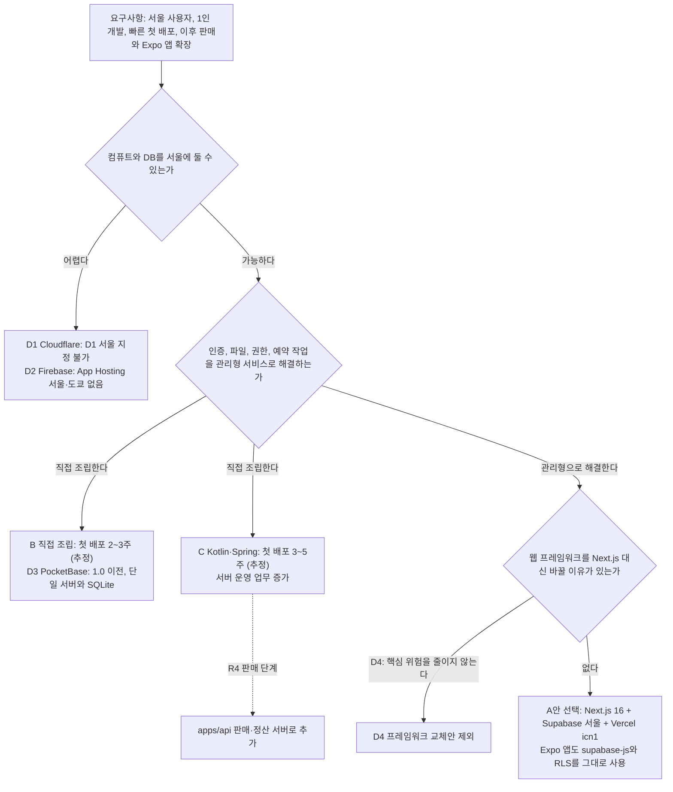

# 웹앱 스택 후보 조사 기록 (2026-11-18)

이 문서는 함뜨까 웹앱의 스택 후보 7개를 2026-11-18에 조사하고 비교한 기록이다. 독자는 후보별 첫 배포 기간, 사용자 규모별 월 비용, 서울 리전과 한국 소셜 로그인 지원 여부를 한곳에서 비교하고, A안을 고른 근거와 운영 중에 지켜야 할 인프라 제약을 출처와 함께 확인할 수 있다.

이 문서는 2026-11-18 시점의 조사 결과를 고정한 기록이므로, 이후 요금이나 버전이 바뀌어도 본문을 고치지 않는다. 정정할 내용이 생기면 문서 끝에 정정 기록을 덧붙인다. 현재 적용하는 결정은 [ADR-0002](../decisions/0002-stack-nextjs-supabase-vercel.md)와 [ADR-0001](../decisions/0001-monorepo-structure.md)이 관리한다. "(추정)"으로 표시한 항목은 공식 문서로 확인하지 못한 내용이거나 조사 단계에서 계산한 추정치다.

## 조사 질문과 기준

조사는 서울 사용자를 대상으로 하는 웹앱 스택 가운데, 1인 개발자가 가장 빨리 첫 배포를 할 수 있으면서 나중에 도안 판매(PG·정산)와 Expo 앱으로 넓힐 수 있는 스택을 찾으려고 했다.

후보는 아래 기준으로 비교했다.

| 기준 | 확인한 내용 |
|---|---|
| 첫 배포 기간 | 로그인, 도안 등록, 무료 도안 받기까지 포함한 첫 프로덕션 배포에 걸리는 기간 (추정) |
| 월 비용 | 월간 활성 사용자(MAU) 0명, 1천 명, 1만 명일 때의 예상 비용 |
| 서울 리전 | 컴퓨트와 DB를 서울에 둘 수 있는지 |
| 한국 소셜 로그인 | 카카오와 네이버 로그인을 연결하는 방식 |
| 파일 저장 | 비공개 파일과 만료 시간이 있는 signed URL 지원 |
| 검색 | 한국어 검색을 구현하는 방법 |
| 예약·백그라운드 작업 | Cron과 Queue 제공 여부 |
| Expo 공유 | Expo 앱이 같은 데이터 계층과 인증을 쓸 수 있는지 |
| 플랫폼 종속 | 다른 플랫폼으로 옮길 때 드는 비용 |

## 후보 비교

비용은 2026-11-18 공개 요금표를 기준으로 조사 단계에서 계산한 추정치이며, 단위는 미국 달러(USD)다. 첫 배포 기간도 추정치이고, A안은 카카오·구글 로그인, 도안 등록, 무료 도안 받기까지 포함한 첫 프로덕션 배포를 기준으로 했다. 후보별 근거 URL은 [출처](#출처) 절에 모았다.

### 배포 기간과 비용

| 후보 | 구성 | 첫 배포 (추정) | 월 비용: 0 MAU | 월 비용: 1천 MAU | 월 비용: 1만 MAU | 서울 리전 |
|---|---|---|---|---|---|---|
| A | Next.js 16 App Router + Supabase(서울) + Vercel(icn1) | 1~2주 | $0 (Vercel Hobby, Supabase Free 제약 적용) | 약 $45 (Vercel Pro $20 + Supabase Pro $25) | 약 $45~90 | 가능: Vercel icn1, Supabase ap-northeast-2 |
| B | Next.js 16 + Drizzle ORM + Better Auth + 관리형 Postgres(Neon 또는 Supabase DB) + 별도 파일 저장소 | 2~3주 | $0 | 약 $25~45 | 약 $40~90 | Neon은 불가(가장 가까운 곳은 싱가포르), Supabase DB를 쓰면 가능 |
| C | Kotlin 2.4 + Spring Boot 4.1 API + React/Next.js 프런트엔드 | 3~5주 | 약 $12~27 | 약 $30~65 | 약 $45~100 | Lightsail 서울은 가능, Fly.io는 도쿄, Railway는 싱가포르가 가장 가깝다 |
| D1 | Cloudflare Workers + D1 + R2 | 2~3주 | $0 | 약 $5 | 약 $5~20 | D1은 서울을 지정할 수 없고 apac 위치 힌트만 있다 |
| D2 | Firebase (Firestore, Cloud Functions, Auth/Identity Platform, App Hosting) | 2~3주 | $0 (서울 스토리지와 OIDC는 과금될 수 있음) | 약 $0~20 + 카카오 OIDC MAU 50명 초과분 | 산정하지 않음 (OIDC 초과 단가 미확인) | Firestore·Functions는 가능, App Hosting은 서울·도쿄 없음 <!-- refine-lint-ignore --> |
| D3 | PocketBase (단일 Go 실행 파일 + SQLite) on Lightsail 서울 | 1~2주 | 약 $5~7 | 약 $7~12 | 약 $12~24 | 가능 |
| D4 | Next.js 대신 React Router v8 또는 SvelteKit 3 (데이터 계층은 A·B와 같음) | A·B와 비슷하거나 1주 증가 | A안 또는 B안과 같음 | A안 또는 B안과 같음 | A안 또는 B안과 같음 | A안 또는 B안과 같음 |

A안의 1만 MAU 비용은 PDF 다운로드가 Supabase Pro 포함 egress 250GB 안에 들면 $45이고, 컴퓨트를 Small로 올리면 $5가 늘어난다고 추정했다. 영상이나 egress 초과분은 GB당 $0.03~$0.09가 추가된다.

### 기능과 종속

| 후보 | 한국 소셜 로그인 | 파일 저장 | 한국어 검색 | 예약·백그라운드 작업 | Expo 공유 | 플랫폼 종속 |
|---|---|---|---|---|---|---|
| A | 카카오·구글·애플 기본 제공, 네이버는 Custom OAuth Provider로 연결 | Storage private bucket과 signed URL, S3 호환 presigned URL | PGroonga로 시작하고 부족하면 Meilisearch (한국어 품질은 실측 필요) | Supabase Cron(pg_cron), Queues(pgmq) | supabase-js를 앱에서 그대로 쓰고 RLS 정책을 공유 | Auth와 RLS에 로직이 깊게 묶이면 이전이 어렵다 (추정). 자체 호스팅에는 Branching, PITR 같은 기능이 없다 |
| B | Better Auth가 카카오·네이버를 기본 제공자로 지원 | Cloudflare R2 또는 Vercel Private Blob을 직접 조립 | Neon lakebase_tokenizer로 한국어 형태소 기반 검색 | 서비스별로 조립, Neon pg_cron은 scale to zero를 꺼야 동작 | @better-auth/expo 플러그인, 앱용 HTTP API는 별도 설계 | 낮음: 사용자·세션 테이블이 자체 스키마에 있다 |
| C | Spring Security에 카카오·네이버 provider를 직접 설정 | S3나 R2를 직접 연동 | Elasticsearch·OpenSearch nori 분석기 (추정) | @Scheduled, Spring Batch (추정) | REST API 하나를 웹과 앱이 공유 (추정) | 가장 낮음: Docker 이미지로 옮길 수 있다 |
| D1 | Better Auth 등을 Workers에서 직접 구성, D1 어댑터 동작은 미확인 | R2(egress 무료), 영상은 Stream | D1 FTS5 trigram 토크나이저 사례 (추정) | Queues, Cron Triggers | 조사하지 않음 | 높음: Workers, D1, R2 바인딩 API에 코드가 묶인다 |
| D2 | 카카오는 Identity Platform OIDC(무료 MAU 50명), 네이버는 커스텀 토큰 발급 | Cloud Storage (무료 할당량은 미국 버킷에만 적용) | 전문 검색 없음, 외부 엔진 필요 (추정) | 조사하지 않음 | Expo·React Native용 Firebase SDK 생태계가 넓다 (추정) | 가장 크다 (추정) <!-- refine-lint-ignore --> |
| D3 | 인증 문서에 카카오·네이버가 명시되어 있지 않다 | 파일 업로드 기본 포함 | 조사하지 않음 | 조사하지 않음 | 공식 JS SDK로 연동 (추정) | 결제·정산 로직을 Go 확장으로 작성해야 할 수 있다 (추정) |
| D4 | A안 또는 B안과 같음 | A안 또는 B안과 같음 | A안 또는 B안과 같음 | A안 또는 B안과 같음 | SvelteKit을 고르면 Expo와 UI·훅을 공유할 수 없다 (추정) | A안 또는 B안과 같음 |

## 후보별 장단점

| 후보 | 주요 장점 | 주요 단점 |
|---|---|---|
| A | 컴퓨트, DB, 스토리지를 모두 서울에 둔다. 인증, 파일, 권한, 예약 작업을 관리형 서비스로 해결한다. Supabase MCP 서버와 next-devtools-mcp가 공식 제공된다. | Vercel Hobby는 비상업 용도만 허용한다. Supabase Free는 1주 비활성 시 일시 중지된다. 서울 Vercel 전송 단가가 GB당 $0.35로 높다. Server Actions는 Expo에서 호출할 수 없다 (추정). |
| B | 카카오·네이버 로그인을 같은 방식으로 구성한다. 인증 데이터를 다른 호스팅으로 그대로 옮길 수 있다. R2는 egress가 무료다. | Neon에는 서울·도쿄 리전이 없다. RLS를 쓰지 않으면 모든 권한 검사를 서버 코드에서 직접 구현해야 한다 (추정). 첫 배포가 A안보다 늦다. |
| C | PortOne JVM SDK(0.24.0)가 있다. 주문, 결제, 정산처럼 상태 전이가 많은 도메인을 Spring 트랜잭션 관리로 다루기 좋다 (추정). 플랫폼 종속이 가장 낮다. | 백엔드와 프런트엔드 두 코드베이스를 혼자 유지해야 한다 (추정). 세션, JWT, 리프레시 토큰을 직접 설계해야 한다. 서버 패치, 백업, 모니터링 같은 운영 업무가 생긴다. |
| D1 | 비용이 가장 낮다. R2 egress가 무료라 PDF와 영상 전송비가 거의 없다. Queues와 Cron Triggers를 같은 플랫폼에서 제공한다. | 서울 고정 배치가 불가능하다. D1은 SQLite이므로 판매 단계에서 Postgres로 옮겨야 할 가능성이 크다 (추정). OpenNext 어댑터는 Windows 지원을 보장하지 않는다. |
| D2 | Firestore와 Cloud Functions를 서울에 둘 수 있다. Firebase Auth 기본 사용자는 MAU 5만 명까지 무료다. | App Hosting은 서울·도쿄를 지원하지 않는다. 카카오 OIDC는 MAU 50명까지만 무료다. 문서형 DB라 주문·정산 같은 관계형 집계가 어렵다 (추정). |
| D3 | 실행 파일 하나로 동작해 구성이 단순하다. Lightsail 서울 소형 인스턴스로 저렴하게 운영한다. 관리자 화면이 기본으로 들어 있다. | v0.42.3으로 1.0 이전 단계라 버전 간 호환성 변경 위험이 있다 (추정). 단일 서버와 SQLite 구조라 동시 쓰기 증가와 고가용성 구성에 대응하기 어렵다 (추정). |
| D4 | React Router v8은 Next.js의 캐시·서버 컴포넌트 규칙 변화에 덜 영향을 받는다 (추정). SvelteKit은 번들이 작다. | 인증, 결제, 정산 같은 핵심 위험을 줄여 주지 않는다. Next.js에 비해 공식 예제와 MCP 지원이 적다 (추정). |

## 선택과 이유

함뜨까는 A안(Next.js 16 App Router + Supabase 서울 + Vercel icn1)을 선택했고, 결정 내용은 [ADR-0002](../decisions/0002-stack-nextjs-supabase-vercel.md)가 관리한다. 조사는 A안이 서울 배치, 카카오·구글·애플 로그인, 비공개 PDF 배포, 예약 작업, Expo 확장을 가장 적은 코드로 해결한다고 평가했다.

저장소 구성은 [ADR-0001](../decisions/0001-monorepo-structure.md)을 따른다. 지금은 `apps/web`, `packages/shared`, `supabase/`, `docs/`만 만들고, C안의 Kotlin·Spring 서버는 R4 판매 단계에서 `apps/api`로 추가한다. Expo 앱은 A1 단계에서 `apps/mobile`로 추가한다.

비용 계획은 다음과 같다. 개발과 비공개 베타 기간에는 Vercel Hobby와 Supabase Free로 $0를 유지한다. 공개 출시 때 Vercel Pro($20)와 Supabase Pro($25)로 바꿔 월 약 $45를 쓴다. R4에서 Spring 서버(예: Lightsail 서울 2GB, 월 $12)를 더해도 월 합계를 10만 원 아래로 유지하는 것이 목표다.

조사가 A안의 약점으로 지적한 항목은 아래 결정으로 보완한다.

| 약점 | 보완하는 결정 |
|---|---|
| Vercel 함수 기본 리전이 iad1이다 | 함수 리전을 icn1로 고정한다 ([ADR-0002](../decisions/0002-stack-nextjs-supabase-vercel.md)) |
| Supabase에서 일반 APAC을 고르면 서울이 아닌 곳에 배치될 수 있다 | 프로젝트 생성 때 ap-northeast-2를 직접 고른다 ([ADR-0002](../decisions/0002-stack-nextjs-supabase-vercel.md)) |
| Supabase에 로직이 묶이면 이전이 어렵다 | supabase-js를 `packages/shared` 안에서만 쓴다 ([ADR-0003](../decisions/0003-data-access-boundary.md)) |
| 카카오 이메일은 비즈 앱에서만 받을 수 있다 | (provider, provider_user_id)로 회원을 식별한다 ([ADR-0005](../decisions/0005-auth-supabase-social-login.md)) |
| PGroonga의 한국어 품질이 확인되지 않았다 | R2 착수 전에 실측하고 검색 엔진을 정한다 ([의사결정 목록](../decisions/README.md)의 OD-08) |

아래 그림은 조사 결과의 장단점을 판단 순서로 다시 배열한 것이다.

점선 화살표는 지금이 아니라 나중 단계(R4)에 추가하는 연결이다. 각 판단의 근거 수치는 후보 비교 표와 아래 인프라 제약 표에서 확인할 수 있다.

## 확인된 인프라 제약

아래 표는 A안을 운영할 때 지켜야 하는 제약이다. 영향 열은 조사 단계에서 정리한 대응 방향이다.

| 영역 | 제약 | 함뜨까에 주는 영향 | 출처 |
|---|---|---|---|
| 인프라 | Vercel 이용약관(2026-10-19 개정) 제4조는 Hobby 플랜을 "personal or non-commercial use"로만 허용하고, 상업적 이용을 정의하지 않는다. | 공개 출시부터 Vercel Pro(좌석당 월 $20)를 쓴다. 사업자가 운영하는 서비스는 결제 기능 전이라도 Hobby 사용이 약관 위반으로 해석될 수 있다 (추정). 사업자등록 시점은 [의사결정 목록](../decisions/README.md)의 OD-04에서 정한다. | [Vercel 약관](https://vercel.com/legal/terms) |
| 인프라 | Vercel 함수 기본 리전은 iad1(워싱턴 D.C.)이고 서울 리전은 icn1이다. 서울 Fast Data Transfer 단가는 GB당 $0.35다. | 함수 리전을 icn1로 지정한다. PDF와 이미지 원본은 Vercel 함수를 거치지 않고 Storage signed URL로 직접 내려보낸다. | [Vercel icn1 요금](https://vercel.com/docs/pricing/regional-pricing/icn1) |
| 인프라 | Vercel Functions의 요청 본문은 4.5MB로 제한된다. | PDF와 이미지는 브라우저에서 저장소의 서명 업로드 URL로 직접 올린다. | [Vercel Functions 제한](https://vercel.com/docs/functions/limitations) |
| 인프라 | Vercel Hobby의 Cron은 하루 1회만 실행되고 최대 59분 어긋날 수 있다. 더 잦은 표현식은 배포 단계에서 실패한다. Cron Jobs는 레거시로 분류되어 Schedules로 이전될 예정이다. | 예약 작업은 Supabase Cron이나 Vercel Pro Cron으로 처리한다. | [Vercel Cron 요금](https://vercel.com/docs/cron-jobs/usage-and-pricing) |
| 인프라 | Supabase Free는 1주 동안 활동이 없으면 프로젝트를 일시 중지하고, 업로드 파일 상한은 50MB이며, 활성 프로젝트는 2개다. Pro는 월 $25부터이고 MAU 10만, 비캐시 egress 250GB를 포함한다. | 개발과 비공개 베타는 Free로 운영하고, 공개 출시부터 Supabase Pro를 쓴다. | [Supabase 요금](https://supabase.com/pricing) |
| 인프라 | Supabase는 서울 리전(ap-northeast-2)을 제공하지만, 일반 "APAC"을 고르면 싱가포르 등으로 배치될 수 있다. | 프로젝트를 만들 때 서울 리전을 직접 고른다. 이 선택은 나중에 바꾸기 어려우므로 ADR에 기록한다. | [Supabase 리전](https://supabase.com/docs/guides/platform/regions) |
| 파일 접근 | Supabase Storage의 개별 signed URL은 취소할 수 없고, 객체 삭제·이동이나 서명 키 교체로만 무효화된다. S3 호환 계층은 객체 버전 관리를 지원하지 않는다. | 다운로드 URL은 만료 시간을 짧게 두고, 요청마다 권한을 확인한 뒤 새로 발급한다. 파일 버전은 애플리케이션 테이블에서 관리한다. | [Supabase Storage 다운로드](https://supabase.com/docs/guides/storage/serving/downloads) |
| 인증 | 카카오 로그인에서 이메일(account_email)은 비즈 앱으로 전환해야 받을 수 있다. 비즈 앱이 아니면 Supabase에서 "Allow users without an email" 옵션을 켜야 한다. | 이메일을 회원 식별 키로 쓰지 않는다. 알림용 이메일은 별도 입력과 인증 절차로 받는다. | [Supabase 카카오 로그인](https://supabase.com/docs/guides/auth/social-login/auth-kakao) |
| 인증 | Supabase Auth는 네이버를 기본 제공하지 않는다. 2026년 4월 출시된 Custom OAuth Provider(Free 3개, Pro 무제한)로 연결해야 하며, 네이버 userinfo 응답은 비표준이다. | 네이버 로그인은 첫 배포에서 빼고, 응답 처리 방식을 검증한 뒤 R1+에서 추가한다. | [Supabase Custom OAuth](https://supabase.com/docs/guides/auth/custom-oauth-providers) |
| 검색 | Supabase에서 PGroonga를 쓸 수 있지만, 공식 문서는 한국어 지원을 명시하지 않는다. 문서는 모든 언어를 지원한다고 설명하면서 일본어와 중국어를 예로 든다. | 검색 인터페이스를 한 계층으로 감싸고, 뜨개 용어와 2글자 검색어로 PGroonga와 pg_trgm 품질을 실측한 뒤 엔진을 정한다. | [Supabase PGroonga](https://supabase.com/docs/guides/database/extensions/pgroonga) |

## 버전 정보 (2026-11-18 기준)

아래 버전은 2026-11-18에 npm registry의 latest 태그와 Maven Central 메타데이터로 확인한 값이다. 조사 자료는 여러 패키지의 버전을 출처 하나로 묶어 기록하기도 했다. 이런 행의 링크는 해당 패키지의 버전을 보여 주지 않는다. 그래서 출처 열에 "개별 출처 미기록"이라고 적고, 묶음 출처 링크는 괄호 안에 남겼다. 조사는 주요 패키지 버전을 고정하고, 사용 버전을 저장소의 에이전트 지침 파일에 기록하라고 권했다.

| 패키지 | 안정 버전 | 참고 | 출처 |
|---|---|---|---|
| Next.js | 16.4.6 | canary는 16.5.0-canary.54다. Next.js 17은 공식 출시가 확인되지 않았다. | [npm next](https://www.npmjs.com/package/next) |
| React | 19.3.1 | | [npm react](https://www.npmjs.com/package/react) |
| TypeScript | 7.0.2 | 7.1.0-beta가 진행 중이다. | 개별 출처 미기록 (조사 자료의 묶음 출처: [npm react](https://www.npmjs.com/package/react)) |
| supabase-js | 2.119.0 | | 개별 출처 미기록 (조사 자료의 묶음 출처: [npm react](https://www.npmjs.com/package/react)) |
| @supabase/ssr | 0.12.7 | | 개별 출처 미기록 (조사 자료의 묶음 출처: [npm react](https://www.npmjs.com/package/react)) |
| Expo SDK | 58 (expo 58.0.26) | sdk-57, sdk-56 태그도 유지된다. | [npm expo](https://www.npmjs.com/package/expo) |
| React Native | 0.88.1 | | 개별 출처 미기록 (조사 자료의 묶음 출처: [npm expo](https://www.npmjs.com/package/expo)) |
| Spring Boot | 4.1.2 | 4.2.0-RC2가 진행 중이다. | [Maven Central](https://repo1.maven.org/maven2/org/springframework/boot/spring-boot/maven-metadata.xml) |
| Kotlin | 2.4.21 | 2.5.0-RC가 진행 중이다. | 개별 출처 미기록 (조사 자료의 묶음 출처: [Maven Central Spring Boot](https://repo1.maven.org/maven2/org/springframework/boot/spring-boot/maven-metadata.xml)) |
| Better Auth | 1.7.25 | Auth.js(next-auth)의 latest는 4.24.15이고 v5는 5.0.0-beta.32다. | [npm better-auth](https://www.npmjs.com/package/better-auth) |
| Drizzle ORM | 0.45.4 | 1.0.0은 beta 태그로만 배포된다. | 개별 출처 미기록 (조사 자료의 묶음 출처: [npm prisma](https://www.npmjs.com/package/prisma)) |
| Prisma Client | 7.10.1 | prisma CLI의 latest 태그는 8.0.0-rc.34로 클라이언트와 어긋나 있다. | [npm prisma](https://www.npmjs.com/package/prisma) |
| React Router | 8.5.1 | v7 계열은 version-7 태그(7.18.5)로 유지된다. | [npm react-router](https://www.npmjs.com/package/react-router) |
| SvelteKit / Svelte | 3.3.1 / 5.57.3 | SvelteKit 2.x는 version-2 태그(2.70.4)로 유지된다. | 개별 출처 미기록 (조사 자료의 묶음 출처: [npm react-router](https://www.npmjs.com/package/react-router)) |
| PortOne 서버 SDK | TS 0.19.0, JVM 0.24.0 | 토스페이먼츠 JS SDK는 2.10.0이다. | [Maven Central](https://repo1.maven.org/maven2/io/portone/server-sdk/maven-metadata.xml) |
| PocketBase | 0.42.3 | 1.0 이전 단계다. | [PocketBase 운영 문서](https://pocketbase.io/docs/going-to-production/) |

Better Auth의 Expo 가이드는 Expo SDK 55와 React Native 0.83 기준으로 작성되어 있다. Better Auth Expo 플러그인과 Supabase Expo 가이드가 Expo SDK 58에서 그대로 동작하는지는 이번 조사에서 확인하지 못했다([Better Auth Expo](https://www.better-auth.com/docs/integrations/expo)).

## 출처

후보 비교 표와 장단점 표의 근거는 아래 문서다. 모든 문서는 2026-11-18에 확인했으며, 날짜를 따로 적은 문서는 그 날짜 기준의 내용이다.

- A안 (Vercel)
  - [Vercel 이용약관](https://vercel.com/legal/terms), [vercel.com/terms](https://vercel.com/terms)
  - [Vercel icn1 리전 요금](https://vercel.com/docs/pricing/regional-pricing/icn1) (2026-09-14 기준)
  - [Vercel Functions 제한](https://vercel.com/docs/functions/limitations)
  - [Vercel Cron Jobs 요금과 사용량](https://vercel.com/docs/cron-jobs/usage-and-pricing) (2026-07-15 기준)
  - [Vercel Queues 요금](https://vercel.com/docs/queues/pricing) (2026-08-12 기준)
  - [Vercel Private Blob 정식 제공](https://vercel.com/changelog/vercel-private-blob-is-now-generally-available)
  - [Vercel Pro Flat Rate CDN 정식 제공](https://vercel.com/changelog/flat-rate-cdn-is-now-ga-for-pro-teams) (2026-09-08 기준)
  - [Next.js MCP 가이드](https://nextjs.org/docs/app/guides/mcp)
- A안 (Supabase)
  - [Supabase 요금](https://supabase.com/pricing), [Supabase 리전](https://supabase.com/docs/guides/platform/regions)
  - [Supabase Custom OAuth Provider](https://supabase.com/docs/guides/auth/custom-oauth-providers), [Supabase 카카오 로그인](https://supabase.com/docs/guides/auth/social-login/auth-kakao)
  - [Supabase Storage 다운로드](https://supabase.com/docs/guides/storage/serving/downloads), [Supabase Cron](https://supabase.com/docs/guides/cron)
  - [Supabase PGroonga](https://supabase.com/docs/guides/database/extensions/pgroonga), [Supabase 자체 호스팅](https://supabase.com/docs/guides/self-hosting)
  - [Supabase Expo 가이드](https://supabase.com/docs/guides/getting-started/quickstarts/expo-react-native), [Supabase MCP 서버](https://supabase.com/blog/mcp-server)
  - [Meilisearch 언어 지원](https://www.meilisearch.com/docs/learn/resources/language)
- B안
  - [Neon 리전](https://neon.com/docs/introduction/regions), [Neon lakebase_tokenizer](https://neon.com/docs/extensions/lakebase-tokenizer)
  - [InfoQ: Databricks Lakebase](https://www.infoq.com/news/2026/02/databricks-lakebase-postgresql)
  - [Better Auth 네이버](https://www.better-auth.com/docs/authentication/naver), [Better Auth Expo](https://www.better-auth.com/docs/integrations/expo)
  - [Auth.js가 Better Auth에 합류](https://better-auth.com/blog/authjs-joins-better-auth)
- C안
  - [Spring Security OAuth2 로그인](https://docs.spring.io/spring-security/reference/servlet/oauth2/login/core.html)
  - [AWS Lightsail 요금](https://aws.amazon.com/lightsail/pricing/), [Fly.io 요금](https://docs.fly.io/about/pricing), [Railway 리전](https://docs.railway.com/reference/deployment-regions)
- D1안
  - [Cloudflare Workers 요금](https://developers.cloudflare.com/workers/platform/pricing/), [Cloudflare D1 데이터 위치](https://developers.cloudflare.com/d1/configuration/data-location/)
  - [OpenNext Cloudflare 어댑터](https://opennext.js.org/cloudflare)
  - [한국 트래픽 라우팅 사례](https://gist.github.com/premist/e7bc1f3892c9643b08ba) (추정 근거)
  - [D1 FTS5 한국어 검색 사례](https://dev.to/riversea/fts5-on-cloudflare-d1-cut-my-korean-keyword-search-from-220ms-to-22ms-heres-what-almost-broke-it-3l9p) (추정 근거)
- D2안
  - [Firebase App Hosting](https://firebase.google.com/docs/app-hosting/about-app-hosting), [Firebase 요금](https://firebase.google.com/pricing)
- D3안
  - [PocketBase 운영 문서](https://pocketbase.io/docs/going-to-production/)
- 버전 정보
  - [npm next](https://www.npmjs.com/package/next), [npm react](https://www.npmjs.com/package/react), [npm expo](https://www.npmjs.com/package/expo)
  - [npm better-auth](https://www.npmjs.com/package/better-auth), [npm prisma](https://www.npmjs.com/package/prisma), [npm react-router](https://www.npmjs.com/package/react-router)
  - [Maven Central Spring Boot](https://repo1.maven.org/maven2/org/springframework/boot/spring-boot/maven-metadata.xml), [Maven Central PortOne 서버 SDK](https://repo1.maven.org/maven2/io/portone/server-sdk/maven-metadata.xml)
