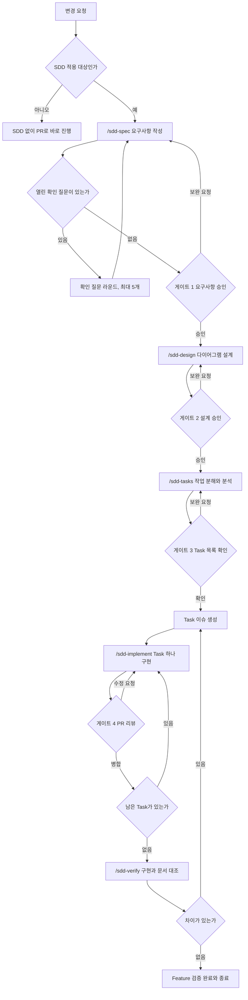
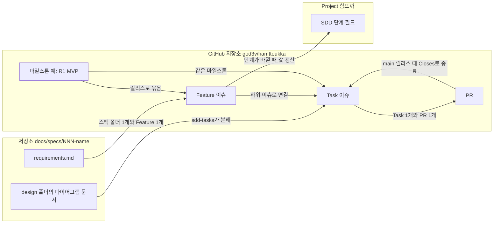

# SDD 흐름으로 기능 만들기

이 문서는 함뜨까에서 기능 하나를 요구사항 작성부터 검증까지 SDD 흐름으로 진행하는 방법을 설명한다. 끝까지 따라가면 스펙 폴더의 문서, GitHub의 Feature 이슈와 Task 이슈, 병합된 PR이 서로 연결되어 남고, 각 단계에서 무엇을 승인해야 다음 단계로 넘어가는지 알 수 있다.

## 이 흐름이 하는 일

SDD(Spec-Driven Development)는 코드를 쓰기 전에 요구사항과 설계를 문서로 확정하고, 그 문서를 근거로 작업을 나누고 구현하고 검증하는 개발 방식이다. 함뜨까는 카카오페이가 공개한 spec-kit 흐름(constitution → specify ↔ clarify → plan → tasks → analyze → implement)을 본떠서, Claude Code 프로젝트 스킬 다섯 개로 이 흐름을 진행한다.

spec-kit은 설치하지 않는다. spec-kit 1.4.2의 명령은 spec.md와 plan.md를 필수로 요구하고, 이슈 변환 기능은 마일스톤, 하위 이슈, Projects 항목을 만들지 않기 때문이다. 그래서 요구사항은 requirements.md에, 설계는 Mermaid 다이어그램 문서에, 작업은 GitHub Task 이슈에 기록하고 spec.md, plan.md, tasks.md는 만들지 않는다.

| spec-kit 단계 | 함뜨까 스킬 | 남는 산출물 |
|---|---|---|
| constitution | 스킬 없이 문서로 관리 | docs/constitution.md |
| specify, clarify | `/sdd-spec` | docs/specs/NNN-name/requirements.md |
| plan | `/sdd-design` | docs/specs/NNN-name/design/ 아래 다이어그램 문서 |
| tasks, analyze, taskstoissues | `/sdd-tasks` | Task 이슈, Feature 이슈의 분석 요약 댓글 |
| implement | `/sdd-implement #N` | 브랜치, 커밋, PR |
| converge | `/sdd-verify` | 차이를 메우는 Task 이슈, 또는 Feature 종료 |

이 문서는 단계를 진행하는 방법과 산출물을 GitHub에 연결하는 방법을 다룬다. 지켜야 할 원칙은 [함뜨까 프로젝트 헌법](constitution.md)에 있고, 이 방식을 고른 이유는 ADR-0010과 ADR-0011에 있다. 스킬이 실제로 따르는 실행 지침은 .claude/skills 아래의 각 SKILL.md에 있다.

## 시작하기 전에

| 준비물 | 확인 방법 |
|---|---|
| gh CLI 로그인과 project scope | `gh auth status`가 보여 주는 토큰 scope에 `project`가 있다 |
| 최신 gh CLI | `gh --version`으로 확인한다. `gh issue create`의 `--type`, `--parent`, `--blocked-by` 플래그를 쓴다 |
| 이슈 타입 Feature, Task, Bug | 저장소의 새 이슈 화면에 세 양식이 보인다 |
| Project `함뜨까`와 저장소 연결 | `gh project list --owner "@me"` 결과에 `함뜨까`가 있다 |
| 마일스톤과 area 라벨 | `gh api repos/god3v/hamtteukka/milestones --jq '.[].title'`과 `gh label list`로 이름을 확인한다 |
| 프로젝트 스킬 다섯 개 | .claude/skills 아래에 sdd-spec, sdd-design, sdd-tasks, sdd-implement, sdd-verify 폴더와 각 SKILL.md가 있다 |

`gh auth login`이 기본으로 요청하는 scope에는 project가 없다. Project에 항목을 추가하는 `gh issue create --project`와 `gh project` 명령을 쓰려면 `gh auth refresh -s project`로 scope를 추가한다([gh 매뉴얼](https://cli.github.com/manual/gh_issue_create)). `--parent` 같은 플래그가 몇 버전에 추가되었는지는 확인하지 못했으므로 gh를 최신 버전으로 유지한다.

모든 명령과 스킬은 저장소 루트에서 실행한다. gh는 현재 폴더의 git 원격 저장소로 대상 저장소를 정하고, Claude Code는 이 위치에서 .claude/skills의 프로젝트 스킬을 읽는다.

## 전체 흐름



마름모는 판단 지점이고, 이름에 "게이트"가 붙은 마름모는 사용자가 승인해야 넘어가는 지점이다. 보완 요청을 받으면 같은 단계로 돌아가고, 앞 단계의 문서를 바꿔야 하면 [수정 규칙](#수정-규칙)을 따른다.

| 게이트 | 단계 | 사용자가 확인하는 것 | 통과하면 바뀌는 것 |
|---|---|---|---|
| 게이트 1 | `/sdd-spec` | 열린 확인 질문이 없는 requirements.md | status가 approved로 바뀐다 |
| 게이트 2 | `/sdd-design` | design/ 문서와 헌법 점검 결과 | 설계 문서가 approved로 바뀐다 |
| 게이트 3 | `/sdd-tasks` | Task 목록과 일관성 분석 결과 | Task 이슈가 만들어진다 |
| 게이트 4 | `/sdd-implement` | PR 변경 내용과 검사 결과 | PR이 `dev`에 병합된다. Task 이슈는 `main` 릴리스 때 닫힌다 |

## SDD 적용 기준

작업을 시작하기 전에 아래 표로 SDD를 적용할지 정한다. 이 기준은 [헌법](constitution.md) P-01과 같다.

| 변경 | SDD 적용 | 진행 방법 |
|---|---|---|
| 테이블 추가 | 적용 | `/sdd-spec`부터 시작한다 |
| 화면 추가 | 적용 | `/sdd-spec`부터 시작한다 |
| 권한 규칙 변경(RLS 정책 추가나 변경) | 적용 | `/sdd-spec`부터 시작한다 |
| SDD로 만든 기능의 요구사항이나 설계 변경 | 해당 스펙 수정 | [수정 규칙](#수정-규칙)에 따라 상위 문서부터 고친다 |
| 버그 수정 | 미적용 | 나중에 다시 확인할 가치가 있는 버그는 Bug 이슈와 `fix/` 브랜치의 PR로 처리한다. 그 밖의 작은 버그는 이슈 없이 PR로 고친다 |
| 문서 문구, 템플릿, 설정의 작은 수정 | 미적용 | 이슈 없이 처리한다. 관련된 PR이 열려 있으면 함께 넣고 본문에 따로 적으며, 없으면 이슈 없는 PR을 연다([ADR-0012](decisions/0012-issue-for-planned-work-only.md)) |
| 리팩터링 | 미적용 | 동작을 바꾸지 않는 작은 리팩터링은 위 행처럼 처리한다. 범위가 크면 Task 이슈와 PR로 처리한다 |
| R0 인프라 작업 | 미적용 | 스펙 폴더 없이 ADR을 근거로 R0 인프라 Feature의 Task를 만든다 |

한 변경이 여러 행에 해당하면 SDD를 적용하는 쪽을 따른다. 예를 들어 버그를 고치다가 테이블을 추가해야 하면 SDD 대상이다. F-UX-01, F-UX-02, F-SUPPORT-01은 R0 인프라 Feature 안에서 스펙 폴더 없이 처리한다.

## 단계별 진행

각 단계는 스킬 하나로 진행한다. 스킬은 Claude Code 대화창에서 `/sdd-spec`처럼 이름으로 호출한다.

### 1. 요구사항을 쓰고 확인 질문을 해결한다: `/sdd-spec`

- **언제**: SDD 적용 대상인 기능을 시작할 때 쓴다. 릴리스는 한 번에 하나만 진행하므로, 진행 중인 릴리스에 속한 기능만 시작한다.
- **입력**: 기능 설명, [기능 목록](product/feature-catalog.md)의 F-ID, [헌법](constitution.md), 관련 ADR, [요구사항 템플릿](specs/_template/requirements.md)
- **산출물**: docs/specs/NNN-name/requirements.md. 사용자 스토리(US-xx), 기능 요구사항(FR-xx), 비기능 요구사항(NFR-xx), Given/When/Then 형식의 수용 기준(AC-xx), 범위 밖 항목, 확인 질문(Q-xx)과 해결 기록을 담는다.
- **게이트**: 게이트 1. 상태가 열림인 확인 질문이 하나도 없을 때 사용자에게 승인을 요청하고, 승인을 받으면 status를 review에서 approved로 바꾼다.
- **왜 이 단계가 있는지**: 요구사항이 모호한 채로 설계에 들어가면 나중에 설계와 이슈를 다시 만들어야 한다. 함께 검토할 기획자가 없는 1인 프로젝트이므로 확인 질문이 요구사항의 빈틈을 찾는다.

진행 순서는 다음과 같다.

1. 기존 스펙 폴더 다음의 세 자리 번호로 docs/specs/NNN-name 폴더를 만들고 요구사항 템플릿을 복사한다.
2. 이 스펙에 대응하는 Feature 이슈가 없으면 [Feature 양식](../.github/ISSUE_TEMPLATE/feature.yml)과 같은 절로 만든다. 릴리스 마일스톤과 Project `함뜨까`에 연결하고, SDD 단계를 요구사항으로 둔다.
3. requirements.md 초안을 쓴다.
4. 확인 질문 라운드를 진행한다. 한 라운드의 질문은 최대 5개다. 답을 받으면 해결 기록 표에 날짜, 질문 ID, 결정, 고친 항목을 한 행으로 적고, 확인 질문 표에서 그 질문의 상태를 열림에서 해결로 바꾼다.
5. 상태가 열림인 질문이 남지 않을 때까지 4를 반복한 뒤 승인을 요청한다.

스펙이 [미결정 사항](decisions/README.md)(OD)에 걸려 있으면 그 OD를 확인 질문으로 올리고, OD가 결정된 뒤에 해결로 바꾼다. 요구사항 검토를 Task로 추적할 때는 `[001] 요구사항 검토와 확인 질문 해결`처럼 제목을 쓴다.

### 2. 설계를 다이어그램으로 그린다: `/sdd-design`

- **언제**: requirements.md의 status가 approved일 때 쓴다.
- **입력**: 승인된 requirements.md, [헌법](constitution.md), [ERD 개요](architecture/erd-overview.md), [도메인 지도](architecture/domain-map.md), [설계 템플릿](specs/_template/design/domain.md)
- **산출물**: 아래 표의 design/ 문서. docs/architecture/erd-overview.md와 docs/architecture/domain-map.md도 이번 설계에 맞게 고친다.
- **게이트**: 게이트 2. 헌법의 원칙을 하나씩 설계와 대조한 결과를 함께 보여 주고 설계 승인을 요청한다.
- **왜 이 단계가 있는지**: 테이블, 권한, 화면 흐름을 코드보다 먼저 정해 두면 구현 PR에는 설계 판단 없이 작업만 남는다. RLS 정책 표는 나중에 권한 검사를 Spring으로 옮길 때 대조하는 목록이 된다.

| 파일 | 다이어그램 | 함께 쓰는 표 | 만드는 조건 |
|---|---|---|---|
| domain.md | classDiagram | shared 함수 인터페이스 표 | 항상 |
| erd.md | erDiagram | 테이블 설명 표, RLS 정책 표 | 항상(바뀌는 테이블이 없으면 그 이유를 적는다) |
| sequence.md | sequenceDiagram(시나리오마다 하나) | 시나리오 표 | 항상 |
| state.md | stateDiagram-v2 | 전이 표 | 상태가 있는 기능만 |
| screens.md | flowchart(화면 이동) | 화면 표 | 항상 |

헌법과 어긋나는 설계가 필요하면 설계에서 예외를 두지 않고 [헌법 변경 절차](constitution.md#헌법-변경-절차)를 먼저 밟는다. 다이어그램 문법은 GitHub에서 렌더링되는 유형만 쓰고, 각 템플릿에 있는 예시 형식을 따른다.

### 3. 작업을 나누고 Task 이슈를 만든다: `/sdd-tasks`

- **언제**: 설계가 승인된 뒤 쓴다.
- **입력**: 승인된 requirements.md와 design/ 문서, [헌법](constitution.md)
- **산출물**: Feature의 하위 이슈인 Task 이슈들, Feature 이슈에 남기는 분석 요약 댓글. tasks.md 파일은 만들지 않는다.
- **게이트**: 게이트 3. 이슈를 만들기 전에 Task 목록과 일관성 분석 결과를 사용자에게 보여 주고 확인을 받는다.
- **왜 이 단계가 있는지**: PR 이전의 계획과 분해가 PR 크기를 줄이는 데 가장 효과가 컸다는 사례가 있다. 카카오페이손해보험은 이 방식으로 200줄 미만 PR 비율이 37%에서 60%로 올랐다고 보고했다([출처](https://tech.kakaopay.com/post/kakaopayins-slow-pr-fast-dev/)).

일관성 분석은 다음 항목을 확인한다.

- 모든 AC가 하나 이상의 Task 근거에 들어 있다.
- 설계 문서의 테이블, RLS 정책, shared 함수, 시나리오, 상태 전이, 화면이 각각 하나 이상의 Task에서 쓰인다.
- 헌법을 어기는 Task가 없다.
- Task마다 PR 하나로 끝날 크기이며, 변경 줄 수는 약 200줄을 기준으로 삼는다.

사용자가 목록을 확인하면 Task마다 이슈를 만든다. 아래 예시에서 12는 Feature 이슈 번호이고 15는 먼저 끝나야 하는 Task 이슈 번호다.

```bash
gh issue create \
  --type Task \
  --title "[003] 작업 제목" \
  --body-file task-body.md \
  --parent 12 \
  --milestone "R1 MVP" \
  --label area:counter \
  --project 함뜨까 \
  --blocked-by 15
```

본문은 [Task 양식](../.github/ISSUE_TEMPLATE/task.yml)과 같은 절(상위 Feature, 관련 문서, 다루는 수용 기준, 작업 범위, 범위 밖, 선행 Task, 완료 조건)로 쓴다. `/sdd-implement`가 이 절 이름으로 본문을 읽으므로, 양식으로 직접 만든 Task도 같은 절을 갖는다. 이슈를 모두 만든 뒤 분석 요약을 `gh issue comment 12 --body-file analysis.md`처럼 Feature 이슈에 댓글로 남긴다. spec-kit의 이슈 변환은 마일스톤, 하위 이슈, Projects 항목을 만들지 않으므로 이 단계에서 gh로 직접 만든다([spec-kit github 확장](https://github.com/github/spec-kit/tree/main/extensions/github)).

### 4. Task 하나를 구현하고 PR을 연다: `/sdd-implement #N`

- **언제**: Task 이슈의 선행 이슈(blocked-by)가 모두 닫힌 뒤 쓴다. `#N`은 구현할 Task 이슈 번호다.
- **입력**: Task 이슈 본문, 본문의 관련 문서 절과 다루는 수용 기준 절에 적힌 요구사항, 설계 문서, AC, [헌법](constitution.md)
- **산출물**: `feat/<N>-<slug>` 브랜치, 커밋, PR
- **게이트**: 게이트 4. 사용자가 PR을 리뷰하고 병합한다.
- **왜 이 단계가 있는지**: 구현 단계의 에이전트는 헌법보다 작업 지시에 집중하는 경향이 있고([출처](https://tech.kakaopay.com/post/ifkakao-agentic-coding/)), 검증 범위를 과장해 보고하기도 한다([출처](https://tech.kakaopay.com/post/ai-agent-2/)). 그래서 테스트 이름으로 AC를 추적하고, 병합 여부는 실행한 검사 결과로 정한다.

진행 순서는 다음과 같다.

1. `feat/<N>-<slug>` 브랜치를 만든다. 버그는 `fix/`, 문서만 바꾸는 작업은 `docs/` 접두사를 쓴다.
2. 근거 문서대로 구현한다. 설계와 다르게 만들어야 하면 구현을 멈추고 [수정 규칙](#수정-규칙)을 따른다.
3. AC를 확인하는 테스트 이름에 기능 번호와 AC ID를 넣는다. 예: `test("003/AC-04 ...")`
4. typecheck, lint, test를 실행하고, 모두 통과했는지 출력 문구가 아니라 종료 코드로 확인한다.
5. 커밋 메시지는 `feat: 단수 카운터 리셋 확인 추가 (#12)`처럼 Conventional Commits 접두사 뒤에 한국어 요약을 쓴다.
6. [PR 템플릿](../.github/pull_request_template.md)으로 PR을 열고 본문에 `Closes #N`을 적는다.

### 5. 병합된 결과를 요구사항과 대조한다: `/sdd-verify`

- **언제**: Feature의 하위 Task 이슈가 모두 닫힌 뒤 쓴다.
- **입력**: 병합된 코드, requirements.md의 AC, design/ 문서
- **산출물**: 찾은 차이마다 새 Task 이슈. 차이가 없으면 Feature의 SDD 단계를 검증으로 바꾸고 Feature 이슈를 닫는다.
- **게이트**: 별도 승인 게이트는 없다. 남은 차이가 없을 때만 Feature를 닫는다.
- **왜 이 단계가 있는지**: 상위 문서의 내용이 하위 산출물로 항상 전파되지는 않는다. 카카오페이 사례에서도 spec에 있던 작업이 tasks에서 빠진 일이 있었다([출처](https://tech.kakaopay.com/post/ifkakao-agentic-coding/)).

새로 만든 Task 이슈는 3단계와 같은 방식으로 만들고 4단계로 구현한다. 차이의 원인이 요구사항이나 설계 자체에 있으면 Task 이슈를 만들기 전에 [수정 규칙](#수정-규칙)에 따라 상위 문서부터 고친다.

## 산출물과 GitHub 연결

스펙 폴더 하나는 Feature 이슈 하나에 대응하고, Task 이슈 하나는 PR 하나에 대응한다. Feature와 하위 Task는 같은 릴리스 마일스톤에 속하며, Project `함뜨까`의 SDD 단계 필드가 Feature의 현재 단계를 보여 준다.



왼쪽 상자는 저장소의 문서이고, 가운데 상자는 GitHub 이슈와 PR이다. 문서에서 이슈로 가는 연결은 스킬이 만들고, PR에서 Task로 가는 연결은 PR 본문의 `Closes #N`이 만든다.

| 단계 | 저장소 산출물 | GitHub에서 바뀌는 것 | Feature의 SDD 단계 |
|---|---|---|---|
| `/sdd-spec` | requirements.md | Feature 이슈 생성, 마일스톤과 Project 연결 | 요구사항 |
| `/sdd-design` | design/ 문서, architecture 문서 갱신 | 없음 | 설계 |
| `/sdd-tasks` | 없음 | Task 이슈 생성, 분석 요약 댓글 | 작업 분해, 이슈를 만든 뒤 구현 |
| `/sdd-implement` | 코드와 테스트 | 브랜치와 PR 생성, `dev` 병합 뒤 Status `dev 반영`, `main` 릴리스 때 Task 종료 | 구현 |
| `/sdd-verify` | 없음 | 차이를 메우는 Task 생성, 또는 Feature 종료 | 검증 |

Task 항목의 SDD 단계는 그 Task가 하는 일의 단계로 둔다. 요구사항 검토 Task는 요구사항이고, `/sdd-tasks`가 만든 구현 Task는 구현이다. 필드 값은 웹 화면에서 바꾸거나 `gh project item-edit`로 바꾸며, CLI를 쓸 때는 `gh project field-list`로 필드 ID와 옵션 ID를 먼저 조회한다([gh 매뉴얼](https://cli.github.com/manual/gh_project_item-edit)).

Project의 다른 필드는 다음과 같이 쓴다.

- **Status**: Todo, In Progress, dev 반영, Done을 쓴다. `dev 반영`은 PR이 `dev`에 병합되어 `main` 릴리스를 기다리는 상태다([ADR-0013](decisions/0013-dev-main-branch-flow.md)). Project의 기본 워크플로는 이슈가 닫히면 항목을 Done으로 옮긴다([GitHub 문서](https://docs.github.com/en/issues/planning-and-tracking-with-projects/automating-your-project/using-the-built-in-automations)).
- **Size**: `/sdd-tasks`가 Task마다 S, M, L, XL 가운데 하나를 제안하고, 사용자가 확인한 값으로 설정한다. `/sdd-verify`가 만드는 빈틈 Task도 같다.
- **Iteration**: 1주 단위다. 이 흐름의 스킬은 Iteration을 자동으로 정하지 않는다.

이슈 제목과 라벨은 다음 형식을 따른다.

- Feature 제목은 `[001] 계정: 가입·로그인·약관 동의·탈퇴`처럼 스펙 번호로 시작한다. 스펙 폴더가 아직 없는 이후 릴리스 Feature는 `[R2] 도안 등록과 심사`처럼 릴리스 코드로 시작한다.
- Task 제목은 `[001] 요구사항 검토와 확인 질문 해결`처럼 쓰고, 인프라 Task는 `[R0] pnpm 모노레포 뼈대 구성`처럼 쓴다.
- 라벨은 영역을 나타내는 area 라벨만 쓴다. 공통 라벨은 `area:infra`, `area:docs`이고, R0~R1 기능 라벨은 `area:account`, `area:project`, `area:counter`, `area:pattern-file`이다. R2 이후 기능 라벨은 `area:pattern-store`, `area:discovery`, `area:community`, `area:moderation`, `area:commerce`, `area:app`이다.
- 마일스톤 이름은 `R0 기반`, `R1 MVP`, `R1+ 도구 보강`, `R2 무료 도안 배포`, `R3 커뮤니티`, `R4 유료 판매`, `A1 앱`을 그대로 쓴다.

## 수정 규칙

산출물을 고칠 때는 항상 상위 산출물부터 고친다. 순서는 requirements.md, design/ 문서, Task 이슈, 코드이며, 하위 산출물만 고쳐서 요구사항과 어긋나게 만들지 않는다. 이 규칙은 중간 산출물을 직접 고치지 않고 spec으로 돌아가 다시 만든 카카오페이의 운영 규칙을 따른 것이다([출처](https://tech.kakaopay.com/post/ifkakao-agentic-coding/)).

| 바꾸려는 것 | 먼저 고칠 곳 | 그다음 다시 맞출 곳 |
|---|---|---|
| 사용자 동작, 수용 기준 | requirements.md | design/ 문서, Task 이슈, 코드 |
| 테이블, RLS 정책, 함수 인터페이스, 화면 흐름 | design/ 문서 | Task 이슈, 코드 |
| Task 범위 나누기, 합치기, 순서 | Task 이슈 | 코드 |
| 헌법 원칙 | 새 ADR | constitution.md, 영향을 받는 스펙 |

- 승인된 requirements.md나 설계 문서를 고치면 status를 review로 되돌리고 해당 게이트에서 다시 승인을 받는다.
- Task 이슈만 고치는 변경은 요구사항과 설계를 바꾸지 않는 경우로 한정한다.
- 상위 문서를 고친 뒤에는 하위 산출물을 다시 만들고, 빠진 내용이 없는지 상위 문서와 대조한다.
- 이미 병합된 코드가 고친 요구사항과 다르면 `/sdd-verify`가 그 차이를 Task 이슈로 연다.

## 문제가 생기면

아래 증상은 조사 자료와 이 흐름의 규칙을 바탕으로 예상한 상황이며, 실제 오류 메시지를 그대로 옮긴 것은 아니다.

| 증상 | 원인 | 이렇게 한다 |
|---|---|---|
| `gh issue create --project`가 권한 부족으로 실패한다 | 토큰에 project scope가 없다 | `gh auth refresh -s project`를 실행하고 `gh auth status`로 scope를 확인한다 |
| gh가 `--type`, `--parent`, `--blocked-by`를 알 수 없는 플래그라고 한다 | 설치된 gh가 오래된 버전이다 | gh를 최신 버전으로 올린다 |
| `--type Task`로 이슈를 만들지 못한다 | 저장소를 소유한 계정에 Task 이슈 타입이 없다 | 개인 계정 Settings > Planning > Issue types에서 Feature, Task, Bug를 확인한다 |
| `--milestone`에 적은 마일스톤을 찾지 못한다 | 마일스톤 이름이 정확히 일치하지 않는다 | 마일스톤 목록을 조회해서 `R1 MVP`처럼 이름을 그대로 쓴다 |
| GitHub에서 Mermaid 블록이 오류를 보이거나 코드로만 보인다 | 라벨에 따옴표가 없거나 허용하지 않은 다이어그램 유형을 썼다 | 노드와 간선의 라벨을 큰따옴표로 감싸고, 템플릿에 있는 유형만 쓴다 |
| 설계 중에 요구사항에 없는 동작을 정해야 한다 | requirements.md에 빠진 요구사항이 있다 | 설계를 멈추고 확인 질문을 추가한 뒤 `/sdd-spec`으로 해결하고 다시 승인받는다 |
| 일관성 분석이 어느 Task에도 연결되지 않은 AC를 보고한다 | 작업 분해나 설계에서 그 AC가 빠졌다 | Task를 추가한다. 설계에 빠진 것이면 설계부터 고친다 |
| PR 변경 줄 수가 200줄을 크게 넘는다 | Task가 PR 하나로 끝내기에 크다 | Task 이슈를 나누고 PR도 나눈다. 요구사항과 설계는 그대로 둔다 |
| 에이전트는 테스트가 통과했다고 하는데 CI가 실패한다 | 에이전트의 자기 보고를 근거로 삼았다 | CI 결과를 기준으로 고친다. 검사 출력을 파이프로 잘라 종료 코드를 가리지 않았는지 확인한다 |
| 스킬 이름을 입력해도 스킬이 실행되지 않는다 | .claude/skills 아래에 해당 SKILL.md가 없거나 다른 폴더에서 실행했다 | 저장소 루트에서 Claude Code를 실행했는지, SKILL.md 경로가 맞는지 확인한다 |

## 관련 자료

- [SDD 참고 자료 조사](research/2026-11-18-sdd-references.md): 카카오페이의 spec-kit 사례, spec-kit 1.4.2, gh CLI와 Projects를 조사한 기록
- [ADR-0010 카카오페이 흐름 기반 SDD와 다이어그램 중심 설계](decisions/0010-sdd-diagram-first.md): spec-kit 대신 스킬 다섯 개와 다이어그램 중심 설계를 고른 이유
- [ADR-0011 GitHub Issues·Projects로 업무 관리](decisions/0011-github-issues-projects.md): Issues와 Projects로 작업을 관리하고 Task 하나를 PR 하나로 끝내는 이유
- [ADR-0012 계획된 작업만 이슈로 관리](decisions/0012-issue-for-planned-work-only.md): 이슈가 필요한 변경과 이슈 없이 PR로 처리하는 작은 수정을 나누는 기준
- [함뜨까 프로젝트 헌법](constitution.md): 게이트에서 점검하는 원칙과 확인 방법
- [요구사항 템플릿](specs/_template/requirements.md): `/sdd-spec`이 복사하는 requirements.md 골격
- [로드맵](product/roadmap.md): 릴리스 순서와 릴리스마다 정한 진입 조건과 종료 조건
