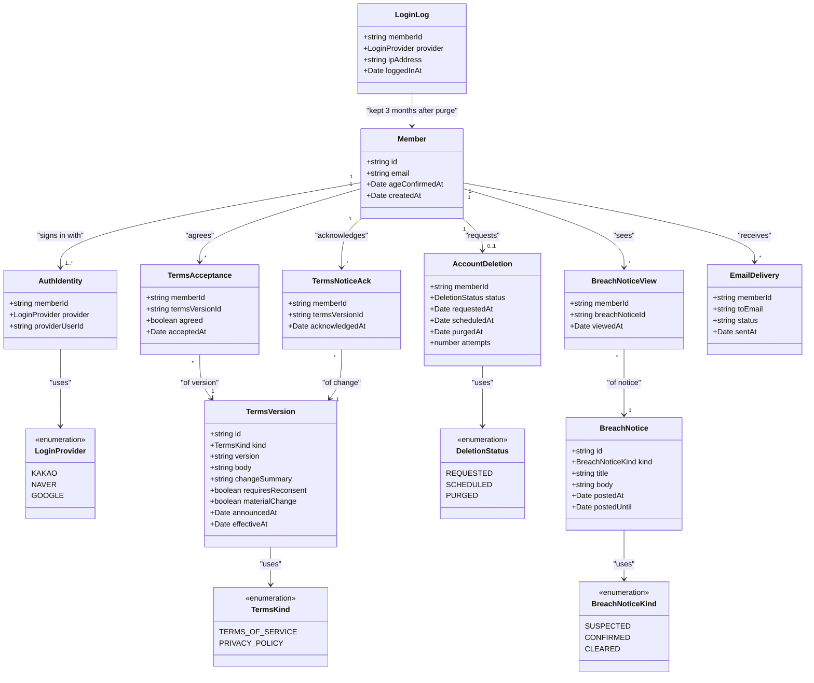
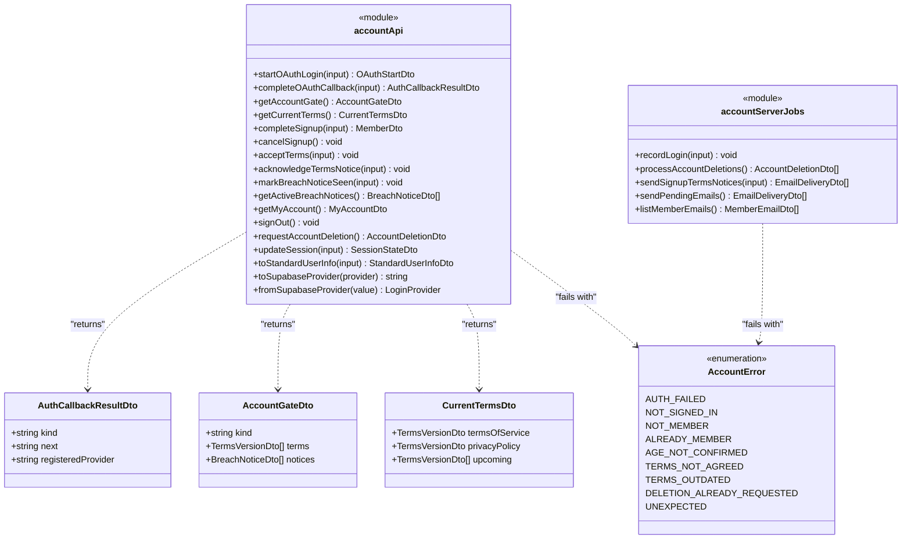

# 계정 도메인 모델

이 문서는 계정 기능의 도메인 개념과 packages/shared가 제공하는 함수 인터페이스를 classDiagram과 표로 정한다. 구현하는 사람은 가입, 로그인, 약관 동의, 탈퇴, 통지를 처리하는 함수가 어떤 입력을 받고 결과로 어떤 DTO와 오류가 나오는지 이 문서에서 확인할 수 있다.

## 설계 범위와 기본 결정

이 설계는 [요구사항](../requirements.md)의 FR-01~FR-33을 모두 다룬다. 설계를 시작하며 정한 기본 결정은 아래와 같다.

| 결정 | 내용 | 근거 |
|---|---|---|
| 회원 ID | 회원 ID는 Supabase Auth의 사용자 ID(`auth.users.id`)와 같은 값이다. 그래서 RLS 정책은 `auth.uid()`로 현재 사용자를 구한다 | ADR-0015, ADR-0004 |
| 가입 대기 | 인증은 마쳤지만 동의를 마치지 않은 사용자는 `auth.users`에만 있고 `members` 행이 없다. 이 사용자는 회원이 아니다 | FR-05, FR-27 |
| 네이버 연결 | 네이버는 Supabase 커스텀 OAuth 제공자(`oauth2` 유형)로 연결하고, 사용자 정보 주소에는 `apps/web`의 `/api/auth/naver/userinfo` 경로를 등록한다. 이 경로는 네이버 응답을 `toStandardUserInfo`로 바꿔 응답한다. 이메일이 없어도 가입할 수 있게 `email_optional`을 켠다 | FR-01, FR-03, ADR-0015 |
| 제공자 식별자 | Supabase에 보내고 받는 제공자 이름은 카카오가 `kakao`, 구글이 `google`, 네이버가 `custom:naver`다. 저장하는 `provider` 값은 `kakao`, `naver`, `google`이며, 두 이름은 `toSupabaseProvider`와 `fromSupabaseProvider`가 바꾼다 | FR-01, FR-02, ADR-0015 |
| 세션 확인 | 가입할 때 쓴 수단으로 로그인했다고 확인한 세션만 `member_sessions`에 기록하고, 회원 데이터 RLS 정책은 이 기록이 있는 세션만 허용한다 | FR-02, FR-04, FR-19 |
| 로그인 수단 | 회원이 가입할 때 쓴 로그인 수단을 `auth_identities`에 따로 저장한다. Supabase가 같은 이메일로 다른 수단을 자동 연결해도, 이 표에 없는 수단으로 들어온 로그인은 끝낸다 | FR-02, FR-04, NFR-06 |
| 시스템 처리 | 가입 완료, 가입 취소, 탈퇴 접수처럼 여러 표를 함께 바꾸거나 `auth` 스키마를 읽는 일은 DB 함수가 한 트랜잭션으로 처리한다 | FR-11, FR-23, FR-27 |
| 예약 작업 | 24시간 안의 삭제와 3개월 뒤 파기는 DB의 예약 작업(pg_cron)이 실행한다. 탈퇴 처리는 저장소 파일을 지워야 하므로, pg_cron이 웹 서버의 작업 경로를 호출하고 서버가 shared 함수로 처리한다 | FR-23, FR-27, FR-29, 004 FR-17 |
| 메일 | 약관 변경 안내와 유출 통지 메일은 서버가 메일 API로 보내고, 보낸 결과를 발송 기록에 남긴다. 메일 서비스는 [OD-21](../../../decisions/README.md)에서 정한다 | FR-30~FR-33 |
| 데이터 접근 | 인증 호출과 회원 데이터 접근은 아래 shared 함수로만 한다. `@supabase/supabase-js`와 `@supabase/ssr`은 packages/shared 안에서만 쓴다 | NFR-04, ADR-0003 |
| 데이터 위치와 토큰 | 회원 데이터는 서울 리전(ap-northeast-2)의 Supabase 프로젝트에 둔다. 이 프로젝트는 비대칭 서명 키로 JWT를 발급하게 설정해, R4의 Spring 서버가 JWKS로 같은 토큰을 검증할 수 있게 한다 | NFR-05, NFR-07, ADR-0015 |

## 도메인 개념

회원(Member)은 가입할 때 쓴 로그인 수단(AuthIdentity)으로 식별하고, 이메일은 비어 있을 수 있다. 동의 기록(TermsAcceptance)은 회원이 동의한 약관 버전(TermsVersion)을 가리키며 추가만 한다. 로그인 기록(LoginLog)은 회원과 연결을 끊고 따로 보관하므로, 회원이 삭제된 뒤에도 3개월 동안 남는다(FR-26).

| 클래스 | 뜻 | 저장하는 테이블 | 관련 FR |
|---|---|---|---|
| Member | 연령 확인과 필수 약관 동의를 마친 회원. ID는 `auth.users.id`와 같다 | members | FR-02, FR-03, FR-05, FR-15 |
| AuthIdentity | 회원이 가입할 때 쓴 로그인 수단. (provider, providerUserId)로 회원을 찾는다 | auth_identities | FR-02, FR-04, NFR-06 |
| LoginProvider | 로그인 수단의 종류. R0에는 카카오, 네이버, 구글이 있다 | auth_identities.provider 열 | FR-01 |
| TermsVersion | 이용약관이나 개인정보 처리방침의 버전. 공지 시작 시각과 시행 시각을 가진다 | terms_versions | FR-08, FR-14, FR-28, FR-32 |
| TermsKind | 문서 종류 | terms_versions.kind 열 | FR-08 |
| TermsAcceptance | 회원이 어느 버전에 언제 동의했는지 남긴 기록 | terms_acceptances | FR-10, FR-11, FR-28 |
| TermsNoticeAck | 회원이 불리하거나 중요한 변경의 안내 창에서 확인을 누른 기록 | terms_notice_acknowledgements | FR-32 |
| AccountDeletion | 탈퇴 처리의 상태와 상태별 시각. 삭제를 마치면 회원 ID를 비운다 | account_deletions | FR-22, FR-23, FR-24 |
| DeletionStatus | 탈퇴 처리 상태 | account_deletions.status 열 | FR-23 |
| LoginLog | 로그인 일시, IP 주소, 로그인 수단 | login_logs | FR-26, FR-29 |
| BreachNotice | 홈페이지에 게시하는 유출 가능성, 유출 확인, 유출 없음 안내 | breach_notices | FR-30, FR-33 |
| BreachNoticeKind | 유출 안내의 종류 | breach_notices.kind 열 | FR-30, FR-33 |
| BreachNoticeView | 이메일이 없는 회원에게 유출 안내를 보여 준 기록 | breach_notice_views | FR-30 |
| EmailDelivery | 약관 변경 안내나 유출 통지 메일 한 통의 발송 기록 | email_deliveries | FR-30, FR-31, FR-32, FR-33 |

## 계정 상태 확인

로그인한 사용자가 회원 기능을 열 때마다 계정 상태(AccountGate)를 확인하고, 상태에 맞는 화면으로 보낸다. 상태와 확인 순서는 [상태 전이 문서](state.md)에서 정한다.

| 상태 값 | 뜻 | 보내는 화면 | 관련 FR |
|---|---|---|---|
| `ANONYMOUS` | 로그인하지 않았거나 세션이 끝났다 | 로그인 화면 | FR-18, FR-20 |
| `PENDING_SIGNUP` | 인증만 마치고 가입을 마치지 않았다 | 가입 동의 화면 | FR-05, FR-27 |
| `DELETION_PENDING` | 탈퇴를 접수했고 아직 삭제를 마치지 않았다 | 탈퇴 처리 중 안내 | FR-24 |
| `BREACH_NOTICE` | 이메일이 없는 회원이 게시 중인 유출 안내를 아직 보지 않았다 | 유출 안내 창 | FR-30, FR-33 |
| `TERMS_CHANGE_NOTICE` | 불리하거나 중요한 변경의 안내 창을 아직 확인하지 않았다 | 약관 변경 안내 창 | FR-32 |
| `RECONSENT_REQUIRED` | 재동의가 필요한 버전에 아직 동의하지 않았다 | 재동의 화면 | FR-28 |
| `ACTIVE` | 회원 기능을 쓸 수 있다 | 요청한 화면 | FR-05 |

## shared 함수

accountApi는 화면, Server Action, Next.js의 요청 처리(proxy)가 호출하는 함수 모음이다. 서버에서 부르는 함수는 Next.js의 쿠키 어댑터를 인수로 받아 그 요청의 세션으로 Supabase를 호출하므로, 권한은 RLS가 검사한다. accountServerJobs는 서버에서만 부르는 함수이며, RLS를 거치지 않는 service-role 키를 쓰므로 브라우저 번들에 들어가지 않게 별도 진입점으로 낸다(헌법 P-10).

| 함수 | 입력 | 출력 DTO | 오류 | 관련 FR |
|---|---|---|---|---|
| `startOAuthLogin` | 로그인 수단, 로그인 뒤 돌아갈 경로 | `OAuthStartDto` (제공자 인증 화면 주소) | `UNEXPECTED` | FR-01, FR-06 |
| `completeOAuthCallback` | 인가 코드, 돌아갈 경로, 요청 IP | `AuthCallbackResultDto` (`MEMBER`, `PENDING_SIGNUP`, `DELETION_PENDING`, `PROVIDER_MISMATCH` 가운데 하나) | `AUTH_FAILED` | FR-02, FR-04, FR-05, FR-06, FR-07, FR-24, FR-29 |
| `getAccountGate` | 없음 | `AccountGateDto` (위 상태 값과, 안내할 약관 버전이나 유출 안내) | 없음 | FR-05, FR-18, FR-20, FR-24, FR-28, FR-30, FR-32 |
| `getCurrentTerms` | 없음 | `CurrentTermsDto` (시행 중인 두 문서와 공지 중인 다음 버전) | `UNEXPECTED` | FR-08, FR-09, FR-14 |
| `completeSignup` | 동의한 약관 버전 ID 두 개, 만 14세 이상 확인 여부 | `MemberDto` | `AGE_NOT_CONFIRMED`, `TERMS_NOT_AGREED`, `TERMS_OUTDATED`, `ALREADY_MEMBER`, `NOT_SIGNED_IN` | FR-05, FR-10, FR-11, FR-15, FR-16 |
| `cancelSignup` | 없음 | 없음 | `ALREADY_MEMBER` | FR-16, FR-27 |
| `acceptTerms` | 다시 동의한 약관 버전 ID 목록 | 없음 | `TERMS_OUTDATED`, `NOT_MEMBER` | FR-11, FR-28 |
| `acknowledgeTermsNotice` | 약관 버전 ID | 없음 | `NOT_MEMBER` | FR-32 |
| `markBreachNoticeSeen` | 유출 안내 ID | 없음 | `NOT_MEMBER` | FR-30, FR-33 |
| `getActiveBreachNotices` | 없음 | `BreachNoticeDto[]` (게시 중인 안내) | `UNEXPECTED` | FR-30, FR-33 |
| `getMyAccount` | 없음 | `MyAccountDto` (로그인 수단, 이메일) | `NOT_MEMBER` | FR-19, FR-21 |
| `signOut` | 없음 | 없음 | 없음 | FR-19 |
| `requestAccountDeletion` | 없음 | `AccountDeletionDto` | `DELETION_ALREADY_REQUESTED`, `NOT_MEMBER` | FR-22, FR-23, FR-24 |
| `updateSession` | 요청과 응답의 쿠키 어댑터 | `SessionStateDto` (세션 유무, 세션이 끝났는지) | 없음 | FR-17, FR-18, FR-20 |
| `toSupabaseProvider`, `fromSupabaseProvider` | `LoginProvider`, Supabase 제공자 이름 | Supabase 제공자 이름(`custom:naver` 등), `LoginProvider` | `UNEXPECTED` (알 수 없는 이름) | FR-01, FR-02 |
| `toStandardUserInfo` | 네이버 사용자 정보 응답 | `StandardUserInfoDto` (`sub`, `email`, `name`. 이메일은 없을 수 있다) | `AUTH_FAILED` (응답 코드가 성공이 아닐 때) | FR-01, FR-02, FR-03 |
| `recordLogin` | 회원 ID, 로그인 수단, IP 주소 | 없음 | `UNEXPECTED` | FR-29 |
| `processAccountDeletions` | 없음 | `AccountDeletionDto[]` (이번 실행에서 처리한 탈퇴) | `UNEXPECTED` | FR-23, FR-25, 004 FR-17 |
| `sendSignupTermsNotices` | 방금 가입한 회원 ID | `EmailDeliveryDto[]` | `UNEXPECTED` | FR-32 |
| `sendPendingEmails` | 없음 | `EmailDeliveryDto[]` (이번에 보낸 메일) | `UNEXPECTED` | FR-30, FR-32, FR-33 |
| `listMemberEmails` | 없음 | `MemberEmailDto[]` (이메일이 있는 회원) | `UNEXPECTED` | FR-31 |

`completeSignup`이 `TERMS_OUTDATED`로 끝나면, 사용자가 동의 화면을 연 뒤 새 버전이 시행되었다는 뜻이다. 화면은 시행 중인 버전을 다시 읽어 보여 준다. `completeOAuthCallback`이 `PROVIDER_MISMATCH`를 돌려주면 그 세션은 이미 끝난 상태이고, `registeredProvider`에 가입할 때 쓴 로그인 수단이 들어 있다.

## 관련 문서

- [요구사항](../requirements.md): 이 설계의 근거인 FR과 AC
- [데이터 모델과 RLS 정책](erd.md): 클래스가 저장되는 테이블, DB 함수, 권한 정책
- [시나리오 시퀀스](sequence.md): 함수가 호출되는 흐름
- [상태 전이](state.md): 계정 상태와 탈퇴 처리 상태
- [ADR-0003 Supabase 접근을 packages/shared로 제한](../../../decisions/0003-data-access-boundary.md), [ADR-0015 Supabase Auth와 카카오·구글·네이버 로그인](../../../decisions/0015-auth-providers-with-naver.md)
- [도메인 지도](../../../architecture/domain-map.md): 기능 전체의 도메인 관계
