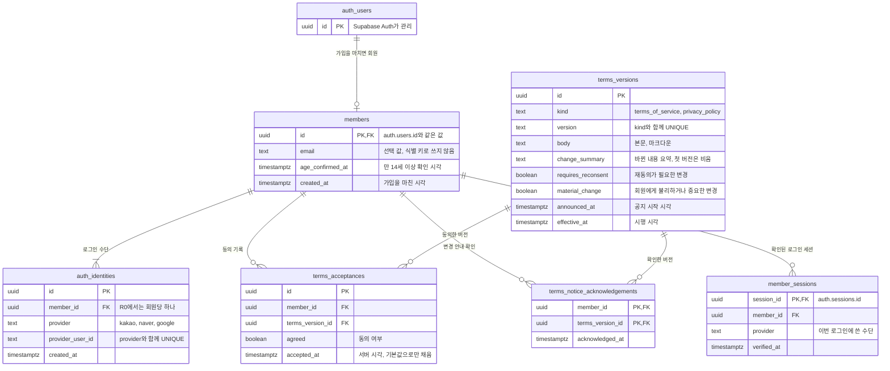
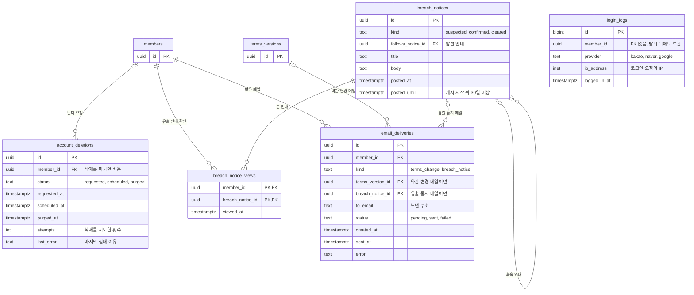

# 계정 데이터 모델과 RLS 정책

이 문서는 계정 기능이 쓰는 테이블과 관계, DB 함수와 예약 작업, 테이블마다 적용하는 RLS 정책을 erDiagram과 표로 정한다. 마이그레이션을 쓰는 사람은 이 문서에서 만들 열, 제약, 함수, 정책을 확인하고, 나중에 권한 검사를 Spring으로 옮길 때는 정책 표를 대조 목록으로 쓴다.

## ERD

### 회원, 로그인 수단, 약관 동의

`auth_users`는 Supabase Auth가 관리하는 `auth.users` 테이블이며, 인증만 마친 가입 대기 사용자도 여기에 있다. 연령 확인과 필수 약관 동의를 마치면 같은 ID로 `members` 행을 만든다. 그래서 회원이 소유하는 데이터의 `member_id`는 `auth.uid()`와 비교할 수 있다.

### 탈퇴, 로그인 기록, 통지

`login_logs`는 회원 테이블과 관계를 두지 않는다. 회원을 삭제해도 로그인 기록은 3개월 동안 남아야 하기 때문이다(FR-26). `account_deletions`의 `member_id`는 회원 행이 삭제되면 비워지므로, 삭제를 마친 뒤에는 회원을 알아볼 수 없는 처리 시각만 남는다.

## 테이블 설명

| 테이블 | 스키마 | 설명 | 관련 FR |
|---|---|---|---|
| members | public | 회원. `id`는 `auth.users(id)`를 참조하고 그 행이 지워지면 함께 지운다. 이메일에는 UNIQUE 제약을 두지 않는다 | FR-02, FR-03, FR-05, FR-15, FR-25 |
| auth_identities | public | 가입할 때 쓴 로그인 수단. (provider, provider_user_id)에 UNIQUE 제약을 두고, R0에서는 `member_id`에도 UNIQUE 제약을 둔다 | FR-02, FR-04, NFR-06 |
| terms_versions | public | 약관 버전. (kind, version)에 UNIQUE 제약을 둔다. `announced_at`은 `effective_at`보다 늦을 수 없고, 첫 버전이 아니면 시행 7일 전, `material_change`이면 30일 전보다 늦을 수 없다(CHECK 제약). 버전은 SQL 마이그레이션으로 등록한다 | FR-08, FR-09, FR-14, FR-28, FR-32 |
| terms_acceptances | public | 동의 기록. 추가만 하며, 회원이 삭제되면 함께 지운다. 약관 버전은 지울 수 없게 참조한다 | FR-10, FR-11, FR-28, NFR-03 |
| terms_notice_acknowledgements | public | 불리하거나 중요한 변경의 안내 창에서 확인을 누른 기록 | FR-32 |
| member_sessions | public | 가입할 때 쓴 로그인 수단으로 로그인했다고 확인한 세션. `session_id`는 `auth.sessions(id)`를 참조하고 그 세션이 지워지면 함께 지운다. 이 행이 없는 세션의 토큰은 회원 데이터를 읽거나 쓸 수 없다 | FR-02, FR-04, FR-19 |
| account_deletions | public | 탈퇴 처리 상태와 상태별 시각. 회원 행이 지워지면 `member_id`를 비운다(ON DELETE SET NULL). `status`가 purged가 아닌 행은 회원마다 하나만 둔다(부분 UNIQUE 인덱스). 삭제에 실패하면 시도 횟수와 마지막 실패 이유를 남긴다 | FR-22, FR-23, FR-24 |
| login_logs | public | 로그인 기록. 회원 테이블과 FK를 두지 않아 purged 단계에서 지워지지 않고, 3개월이 지나면 예약 작업이 지운다 | FR-26, FR-29 |
| breach_notices | public | 유출 안내. 운영자가 SQL로 등록하고, 게시 기간에는 로그인하지 않아도 읽을 수 있다 | FR-30, FR-33 |
| breach_notice_views | public | 이메일이 없는 회원에게 유출 안내를 보여 준 기록 | FR-30, FR-33 |
| email_deliveries | public | 메일 발송 대기열이자 발송 기록. `terms_version_id`와 `breach_notice_id` 가운데 하나만 채우고, 같은 회원에게 같은 메일을 두 번 만들지 않게 UNIQUE 제약을 둔다 | FR-30, FR-31, FR-32, FR-33 |

회원 소유 테이블의 FK는 모두 `members(id)`를 ON DELETE CASCADE로 참조한다. 그래서 탈퇴 처리가 `auth.users` 행을 지우면 `members`와, `members`를 참조하는 동의 기록, 로그인 수단, 안내 확인 기록, 발송 기록이 함께 지워진다(FR-25). R1 이후 기능이 추가하는 회원 데이터 행도 같은 방식으로 `members(id)`를 참조한다.

Storage 버킷의 파일은 이 연쇄 삭제로 지워지지 않는다. 그래서 탈퇴 처리 작업은 `auth.users` 행을 지우기 전에 회원의 저장소 파일을 Storage API로 먼저 지우고, 파일을 모두 지운 뒤에만 purged를 기록한다(004 FR-17, AC-17). 자료 기록 없이 남은 파일을 찾아 지우는 정리 작업은 004 설계가 같은 작업 경로에 더한다(004 NFR-09).

`terms_acceptances.accepted_at`, `terms_notice_acknowledgements.acknowledged_at`, `breach_notice_views.viewed_at`은 기본값 `now()`로만 채운다. `authenticated` 역할에는 이 세 테이블에서 시각 열을 뺀 열에만 INSERT 권한을 주므로(열 권한), 회원이 시각을 직접 넣으면 요청이 거부된다(FR-11).

## 현재 회원 ID

다른 기능의 RLS 정책 표에 있는 `{현재 회원 ID}`는 아래 식으로 바꾼다.

| 용도 | 식 | 설명 |
|---|---|---|
| 자기 데이터 읽기 | `(select public.session_member_id())` | 지금 요청의 세션이 `member_sessions`에 있을 때만 `auth.uid()`를 알려 준다. 탈퇴를 처리하는 동안에도 자기 행은 읽을 수 있다 |
| 회원 데이터 쓰기 | `(select public.current_member_id())` | `session_member_id()`가 알려 준 회원에게 처리 중인 탈퇴가 없을 때만 그 ID를 알려 주고, 아니면 null을 알려 준다. 가입 대기 사용자, 탈퇴를 접수한 회원, 확인되지 않은 세션은 쓸 수 없다 |

두 함수는 SECURITY DEFINER로 만들고 `search_path`를 고정한다. 세션은 JWT의 `session_id` 클레임으로 찾는다. 정책에서는 행마다 다시 계산하지 않도록 `(select ...)`로 감싸 호출한다.

Supabase Auth가 같은 이메일을 이유로 다른 수단을 기존 회원에 연결하면, 그 로그인으로 받은 토큰의 `sub`도 기존 회원 ID가 된다. `auth.uid()`만 비교하면 콜백이 세션을 끝내기 전에 그 토큰으로 Data API를 직접 불러 회원 데이터를 읽을 수 있다. 그래서 회원 데이터 정책은 `auth.uid()` 대신 위 두 함수를 쓴다. 가입한 수단과 다른 수단으로 시작한 세션은 `member_sessions` 행이 만들어지지 않으므로 처음부터 회원 데이터에 접근하지 못한다. 로그아웃이나 탈퇴로 `auth.sessions` 행이 지워지면 `member_sessions` 행도 함께 지워지므로, 만료되지 않은 액세스 토큰이 남아 있어도 회원 데이터에 접근할 수 없다(FR-04, FR-19, FR-24).

## DB 함수와 예약 작업

여러 테이블을 한 트랜잭션으로 바꾸거나 `auth` 스키마를 읽고 지우는 일은 아래 함수가 맡는다. SECURITY DEFINER 함수는 `search_path`를 고정하고, 실행 권한을 표의 역할에만 준다.

| 함수 | 실행하는 쪽 | 하는 일 | 관련 FR/AC |
|---|---|---|---|
| `session_member_id()`, `current_member_id()` | RLS 정책 | 위 표의 현재 회원 ID를 알려 준다 | NFR-02, FR-04, FR-24 |
| `verify_login_session()` | `authenticated` | 이번 로그인에 쓴 로그인 수단 정보(`auth.identities`에서 `last_sign_in_at`이 가장 늦은 행)를 회원의 `auth_identities`와 비교해 `MEMBER`, `PENDING_SIGNUP`, `DELETION_PENDING`, `PROVIDER_MISMATCH` 가운데 하나와 가입한 로그인 수단을 알려 준다. `MEMBER`이면 지금 세션을 `member_sessions`에 기록한다. `auth.identities.provider`의 `custom:naver`는 `naver`로 바꿔 비교한다 | FR-02, FR-04, FR-24, AC-07, AC-17, AC-18 |
| `complete_signup(terms_version_ids, age_confirmed)` | `authenticated` | 만 14세 이상 확인과 두 문서가 지금 시행 중인 버전인지 검사한 뒤 `members`, `auth_identities`, `terms_acceptances` 행을 한 트랜잭션으로 만들고, 지금 세션을 `member_sessions`에 기록한다. 이메일은 `auth.users.email`에서 복사하고, 로그인 수단은 이번 로그인에 쓴 `auth.identities` 행에서 읽는다 | FR-02, FR-03, FR-05, FR-10, FR-11, FR-15, FR-16, AC-01, AC-02, AC-03, AC-09 |
| `cancel_signup()` | `authenticated` | `members` 행이 없는 현재 사용자의 `auth.users` 행을 지운다 | FR-16, FR-27, AC-19 |
| `account_gate()` | `authenticated` | 계정 상태 값과, 안내할 약관 버전이나 유출 안내를 알려 준다. 판단 순서는 [상태 전이](state.md#계정-상태-확인-순서)를 따른다 | FR-05, FR-24, FR-28, FR-30, FR-32 |
| `request_account_deletion()` | `authenticated` | 현재 회원의 `account_deletions` 행을 requested로 추가한다 | FR-22, FR-23, AC-12 |
| `request_account_deletion_job()` | pg_cron, 15분마다 | pg_net으로 웹 서버의 탈퇴 처리 작업 경로를 호출한다. 호출에 쓰는 비밀 값은 Supabase Vault에 둔다 | FR-23 |
| `schedule_account_deletions()` | `service_role` (탈퇴 처리 작업) | requested 행을 scheduled로 바꾸고, scheduled 행 목록을 알려 준다 | FR-23 |
| `record_account_deletion_failure(deletion_id, error)` | `service_role` (탈퇴 처리 작업) | 시도 횟수를 늘리고 마지막 실패 이유를 남긴다. 행은 scheduled로 둔다 | FR-23 |
| `finalize_account_deletion(deletion_id)` | `service_role` (탈퇴 처리 작업) | 회원 행이 이미 지워졌으면 purged와 `purged_at`을 기록한다 | FR-23, FR-25, AC-13 |
| `cleanup_pending_signups()` | pg_cron, 15분마다 | 만든 지 23시간 45분이 지났고 `members` 행이 없는 `auth.users` 행을 지운다 | FR-27, AC-20 |
| `purge_old_login_logs()` | pg_cron, 하루마다 | `logged_in_at`이 3개월 지난 로그인 기록을 지운다 | FR-26, FR-29, AC-24 |
| `enqueue_terms_change_emails(terms_version_id)` | `service_role` (운영자) | 공지를 시작할 때 가입해 있던 회원 가운데 이메일이 있는 회원의 발송 대기 행을 만든다 | FR-32, AC-30 |
| `enqueue_breach_emails(breach_notice_id)` | `service_role` (운영자) | 이메일이 있는 모든 회원의 발송 대기 행을 만든다 | FR-30, FR-33, AC-32 |
| `member_email_list()` | `service_role` (운영자) | 이메일이 있는 회원의 이메일 목록을 알려 준다 | FR-31, AC-25 |

탈퇴 처리 작업은 웹 서버의 작업 경로이며, 요청의 비밀 값을 확인한 뒤 shared의 `processAccountDeletions()`를 부른다. 이 함수는 `schedule_account_deletions()`가 알려 준 행마다 저장소 파일 삭제, Supabase Admin API의 사용자 삭제, `finalize_account_deletion()`을 차례로 실행한다. 한 단계라도 실패하면 `record_account_deletion_failure()`로 기록하고 다음 실행에서 처음부터 다시 시도한다. 사용자 삭제가 끝난 뒤 purged 기록만 실패해도, 다음 실행에서 `member_id`가 빈 행을 purged로 마무리한다.

가입 대기 사용자 정리는 15분마다 실행하고 23시간 45분이 지난 행을 지우므로, 인증한 때부터 24시간이 되기 전에 삭제가 끝난다(AC-20). 탈퇴 처리도 15분마다 다시 시도하므로 접수한 때부터 24시간 안에 purged까지 끝난다. pg_cron과 pg_net을 무료 요금제에서 쓸 수 있는지와, 예약 작업에서 `auth.users` 행을 지울 수 있는지는 구현 Task에서 Supabase 문서와 로컬 스택으로 확인한다. 안 되면 이 표를 먼저 고친다.

## RLS 정책

모든 테이블에 RLS를 켠다. `service_role` 키로 실행하는 서버 작업과 SECURITY DEFINER 함수는 RLS를 거치지 않으므로, 아래 표의 "허용하지 않음"은 `anon`과 `authenticated` 역할에 정책을 만들지 않는다는 뜻이다.

| 테이블 | 작업 | 허용 대상(역할) | USING 조건 | WITH CHECK 조건 | 근거 FR/AC |
|---|---|---|---|---|---|
| members | SELECT | `authenticated`, 본인 | `id = (select session_member_id())` | 해당 없음 | NFR-02, AC-01, AC-14 |
| members | INSERT | 허용하지 않음 (`complete_signup`만 만든다) | 정책 없음 | 정책 없음 | FR-05, AC-03, AC-09 |
| members | UPDATE | 허용하지 않음 (R0에는 회원이 고치는 열이 없다) | 정책 없음 | 정책 없음 | NFR-02, AC-14 |
| members | DELETE | 허용하지 않음 (탈퇴 예약 작업만 지운다) | 정책 없음 | 해당 없음 | FR-23, AC-13 |
| auth_identities | SELECT | `authenticated`, 본인 | `member_id = (select session_member_id())` | 해당 없음 | NFR-02, AC-07 |
| auth_identities | INSERT | 허용하지 않음 (`complete_signup`만 만든다) | 정책 없음 | 정책 없음 | FR-02, AC-01 |
| auth_identities | UPDATE | 허용하지 않음 | 정책 없음 | 정책 없음 | FR-04, AC-07 |
| auth_identities | DELETE | 허용하지 않음 | 정책 없음 | 해당 없음 | FR-25, AC-13 |
| terms_versions | SELECT | `anon`, `authenticated` | `announced_at <= now()` | 해당 없음 | FR-09, FR-14, AC-10, AC-22 |
| terms_versions | INSERT | 허용하지 않음 (마이그레이션으로 등록한다) | 정책 없음 | 정책 없음 | FR-08, AC-21 |
| terms_versions | UPDATE | 허용하지 않음 | 정책 없음 | 정책 없음 | FR-08, AC-22 |
| terms_versions | DELETE | 허용하지 않음 | 정책 없음 | 해당 없음 | FR-08, AC-21 |
| terms_acceptances | SELECT | `authenticated`, 본인 | `member_id = (select session_member_id())` | 해당 없음 | NFR-02, AC-14 |
| terms_acceptances | INSERT | `authenticated`, 회원 | 해당 없음 | `member_id = (select current_member_id())` 이고 `agreed` 이고 `terms_version_id`가 `effective_at <= now()`인 그 종류의 최신 버전 | FR-11, FR-28, AC-21, AC-29 |
| terms_acceptances | UPDATE | 허용하지 않음 | 정책 없음 | 정책 없음 | NFR-03, AC-15 |
| terms_acceptances | DELETE | 허용하지 않음 | 정책 없음 | 해당 없음 | NFR-03, AC-15 |
| terms_notice_acknowledgements | SELECT | `authenticated`, 본인 | `member_id = (select session_member_id())` | 해당 없음 | FR-32, AC-30 |
| terms_notice_acknowledgements | INSERT | `authenticated`, 회원 | 해당 없음 | `member_id = (select current_member_id())` 이고 대상 버전이 `material_change`이며 `announced_at <= now()` | FR-32, AC-30, AC-33 |
| terms_notice_acknowledgements | UPDATE | 허용하지 않음 | 정책 없음 | 정책 없음 | FR-32, AC-30 |
| terms_notice_acknowledgements | DELETE | 허용하지 않음 | 정책 없음 | 해당 없음 | FR-32, AC-30 |
| account_deletions | SELECT | `authenticated`, 본인 | `member_id = (select session_member_id())` | 해당 없음 | FR-24, AC-12, AC-17 |
| account_deletions | INSERT | 허용하지 않음 (`request_account_deletion`만 만든다) | 정책 없음 | 정책 없음 | FR-22, AC-12 |
| account_deletions | UPDATE | 허용하지 않음 (예약 작업만 바꾼다) | 정책 없음 | 정책 없음 | FR-23, AC-13 |
| account_deletions | DELETE | 허용하지 않음 | 정책 없음 | 해당 없음 | FR-23, AC-13 |
| login_logs | SELECT | 허용하지 않음 | 정책 없음 | 해당 없음 | NFR-02, AC-28 |
| login_logs | INSERT | 허용하지 않음 (서버의 `recordLogin`만 남긴다) | 정책 없음 | 정책 없음 | FR-29, AC-28 |
| login_logs | UPDATE | 허용하지 않음 | 정책 없음 | 정책 없음 | FR-29, AC-24 |
| login_logs | DELETE | 허용하지 않음 (예약 작업만 지운다) | 정책 없음 | 해당 없음 | FR-26, AC-24 |
| breach_notices | SELECT | `anon`, `authenticated` | `posted_at <= now()` 이고 `now() < posted_until` | 해당 없음 | FR-30, AC-26, AC-32 |
| breach_notices | INSERT | 허용하지 않음 (운영자가 SQL로 등록한다) | 정책 없음 | 정책 없음 | FR-30, AC-26 |
| breach_notices | UPDATE | 허용하지 않음 | 정책 없음 | 정책 없음 | FR-33, AC-32 |
| breach_notices | DELETE | 허용하지 않음 | 정책 없음 | 해당 없음 | FR-30, AC-26 |
| breach_notice_views | SELECT | `authenticated`, 본인 | `member_id = (select session_member_id())` | 해당 없음 | FR-30, AC-26 |
| breach_notice_views | INSERT | `authenticated`, 회원 | 해당 없음 | `member_id = (select current_member_id())` 이고 대상 안내가 게시 중 | FR-30, AC-26, AC-32 |
| breach_notice_views | UPDATE | 허용하지 않음 | 정책 없음 | 정책 없음 | FR-30, AC-26 |
| breach_notice_views | DELETE | 허용하지 않음 | 정책 없음 | 해당 없음 | FR-30, AC-26 |
| email_deliveries | SELECT | 허용하지 않음 (서버 작업만 읽는다) | 정책 없음 | 해당 없음 | FR-31, AC-30 |
| email_deliveries | INSERT | 허용하지 않음 (서버 작업과 발송 대기 함수만 만든다) | 정책 없음 | 정책 없음 | FR-32, AC-34 |
| email_deliveries | UPDATE | 허용하지 않음 (서버 작업만 결과를 기록한다) | 정책 없음 | 정책 없음 | FR-32, AC-30 |
| email_deliveries | DELETE | 허용하지 않음 | 정책 없음 | 해당 없음 | FR-33, AC-32 |
| member_sessions | SELECT | 허용하지 않음 (RLS 정책 안의 함수만 읽는다) | 정책 없음 | 해당 없음 | FR-04, AC-07 |
| member_sessions | INSERT | 허용하지 않음 (`verify_login_session`과 `complete_signup`만 만든다) | 정책 없음 | 정책 없음 | FR-04, AC-07 |
| member_sessions | UPDATE | 허용하지 않음 | 정책 없음 | 정책 없음 | FR-04, AC-07 |
| member_sessions | DELETE | 허용하지 않음 (`auth.sessions` 연쇄 삭제만 지운다) | 정책 없음 | 해당 없음 | FR-19, AC-11 |

회원이 직접 쓰는 테이블은 재동의 기록, 안내 확인 기록, 유출 안내 확인 기록 세 가지뿐이다. 회원 생성, 탈퇴 접수, 삭제처럼 다른 테이블이나 `auth` 스키마를 함께 바꾸는 일은 위의 DB 함수가 처리하고, 함수 안에서 같은 조건을 검사한다. AC-14와 AC-15는 회원 A의 세션으로 회원 B의 행을 읽거나, 자기 동의 기록을 고치고 지우는 요청이 거부되는지 테스트로 확인한다. AC-07은 자동 연결된 다른 수단의 토큰으로 회원 행을 읽는 요청이 빈 결과로 끝나는지도 함께 확인한다. `member_sessions`가 `auth.sessions`를 참조할 수 있는지는 구현 Task에서 로컬 스택으로 확인하고, 안 되면 이 표를 먼저 고친다.

## 관련 문서

- [요구사항](../requirements.md): 정책의 근거인 FR과 AC
- [도메인 모델](domain.md): 테이블에 저장되는 도메인 개념과 shared 함수
- [상태 전이](state.md): 탈퇴 처리 상태와 계정 상태 확인 순서
- [ERD 개요](../../../architecture/erd-overview.md): 기능 전체의 테이블 관계
- [ADR-0004 RLS를 1차 권한 검사로 사용](../../../decisions/0004-rls-authorization.md), [ADR-0006 DB 마이그레이션 소유권을 스키마별로 분리](../../../decisions/0006-migration-ownership.md), [ADR-0007 판매에 대비한 데이터 원칙](../../../decisions/0007-sales-ready-data-model.md)
