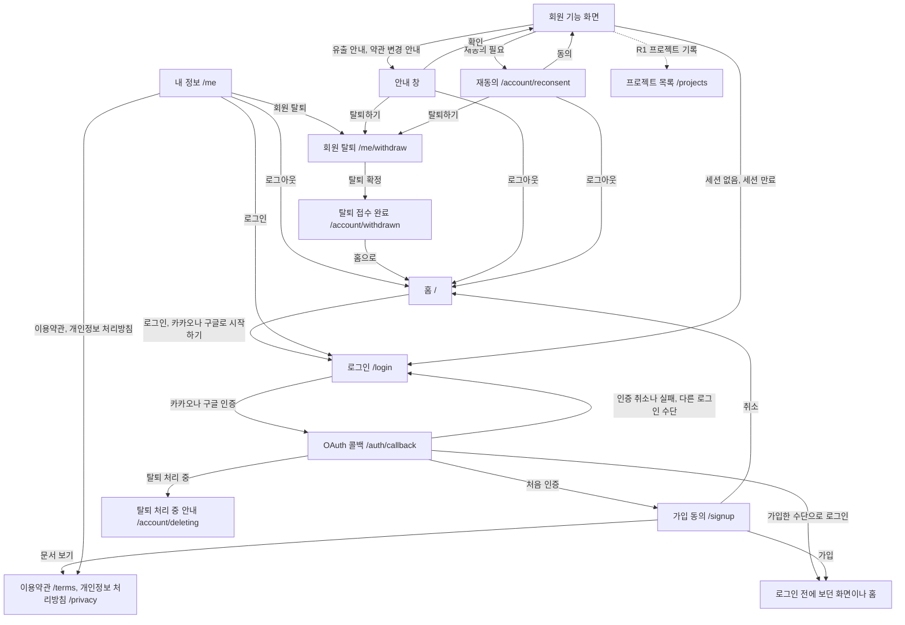

# 계정 화면 흐름

이 문서는 계정 기능의 화면과 화면 사이의 이동을 flowchart와 화면 표로 정한다. 구현하는 사람은 화면마다 경로와 접근 조건, 근거가 되는 사용자 스토리를 확인할 수 있다.

## 화면 이동

점선은 R1에서 002 프로젝트 기록 기능이 만드는 예정된 연결이다. R0의 회원 기능 화면은 로그인한 사용자가 연 내 정보 화면과 회원 탈퇴 화면이며, R1부터는 프로젝트처럼 로그인이 필요한 모든 화면이 같은 확인을 거친다. 회원 기능 화면을 열 때 어느 화면으로 보낼지는 [계정 상태 확인 순서](state.md#계정-상태-확인-순서)를 따른다.

가입은 로그인 화면, 제공자 인증, 가입 동의 화면(체크 세 개와 가입 버튼)을 거친다. 탈퇴는 회원 탈퇴 화면에서 안내를 읽고 확정 버튼 한 번을 누르면 끝나므로, 가입보다 화면 수와 입력 단계가 많지 않다(NFR-01).

## 화면 표

| 화면 | 경로 | 접근 조건 | 관련 US |
|---|---|---|---|
| 홈 | `/` | 모두. 로그인하지 않았으면 앱 바의 `로그인` 버튼과 카카오·구글 시작 버튼을 보여 준다([R1 화면 구성](../../../design/r1-screens.md#로그아웃-홈)). 게시 중인 유출 안내가 있으면 위쪽에 안내를 보여 준다 | US-01, US-09 |
| 로그인 | `/login` | 로그인하지 않은 사용자. 카카오와 구글 버튼, 이용약관과 처리방침 링크를 둔다. 인증을 취소하거나 실패하면 다시 시도할 수 있다는 안내를, 세션이 끝났으면 로그인이 끝났다는 안내를, 다른 수단으로 들어왔으면 가입한 로그인 수단을 안내한다 | US-01, US-02 |
| OAuth 콜백 | `/auth/callback` | 화면 없이 인증 결과를 처리하고 다음 화면으로 보낸다 | US-01, US-02 |
| 가입 동의 | `/signup` | 가입 대기 사용자. '만 14세 이상입니다', 이용약관 동의(필수), 개인정보 처리방침 동의(필수) 체크와 문서 보기 링크, 가입과 취소 버튼을 둔다. 만 14세 이상에 체크하지 않고 가입을 누르면 만 14세 미만은 가입할 수 없다고 안내한다 | US-01, US-03, US-08 |
| 이용약관, 개인정보 처리방침 | `/terms`, `/privacy` | 모두. 시행 중인 버전의 본문과 시행일을 보여 주고, 공지 중인 다음 버전이 있으면 시행 예정 버전, 시행일, 바뀐 내용 요약을 위쪽에 보여 준다 | US-03, US-07 |
| 내 정보 | `/me` | 모두. 로그인한 회원에게는 계정 구역에 로그인 수단과 이메일(있을 때), 로그아웃, 회원 탈퇴를 보여 준다. 도움말 구역에 이용약관과 처리방침 링크를 둔다([R1 화면 구성](../../../design/r1-screens.md#내-정보)) | US-05, US-06 |
| 회원 탈퇴 | `/me/withdraw` | 회원. 재동의를 마치지 않은 회원과 시행 뒤 약관 변경 안내를 확인하지 않은 회원도 열 수 있다. 삭제되는 데이터, 3개월 동안 보존하는 로그인 기록, 접수한 때부터 24시간 안에 삭제가 끝난다는 사실, 되돌릴 수 없다는 사실을 보여 주고 `탈퇴` 버튼 하나를 둔다 | US-06 |
| 탈퇴 접수 완료 | `/account/withdrawn` | 탈퇴를 접수해 로그아웃된 사용자. 접수 시각과 24시간 안에 삭제가 끝난다는 안내를 보여 준다 | US-06 |
| 탈퇴 처리 중 안내 | `/account/deleting` | 삭제를 마치기 전에 다시 로그인한 사용자. 안내를 보여 줄 때 이미 로그아웃되어 있다 | US-06 |
| 재동의 | `/account/reconsent` | 재동의가 필요한 회원. 바뀐 문서의 버전, 시행일, 바뀐 내용 요약, 문서 보기 링크, 동의 버튼, 로그아웃, 탈퇴하기를 둔다 | US-03, US-05, US-06 |
| 약관 변경 안내 창 | 회원 기능 화면 위 대화상자 | 확인하지 않은 불리하거나 중요한 변경이 있는 회원. 시행 예정 버전(또는 시행된 버전), 시행일, 바뀐 내용 요약과 확인 버튼을 둔다. 시행 뒤에는 로그아웃과 탈퇴하기도 둔다 | US-10, US-05, US-06 |
| 유출 안내 창 | 회원 기능 화면 위 대화상자 | 게시 중인 유출 안내를 보지 않은 이메일 없는 회원. 안내 본문과 확인 버튼을 둔다 | US-09 |

모든 화면은 휴대폰 세로 화면을 기준으로 가로 스크롤 없이 배치하고, `globals.css`의 색 토큰을 써서 라이트 모드와 다크 모드에서 모두 읽히게 한다(NFR-08, 헌법 P-12). 카카오와 구글 버튼은 각 회사의 로그인 버튼 디자인 가이드를 따른다([비주얼 시스템](../../../design/visual-system.md)). 화면 문구는 [브랜드와 말투](../../../design/brand.md)의 해요체 규칙을 따른다.

## 관련 문서

- [요구사항](../requirements.md): 화면의 근거인 사용자 스토리
- [시나리오 시퀀스](sequence.md): 화면에서 시작하는 요청 흐름
- [상태 전이](state.md): 회원 기능을 열 때 보내는 화면의 순서
- [함뜨까 프로젝트 헌법](../../../constitution.md): 모바일 우선과 다크 모드 원칙(P-12)
- [화면 구조](../../../design/information-architecture.md), [R1 화면 구성](../../../design/r1-screens.md), [비주얼 시스템](../../../design/visual-system.md), [브랜드와 말투](../../../design/brand.md): 모든 화면이 따르는 공통 규칙
