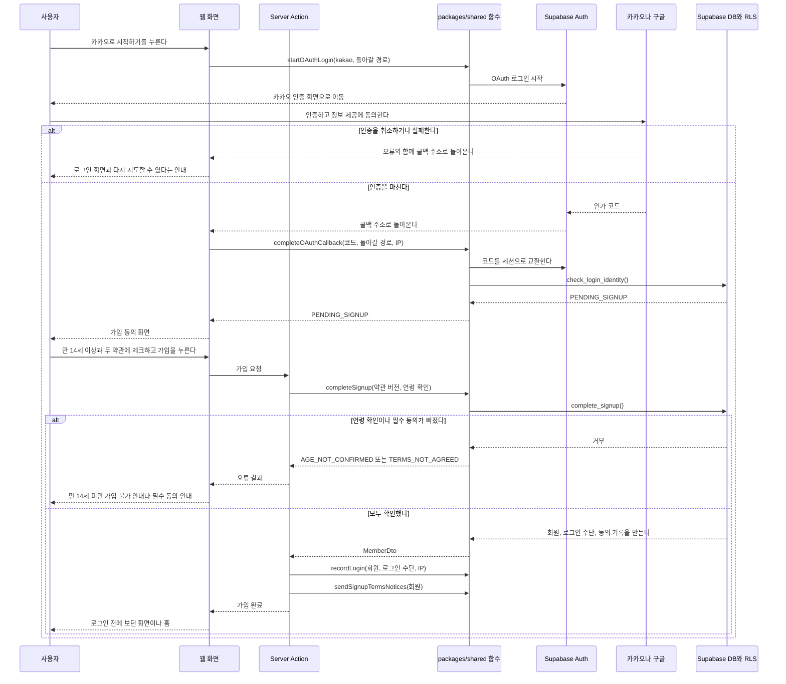
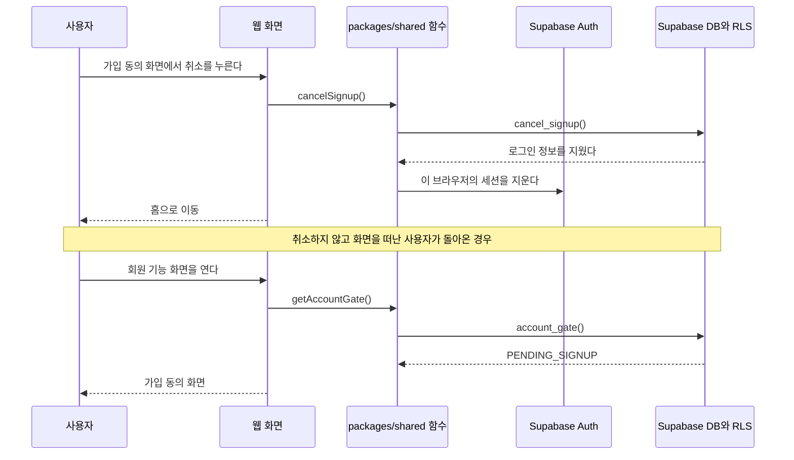
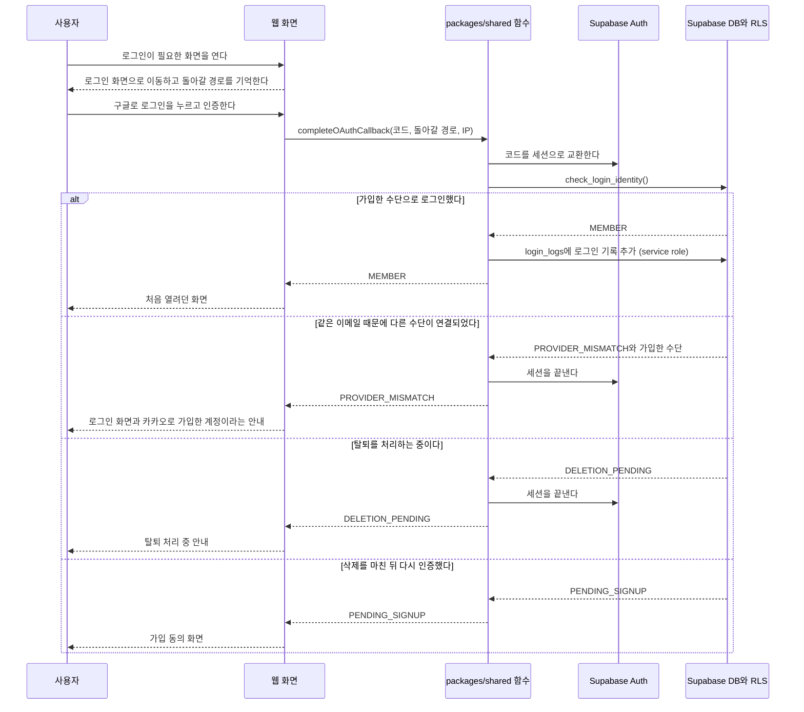
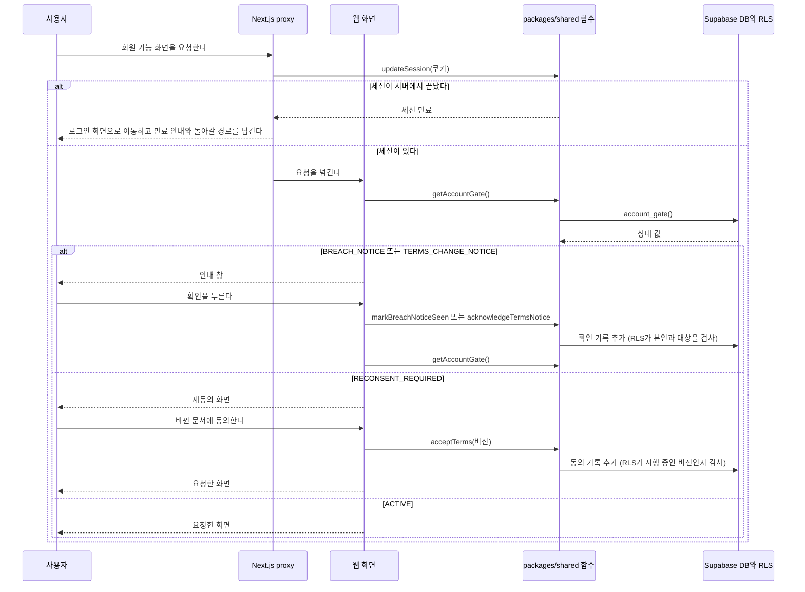
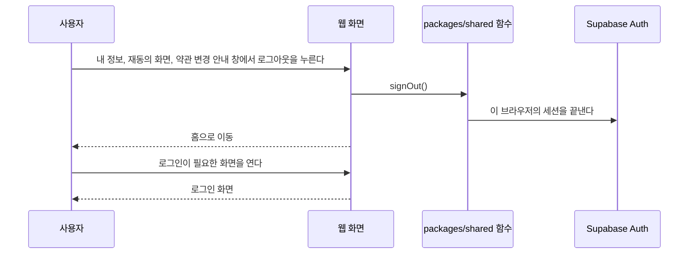
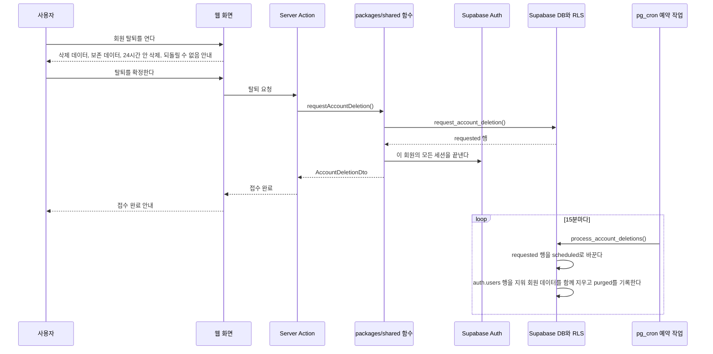
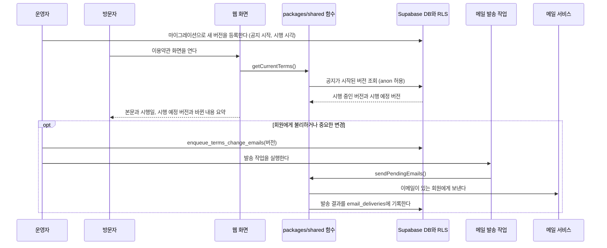
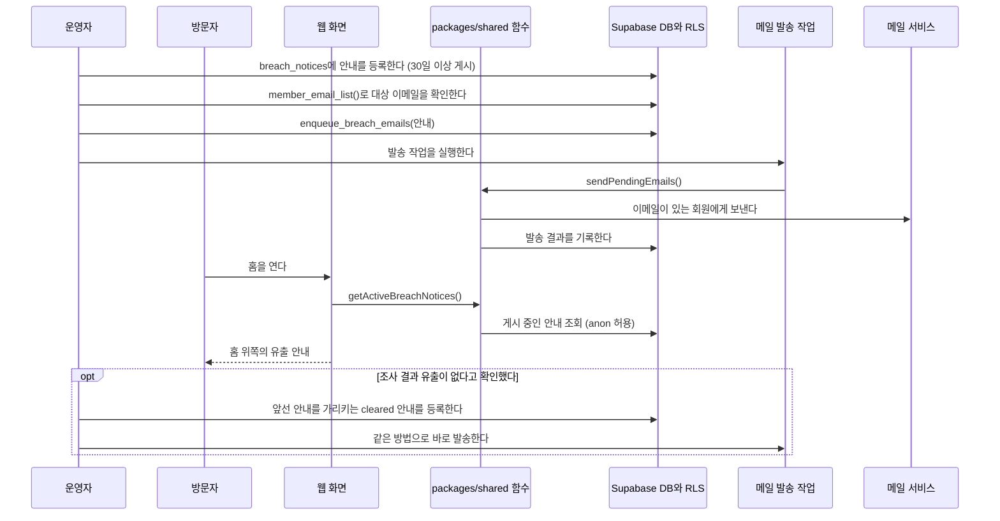
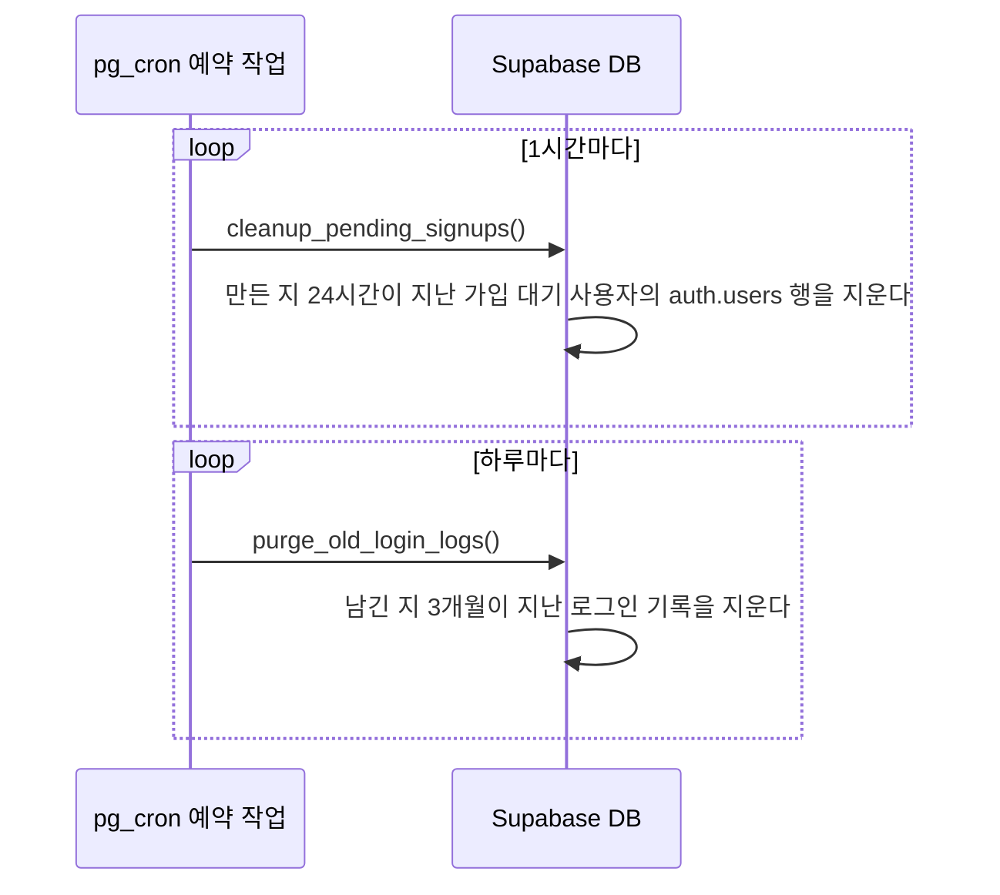

# 계정 시나리오 시퀀스

이 문서는 계정 기능의 주요 시나리오에서 화면, Server Action, shared 함수, Supabase Auth, DB, 예약 작업이 주고받는 요청을 sequenceDiagram으로 정한다. 구현하는 사람은 시나리오마다 어느 계층이 무엇을 호출하고, 실패와 권한 검사를 어디서 처리하는지 확인할 수 있다.

## 시나리오 목록

| 시나리오 | 관련 AC |
|---|---|
| [처음 가입한다](#처음-가입한다) | AC-01, AC-02, AC-03, AC-09, AC-16, AC-34 |
| [가입을 취소하거나 마치지 않고 떠난다](#가입을-취소하거나-마치지-않고-떠난다) | AC-08, AC-19, AC-20 |
| [회원이 다시 로그인한다](#회원이-다시-로그인한다) | AC-06, AC-07, AC-17, AC-18, AC-28 |
| [회원 기능을 열 때 계정 상태를 확인한다](#회원-기능을-열-때-계정-상태를-확인한다) | AC-08, AC-21, AC-23, AC-26, AC-27, AC-29, AC-30, AC-33 |
| [로그아웃한다](#로그아웃한다) | AC-11, AC-31 |
| [탈퇴를 요청하고 삭제한다](#탈퇴를-요청하고-삭제한다) | AC-12, AC-13, AC-31 |
| [약관 새 버전을 공지하고 알린다](#약관-새-버전을-공지하고-알린다) | AC-10, AC-22, AC-30, AC-34 |
| [유출 안내를 게시하고 알린다](#유출-안내를-게시하고-알린다) | AC-25, AC-26, AC-32 |
| [예약 작업이 기록을 정리한다](#예약-작업이-기록을-정리한다) | AC-13, AC-20, AC-24 |

AC-14와 AC-15는 화면 흐름이 아니라 RLS 정책으로 확인하므로 [데이터 모델과 RLS 정책](erd.md#rls-정책)에서 다룬다.

## 처음 가입한다

가입 동의 화면도 체크 항목을 검사하지만, 회원을 만들지는 `complete_signup()`이 판단한다. 회원, 로그인 수단, 동의 기록은 한 트랜잭션으로 만들어지므로 하나라도 실패하면 아무것도 남지 않는다(AC-03, AC-09). 카카오가 이메일을 주지 않으면 이메일이 빈 회원이 만들어진다(AC-02). `sendSignupTermsNotices`는 공지 중인 불리하거나 중요한 변경이 있고 회원에게 이메일이 있을 때만 메일을 보낸다(AC-34).

## 가입을 취소하거나 마치지 않고 떠난다

취소하면 로그인 정보가 바로 지워지고 회원과 동의 기록은 만들어지지 않는다(AC-19). 취소하지 않고 떠난 사용자는 회원 기능을 열 때마다 가입 동의 화면으로 돌아오며(AC-08), 인증한 때부터 24시간이 지나면 [예약 작업](#예약-작업이-기록을-정리한다)이 로그인 정보를 지운다(AC-20).

## 회원이 다시 로그인한다

기존 회원은 약관 동의 화면 없이 처음 열려던 화면으로 돌아간다(AC-06). 로그인 기록은 회원이 가입한 수단으로 로그인했을 때 남기며, IP 주소는 콜백 요청에서 읽는다(AC-28). Supabase Auth가 같은 이메일을 이유로 구글 로그인 정보를 카카오 회원에 연결해도, 회원의 `auth_identities`에 구글이 없으므로 세션을 끝낸다(AC-07). 삭제를 마친 회원은 `members` 행이 없으므로 처음 가입하는 사용자와 같은 절차를 밟고, 이전 기록이 없는 새 회원이 된다(AC-17, AC-18).

## 회원 기능을 열 때 계정 상태를 확인한다

로그인 상태는 refresh token이 만료되지 않는 Supabase Auth 기본 설정으로 유지되므로, 브라우저를 다시 열어도 proxy가 세션을 이어 간다(AC-23). 세션이 서버에서 끝났으면 만료 안내와 함께 로그인 화면으로 보내고, 다시 로그인하면 열려던 화면으로 돌아간다(AC-27). 안내 창을 확인한 뒤에는 상태를 다시 확인하므로, 재동의가 남아 있으면 재동의 화면이 이어서 나온다(AC-33). 로그인을 유지한 회원도 회원 기능을 열 때 같은 확인을 거친다(AC-26, AC-29, AC-30).

## 로그아웃한다

로그아웃은 현재 브라우저의 세션만 끝낸다(FR-19). 재동의 화면과 시행 뒤의 약관 변경 안내 창에서도 같은 함수로 로그아웃한다(AC-31).

## 탈퇴를 요청하고 삭제한다

탈퇴는 내 정보, 재동의 화면, 시행 뒤의 약관 변경 안내 창에서 열 수 있고, 동의를 마치지 않은 회원도 탈퇴 화면을 열어 접수할 수 있다(AC-31). 탈퇴 화면은 안내 한 화면과 확정 버튼 하나로 끝나므로, 가입 동의 화면보다 단계가 많지 않다(NFR-01, AC-12). 삭제가 끝나면 로그인 기록만 분리된 테이블에 남는다(AC-13).

## 약관 새 버전을 공지하고 알린다

R0에는 관리자 화면이 없으므로 약관 버전은 SQL 마이그레이션으로 등록한다. 공지 시작 시각을 시행 7일 전, 불리하거나 중요한 변경은 30일 전보다 늦게 넣으면 erd.md에 정한 CHECK 제약이 마이그레이션을 막는다. 메일 발송 작업은 서버의 작업 경로이며, 비밀 값으로 호출을 확인하고 하루 한 번 자동으로도 실행된다. 공지를 시작한 뒤 시행 전까지 가입한 회원에게는 [가입을 마친 때](#처음-가입한다) 바로 보낸다(AC-30, AC-34). 재동의가 필요 없는 버전은 공지만 하고, 시행된 뒤에도 재동의 화면을 띄우지 않는다(AC-22).

## 유출 안내를 게시하고 알린다

운영자는 화면 없이 `member_email_list()`로 이메일이 있는 회원 목록을 한 번에 조회한다(AC-25). 이메일이 없는 회원은 게시 기간에 회원 기능을 처음 열 때 [계정 상태 확인](#회원-기능을-열-때-계정-상태를-확인한다)에서 같은 안내를 본다(AC-26). 유출 가능성 안내의 본문에는 유출 여부가 확정되면 다시 알린다는 문장을 넣고, 유출이 없다고 확인되면 같은 방법으로 즉시 다시 알린다(AC-32).

## 예약 작업이 기록을 정리한다

예약 작업은 DB 안에서 실행되므로 브라우저나 서버 코드를 거치지 않는다. 가입 대기 사용자의 로그인 정보는 24시간 뒤에 지워지고, 같은 계정으로 다시 로그인하면 가입 절차를 처음부터 진행한다(AC-20). 로그인 기록은 3개월이 지난 행만 지우고 그보다 새 행은 남긴다(AC-24). 탈퇴 삭제 작업은 [탈퇴 시나리오](#탈퇴를-요청하고-삭제한다)에 있다(AC-13).

## 관련 문서

- [요구사항](../requirements.md): 시나리오가 확인하는 AC
- [도메인 모델](domain.md): 시나리오에 나오는 shared 함수와 DTO
- [데이터 모델과 RLS 정책](erd.md): 시나리오에서 허용하거나 거부하는 정책과 DB 함수
- [상태 전이](state.md): 계정 상태 확인 순서
- [ADR-0005 Supabase Auth와 카카오·구글 로그인](../../../decisions/0005-auth-supabase-social-login.md): OAuth 로그인 흐름
