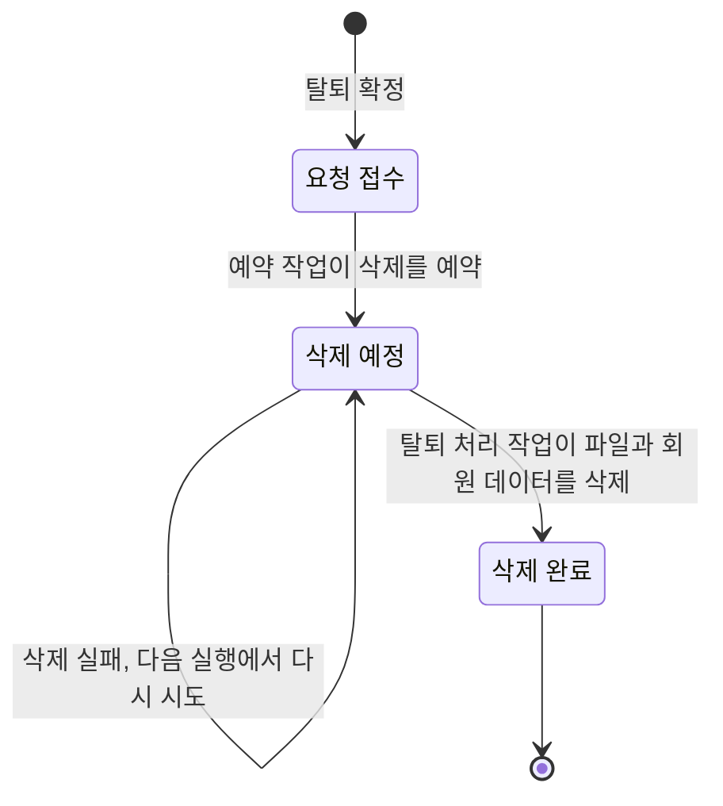
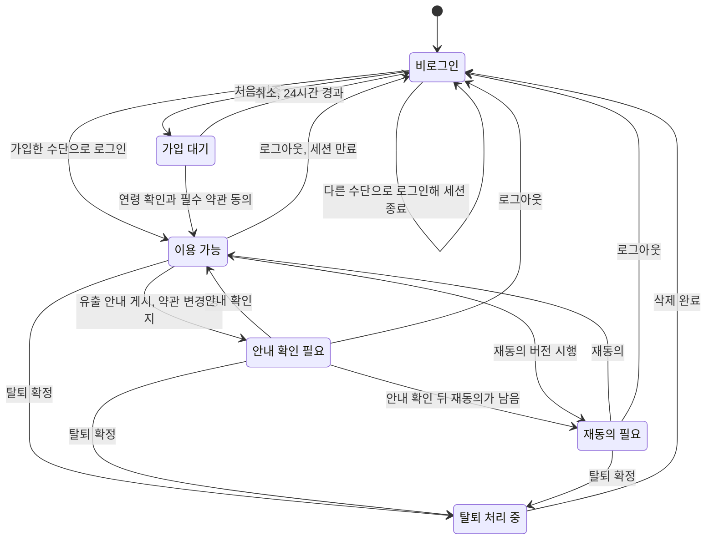

# 계정 상태 전이

이 문서는 탈퇴 처리 상태와, 로그인한 사용자가 회원 기능을 열 때 확인하는 계정 상태를 stateDiagram-v2와 전이 표로 정한다. 구현하는 사람은 허용되는 전이와 조건, 상태를 판단하는 순서를 확인하고, 표에 없는 전이를 막는 테스트를 쓸 수 있다.

## 탈퇴 처리 상태

탈퇴 처리는 `account_deletions.status`의 requested, scheduled, purged를 차례로 거치고, 상태마다 `requested_at`, `scheduled_at`, `purged_at`을 남긴다(FR-23). 되돌아가는 전이가 없으므로 접수한 탈퇴는 철회할 수 없다. 탈퇴 처리 작업은 15분마다 실행되고 실패한 행을 다음 실행에서 다시 시도하므로, 접수한 때부터 24시간 안에 purged까지 끝난다.

| 현재 | 이벤트 | 다음 | 조건 | 근거 |
|---|---|---|---|---|
| 없음 | 탈퇴 확정 | 요청 접수(Requested) | 처리 중인 탈퇴가 없는 회원. 접수와 함께 그 회원의 모든 세션을 끝낸다 | FR-22, FR-24, AC-12 |
| 요청 접수(Requested) | 탈퇴 처리 작업 실행 | 삭제 예정(Scheduled) | 없음 | FR-23 |
| 삭제 예정(Scheduled) | 탈퇴 처리 작업 실행 | 삭제 완료(Purged) | 회원의 저장소 파일을 모두 지운 뒤 `auth.users` 행을 지운다. 회원과 회원 데이터가 함께 지워지고 `member_id`는 비워진다. 로그인 기록은 남는다 | FR-25, FR-26, AC-13, 004 AC-17 |
| 삭제 예정(Scheduled) | 삭제 실패 | 삭제 예정(Scheduled) | 시도 횟수와 마지막 실패 이유를 남기고 다음 실행에서 다시 시도한다 | FR-23 |

## 계정 상태

계정 상태는 저장하는 값이 아니라, 로그인한 사용자가 회원 기능을 열 때마다 `account_gate()`가 판단하는 값이다. 안내 확인 필요와 재동의 필요 상태에서도 로그아웃과 탈퇴는 할 수 있다(FR-19, FR-21). 탈퇴 처리 중인 회원은 접수할 때 로그아웃되고, 삭제가 끝나기 전에 다시 로그인하면 탈퇴 처리 중 안내를 본 뒤 다시 로그아웃된다(FR-24).

| 현재 | 이벤트 | 다음 | 조건 | 근거 |
|---|---|---|---|---|
| 비로그인 | 처음 인증 | 가입 대기 | `members` 행이 없다. 삭제를 마친 회원이 다시 인증한 경우도 여기에 해당한다 | FR-05, FR-24, AC-18 |
| 비로그인 | 가입한 수단으로 로그인 | 이용 가능 | 이번 로그인에 쓴 로그인 수단이 회원의 `auth_identities`와 같다. 안내나 재동의가 필요하면 아래 순서에 따라 그 상태로 판단한다 | FR-02, AC-06 |
| 비로그인 | 다른 수단으로 로그인 | 비로그인 | 이번 로그인에 쓴 로그인 수단이 회원의 `auth_identities`에 없다. 세션을 끝내고 가입한 수단을 안내한다 | FR-04, AC-07 |
| 가입 대기 | 연령 확인과 필수 약관 동의 | 이용 가능 | 만 14세 이상을 확인했고, 시행 중인 두 문서에 모두 동의했다 | FR-10, FR-15, AC-01 |
| 가입 대기 | 취소, 24시간 경과 | 비로그인 | 로그인 정보를 지운다 | FR-16, FR-27, AC-19, AC-20 |
| 이용 가능 | 유출 안내 게시 | 안내 확인 필요 | 이메일이 없는 회원이고, 게시 중인 안내를 아직 보지 않았다 | FR-30, FR-33, AC-26, AC-32 |
| 이용 가능 | 약관 변경 공지 | 안내 확인 필요 | 공지 중인 `material_change` 버전이 있고, 회원이 그 버전의 시행 전에 가입했으며, 안내를 확인하지도 그 버전에 동의하지도 않았다 | FR-32, AC-30, AC-34 |
| 안내 확인 필요 | 안내 확인 | 이용 가능 또는 재동의 필요 | 재동의가 남아 있으면 재동의 필요로 판단한다 | FR-32, AC-33 |
| 이용 가능 | 재동의 버전 시행 | 재동의 필요 | 회원이 마지막에 동의한 버전보다 새로 시행된 버전 가운데 `requires_reconsent`인 버전이 있다 | FR-28, AC-21, AC-29 |
| 재동의 필요 | 재동의 | 이용 가능 | 그 종류의 시행 중인 최신 버전에 동의 기록을 추가한다 | FR-11, FR-28 |
| 이용 가능, 안내 확인 필요, 재동의 필요 | 로그아웃 | 비로그인 | 현재 브라우저의 세션을 끝낸다 | FR-19, AC-11, AC-31 |
| 이용 가능 | 세션 만료 | 비로그인 | 세션이 서버에서 끝났다 | FR-20, AC-27 |
| 이용 가능, 안내 확인 필요, 재동의 필요 | 탈퇴 확정 | 탈퇴 처리 중 | 위 탈퇴 처리 상태의 첫 전이 | FR-21, FR-22, AC-12, AC-31 |
| 탈퇴 처리 중 | 삭제 완료 | 비로그인 | 같은 계정으로 다시 인증하면 가입 대기가 된다 | FR-24, AC-18 |

## 계정 상태 확인 순서

`account_gate()`는 아래 순서로 조건을 확인하고, 처음 맞는 상태를 결과로 알려 준다.

| 순서 | 조건 | 상태 값 | 화면 |
|---|---|---|---|
| 1 | 세션이 없다 | `ANONYMOUS` | 로그인 화면. 세션이 끝난 경우에는 만료 안내를 함께 보여 준다 |
| 2 | `members` 행이 없다 | `PENDING_SIGNUP` | 가입 동의 화면 |
| 3 | 처리 중인 탈퇴가 있다 | `DELETION_PENDING` | 탈퇴 처리 중 안내 |
| 4 | 이메일이 없는 회원이 게시 중인 유출 안내를 보지 않았다 | `BREACH_NOTICE` | 유출 안내 창. 확인하면 본 기록을 남기고 다음 순서로 넘어간다 |
| 5 | 확인하지 않은 약관 변경 안내가 있다 | `TERMS_CHANGE_NOTICE` | 약관 변경 안내 창. 시행 전에는 닫을 수 있고, 시행 뒤에는 확인해야 넘어간다 |
| 6 | 재동의가 필요한 버전이 있다 | `RECONSENT_REQUIRED` | 재동의 화면 |
| 7 | 위 조건에 해당하지 않는다 | `ACTIVE` | 요청한 화면 |

안내 창은 회원 기능 화면 위에 대화상자로 열린다. 시행 뒤의 약관 변경 안내 창과 재동의 화면에는 로그아웃과 탈퇴하기를 둔다(FR-19, FR-21, FR-28, FR-32).

## 관련 문서

- [요구사항](../requirements.md): 상태 전이의 근거인 FR과 AC
- [데이터 모델과 RLS 정책](erd.md): 상태를 판단하는 테이블과 DB 함수
- [도메인 모델](domain.md): 상태 값을 알려 주는 shared 함수
- [화면 흐름](screens.md): 상태마다 보내는 화면
