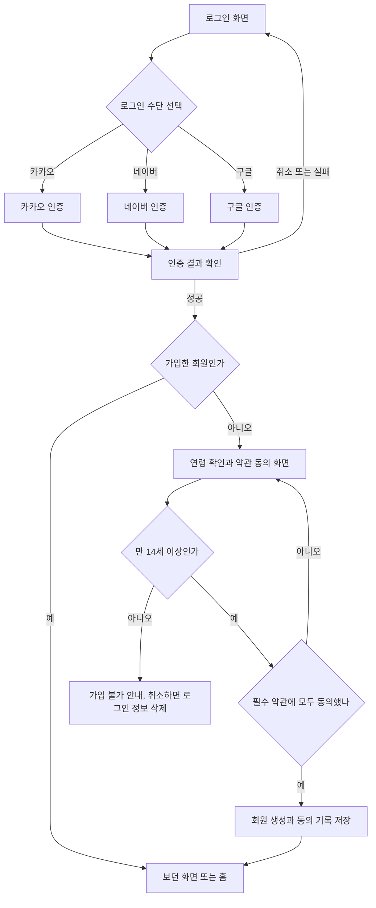
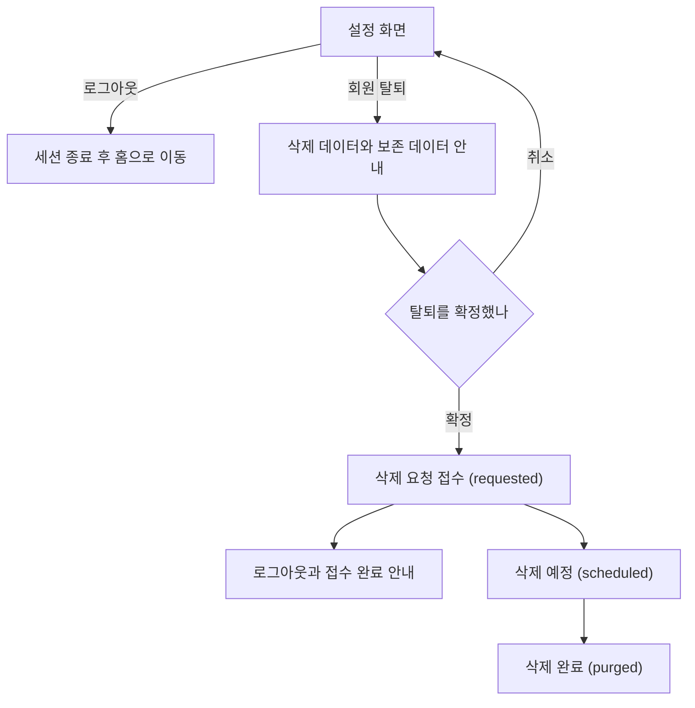

# 계정: 가입·로그인·약관 동의·탈퇴 요구사항

이 문서는 R0 기반 출시에 들어가는 계정 기능의 요구사항을 정의한다. 카카오·구글 가입과 로그인, 약관 동의 기록과 연령 확인, 로그아웃, 회원 탈퇴를 사용자 스토리와 기능 요구사항, 수용 기준으로 정리했다. 설계, 작업 분해, 테스트는 이 문서에 붙은 ID를 기준으로 삼는다.

## 상태와 승인

이 문서는 2026-11-19에 Feature 이슈 `[001] 계정: 가입·로그인·약관 동의·탈퇴`의 '요구사항 검토' Task에서 승인되었고, 2026-11-20에 리뷰에서 나온 Q-12~Q-18을 반영해 다시 승인되었다. 2026-11-24에 설계 단계에서 나온 Q-19를 반영해 다시 승인되었다. 같은 날 네이버 로그인을 R0에 넣는 Q-20을 반영해 다시 승인된 기준 문서다. 설계와 이후의 작업 분해, 테스트는 이 문서를 기준으로 삼는다.

[확인 질문](#확인-질문)은 모두 해결했고, 결정 내용은 [해결 기록](#해결-기록)에 있다. 요구사항을 바꿔야 하면 설계나 이슈보다 이 문서를 먼저 고치고, `status`를 `review`로 되돌려 다시 승인을 받는다.

| 항목 | 값 |
|---|---|
| 상태 | 승인 (`approved`) |
| 출시 단계 | R0 기반 |
| 기능 ID | F-ACCT-01, F-ACCT-02, F-ACCT-04, F-ACCT-05 |
| Feature 이슈 | [#8](https://github.com/god3v/hamtteukka/issues/8) `[001] 계정: 가입·로그인·약관 동의·탈퇴` |
| 승인 위치 | Feature 이슈의 '요구사항 검토' Task ([#9](https://github.com/god3v/hamtteukka/issues/9) `[001] 요구사항 검토와 확인 질문 해결`) |
| 선행 명세 | 없음 |
| 연결된 미결정 항목 | [OD-01 만 14세 미만 가입 처리](../../decisions/README.md), [OD-02 탈퇴 데이터 처리](../../decisions/README.md) (2026-11-19 결정됨, Q-01과 Q-02의 해결 기록 참고) |
| 승인 조건 | 확인 질문(Q)을 모두 해결했다 |
| 승인 후 단계 | `/sdd-design` |

## 배경

함뜨까의 R1 MVP는 프로젝트 기록, 단수 카운터, 게이지, 내 도안 파일 같은 개인 뜨개 도구로 구성된다([ADR-0008](../../decisions/0008-mvp-personal-tools.md)). 퀵 카운터를 뺀 나머지 도구는 기록을 서버에 저장하므로 회원 계정이 먼저 있어야 한다. 그래서 R0에서 가입, 로그인, 탈퇴를 먼저 만들고, 운영 도메인에서 세 흐름이 동작하는 것을 R0 완료 조건으로 삼는다.

인증은 Supabase Auth가 맡고, 첫 로그인 수단은 카카오, 네이버, 구글로 정했다([ADR-0015](../../decisions/0015-auth-providers-with-naver.md)). 회원은 이메일이 아니라 로그인 제공자와 제공자가 발급한 사용자 ID의 조합으로 식별한다. 동의 기록은 나중에 소급해서 만들 수 없으므로 첫 가입자부터 남기며, 판매 기능이 열린 뒤에도 증빙 자료로 쓴다([ADR-0007](../../decisions/0007-sales-ready-data-model.md)).

이 요구사항이 근거로 삼은 조사 내용은 다음과 같다. 모든 출처는 2026-11-18에 조사한 기준이다.

- 카카오 로그인은 비즈 앱으로 전환해야 이메일을 받을 수 있다. 비즈 앱이 아니면 Supabase에서 'Allow users without an email' 옵션을 켜야 한다([Supabase 카카오 로그인 문서](https://supabase.com/docs/guides/auth/social-login/auth-kakao)).
- 개인정보 보호법 제38조 제4항은 삭제 같은 권리 행사 절차를 개인정보 수집 절차보다 어렵지 않게 만들도록 요구한다([개인정보 보호법 제38조](https://casenote.kr/법령/개인정보_보호법/제38조)).
- 만 14세 미만 아동의 개인정보를 동의에 근거해 처리하려면 법정대리인의 동의를 받고 확인해야 한다([개인정보 보호법 제22조의2](https://casenote.kr/법령/개인정보_보호법/제22조의2)).
- 개인정보 처리방침에는 처리 목적, 보유 기간, 파기, 위탁, 권리 행사 방법, 보호책임자 연락처 등을 담아 공개해야 한다([개인정보 보호법 제30조](https://casenote.kr/법령/개인정보_보호법/제30조)).
- 2026-09-11 시행된 개정 개인정보 보호법은 유출이 확인되기 전이라도 유출 가능성을 알면 지체 없이 정보주체에게 알리도록 한다([법률신문](https://www.lawtimes.co.kr/news/articleView.html?idxno=226177)).
- 2026년 10월 1일 시행된 개정 정보통신망법은 광고성 정보 전송 제한을 문자, 이메일, 앱 푸시 광고에도 적용한다([법률신문](https://www.lawtimes.co.kr/news/articleView.html?idxno=226177)).
- 도아니티는 가입할 때 이용약관(필수), 개인정보 처리방침(필수), 광고 수신(선택) 동의를 항목별로 받는다([도아니티 가입 화면](https://www.doanity.com/signup)).
- 도아니티는 회원이 탈퇴하면 회원 정보를 즉시 지우지만 글과 댓글은 남긴다([도아니티 FAQ](https://doanity.notion.site/FAQ-5859c83e51f14ef49d76353fb95a8f2d)).

확인 질문을 정하면서 2026-11-19에 추가로 확인한 사실은 다음과 같다. 출처와 확인하지 못한 항목은 [계정 정책의 법령과 서비스 조건 확인](../../research/2026-11-19-account-policy-facts.md)에 있다.

- 법령에는 만 14세 이상인지 확인하는 방법을 정한 조문이 없다. 나이와 본인 여부를 반드시 확인해야 하는 경우는 청소년유해매체물을 제공할 때다.
- 광고성 정보 수신 동의를 받으면 동의를 받은 날부터 2년마다 수신 동의 여부를 확인해야 한다(정보통신망법 시행령 제62조의3).
- 통신비밀보호법 시행령 제41조는 전기통신사업자에게 인터넷 로그기록을 3개월 이상 보관하게 한다. 뜨개 기록 서비스가 이 의무 대상인지는 확인하지 못했다.
- 연락처를 알 수 없는 정보주체에게는 홈페이지에 30일 이상 게시하는 것으로 유출 통지를 대신할 수 있다(개인정보 보호법 시행령 제39조제3항).
- Supabase Auth의 refresh token은 기본으로 만료되지 않으며, 일정 기간이나 비활동 뒤 세션을 끝내는 설정은 Pro 요금제 이상에서만 쓸 수 있다.

설계 단계인 2026-11-24에 아래 사실을 추가로 확인했다.

- Supabase Auth는 제공자가 확인한 이메일이 같으면 다른 제공자의 로그인을 기존 사용자에 자동으로 연결하며, 이 동작을 끄는 설정은 문서에 없다([Supabase 계정 연결 문서](https://supabase.com/docs/guides/auth/auth-identity-linking)). 카카오 앱을 비즈 앱으로 전환하지 않으면 카카오가 이메일을 주지 않으므로, 카카오와 구글 사이에서는 이 연결이 생기지 않는다.
- Supabase는 네이버를 기본 제공하지 않지만, 커스텀 OAuth 제공자로 연결할 수 있다. 네이버의 사용자 정보 응답은 Supabase가 기대하는 형식과 달라서 변환 경로가 필요하다. 자세한 내용은 [네이버 로그인 연결 확인](../../research/2026-11-24-naver-login-supabase.md)에 있다.

## 사용자 흐름

### 가입과 로그인

카카오, 네이버, 구글 인증은 같은 확인 단계로 합류한다. 처음 로그인한 사용자는 연령 확인과 필수 약관 동의를 마쳐야 회원이 된다. 만 14세 미만은 가입할 수 없으며, 동의를 마치지 않은 로그인 정보는 FR-27에 따라 삭제한다.

### 로그아웃과 탈퇴

회원이 직접 하는 일은 탈퇴 메뉴를 열고 한 번 확정하는 것까지다. requested 이후의 상태 변경은 시스템이 처리하며, 접수한 때부터 24시간 안에 purged까지 끝낸다. 접수한 탈퇴는 철회할 수 없다.

| 삭제 상태 | 뜻 |
|---|---|
| requested | 회원이 탈퇴를 확정해 삭제 요청이 접수된 상태다. |
| scheduled | 삭제 일정이 정해져 처리를 기다리는 상태다. |
| purged | 회원 데이터를 삭제하고, 법령에 따라 보존할 데이터만 분리해 보관하는 상태다. |

## 사용자 스토리

| ID | 사용자 | 원하는 일 | 이유 | 기능 ID |
|---|---|---|---|---|
| US-01 | 처음 방문한 사용자 | 카카오, 네이버, 구글 가운데 쓰던 계정으로 가입하고 싶다 | 새 비밀번호를 만들지 않고 바로 기록을 시작하려고 | F-ACCT-01, F-ACCT-02 |
| US-02 | 회원 | 가입할 때 쓴 계정으로 다시 로그인하고 싶다 | 내 기록을 이어서 보려고 | F-ACCT-01 |
| US-03 | 가입하는 사용자 | 어떤 약관에 동의하는지 확인한 뒤 항목별로 동의하고 싶다 | 무엇에 동의하는지 알고 가입하려고 | F-ACCT-05 |
| US-05 | 회원 | 다른 사람과 함께 쓰는 기기에서 로그아웃하고 싶다 | 그 기기를 쓰는 다른 사람이 내 계정을 쓰지 못하게 하려고 | F-ACCT-01 |
| US-06 | 회원 | 가입만큼 쉬운 절차로 탈퇴하고, 내 데이터가 언제 지워지는지 알고 싶다 | 서비스를 그만 쓸 때 번거롭지 않게 정리하려고 | F-ACCT-04 |
| US-07 | 운영자 | 회원이 어느 버전의 약관에 언제 동의했는지 확인하고 싶다 | 분쟁이 생겼을 때 증빙을 내려고 | F-ACCT-05 |
| US-08 | 운영자 | 만 14세 미만 사용자의 개인정보를 법정대리인 확인 없이 처리하지 않으려고 한다 | 개인정보 보호법 제22조의2를 지키려고 | F-ACCT-05 |
| US-09 | 운영자 | 개인정보 유출 사고가 생기면 이메일이 없는 회원까지 모든 회원에게 알리고 싶다 | 개인정보 보호법이 정한 통지 의무를 지키려고 | F-ACCT-04 |
| US-10 | 회원 | 나에게 불리하거나 중요한 약관 변경은 시행 전에 따로 알림을 받고 싶다 | 바뀐 내용을 미리 보고 계속 쓸지 정하려고 | F-ACCT-05 |

## 기능 요구사항

### 가입과 로그인

| ID | 요구사항 | 관련 US |
|---|---|---|
| FR-01 | 로그인 화면은 카카오, 네이버, 구글 로그인 버튼을 제공한다. 가입과 로그인은 같은 버튼에서 시작한다. | US-01, US-02 |
| FR-02 | 시스템은 회원을 로그인 제공자와 제공자 사용자 ID의 조합으로 식별한다. 이메일은 식별 키로 쓰지 않는다. | US-01, US-02 |
| FR-03 | 이메일은 선택 정보로 저장한다. 제공자가 이메일을 주지 않아도 가입과 로그인을 끝까지 진행할 수 있다. | US-01 |
| FR-04 | 로그인 제공자가 다르면 이메일이 같아도 같은 회원으로 합치지 않는다. 회원은 가입할 때 쓴 로그인 수단으로만 로그인한다. 인증 서비스가 같은 이메일을 이유로 다른 제공자의 로그인을 기존 회원에 연결하면, 시스템은 그 로그인의 세션을 끝내고 가입할 때 쓴 로그인 수단으로 로그인하라고 안내한다. | US-02 |
| FR-05 | 처음 로그인한 사용자는 연령 확인과 필수 약관 동의를 마친 뒤에 회원이 된다. 이 단계를 마치기 전에는 회원 기능을 쓸 수 없고, 다음 로그인 때 같은 화면을 다시 보여 준다. | US-01, US-03 |
| FR-06 | 로그인을 마치면 로그인 전에 보던 화면으로 돌아간다. 돌아갈 화면이 없으면 홈으로 이동한다. | US-02 |
| FR-07 | 사용자가 제공자 인증을 취소하거나 인증이 실패하면 로그인 화면으로 돌아오고, 다시 시도할 수 있다고 안내한다. | US-01 |
| FR-27 | 인증은 마쳤지만 연령 확인과 필수 약관 동의를 마치지 않은 사용자의 로그인 정보는 회원 정보로 다루지 않는다. 동의 화면에서 취소하면 그 로그인 정보를 바로 삭제하고, 취소 없이 화면을 떠났으면 인증한 때부터 24시간 뒤에 삭제한다. | US-01, US-03 |

### 약관과 동의 기록

| ID | 요구사항 | 관련 US |
|---|---|---|
| FR-08 | 이용약관과 개인정보 처리방침은 버전별로 관리한다. 각 버전은 버전 번호, 시행일, 본문, 바뀐 내용 요약, 재동의가 필요한지 여부를 가진다. | US-03, US-07 |
| FR-09 | 현재 시행 중인 이용약관과 처리방침은 로그인하지 않아도 열람할 수 있다. 사이트의 공통 영역에서 두 문서로 가는 링크를 제공한다. | US-03 |
| FR-10 | 가입 화면은 이용약관 동의(필수)와 처리방침 동의(필수)를 항목별로 받는다. 두 항목에 모두 동의해야 가입을 마칠 수 있다. 광고성 정보 수신 동의는 R0에서 받지 않는다. | US-03 |
| FR-11 | 회원이 동의하거나 다시 동의할 때마다 회원, 문서 종류, 문서 버전, 동의 여부, 시각을 기록한다. 시각은 서버 시각을 쓴다. | US-07 |
| FR-14 | 시스템은 회원별로 마지막에 동의한 필수 문서의 버전을 조회할 수 있다. 필수 문서의 새 버전은 시행 7일 전부터, 회원에게 불리하거나 중요한 변경은 시행 30일 전부터 약관 화면에 시행 예정 버전, 시행일, 바뀐 내용 요약을 보여 주어 공지한다. | US-03, US-07 |
| FR-32 | 회원에게 불리하거나 중요한 변경은 FR-14의 공지에 더해 회원마다 따로 알린다. 시행 30일 전부터 회원이 회원 기능을 열면 시행 예정 버전, 시행일, 바뀐 내용 요약을 담은 안내 창을 보여 주고, 회원이 확인하면 그 버전의 안내 창을 다시 보여 주지 않는다. 이메일이 있는 회원에게는 같은 내용을 이메일로도 보낸다. 공지를 시작할 때 가입해 있던 회원에게는 시행 30일 전까지 보내고, 공지를 시작한 뒤 시행일 전까지 가입한 회원에게는 가입을 마친 때 보낸다. 시행일까지 안내 창에서 확인하지 않은 회원에게는 시행 뒤 회원 기능을 열 때 안내 창을 보여 주고, 확인하기 전에는 회원 기능을 열지 않는다. 이 안내 창에서도 로그아웃하거나 탈퇴 화면을 열 수 있다. 시행일 뒤에 가입한 회원은 가입할 때 시행 중인 버전에 동의하므로(FR-10), 그 버전의 변경 이메일과 안내 창을 보내지 않는다. | US-10 |
| FR-28 | 재동의가 필요하다고 표시한 버전이 시행되면, 그 버전에 아직 동의하지 않은 회원이 로그인하거나 로그인을 유지한 채 회원 기능을 열 때 재동의 화면을 보여 준다. 재동의를 마치기 전에는 회원 기능을 열지 않지만, 재동의 화면에서 로그아웃하거나 탈퇴 화면을 열 수 있다. 재동의가 필요한 경우는 개인정보 수집 목적, 항목, 보유 기간처럼 동의받은 내용이 바뀌는 경우다. | US-03, US-07 |

### 연령 확인

| ID | 요구사항 | 관련 US |
|---|---|---|
| FR-15 | 가입 화면은 '만 14세 이상입니다' 필수 확인 항목으로 사용자가 만 14세 이상인지 확인한다. 생년월일이나 휴대폰 본인인증은 받지 않는다. 확인 결과와 시각은 동의 기록과 함께 남긴다. | US-08 |
| FR-16 | 만 14세 미만은 가입할 수 없다. 만 14세 이상 확인 항목에 체크하지 않으면 가입을 마칠 수 없고, 화면은 만 14세 미만은 가입할 수 없다고 안내한다. 이 상태에서 취소하거나 화면을 떠나면 FR-27에 따라 로그인 정보를 삭제하고 회원을 만들지 않는다. | US-08 |

### 세션과 로그아웃

| ID | 요구사항 | 관련 US |
|---|---|---|
| FR-17 | 로그인 상태는 브라우저를 닫았다가 다시 열어도 유지되고, 회원이 그 브라우저에서 로그아웃하거나 탈퇴할 때까지 이어진다. 기간이나 비활동을 기준으로 로그인 상태를 끝내지 않는다. | US-02 |
| FR-18 | 로그인하지 않은 사용자가 로그인이 필요한 화면을 열면 로그인 화면으로 보낸다. 로그인을 마치면 FR-06에 따라 원래 화면으로 돌려보낸다. | US-02 |
| FR-19 | 회원은 설정 화면에서 로그아웃할 수 있다. 재동의 화면(FR-28)과 시행 뒤의 약관 변경 안내 창(FR-32)에서도 로그아웃할 수 있다. 로그아웃하면 현재 브라우저의 세션을 끝내고 홈으로 이동한다. | US-05 |
| FR-20 | 세션이 만료된 뒤 회원 기능을 요청하면 만료 사실을 안내하고 로그인 화면으로 보낸다. | US-02 |
| FR-29 | 회원이 로그인할 때마다 로그인 일시, IP 주소, 로그인 수단을 로그인 기록으로 남긴다. 로그인 기록은 남긴 때부터 3개월 동안 보관하고, 3개월이 지난 기록은 파기한다. | US-06, US-07 |

### 탈퇴

| ID | 요구사항 | 관련 US |
|---|---|---|
| FR-21 | 회원은 설정 화면에서 탈퇴를 시작한다. 재동의 화면(FR-28)과 시행 뒤의 약관 변경 안내 창(FR-32)에서도 탈퇴 화면을 열 수 있다. 탈퇴 화면은 삭제되는 데이터, 법령에 따라 보존하는 데이터, 접수한 때부터 24시간 안에 삭제가 끝난다는 사실, 접수한 탈퇴는 되돌릴 수 없다는 사실을 안내한다. | US-06 |
| FR-22 | 회원이 탈퇴를 한 번 확정하면 삭제 요청을 접수한다. 탈퇴 사유 입력이나 별도 문의 절차는 요구하지 않는다. | US-06 |
| FR-23 | 탈퇴 처리는 requested, scheduled, purged 상태를 차례로 거치고, 상태가 바뀐 시각을 기록한다. 삭제 요청을 접수하면 바로 삭제 작업을 예약하고, 접수한 때부터 24시간 안에 purged까지 처리한다. 접수한 탈퇴는 철회할 수 없다. | US-06 |
| FR-24 | 삭제 요청을 접수하면 즉시 로그아웃한다. purged가 되기 전에 같은 계정으로 로그인하면 탈퇴를 처리하고 있다고 안내하고 회원 기능을 열지 않는다. purged가 된 뒤에 같은 계정으로 로그인하면 처음 가입하는 사용자와 같은 가입 절차를 시작한다. | US-06 |
| FR-25 | purged 단계에서는 회원 정보, 로그인 정보, 동의 기록, 회원이 만든 기록을 삭제한다. R1 이후 기능이 추가하는 회원 데이터도 같은 삭제 절차를 따른다. | US-06 |
| FR-26 | R0에서 탈퇴 뒤에도 남기는 데이터는 로그인 기록(FR-29) 하나다. 로그인 기록은 일반 회원 데이터와 분리해 보관하므로 purged 단계에서 지우지 않고, 남긴 때부터 3개월이 지나면 파기한다. | US-06, US-07 |

### 유출 통지

| ID | 요구사항 | 관련 US |
|---|---|---|
| FR-30 | 개인정보 유출이나 유출 가능성을 알게 되면 법령이 정한 기한 안에 회원에게 알린다. 이메일이 있는 회원에게는 이메일로 알리고, 이메일이 없는 회원에게는 홈페이지에 30일 이상 안내를 게시하는 것으로 통지를 대신하며, 게시 기간에 로그인하거나 로그인을 유지한 채 회원 기능을 처음 열 때 같은 안내를 보여 준다. | US-09 |
| FR-33 | 유출 가능성을 알린 뒤 실제로 유출되지 않았다고 확인되면, 즉시 FR-30과 같은 방법으로 그 사실을 회원에게 알린다. 유출 가능성 안내에는 유출 여부가 확정되면 다시 알린다는 사실을 함께 적는다. | US-09 |
| FR-31 | 운영자는 유출 통지(FR-30, FR-33)와 약관 변경 통지(FR-32)를 위해 이메일이 있는 회원의 이메일 목록을 한 번에 조회할 수 있다. R0에는 관리자 화면이 없으므로, 화면 없이 조회할 수 있으면 된다. | US-09 |

## 비기능 요구사항

| ID | 분류 | 요구사항 | 근거 |
|---|---|---|---|
| NFR-01 | 법령 | 탈퇴 절차는 가입 절차보다 화면 수와 입력 단계가 많지 않다. | 개인정보 보호법 제38조 제4항 |
| NFR-02 | 권한 | 회원은 자기 계정 정보와 동의 기록만 조회할 수 있다. 권한은 RLS 정책으로 검사한다. | [ADR-0004](../../decisions/0004-rls-authorization.md) |
| NFR-03 | 무결성 | 동의 기록에는 새 기록 추가만 허용한다. 탈퇴 삭제 절차가 아니면 기존 기록을 고치거나 지우지 않는다. | [ADR-0007](../../decisions/0007-sales-ready-data-model.md) |
| NFR-04 | 구조 | 인증과 회원 데이터에 접근하는 코드는 `packages/shared`에만 둔다. `apps/web`은 shared 함수만 호출한다. | [ADR-0003](../../decisions/0003-data-access-boundary.md) |
| NFR-05 | 데이터 위치 | 회원 데이터는 서울 리전(ap-northeast-2)의 Supabase 프로젝트에 저장한다. | [ADR-0002](../../decisions/0002-stack-nextjs-supabase-vercel.md) |
| NFR-06 | 확장성 | 회원과 로그인 수단을 따로 저장한다. Apple(A1)처럼 로그인 수단을 더할 때 회원 구조를 바꾸지 않기 위해서다. | [ADR-0015](../../decisions/0015-auth-providers-with-naver.md) |
| NFR-07 | 이식성 | Supabase Auth는 비대칭 서명 키로 JWT를 발급한다. R4에 추가할 Spring 서버가 JWKS로 같은 토큰을 검증할 수 있어야 한다. | [ADR-0015](../../decisions/0015-auth-providers-with-naver.md) |
| NFR-08 | 사용성 | 로그인, 동의, 설정, 탈퇴 화면은 휴대폰 브라우저에서 가로 스크롤 없이 쓸 수 있다. | F-UX-01 |

## 수용 기준

수용 기준은 Given/When/Then 형식으로 쓴다. 구현 단계의 테스트 이름에는 `001/AC-01`처럼 기능 번호와 AC ID를 붙인다.

### AC-01 카카오로 처음 가입한다

관련 항목: FR-01, FR-02, FR-05, FR-10, FR-11

- **Given** 가입한 적이 없는 사용자가 로그인 화면을 연 상태다.
- **When** 카카오 인증을 마치고, 만 14세 이상임을 확인하고, 필수 약관 두 개에 동의한다.
- **Then** 카카오 제공자 ID로 식별되는 회원이 생성되고, 동의한 문서의 버전과 시각이 기록된다.

### AC-02 이메일 없이 가입한다

관련 항목: FR-03

- **Given** 카카오 앱이 이메일을 제공하지 않는 설정이다.
- **When** 사용자가 카카오로 가입 절차를 마친다.
- **Then** 이메일이 비어 있는 회원이 생성되고, 가입이 오류 없이 끝난다.

### AC-03 필수 동의 없이는 가입을 마칠 수 없다

관련 항목: FR-05, FR-10

- **Given** 처음 로그인한 사용자가 약관 동의 화면에 있다.
- **When** 이용약관에만 동의하고 처리방침에는 동의하지 않는다.
- **Then** 가입을 마칠 수 없고, 회원과 동의 기록이 만들어지지 않는다.

### AC-06 기존 회원은 보던 화면으로 돌아간다

관련 항목: FR-06, FR-18

- **Given** 구글로 가입한 회원이 로그아웃 상태에서 로그인이 필요한 화면을 열었다.
- **When** 로그인 화면으로 이동해 구글 인증을 마친다.
- **Then** 약관 동의 화면을 거치지 않고, 처음 열려던 화면이 열린다.

### AC-07 로그인 제공자가 다르면 다른 회원이다

관련 항목: FR-02, FR-04

- **Given** 카카오로 가입한 회원이 있고, 같은 이메일을 쓰는 구글 계정이 있다.
- **When** 그 구글 계정으로 로그인한다.
- **Then** 기존 회원으로 로그인되지 않고 새 회원도 만들어지지 않으며, 카카오로 가입한 계정이라는 안내가 보이고 로그아웃된다.

### AC-08 동의를 마치지 않으면 회원 기능을 쓸 수 없다

관련 항목: FR-05

- **Given** 인증만 마치고 약관 동의 화면을 벗어난 사용자가 있다.
- **When** 회원 기능 화면을 열거나 다시 로그인한다.
- **Then** 회원 기능은 열리지 않고, 연령 확인과 약관 동의 화면이 다시 나타난다.

### AC-09 만 14세 이상을 확인하지 않으면 가입할 수 없다

관련 항목: FR-15, FR-16

- **Given** 처음 로그인한 사용자가 연령 확인과 약관 동의 화면에 있다.
- **When** 필수 약관 두 개에는 동의했지만 '만 14세 이상입니다' 항목에는 체크하지 않은 채 가입을 시도한다.
- **Then** 가입을 마칠 수 없고 만 14세 미만은 가입할 수 없다는 안내가 보이며, 회원과 동의 기록은 만들어지지 않는다.

### AC-10 로그인 없이 약관을 열람한다

관련 항목: FR-08, FR-09

- **Given** 로그인하지 않은 방문자가 있다.
- **When** 이용약관이나 처리방침 링크를 연다.
- **Then** 현재 시행 중인 버전의 본문과 시행일이 보인다.

### AC-11 로그아웃한다

관련 항목: FR-18, FR-19

- **Given** 로그인한 회원이 설정 화면에 있다.
- **When** 로그아웃을 누른다.
- **Then** 세션이 끝나 홈으로 이동하고, 이후 로그인이 필요한 화면을 열면 로그인 화면으로 이동한다.

### AC-12 설정 화면에서 탈퇴를 요청한다

관련 항목: FR-21, FR-22, FR-23, FR-24, NFR-01

- **Given** 로그인한 회원이 설정 화면에 있다.
- **When** 탈퇴 메뉴를 열고 안내를 확인한 뒤 탈퇴를 한 번 확정한다.
- **Then** 안내 화면에는 접수한 때부터 24시간 안에 삭제가 끝나고 되돌릴 수 없다는 내용이 있다. 확정하면 삭제 상태가 requested로 기록되고, 회원은 즉시 로그아웃되며, 접수 완료 안내가 보인다.

### AC-13 삭제가 끝나면 회원 데이터가 지워진다

관련 항목: FR-23, FR-25, FR-26

- **Given** 회원이 탈퇴를 확정해 삭제 상태가 requested로 기록되었다.
- **When** 접수한 때부터 24시간이 지난다.
- **Then** 그 전에 상태가 purged로 바뀌어 있고, 회원 정보, 로그인 정보, 동의 기록, 회원 기록이 삭제되며, 3개월이 지나지 않은 로그인 기록만 분리된 위치에 남는다.

### AC-14 다른 회원이 남긴 동의 기록은 볼 수 없다

관련 항목: NFR-02

- **Given** 회원 A와 회원 B에게 각각 동의 기록이 있다.
- **When** 회원 A의 세션으로 회원 B의 동의 기록을 조회한다.
- **Then** 결과가 비어 있고, 회원 B의 기록은 노출되지 않는다.

### AC-15 동의 기록은 고칠 수 없다

관련 항목: NFR-03

- **Given** 회원이 남긴 동의 기록이 있다.
- **When** 회원 세션으로 그 기록을 수정하거나 삭제하도록 요청한다.
- **Then** 요청이 거부되고, 기록은 바뀌지 않는다.

### AC-16 인증을 취소하면 로그인 화면으로 돌아온다

관련 항목: FR-07

- **Given** 사용자가 구글 인증 화면에 있다.
- **When** 인증을 취소한다.
- **Then** 로그인 화면으로 돌아와 다시 시도할 수 있다는 안내가 보이고, 회원은 만들어지지 않는다.

### AC-17 탈퇴를 처리하는 동안 다시 로그인한다

관련 항목: FR-23, FR-24

- **Given** 회원이 탈퇴를 확정했고, 삭제 상태가 아직 purged가 아니다.
- **When** 같은 카카오 계정으로 다시 로그인한다.
- **Then** 탈퇴를 처리하고 있다는 안내가 보이고, 회원 기능은 열리지 않으며, 새 회원도 만들어지지 않는다.

### AC-18 삭제가 끝난 뒤 같은 계정으로 다시 가입한다

관련 항목: FR-24, FR-05

- **Given** 카카오로 가입했던 회원의 삭제 상태가 purged다.
- **When** 같은 카카오 계정으로 로그인한다.
- **Then** 연령 확인과 약관 동의 화면이 나타나고, 가입을 마치면 이전 기록이 없는 새 회원이 생성된다.

### AC-19 동의 화면에서 취소하면 로그인 정보를 바로 지운다

관련 항목: FR-27

- **Given** 처음 로그인한 사용자가 구글 인증을 마치고 연령 확인과 약관 동의 화면에 있다.
- **When** 동의하지 않고 취소를 누른다.
- **Then** 그 사용자의 로그인 정보가 바로 삭제되고, 회원과 동의 기록은 만들어지지 않는다.

### AC-20 동의를 마치지 않고 떠나면 24시간 뒤에 지운다

관련 항목: FR-27

- **Given** 처음 로그인한 사용자가 카카오 인증만 마치고 동의 화면에서 창을 닫았다.
- **When** 인증한 때부터 24시간이 지난다.
- **Then** 그 사용자의 로그인 정보가 삭제되어 있고, 같은 카카오 계정으로 다시 로그인하면 인증부터 가입 절차를 처음부터 다시 진행한다.

### AC-21 재동의가 필요한 새 버전은 로그인할 때 다시 동의를 받는다

관련 항목: FR-08, FR-11, FR-28

- **Given** 회원이 처리방침 1.0에 동의했고, 재동의가 필요하다고 표시한 처리방침 2.0이 시행되었다.
- **When** 그 회원이 로그인한다.
- **Then** 재동의 화면이 나타나고 동의하기 전에는 회원 기능이 열리지 않으며, 동의하면 처리방침 2.0의 동의 기록이 새로 추가된다.

### AC-29 로그인을 유지한 회원도 회원 기능을 열면 재동의를 받는다

관련 항목: FR-17, FR-28

- **Given** 회원이 처리방침 1.0에 동의하고 로그인을 유지하고 있는 동안, 재동의가 필요하다고 표시한 처리방침 2.0이 시행되었다.
- **When** 그 회원이 다시 로그인하지 않고 설정 화면을 연다.
- **Then** 설정 화면 대신 재동의 화면이 나타나고, 동의하면 처리방침 2.0의 동의 기록이 추가된 뒤 설정 화면이 열린다.

### AC-31 재동의하지 않은 회원도 로그아웃하거나 탈퇴할 수 있다

관련 항목: FR-19, FR-21, FR-28

- **Given** 재동의가 필요하다고 표시한 처리방침 2.0이 시행되었고, 회원 A와 회원 B는 아직 동의하지 않았다.
- **When** 회원 A는 재동의 화면에서 로그아웃을 누르고, 회원 B는 재동의 화면에서 탈퇴하기를 눌러 탈퇴를 확정한다.
- **Then** 회원 A는 세션이 끝나고 홈으로 이동한다. 회원 B는 동의하지 않은 상태로 탈퇴 화면을 열어 탈퇴를 접수한다. 두 회원 모두 동의하기 전에는 다른 회원 기능을 열 수 없다.

### AC-30 불리하거나 중요한 약관 변경은 회원마다 따로 알린다

관련 항목: FR-31, FR-32

- **Given** 회원에게 불리한 변경이 담긴 이용약관 2.0의 시행일이 30일 뒤이고, 이메일이 있는 회원 A와 이메일이 없는 회원 B가 로그인을 유지하고 있다.
- **When** 두 회원이 각각 회원 기능을 열어 안내 창에서 확인을 누른 뒤, 회원 기능을 다시 연다.
- **Then** 두 회원 모두 처음 열 때 시행 예정 버전, 시행일, 바뀐 내용 요약이 담긴 안내 창을 보고, 확인한 뒤에는 같은 안내 창을 다시 보지 않는다. 회원 A의 이메일 주소로 같은 내용의 메일이 시행 30일 전까지 발송되었는지는 발송 기록으로 확인한다.

### AC-33 시행 전에 안내를 받지 못한 회원은 확인한 뒤에 회원 기능을 쓴다

관련 항목: FR-19, FR-21, FR-28, FR-32

- **Given** 회원에게 불리한 변경이 담긴 이용약관 2.0이 시행되었고, 이메일이 없는 회원 B는 시행 전에 회원 기능을 열지 않아 안내 창을 확인하지 않았다.
- **When** 회원 B가 시행 뒤 처음으로 회원 기능을 연다.
- **Then** 이용약관 2.0의 시행일과 바뀐 내용 요약이 담긴 안내 창이 나타나고, 확인하기 전에는 회원 기능이 열리지 않는다. 안내 창에는 로그아웃과 탈퇴하기가 있고, 확인을 누르면 회원 기능이 열린다. 다만 FR-28에 따른 재동의가 남아 있으면 재동의를 마치기 전까지 회원 기능을 열지 않는다.

### AC-34 공지 기간에 가입한 회원만 가입을 마친 때 이메일을 받는다

관련 항목: FR-10, FR-32

- **Given** 회원에게 불리한 변경이 담긴 이용약관 2.0의 공지가 시작되었다. 이메일이 있는 사용자 C는 시행 10일 전에, 이메일이 있는 사용자 D는 시행 다음 날에 가입하려 한다.
- **When** C와 D가 각각 카카오로 가입을 마치고 회원 기능을 연다.
- **Then** C에게는 가입을 마친 때 시행 예정 버전, 시행일, 바뀐 내용 요약이 담긴 메일이 발송되고, 처음 회원 기능을 열 때 같은 내용의 안내 창이 보인다. D는 가입할 때 이용약관 2.0에 동의하며, 2.0의 변경 메일을 받지 않고 안내 창 없이 회원 기능을 쓴다. 메일 발송은 발송 기록으로 확인한다.

### AC-22 재동의가 필요 없는 새 버전은 공지만 한다

관련 항목: FR-08, FR-09, FR-14

- **Given** 재동의가 필요 없다고 표시한 이용약관 2.0의 시행일이 7일 뒤다.
- **When** 방문자가 이용약관 화면을 열고, 시행일 뒤에 회원이 로그인한다.
- **Then** 이용약관 화면에는 시행 예정 버전, 시행일, 바뀐 내용 요약이 보이고, 회원은 재동의 화면 없이 회원 기능을 쓴다.

### AC-23 로그인 상태는 로그아웃할 때까지 유지된다

관련 항목: FR-17

- **Given** 회원이 휴대폰 브라우저에서 로그인했다.
- **When** 브라우저를 닫고 며칠 뒤에 다시 연다.
- **Then** 다시 로그인하지 않아도 회원 기능을 쓸 수 있다.

### AC-24 로그인 기록은 3개월이 지나면 파기한다

관련 항목: FR-26, FR-29

- **Given** 남긴 지 3개월이 지난 로그인 기록과 1주일 된 로그인 기록이 있다.
- **When** 로그인 기록 파기 작업이 실행된다.
- **Then** 3개월이 지난 기록만 삭제되고, 1주일 된 기록은 그대로 남는다.

### AC-25 유출 통지 대상의 이메일을 한 번에 조회한다

관련 항목: FR-31

- **Given** 이메일이 있는 회원 두 명과 이메일이 없는 회원 한 명이 있다.
- **When** 운영자가 유출 통지 대상 조회를 실행한다.
- **Then** 이메일이 있는 두 회원의 이메일만 결과에 나온다.

### AC-26 이메일이 없는 회원은 로그인하거나 회원 기능을 열 때 유출 안내를 본다

관련 항목: FR-17, FR-30

- **Given** 운영자가 유출 안내를 홈페이지에 게시했고, 게시한 지 30일이 지나지 않았다. 이메일이 없는 회원 A는 로그아웃 상태이고, 이메일이 없는 회원 B는 게시 전부터 로그인을 유지하고 있다.
- **When** 회원 A가 로그인하고, 회원 B가 다시 로그인하지 않고 회원 기능을 연다.
- **Then** 두 회원 모두 유출 안내를 보고, 로그인하지 않은 방문자도 홈페이지에서 같은 안내를 볼 수 있다.

### AC-32 유출이 없다고 확인되면 즉시 다시 알린다

관련 항목: FR-30, FR-31, FR-33

- **Given** 운영자가 유출 가능성을 이메일과 홈페이지 게시로 알렸고, 안내에는 유출 여부가 확정되면 다시 알린다는 문장이 있다.
- **When** 조사 결과 실제로 유출되지 않았다고 확인한다.
- **Then** 이메일이 있는 회원에게 유출되지 않았다는 메일이 바로 발송되고, 홈페이지에 같은 안내가 30일 이상 게시된다. 이메일이 없는 회원은 게시 기간에 회원 기능을 처음 열 때 이 안내를 본다. 메일 발송은 발송 기록으로 확인한다.

### AC-27 세션이 끝난 뒤 회원 기능을 열면 로그인 화면으로 보낸다

관련 항목: FR-20

- **Given** 회원이 로그인했던 브라우저의 세션이 서버에서 끝났다.
- **When** 그 브라우저에서 회원 기능 화면을 연다.
- **Then** 로그인이 끝났다는 안내와 함께 로그인 화면으로 이동하고, 다시 로그인하면 열려던 화면이 열린다.

### AC-28 로그인할 때마다 로그인 기록을 남긴다

관련 항목: FR-29

- **Given** 가입을 마친 회원이 로그아웃 상태다.
- **When** 구글로 로그인한다.
- **Then** 로그인 일시, IP 주소, 로그인 수단이 담긴 로그인 기록이 하나 추가된다.

### AC-35 네이버로 처음 가입한다

관련 항목: FR-01, FR-02, FR-03

- **Given** 가입한 적이 없는 사용자가 로그인 화면을 열었고, 네이버 인증 화면에서 이메일 제공에 동의하지 않는다.
- **When** 네이버 인증을 마치고, 만 14세 이상임을 확인하고, 필수 약관 두 개에 동의한다.
- **Then** 네이버 제공자 ID로 식별되고 이메일이 빈 회원이 생성되며, 가입이 오류 없이 끝난다.

## 범위 밖

| 항목 | 다루는 시점 | 이유 |
|---|---|---|
| Sign in with Apple과 Apple 계정 변경 알림 | A1 (F-ACCT-03) | Apple 가이드라인 4.8은 소셜 로그인을 쓰는 iOS 앱에 적용되므로, 웹만 운영하는 동안에는 필요하지 않다([Apple 가이드라인](https://developer.apple.com/app-store/review/guidelines/)). |
| 로그인 없이 여는 계정 삭제 요청 페이지 | A1 준비 항목 | Google Play는 Play Console에 등록할 웹 삭제 요청 링크를 요구한다([Google Play 정책](https://support.google.com/googleplay/android-developer/answer/13327111?hl=en)). A1에서 이 페이지를 만들 때 R0 탈퇴와 같은 삭제 상태를 쓴다. |
| 이메일·비밀번호 가입 | 정하지 않음 | 첫 로그인 수단은 카카오, 네이버, 구글로 정했다([ADR-0015](../../decisions/0015-auth-providers-with-naver.md)). |
| 광고성 정보 수신 동의와 발송 | R2 (F-NOTI-02와 함께) | 광고를 보낼 수 있게 되는 R2에서 채널별 수신 동의, 동의 변경, 2년마다 수신 동의 확인을 함께 만든다. 정보통신망법 시행령 제62조의3은 수신 동의를 받은 날부터 2년마다 동의 여부를 확인하게 한다([국가법령정보센터](https://www.law.go.kr/법령/정보통신망이용촉진및정보보호등에관한법률시행령/제62조의3)). 이 항목은 처음 초안의 US-04, FR-12, FR-13, AC-04, AC-05였다. |
| 일정 기간이나 비활동 뒤 로그인 상태 만료 | 정하지 않음 | Supabase Auth에서 이 설정은 Pro 요금제 이상에서만 쓸 수 있다([Supabase 세션 문서](https://supabase.com/docs/guides/auth/sessions)). |
| 관리자 화면에서 약관 버전 등록 | R2 (F-ADMIN-01) | 관리자 콘솔은 R2에 들어간다. R0에서 버전을 등록하는 방법은 설계 단계에서 정한다. |
| 닉네임과 프로필 화면 | R2, R3 | 작가 프로필(F-STORE-01)은 R2에서, 커뮤니티 작성자 표시 방식(OD-09)은 R3에서 정한다. |
| 탈퇴 회원의 게시글 처리 | R3 (OD-10) | 게시글은 커뮤니티 기능이 생길 때 처음 만들어진다. |
| 한 회원에 여러 로그인 수단 연결 | 정하지 않음 | R0에서는 회원 하나에 로그인 수단 하나만 둔다. 회원과 로그인 수단을 따로 저장하므로(NFR-06) 나중에 연결 기능을 더할 수 있다. FR-04에 따라 자동 연결은 하지 않는다. |

## 제약 조건

이 요구사항은 아래 확정 결정을 따른다. 결정을 바꿔야 하면 이 문서를 고치기 전에 새 ADR로 기존 결정을 대체한다.

| 결정 | 이 기능에 주는 제약 |
|---|---|
| [ADR-0015](../../decisions/0015-auth-providers-with-naver.md) Supabase Auth와 카카오·구글·네이버 로그인 | 인증은 Supabase Auth가 맡는다. 네이버는 커스텀 OAuth 제공자와 사용자 정보 변환 경로로 연결한다. 회원은 (provider, provider_user_id)로 식별하고, 이메일은 선택 정보로 다룬다. |
| [ADR-0004](../../decisions/0004-rls-authorization.md) RLS를 1차 권한 검사로 사용 | 회원 정보와 동의 기록에 접근할 권한은 RLS 정책으로 검사하고, 정책은 `design/erd.md`의 정책 표에 기록한다. |
| [ADR-0003](../../decisions/0003-data-access-boundary.md) Supabase 접근을 packages/shared로 제한 | 인증 호출과 회원 데이터 접근은 shared 함수로 감싸고, Supabase 타입을 앱에 노출하지 않는다. |
| [ADR-0006](../../decisions/0006-migration-ownership.md) DB 마이그레이션 소유권을 스키마별로 분리 | 회원과 동의 관련 테이블은 `public` 스키마에 두고 `supabase/migrations`의 SQL로 관리한다. |
| [ADR-0007](../../decisions/0007-sales-ready-data-model.md) 판매에 대비한 데이터 원칙 | 동의 기록은 첫 가입자부터 남기고, 판매 기능이 열린 뒤에도 증빙으로 쓴다. |
| [ADR-0002](../../decisions/0002-stack-nextjs-supabase-vercel.md) Next.js·Supabase·Vercel 스택과 서울 리전 | 회원 데이터는 서울 리전에 저장한다. |

외부 규정과 서비스 조건에서 오는 제약은 다음과 같다.

- 처리방침에는 개인정보 보호법 제30조가 정한 항목을 담는다. Vercel과 Supabase 사용이 국외 이전에 해당하는지와 기재 범위는 법률 검토로 확정한다([개인정보보호위원회](https://pipc.go.kr/np/default/page.do?mCode=D060040000)).
- 약관 변경을 회원마다 알리는 방법(FR-32)이 공정거래위원회가 요구하는 개별 통지로 충분한지는 공개 출시 전에 약관을 확정할 때 법률 검토로 확인한다. 이메일이 없고 시행 전에 접속하지 않은 회원에게는 시행 전에 개별 통지를 보낼 수 없다는 점을 함께 검토한다.
- 카카오 앱을 비즈 앱으로 전환하지 않는 동안에는 Supabase의 'Allow users without an email' 옵션을 켜 둔다([Supabase 카카오 로그인 문서](https://supabase.com/docs/guides/auth/social-login/auth-kakao)).
- 네이버 커스텀 제공자는 `email_optional`을 켜 두어, 네이버가 이메일을 주지 않아도 가입할 수 있게 한다([Supabase 커스텀 제공자 문서](https://supabase.com/docs/guides/auth/custom-oauth-providers)).

## 확인 질문

승인하기 전에 아래 질문을 모두 해결한다. Q-01과 Q-02는 [결정 목록](../../decisions/README.md)의 OD-01, OD-02와 같은 질문이므로, 답을 정하면 두 문서를 함께 고친다.

| ID | 질문 | 선택지와 제안 | 관련 항목 | 상태 |
|---|---|---|---|---|
| Q-01 | 만 14세 미만 사용자의 가입을 어떻게 처리할까? (OD-01) | 가입 차단, 법정대리인 동의 절차. 제안은 가입 차단이다. | FR-16, AC-09 | 해결 |
| Q-02 | 탈퇴한 회원의 데이터를 즉시 삭제할까, 유예 기간 뒤에 삭제할까? 유예 기간 중 탈퇴 철회를 허용할까? (OD-02) | 즉시 삭제, 유예 기간 뒤 삭제 | FR-23, FR-24 | 해결 |
| Q-03 | 만 14세 이상인지 어떤 방식으로 확인할까? | 확인 체크 항목, 출생 연도 입력. 제안은 확인 체크 항목이다. | FR-15 | 해결 |
| Q-04 | R0 가입 화면에서 광고성 정보 수신 동의를 받을 채널은 무엇인가? | 이메일, 문자, 앱 푸시 가운데 고른다. 앱 푸시는 A1 전에는 쓸 수 없다. | FR-12, AC-04 | 해결 |
| Q-05 | 필수 약관의 새 버전을 시행할 때 기존 회원에게 재동의를 받을까? | 다음 로그인 때 재동의, 공지 후 시행 | FR-14 | 해결 |
| Q-06 | 로그인 세션을 얼마나 유지하고, 어떤 조건에서 만료할까? | Supabase Auth 기본 설정 사용, 별도 기간 지정 | FR-17 | 해결 |
| Q-07 | 인증만 하고 동의를 마치지 않은 로그인 정보는 언제 지울까? | 일정 기간 뒤 삭제, 다음 로그인까지 보관 | FR-05, AC-08 | 해결 |
| Q-08 | 탈퇴한 사람이 같은 카카오·구글 계정으로 다시 가입할 수 있는 시점은 언제인가? | requested 직후, purged 이후 | FR-24 | 해결 |
| Q-09 | 한 회원이 카카오와 구글을 모두 연결하는 기능을 R0에 넣을까? | R0에 포함, 이후 출시로 미룸. 제안은 미루는 것이다. | FR-04 | 해결 |
| Q-10 | R0에서 법령에 따라 보존해야 하는 데이터 항목과 보존 기간은 무엇인가? | 동의 기록을 보존할지와 보존 기간을 포함해 법률 확인이 필요하다. | FR-26, AC-13 | 해결 |
| Q-11 | 개인정보 유출이 생기면 이메일이 없는 회원에게 어떻게 알리고, 통지할 회원 연락처는 어떻게 한꺼번에 조회할까? | 사이트 공지와 로그인할 때 안내, 연락용 이메일 선택 입력 | FR-03 | 해결 |
| Q-12 | 회원에게 불리하거나 중요한 약관 변경을 회원마다 어떻게 알릴까? | 이메일과 안내 창, 안내 창만, 약관 화면 공지만 | FR-14, FR-32 | 해결 |
| Q-13 | 로그인을 유지해 다시 로그인하지 않는 회원에게 재동의 화면과 유출 안내를 언제 보여 줄까? | 회원 기능을 열 때, 재동의 버전이 시행되면 모든 회원을 로그아웃 | FR-17, FR-28, FR-30 | 해결 |
| Q-14 | 새 버전에 재동의하지 않은 회원은 어떻게 로그아웃하거나 탈퇴할까? | 재동의 화면에 로그아웃과 탈퇴 경로 두기, 탈퇴 경로만 두기 | FR-19, FR-21, FR-28 | 해결 |
| Q-15 | 유출 가능성을 알린 뒤 실제 유출이 없다고 확인되면 어떻게 알릴까? | 가능성 안내와 같은 방법, 이메일과 게시만 | FR-30, FR-33 | 해결 |
| Q-16 | 이메일이 없고 시행 전에 접속하지 않아 약관 변경 안내를 받지 못한 회원은 어떻게 할까? | 확인할 때까지 회원 기능 제한, 안내 창만 계속 표시 | US-10, FR-32 | 해결 |
| Q-17 | 약관 변경 공지를 시작한 뒤 가입해 시행 30일 전 발송 기한이 지난 회원에게는 이메일을 언제 보낼까? | 가입을 마친 때 보내기, 보내지 않고 안내 창만 보여 주기 | FR-32 | 해결 |
| Q-18 | 약관 변경의 시행일 뒤에 가입한 회원에게도 그 변경의 이메일과 안내 창을 보낼까? | 보내지 않기, 보내기 | FR-10, FR-32 | 해결 |
| Q-19 | 인증 서비스가 같은 이메일을 이유로 다른 제공자의 로그인을 기존 회원에 자동으로 연결하면 어떻게 할까? | 가입한 수단으로 안내, 한 회원으로 합치기 | FR-04, AC-07 | 해결 |
| Q-20 | 네이버 로그인을 R1+가 아니라 R0에 넣을까? | R0에 추가, 계획대로 R1+ | FR-01, AC-35 | 해결 |

### 해결 기록

질문을 해결하면 아래 표에 한 행을 추가하고, 위 표에서 그 질문의 상태를 `해결`로 바꾼다. 결정에 따라 고친 US, FR, NFR, AC의 ID는 고친 항목 칸에 적는다.

| 날짜 | ID | 결정 | 고친 항목 |
|---|---|---|---|
| 2026-11-19 | Q-02 | 유예 기간 없이 바로 삭제한다. 접수한 때부터 24시간 안에 purged까지 처리하고, 접수한 탈퇴는 철회할 수 없다. | FR-21, FR-23, AC-13 |
| 2026-11-19 | Q-08 | 같은 계정으로 다시 가입하는 일은 purged 뒤에만 허용한다. purged 전에 로그인하면 탈퇴를 처리하고 있다고 안내한다. | FR-24, AC-17, AC-18 |
| 2026-11-19 | Q-09 | 여러 로그인 수단을 한 회원에 연결하는 기능은 R0에 넣지 않고 나중으로 미룬다. 시점은 정하지 않았다. | 범위 밖 표 |
| 2026-11-19 | Q-07 | 동의를 마치지 않은 로그인 정보는 동의 화면에서 취소하면 바로 지우고, 취소 없이 떠났으면 인증한 때부터 24시간 뒤에 지운다. | FR-27, AC-19, AC-20 |
| 2026-11-19 | Q-01 | 만 14세 미만은 가입할 수 없게 막는다. 법령에는 만 14세 이상을 확인하는 방법이 정해져 있지 않다. | FR-16, AC-09, 가입과 로그인 흐름도 |
| 2026-11-19 | Q-03 | '만 14세 이상입니다' 필수 확인 항목으로 확인하고, 생년월일이나 휴대폰 본인인증은 받지 않는다. | FR-15, AC-09 |
| 2026-11-19 | Q-04 | R0에서는 광고성 정보 수신 동의를 받지 않고, 광고를 보낼 수 있게 되는 R2에서 받는다. | US-03, FR-10, 범위 밖 표(처음 초안의 US-04, FR-12, FR-13, AC-04, AC-05를 옮김) |
| 2026-11-19 | Q-05 | 새 버전은 시행 7일 전, 불리하거나 중요한 변경은 30일 전에 약관 화면으로 공지한다. 동의받은 내용이 바뀌는 버전만 다음 로그인 때 재동의를 받는다. | FR-08, FR-14, FR-28, AC-21, AC-22 |
| 2026-11-19 | Q-06 | 로그인 상태는 로그아웃하거나 탈퇴할 때까지 유지한다. Supabase Auth 기본 설정을 쓴다. | FR-17, AC-23, 범위 밖 표 |
| 2026-11-19 | Q-10 | 로그인 기록(로그인 일시, IP 주소, 로그인 수단)을 회원 데이터와 분리해 3개월 동안 보관한다. 동의 기록을 포함한 나머지 회원 데이터는 purged 때 삭제한다. 뜨개 기록 서비스가 통신비밀보호법의 보관 의무 대상인지는 확인하지 못했고, 많은 서비스가 따르는 관행에 맞춰 정했다. | FR-25, FR-26, FR-29, AC-13, AC-24 |
| 2026-11-19 | Q-11 | 이메일이 있는 회원에게는 이메일로 알리고, 이메일이 없는 회원에게는 홈페이지 30일 이상 게시와 로그인 때 안내로 통지를 대신한다. 운영자는 이메일이 있는 회원 목록을 한 번에 조회할 수 있어야 한다. | US-09, FR-30, FR-31, AC-25, AC-26 |
| 2026-11-20 | Q-12 | 불리하거나 중요한 변경은 약관 화면 공지에 더해 회원마다 따로 알린다. 시행 30일 전부터 회원이 회원 기능을 열면 안내 창을 회원마다 한 번 보여 주고, 이메일이 있는 회원에게는 이메일도 보낸다. 조사 기록에 정리한 공정거래위원회의 시정 기준에 맞췄다. | US-10, FR-31, FR-32, AC-30 |
| 2026-11-20 | Q-13 | 로그인을 유지한 회원에게도 회원 기능을 열 때 재동의 화면을 보여 주고, 유출 안내 게시 기간에는 회원 기능을 처음 열 때 유출 안내를 보여 준다. 로그인할 때도 같은 화면을 보여 준다. | FR-28, FR-30, AC-26, AC-29 |
| 2026-11-20 | Q-14 | 재동의 화면과 시행 뒤의 약관 변경 안내 창에서 로그아웃하거나 탈퇴 화면을 열 수 있게 한다. 동의하기 전에는 다른 회원 기능을 열지 않는다. | FR-19, FR-21, FR-28, AC-31 |
| 2026-11-20 | Q-15 | 유출 가능성을 알린 뒤 실제 유출이 없다고 확인되면 가능성 안내와 같은 방법으로 즉시 알린다. 가능성 안내에는 확정되면 다시 알린다는 사실을 적는다. 개인정보 보호법 시행령 제39조의2 제2항과 제39조의3 제3항, 제4항에 맞췄다. | FR-31, FR-33, AC-32 |
| 2026-11-20 | Q-16 | 시행일까지 안내 창에서 확인하지 않은 회원은 시행 뒤 회원 기능을 열 때 안내 창에서 확인해야 회원 기능을 쓸 수 있다. 시행 전에 접속하지 않은 이메일 없는 회원이 바뀐 내용을 보지 않은 채 새 약관으로 서비스를 쓰지 않게 하려는 결정이다. | FR-32, AC-33 |
| 2026-11-20 | Q-17 | 공지를 시작할 때 가입해 있던 회원에게는 시행 30일 전까지, 공지를 시작한 뒤 가입한 회원에게는 가입을 마친 때 이메일을 보낸다. 같은 리뷰에서 AC-33에 FR-28의 재동의가 남은 경우를 더하고, 개별 통지 방법의 법률 검토를 제약 조건에 적었다. | FR-32, AC-33, AC-34, 제약 조건 |
| 2026-11-20 | Q-18 | 가입 때 이메일을 보내는 대상은 공지를 시작한 뒤 시행일 전까지 가입한 회원으로 한정한다. 시행일 뒤에 가입한 회원은 가입할 때 시행 중인 버전에 동의하므로, 그 버전의 변경 이메일과 안내 창을 보내지 않는다. | FR-32, AC-34 |
| 2026-11-24 | Q-19 | Supabase Auth의 자동 연결은 끌 수 없으므로, 가입할 때 쓴 로그인 수단이 아닌 수단으로 들어오면 세션을 끝내고 가입한 로그인 수단을 안내한다. 같은 이메일이어도 가입 수단별로 계정을 나누고 가입한 수단을 안내하는 국내 서비스 방식에 맞췄고, Q-09에서 수단 연결 기능을 미룬 결정을 유지한다. | 배경, FR-04, AC-07 |
| 2026-11-24 | Q-20 | 네이버 로그인을 R0에 넣고, Supabase 커스텀 OAuth 제공자와 웹 앱의 사용자 정보 변환 경로로 연결한다. 회원은 가입한 수단으로만 로그인하므로(Q-19), 첫 출시부터 네이버를 제공해야 네이버를 쓰는 사용자가 다른 수단으로 가입하지 않는다. 이 결정으로 ADR-0005를 ADR-0015로 대체했다. | 배경, 사용자 흐름도, US-01, FR-01, NFR-06, AC-35, 범위 밖 표, 제약 조건 |

## 관련 문서

- [결정 목록](../../decisions/README.md): 확정된 ADR과 미결정 항목 OD-01, OD-02를 관리한다.
- [ADR-0015 Supabase Auth와 카카오·구글·네이버 로그인](../../decisions/0015-auth-providers-with-naver.md): ADR-0005를 대체한 인증 결정
- [ADR-0004 RLS를 1차 권한 검사로 사용](../../decisions/0004-rls-authorization.md)
- [ADR-0007 판매에 대비한 데이터 원칙](../../decisions/0007-sales-ready-data-model.md)
- [기능 목록](../../product/feature-catalog.md): F-ACCT-01부터 F-ACCT-05까지의 설명과 출시 단계를 담고 있다.
- [로드맵](../../product/roadmap.md): R0 범위와 완료 조건을 담고 있다.
- [SDD 진행 가이드](../../sdd-guide.md): 요구사항 승인과 설계 착수 절차를 설명한다.
- [요구사항 템플릿](../_template/requirements.md)
- [결제와 법령 조사](../../research/2026-11-18-payments-and-law.md): 결제와 관련 법령을 조사한 기록이다.
- [앱 스토어 정책 조사](../../research/2026-11-18-app-store-policy.md): Apple과 Google의 계정 삭제 요건과 개정 개인정보 보호법의 유출 통지 내용을 기록했다.
- [참고 서비스 조사](../../research/2026-11-18-reference-services.md): 도아니티의 가입과 탈퇴 방식을 기록했다.
- [002 뜨개 프로젝트 기록 요구사항](../002-projects/requirements.md): 탈퇴할 때 함께 삭제할 R1 데이터를 정의한다.
