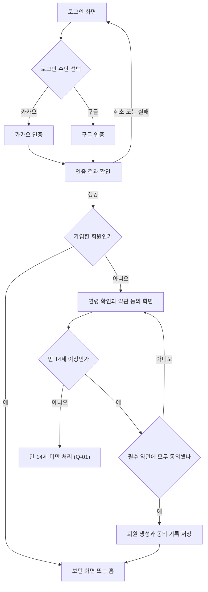
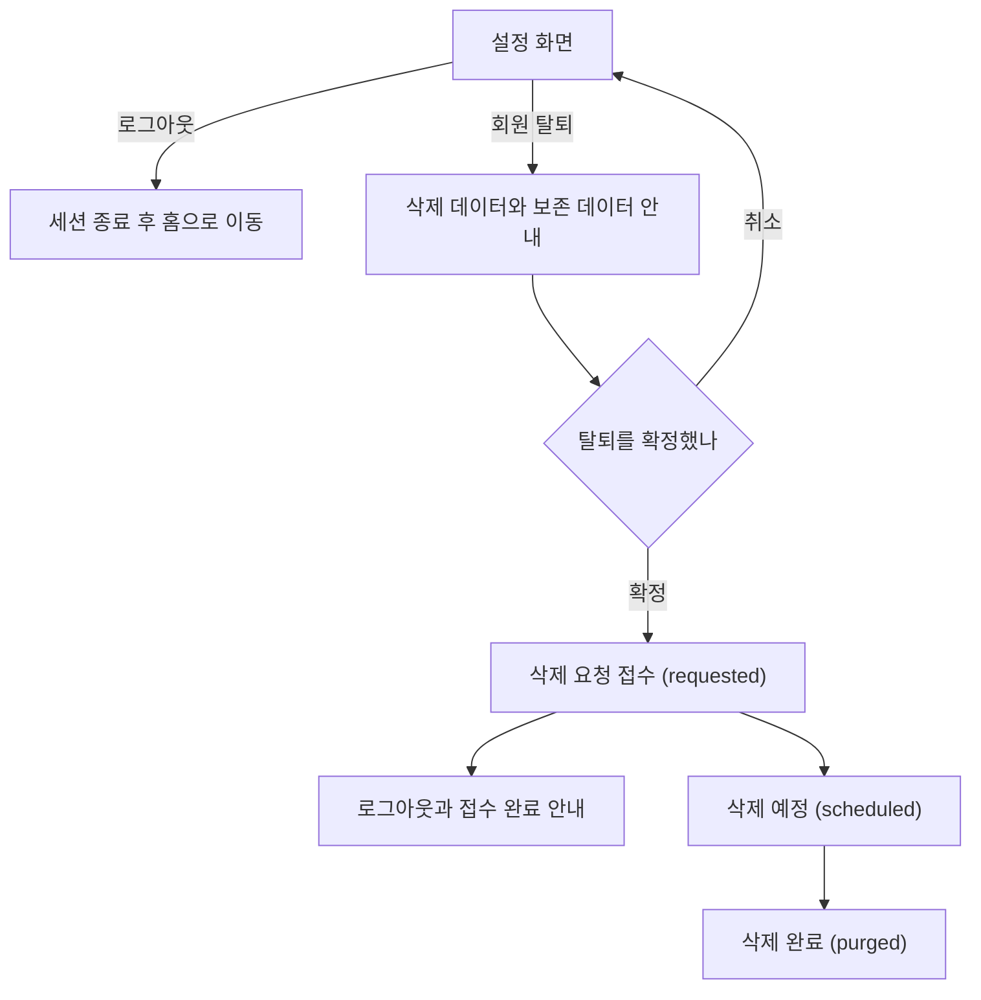

# 계정: 가입·로그인·약관 동의·탈퇴 요구사항

이 문서는 R0 기반 출시에 들어가는 계정 기능의 요구사항을 정의한다. 카카오·구글 가입과 로그인, 약관 동의 기록과 연령 확인, 로그아웃, 회원 탈퇴를 사용자 스토리와 기능 요구사항, 수용 기준으로 정리했다. 설계, 작업 분해, 테스트는 이 문서에 붙은 ID를 기준으로 삼는다.

## 상태와 승인

이 문서는 승인을 기다리는 제안이며, 아직 확정된 규칙이 아니다. 승인은 Feature 이슈 `[001] 계정: 가입·로그인·약관 동의·탈퇴`의 '요구사항 검토' Task에서 한다. 승인하면 frontmatter의 `status`를 `review`에서 `approved`로 바꾸고, 그때부터 `/sdd-design` 단계를 시작할 수 있다.

승인하기 전에 [확인 질문](#확인-질문)에 열린 항목이 남아 있으면 안 된다. 확인 질문에 답을 정하면 관련 요구사항과 수용 기준을 먼저 고치고, 해결 기록에 결정 내용을 남긴다.

| 항목 | 값 |
|---|---|
| 상태 | 검토 대기 (`review`) |
| 출시 단계 | R0 기반 |
| 기능 ID | F-ACCT-01, F-ACCT-04, F-ACCT-05 |
| Feature 이슈 | [#8](https://github.com/god3v/hamtteukka/issues/8) `[001] 계정: 가입·로그인·약관 동의·탈퇴` |
| 승인 위치 | Feature 이슈의 '요구사항 검토' Task ([#9](https://github.com/god3v/hamtteukka/issues/9) `[001] 요구사항 검토와 확인 질문 해결`) |
| 선행 명세 | 없음 |
| 연결된 미결정 항목 | [OD-01 만 14세 미만 가입 처리](../../decisions/README.md), [OD-02 탈퇴 데이터 처리](../../decisions/README.md) (R0 착수 전 결정) |
| 승인 조건 | 확인 질문(Q)을 모두 해결했다 |
| 승인 후 단계 | `/sdd-design` |

## 배경

함뜨까의 R1 MVP는 프로젝트 기록, 단수 카운터, 게이지, 내 도안 파일 같은 개인 뜨개 도구로 구성된다([ADR-0008](../../decisions/0008-mvp-personal-tools.md)). 퀵 카운터를 뺀 나머지 도구는 기록을 서버에 저장하므로 회원 계정이 먼저 있어야 한다. 그래서 R0에서 가입, 로그인, 탈퇴를 먼저 만들고, 운영 도메인에서 세 흐름이 동작하는 것을 R0 완료 조건으로 삼는다.

인증은 Supabase Auth가 맡고, 첫 로그인 수단은 카카오와 구글로 정했다([ADR-0005](../../decisions/0005-auth-supabase-social-login.md)). 회원은 이메일이 아니라 로그인 제공자와 제공자가 발급한 사용자 ID의 조합으로 식별한다. 동의 기록은 나중에 소급해서 만들 수 없으므로 첫 가입자부터 남기며, 판매 기능이 열린 뒤에도 증빙 자료로 쓴다([ADR-0007](../../decisions/0007-sales-ready-data-model.md)).

이 요구사항이 근거로 삼은 조사 내용은 다음과 같다. 모든 출처는 2026-11-18에 조사한 기준이다.

- 카카오 로그인은 비즈 앱으로 전환해야 이메일을 받을 수 있다. 비즈 앱이 아니면 Supabase에서 'Allow users without an email' 옵션을 켜야 한다([Supabase 카카오 로그인 문서](https://supabase.com/docs/guides/auth/social-login/auth-kakao)).
- 개인정보 보호법 제38조 제4항은 삭제 같은 권리 행사 절차를 개인정보 수집 절차보다 어렵지 않게 만들도록 요구한다([개인정보 보호법 제38조](https://casenote.kr/법령/개인정보_보호법/제38조)).
- 만 14세 미만 아동의 개인정보를 동의에 근거해 처리하려면 법정대리인의 동의를 받고 확인해야 한다([개인정보 보호법 제22조의2](https://casenote.kr/법령/개인정보_보호법/제22조의2)).
- 개인정보 처리방침에는 처리 목적, 보유 기간, 파기, 위탁, 권리 행사 방법, 보호책임자 연락처 등을 담아 공개해야 한다([개인정보 보호법 제30조](https://casenote.kr/법령/개인정보_보호법/제30조)).
- 2026-09-11 시행된 개정 개인정보 보호법은 유출이 확인되기 전이라도 유출 가능성을 알면 지체 없이 정보주체에게 알리도록 한다([법률신문](https://www.lawtimes.co.kr/news/articleView.html?idxno=226177)).
- 2026년 10월 1일 시행된 개정 정보통신망법은 광고성 정보 전송 제한을 문자, 이메일, 앱 푸시 광고에도 적용한다([법률신문](https://www.lawtimes.co.kr/news/articleView.html?idxno=226177)).
- 도아니티는 가입할 때 이용약관(필수), 개인정보 처리방침(필수), 광고 수신(선택) 동의를 항목별로 받는다([도아니티 가입 화면](https://www.doanity.com/signup)).
- 도아니티는 회원이 탈퇴하면 회원 정보를 즉시 지우지만 글과 댓글은 남긴다([도아니티 FAQ](https://doanity.notion.site/FAQ-5859c83e51f14ef49d76353fb95a8f2d)).

## 사용자 흐름

### 가입과 로그인

카카오 인증과 구글 인증은 같은 확인 단계로 합류한다. 처음 로그인한 사용자는 연령 확인과 필수 약관 동의를 마쳐야 회원이 된다. 만 14세 미만 사용자를 어떻게 처리할지는 Q-01에서 정한다.

### 로그아웃과 탈퇴

회원이 직접 하는 일은 탈퇴 메뉴를 열고 한 번 확정하는 것까지다. requested 이후의 상태 변경은 시스템이 처리하며, scheduled에서 purged까지 걸리는 기간은 Q-02에서 정한다.

| 삭제 상태 | 뜻 |
|---|---|
| requested | 회원이 탈퇴를 확정해 삭제 요청이 접수된 상태다. |
| scheduled | 삭제 일정이 정해져 처리를 기다리는 상태다. |
| purged | 회원 데이터를 삭제하고, 법령에 따라 보존할 데이터만 분리해 보관하는 상태다. |

## 사용자 스토리

| ID | 사용자 | 원하는 일 | 이유 | 기능 ID |
|---|---|---|---|---|
| US-01 | 처음 방문한 사용자 | 카카오나 구글 계정으로 가입하고 싶다 | 새 비밀번호를 만들지 않고 바로 기록을 시작하려고 | F-ACCT-01 |
| US-02 | 회원 | 가입할 때 쓴 계정으로 다시 로그인하고 싶다 | 내 기록을 이어서 보려고 | F-ACCT-01 |
| US-03 | 가입하는 사용자 | 어떤 약관에 동의하는지 확인하고, 광고 수신은 원할 때만 동의하고 싶다 | 무엇에 동의하는지 알고 가입하려고 | F-ACCT-05 |
| US-04 | 회원 | 광고성 정보 수신 동의를 채널별로 언제든 바꾸고 싶다 | 원하는 채널로만 광고성 정보를 받으려고 | F-ACCT-05 |
| US-05 | 회원 | 다른 사람과 함께 쓰는 기기에서 로그아웃하고 싶다 | 그 기기를 쓰는 다른 사람이 내 계정을 쓰지 못하게 하려고 | F-ACCT-01 |
| US-06 | 회원 | 가입만큼 쉬운 절차로 탈퇴하고, 내 데이터가 언제 지워지는지 알고 싶다 | 서비스를 그만 쓸 때 번거롭지 않게 정리하려고 | F-ACCT-04 |
| US-07 | 운영자 | 회원이 어느 버전의 약관에 언제 동의했는지 확인하고 싶다 | 분쟁이 생겼을 때 증빙을 내려고 | F-ACCT-05 |
| US-08 | 운영자 | 만 14세 미만 사용자의 개인정보를 법정대리인 확인 없이 처리하지 않으려고 한다 | 개인정보 보호법 제22조의2를 지키려고 | F-ACCT-05 |

## 기능 요구사항

### 가입과 로그인

| ID | 요구사항 | 관련 US |
|---|---|---|
| FR-01 | 로그인 화면은 카카오와 구글 로그인 버튼을 제공한다. 가입과 로그인은 같은 버튼에서 시작한다. | US-01, US-02 |
| FR-02 | 시스템은 회원을 로그인 제공자와 제공자 사용자 ID의 조합으로 식별한다. 이메일은 식별 키로 쓰지 않는다. | US-01, US-02 |
| FR-03 | 이메일은 선택 정보로 저장한다. 제공자가 이메일을 주지 않아도 가입과 로그인을 끝까지 진행할 수 있다. | US-01 |
| FR-04 | 로그인 제공자가 다르면 이메일이 같아도 서로 다른 회원으로 다룬다. 시스템은 계정을 자동으로 합치지 않는다. | US-02 |
| FR-05 | 처음 로그인한 사용자는 연령 확인과 필수 약관 동의를 마친 뒤에 회원이 된다. 이 단계를 마치기 전에는 회원 기능을 쓸 수 없고, 다음 로그인 때 같은 화면을 다시 보여 준다. | US-01, US-03 |
| FR-06 | 로그인을 마치면 로그인 전에 보던 화면으로 돌아간다. 돌아갈 화면이 없으면 홈으로 이동한다. | US-02 |
| FR-07 | 사용자가 제공자 인증을 취소하거나 인증이 실패하면 로그인 화면으로 돌아오고, 다시 시도할 수 있다고 안내한다. | US-01 |

### 약관과 동의 기록

| ID | 요구사항 | 관련 US |
|---|---|---|
| FR-08 | 이용약관과 개인정보 처리방침은 버전별로 관리한다. 각 버전은 버전 번호, 시행일, 본문을 가진다. | US-03, US-07 |
| FR-09 | 현재 시행 중인 이용약관과 처리방침은 로그인하지 않아도 열람할 수 있다. 사이트의 공통 영역에서 두 문서로 가는 링크를 제공한다. | US-03 |
| FR-10 | 가입 화면은 이용약관 동의(필수), 처리방침 동의(필수), 광고성 정보 수신 동의(선택)를 항목별로 받는다. 필수 항목에 모두 동의해야 가입을 마칠 수 있다. | US-03 |
| FR-11 | 회원이 동의하거나 동의를 바꿀 때마다 회원, 문서 종류, 문서 버전, 동의 여부, 시각을 기록한다. 시각은 서버 시각을 쓴다. | US-07 |
| FR-12 | 광고성 정보 수신 동의는 채널별로 따로 받고 따로 기록한다. R0에서 받을 채널은 Q-04에서 정한다. | US-03, US-04 |
| FR-13 | 회원은 설정 화면에서 채널별 수신 동의를 언제든 바꿀 수 있다. 바꿀 때마다 새 기록을 추가하고, 이전 기록은 고치지 않는다. | US-04, US-07 |
| FR-14 | 시스템은 회원별로 마지막에 동의한 필수 문서의 버전을 조회할 수 있다. 새 버전을 시행할 때 재동의를 받을지는 Q-05에서 정한다. | US-07 |

### 연령 확인

| ID | 요구사항 | 관련 US |
|---|---|---|
| FR-15 | 가입 화면은 사용자가 만 14세 이상인지 확인한다. 확인 방식은 Q-03에서 정하고, 확인 결과와 시각은 동의 기록과 함께 남긴다. | US-08 |
| FR-16 | 만 14세 미만으로 확인되면 Q-01의 결정에 따라 처리한다. 가입을 막는 경우에는 회원을 만들지 않고, 인증 과정에서 생긴 로그인 정보도 삭제한다. | US-08 |

### 세션과 로그아웃

| ID | 요구사항 | 관련 US |
|---|---|---|
| FR-17 | 로그인 상태는 브라우저를 닫았다가 다시 열어도 유지된다. 로그아웃하거나 세션이 만료되면 로그인 상태가 끝나며, 유지 기간은 Q-06에서 정한다. | US-02 |
| FR-18 | 로그인하지 않은 사용자가 로그인이 필요한 화면을 열면 로그인 화면으로 보낸다. 로그인을 마치면 FR-06에 따라 원래 화면으로 돌려보낸다. | US-02 |
| FR-19 | 회원은 설정 화면에서 로그아웃할 수 있다. 로그아웃하면 현재 브라우저의 세션을 끝내고 홈으로 이동한다. | US-05 |
| FR-20 | 세션이 만료된 뒤 회원 기능을 요청하면 만료 사실을 안내하고 로그인 화면으로 보낸다. | US-02 |

### 탈퇴

| ID | 요구사항 | 관련 US |
|---|---|---|
| FR-21 | 회원은 설정 화면에서 탈퇴를 시작한다. 탈퇴 화면은 삭제되는 데이터, 법령에 따라 보존하는 데이터, 삭제가 끝나는 시점을 안내한다. | US-06 |
| FR-22 | 회원이 탈퇴를 한 번 확정하면 삭제 요청을 접수한다. 탈퇴 사유 입력이나 별도 문의 절차는 요구하지 않는다. | US-06 |
| FR-23 | 탈퇴 처리는 requested, scheduled, purged 상태를 차례로 거치고, 상태가 바뀐 시각을 기록한다. | US-06 |
| FR-24 | 삭제 요청을 접수하면 즉시 로그아웃한다. requested 이후 같은 계정으로 로그인했을 때의 처리는 Q-02와 Q-08에서 정한다. | US-06 |
| FR-25 | purged 단계에서는 회원 정보, 로그인 정보, 회원이 만든 기록을 삭제한다. R1 이후 기능이 추가하는 회원 데이터도 같은 삭제 절차를 따른다. | US-06 |
| FR-26 | 법령에 따라 보존해야 하는 데이터는 일반 회원 데이터와 분리해 보관하고, 보존 기간이 끝나면 파기한다. R0의 보존 대상 항목과 기간은 Q-10에서 정한다. | US-06, US-07 |

## 비기능 요구사항

| ID | 분류 | 요구사항 | 근거 |
|---|---|---|---|
| NFR-01 | 법령 | 탈퇴 절차는 가입 절차보다 화면 수와 입력 단계가 많지 않다. | 개인정보 보호법 제38조 제4항 |
| NFR-02 | 권한 | 회원은 자기 계정 정보와 동의 기록만 조회할 수 있다. 권한은 RLS 정책으로 검사한다. | [ADR-0004](../../decisions/0004-rls-authorization.md) |
| NFR-03 | 무결성 | 동의 기록에는 새 기록 추가만 허용한다. 탈퇴 삭제 절차가 아니면 기존 기록을 고치거나 지우지 않는다. | [ADR-0007](../../decisions/0007-sales-ready-data-model.md) |
| NFR-04 | 구조 | 인증과 회원 데이터에 접근하는 코드는 `packages/shared`에만 둔다. `apps/web`은 shared 함수만 호출한다. | [ADR-0003](../../decisions/0003-data-access-boundary.md) |
| NFR-05 | 데이터 위치 | 회원 데이터는 서울 리전(ap-northeast-2)의 Supabase 프로젝트에 저장한다. | [ADR-0002](../../decisions/0002-stack-nextjs-supabase-vercel.md) |
| NFR-06 | 확장성 | 회원과 로그인 수단을 따로 저장한다. 네이버(R1+)와 Apple(A1)을 추가할 때 회원 구조를 바꾸지 않기 위해서다. | [ADR-0005](../../decisions/0005-auth-supabase-social-login.md) |
| NFR-07 | 이식성 | Supabase Auth는 비대칭 서명 키로 JWT를 발급한다. R4에 추가할 Spring 서버가 JWKS로 같은 토큰을 검증할 수 있어야 한다. | [ADR-0005](../../decisions/0005-auth-supabase-social-login.md) |
| NFR-08 | 사용성 | 로그인, 동의, 설정, 탈퇴 화면은 휴대폰 브라우저에서 가로 스크롤 없이 쓸 수 있다. | F-UX-01 |

## 수용 기준

수용 기준은 Given/When/Then 형식으로 쓴다. 구현 단계의 테스트 이름에는 `001/AC-01`처럼 기능 번호와 AC ID를 붙인다.

### AC-01 카카오로 처음 가입한다

관련 항목: FR-01, FR-02, FR-05, FR-10, FR-11

- **Given** 가입한 적이 없는 사용자가 로그인 화면을 연 상태다.
- **When** 카카오 인증을 마치고, 만 14세 이상임을 확인하고, 필수 약관 두 개에 동의한다.
- **Then** 카카오 제공자 ID로 식별되는 회원이 생성되고, 동의한 문서의 버전과 시각이 기록된다.

### AC-02 이메일 없이 가입한다

관련 항목: FR-03

- **Given** 카카오 앱이 이메일을 제공하지 않는 설정이다.
- **When** 사용자가 카카오로 가입 절차를 마친다.
- **Then** 이메일이 비어 있는 회원이 생성되고, 가입이 오류 없이 끝난다.

### AC-03 필수 동의 없이는 가입을 마칠 수 없다

관련 항목: FR-05, FR-10

- **Given** 처음 로그인한 사용자가 약관 동의 화면에 있다.
- **When** 이용약관에만 동의하고 처리방침에는 동의하지 않는다.
- **Then** 가입을 마칠 수 없고, 회원과 동의 기록이 만들어지지 않는다.

### AC-04 광고 수신 동의를 채널별로 기록한다

관련 항목: FR-11, FR-12

- **Given** 가입 화면에 Q-04에서 정한 광고 수신 채널이 표시된 상태다.
- **When** 사용자가 필수 항목에 동의하고, 광고 수신 채널마다 동의 여부를 고른 뒤 가입한다.
- **Then** 채널마다 동의 여부와 시각이 따로 기록된다.

### AC-05 수신 동의를 바꾸면 이력이 남는다

관련 항목: FR-13

- **Given** 광고 수신에 동의한 회원이 설정 화면을 연 상태다.
- **When** 한 채널의 수신 동의를 철회한다.
- **Then** 철회 기록이 새로 추가되고, 이전 동의 기록은 그대로 남는다.

### AC-06 기존 회원은 보던 화면으로 돌아간다

관련 항목: FR-06, FR-18

- **Given** 구글로 가입한 회원이 로그아웃 상태에서 로그인이 필요한 화면을 열었다.
- **When** 로그인 화면으로 이동해 구글 인증을 마친다.
- **Then** 약관 동의 화면을 거치지 않고, 처음 열려던 화면이 열린다.

### AC-07 로그인 제공자가 다르면 다른 회원이다

관련 항목: FR-02, FR-04

- **Given** 카카오로 가입한 회원이 있고, 같은 이메일을 쓰는 구글 계정이 있다.
- **When** 그 구글 계정으로 로그인한다.
- **Then** 기존 회원으로 로그인되지 않고, 새 가입 절차가 시작된다.

### AC-08 동의를 마치지 않으면 회원 기능을 쓸 수 없다

관련 항목: FR-05

- **Given** 인증만 마치고 약관 동의 화면을 벗어난 사용자가 있다.
- **When** 회원 기능 화면을 열거나 다시 로그인한다.
- **Then** 회원 기능은 열리지 않고, 연령 확인과 약관 동의 화면이 다시 나타난다.

### AC-09 만 14세 미만이면 회원을 만들지 않는다 (Q-01에서 가입 차단을 택한 경우)

관련 항목: FR-15, FR-16

- **Given** 처음 로그인한 사용자가 연령 확인 화면에 있다.
- **When** 만 14세 미만이라고 답한다.
- **Then** 가입할 수 없는 이유가 안내되고, 회원과 로그인 정보가 남지 않는다.

### AC-10 로그인 없이 약관을 열람한다

관련 항목: FR-08, FR-09

- **Given** 로그인하지 않은 방문자가 있다.
- **When** 이용약관이나 처리방침 링크를 연다.
- **Then** 현재 시행 중인 버전의 본문과 시행일이 보인다.

### AC-11 로그아웃한다

관련 항목: FR-18, FR-19

- **Given** 로그인한 회원이 설정 화면에 있다.
- **When** 로그아웃을 누른다.
- **Then** 세션이 끝나 홈으로 이동하고, 이후 로그인이 필요한 화면을 열면 로그인 화면으로 이동한다.

### AC-12 설정 화면에서 탈퇴를 요청한다

관련 항목: FR-21, FR-22, FR-23, FR-24, NFR-01

- **Given** 로그인한 회원이 설정 화면에 있다.
- **When** 탈퇴 메뉴를 열고 안내를 확인한 뒤 탈퇴를 한 번 확정한다.
- **Then** 삭제 상태가 requested로 기록되고, 회원은 즉시 로그아웃되며, 접수 완료 안내가 보인다.

### AC-13 삭제가 끝나면 회원 데이터가 지워진다

관련 항목: FR-23, FR-25, FR-26

- **Given** 삭제 상태가 scheduled인 회원이 있다.
- **When** 삭제 처리가 실행된다.
- **Then** 상태가 purged로 바뀌고 회원 정보, 로그인 정보, 회원 기록이 삭제되며, 법적 보존 데이터만 분리된 위치에 남는다.

### AC-14 다른 회원이 남긴 동의 기록은 볼 수 없다

관련 항목: NFR-02

- **Given** 회원 A와 회원 B에게 각각 동의 기록이 있다.
- **When** 회원 A의 세션으로 회원 B의 동의 기록을 조회한다.
- **Then** 결과가 비어 있고, 회원 B의 기록은 노출되지 않는다.

### AC-15 동의 기록은 고칠 수 없다

관련 항목: NFR-03

- **Given** 회원이 남긴 동의 기록이 있다.
- **When** 회원 세션으로 그 기록을 수정하거나 삭제하도록 요청한다.
- **Then** 요청이 거부되고, 기록은 바뀌지 않는다.

### AC-16 인증을 취소하면 로그인 화면으로 돌아온다

관련 항목: FR-07

- **Given** 사용자가 구글 인증 화면에 있다.
- **When** 인증을 취소한다.
- **Then** 로그인 화면으로 돌아와 다시 시도할 수 있다는 안내가 보이고, 회원은 만들어지지 않는다.

## 범위 밖

| 항목 | 다루는 시점 | 이유 |
|---|---|---|
| 네이버 로그인 | R1+ (F-ACCT-02) | Supabase Auth가 네이버를 기본 제공하지 않아 Custom OAuth Provider로 연결해야 한다([Supabase 문서](https://supabase.com/docs/guides/auth/custom-oauth-providers)). |
| Sign in with Apple과 Apple 계정 변경 알림 | A1 (F-ACCT-03) | Apple 가이드라인 4.8은 소셜 로그인을 쓰는 iOS 앱에 적용되므로, 웹만 운영하는 동안에는 필요하지 않다([Apple 가이드라인](https://developer.apple.com/app-store/review/guidelines/)). |
| 로그인 없이 여는 계정 삭제 요청 페이지 | A1 준비 항목 | Google Play는 Play Console에 등록할 웹 삭제 요청 링크를 요구한다([Google Play 정책](https://support.google.com/googleplay/android-developer/answer/13327111?hl=en)). A1에서 이 페이지를 만들 때 R0 탈퇴와 같은 삭제 상태를 쓴다. |
| 이메일·비밀번호 가입 | 정하지 않음 | 첫 로그인 수단은 카카오와 구글로 정했다([ADR-0005](../../decisions/0005-auth-supabase-social-login.md)). |
| 광고성 정보 발송 | 정하지 않음 | R0은 수신 동의만 기록한다. 이메일 발송 기반(F-NOTI-02)은 R2에 들어간다. |
| 관리자 화면에서 약관 버전 등록 | R2 (F-ADMIN-01) | 관리자 콘솔은 R2에 들어간다. R0에서 버전을 등록하는 방법은 설계 단계에서 정한다. |
| 닉네임과 프로필 화면 | R2, R3 | 작가 프로필(F-STORE-01)은 R2에서, 커뮤니티 작성자 표시 방식(OD-09)은 R3에서 정한다. |
| 탈퇴 회원의 게시글 처리 | R3 (OD-10) | 게시글은 커뮤니티 기능이 생길 때 처음 만들어진다. |
| 한 회원에 여러 로그인 수단 연결 | Q-09에서 정함 | FR-04에 따라 자동 연결은 하지 않는다. |

## 제약 조건

이 요구사항은 아래 확정 결정을 따른다. 결정을 바꿔야 하면 이 문서를 고치기 전에 새 ADR로 기존 결정을 대체한다.

| 결정 | 이 기능에 주는 제약 |
|---|---|
| [ADR-0005](../../decisions/0005-auth-supabase-social-login.md) Supabase Auth와 카카오·구글 로그인 | 인증은 Supabase Auth가 맡는다. 회원은 (provider, provider_user_id)로 식별하고, 이메일은 선택 정보로 다룬다. |
| [ADR-0004](../../decisions/0004-rls-authorization.md) RLS를 1차 권한 검사로 사용 | 회원 정보와 동의 기록에 접근할 권한은 RLS 정책으로 검사하고, 정책은 `design/erd.md`의 정책 표에 기록한다. |
| [ADR-0003](../../decisions/0003-data-access-boundary.md) Supabase 접근을 packages/shared로 제한 | 인증 호출과 회원 데이터 접근은 shared 함수로 감싸고, Supabase 타입을 앱에 노출하지 않는다. |
| [ADR-0006](../../decisions/0006-migration-ownership.md) DB 마이그레이션 소유권을 스키마별로 분리 | 회원과 동의 관련 테이블은 `public` 스키마에 두고 `supabase/migrations`의 SQL로 관리한다. |
| [ADR-0007](../../decisions/0007-sales-ready-data-model.md) 판매에 대비한 데이터 원칙 | 동의 기록은 첫 가입자부터 남기고, 판매 기능이 열린 뒤에도 증빙으로 쓴다. |
| [ADR-0002](../../decisions/0002-stack-nextjs-supabase-vercel.md) Next.js·Supabase·Vercel 스택과 서울 리전 | 회원 데이터는 서울 리전에 저장한다. |

외부 규정과 서비스 조건에서 오는 제약은 다음과 같다.

- 처리방침에는 개인정보 보호법 제30조가 정한 항목을 담는다. Vercel과 Supabase 사용이 국외 이전에 해당하는지와 기재 범위는 법률 검토로 확정한다([개인정보보호위원회](https://pipc.go.kr/np/default/page.do?mCode=D060040000)).
- 카카오 앱을 비즈 앱으로 전환하지 않는 동안에는 Supabase의 'Allow users without an email' 옵션을 켜 둔다([Supabase 카카오 로그인 문서](https://supabase.com/docs/guides/auth/social-login/auth-kakao)).

## 확인 질문

승인하기 전에 아래 질문을 모두 해결한다. Q-01과 Q-02는 [결정 목록](../../decisions/README.md)의 OD-01, OD-02와 같은 질문이므로, 답을 정하면 두 문서를 함께 고친다.

| ID | 질문 | 선택지와 제안 | 관련 항목 | 상태 |
|---|---|---|---|---|
| Q-01 | 만 14세 미만 사용자의 가입을 어떻게 처리할까? (OD-01) | 가입 차단, 법정대리인 동의 절차. 제안은 가입 차단이다. | FR-16, AC-09 | 열림 |
| Q-02 | 탈퇴한 회원의 데이터를 즉시 삭제할까, 유예 기간 뒤에 삭제할까? 유예 기간 중 탈퇴 철회를 허용할까? (OD-02) | 즉시 삭제, 유예 기간 뒤 삭제 | FR-23, FR-24 | 열림 |
| Q-03 | 만 14세 이상인지 어떤 방식으로 확인할까? | 확인 체크 항목, 출생 연도 입력. 제안은 확인 체크 항목이다. | FR-15 | 열림 |
| Q-04 | R0 가입 화면에서 광고성 정보 수신 동의를 받을 채널은 무엇인가? | 이메일, 문자, 앱 푸시 가운데 고른다. 앱 푸시는 A1 전에는 쓸 수 없다. | FR-12, AC-04 | 열림 |
| Q-05 | 필수 약관의 새 버전을 시행할 때 기존 회원에게 재동의를 받을까? | 다음 로그인 때 재동의, 공지 후 시행 | FR-14 | 열림 |
| Q-06 | 로그인 세션을 얼마나 유지하고, 어떤 조건에서 만료할까? | Supabase Auth 기본 설정 사용, 별도 기간 지정 | FR-17 | 열림 |
| Q-07 | 인증만 하고 동의를 마치지 않은 로그인 정보는 언제 지울까? | 일정 기간 뒤 삭제, 다음 로그인까지 보관 | FR-05, AC-08 | 열림 |
| Q-08 | 탈퇴한 사람이 같은 카카오·구글 계정으로 다시 가입할 수 있는 시점은 언제인가? | requested 직후, purged 이후 | FR-24 | 열림 |
| Q-09 | 한 회원이 카카오와 구글을 모두 연결하는 기능을 R0에 넣을까? | R0에 포함, 이후 출시로 미룸. 제안은 미루는 것이다. | FR-04 | 열림 |
| Q-10 | R0에서 법령에 따라 보존해야 하는 데이터 항목과 보존 기간은 무엇인가? | 동의 기록을 보존할지와 보존 기간을 포함해 법률 확인이 필요하다. | FR-26, AC-13 | 열림 |
| Q-11 | 개인정보 유출이 생기면 이메일이 없는 회원에게 어떻게 알리고, 통지할 회원 연락처는 어떻게 한꺼번에 조회할까? | 사이트 공지와 로그인할 때 안내, 연락용 이메일 선택 입력 | FR-03 | 열림 |

### 해결 기록

질문을 해결하면 아래 표에 한 행을 추가하고, 위 표에서 그 질문의 상태를 `해결`로 바꾼다. 결정에 따라 고친 US, FR, NFR, AC의 ID는 고친 항목 칸에 적는다. 아직 해결한 질문은 없다.

| 날짜 | ID | 결정 | 고친 항목 |
|---|---|---|---|
| - | - | - | - |

## 관련 문서

- [결정 목록](../../decisions/README.md): 확정된 ADR과 미결정 항목 OD-01, OD-02를 관리한다.
- [ADR-0005 Supabase Auth와 카카오·구글 로그인](../../decisions/0005-auth-supabase-social-login.md)
- [ADR-0004 RLS를 1차 권한 검사로 사용](../../decisions/0004-rls-authorization.md)
- [ADR-0007 판매에 대비한 데이터 원칙](../../decisions/0007-sales-ready-data-model.md)
- [기능 목록](../../product/feature-catalog.md): F-ACCT-01부터 F-ACCT-05까지의 설명과 출시 단계를 담고 있다.
- [로드맵](../../product/roadmap.md): R0 범위와 완료 조건을 담고 있다.
- [SDD 진행 가이드](../../sdd-guide.md): 요구사항 승인과 설계 착수 절차를 설명한다.
- [요구사항 템플릿](../_template/requirements.md)
- [결제와 법령 조사](../../research/2026-11-18-payments-and-law.md): 결제와 관련 법령을 조사한 기록이다.
- [앱 스토어 정책 조사](../../research/2026-11-18-app-store-policy.md): Apple과 Google의 계정 삭제 요건과 개정 개인정보 보호법의 유출 통지 내용을 기록했다.
- [참고 서비스 조사](../../research/2026-11-18-reference-services.md): 도아니티의 가입과 탈퇴 방식을 기록했다.
- [002 뜨개 프로젝트 기록 요구사항](../002-projects/requirements.md): 탈퇴할 때 함께 삭제할 R1 데이터를 정의한다.
