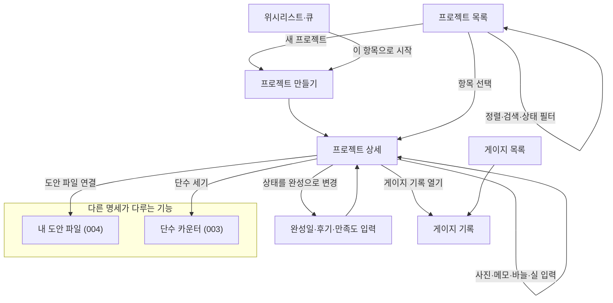

# 뜨개 프로젝트 기록 요구사항

이 문서는 R1 MVP에 들어가는 뜨개 프로젝트 기록, 위시리스트·큐, 게이지 기록의 요구사항을 정의한다. 회원이 혼자 쓰는 기록 도구에서 무엇을 저장하고 어떻게 찾고 정리하는지를 사용자 스토리와 기능 요구사항, 수용 기준으로 정리했다. 설계, 작업 분해, 테스트는 이 문서에 붙은 ID를 기준으로 삼는다.

## 상태와 승인

이 문서는 승인을 기다리는 제안이며, 아직 확정된 규칙이 아니다. 승인은 Feature 이슈 `[002] 뜨개 프로젝트 기록`의 '요구사항 검토' Task에서 한다. 승인하면 frontmatter의 `status`를 `review`에서 `approved`로 바꾸고, 그때부터 `/sdd-design` 단계를 시작할 수 있다.

승인하기 전에 [확인 질문](#확인-질문)에 열린 항목이 남아 있으면 안 된다. 확인 질문에 답을 정하면 관련 요구사항과 수용 기준을 먼저 고치고, 해결 기록에 결정 내용을 남긴다.

| 항목 | 값 |
|---|---|
| 상태 | 검토 대기 (`review`) |
| 출시 단계 | R1 MVP |
| 기능 ID | F-PROJ-01, F-PROJ-02, F-TOOL-01 |
| Feature 이슈 | `[002] 뜨개 프로젝트 기록` |
| 승인 위치 | Feature 이슈의 '요구사항 검토' Task (`[002] 요구사항 검토와 확인 질문 해결`) |
| 선행 명세 | [001 계정](../001-account/requirements.md) (R0) |
| 연결된 미결정 항목 | [OD-03 개인 PDF 업로드 용량 한도](../../decisions/README.md) (R1 착수 전 결정) |
| 승인 조건 | 확인 질문(Q)을 모두 해결했다 |
| 승인 후 단계 | `/sdd-design` |

## 배경

R1 MVP는 다른 사용자가 없어도 혼자 쓸 수 있는 개인 뜨개 도구로 시작한다([ADR-0008](../../decisions/0008-mvp-personal-tools.md)). 이 문서는 그중 프로젝트 기록(F-PROJ-01), 위시리스트·큐(F-PROJ-02), 게이지 기록(F-TOOL-01)을 다룬다. 같은 R1에 들어가는 단수 카운터는 [003](../003-row-counter/requirements.md)이, 도안 파일 첨부는 [004](../004-pattern-files/requirements.md)가 다룬다.

실 보관함(F-STASH-01)은 R1+에 들어가므로, R1에서는 사용한 바늘과 실을 자유 텍스트로 기록한다. R1의 모든 기록은 작성한 회원만 볼 수 있고, 공개 공유는 R3의 완성작 공유(F-COMM-03)에서 다룬다.

이 요구사항이 근거로 삼은 조사 내용은 다음과 같다. 모든 출처는 2026-11-18에 조사한 기준이다.

- 실노트는 진행 중인 작품과 위시리스트 정리를 첫 번째 핵심 기능으로 소개하고, 세탁 전후 게이지 기록을 별도 기능으로 제공한다([Google Play 소개](https://play.google.com/store/apps/details?id=com.chbb.knit_schedule&hl=en_US)). 2026-11-18에 조회했을 때 실노트의 스토어 페이지는 열리지 않았다.
- 실노트 업데이트 노트에는 완성작 후기와 게이지 메모의 글자 수 제한을 늘렸다는 내용이 있다([App Store](https://apps.apple.com/kr/app/%EC%8B%A4%EB%85%B8%ED%8A%B8-%EB%9C%A8%EA%B0%9C-%ED%94%84%EB%A1%9C%EC%A0%9D%ED%8A%B8-%EA%B4%80%EB%A6%AC/id6749874186?l=en-GB)).
- 니트플로우는 프로젝트를 생성일, 시작일, 완성일, 제목 순으로 정렬하고, 끌어서 놓는 방식으로 순서를 바꾸고, 본인 프로젝트를 검색하는 기능을 제공한다([App Store 버전 기록](https://apps.apple.com/kr/app/knitflow-%EB%8B%88%ED%8A%B8%ED%94%8C%EB%A1%9C%EC%9A%B0-%EB%9C%A8%EA%B0%9C-%EA%B8%B0%EB%A1%9D-%EB%8F%84%EA%B5%AC/id6740465748?see-all=version-history)).
- 니트플로우의 게이지 도구는 바늘을 표준 차트에서 바로 고르게 한다([App Store 버전 기록](https://apps.apple.com/kr/app/knitflow-%EB%8B%88%ED%8A%B8%ED%94%8C%EB%A1%9C%EC%9A%B0-%EB%9C%A8%EA%B0%9C-%EA%B8%B0%EB%A1%9D-%EB%8F%84%EA%B5%AC/id6740465748?see-all=version-history)).
- 니트플로우는 데이터를 회원 계정 없이 사용자 iCloud에 저장하며, 동기화 누락과 프로젝트 소실을 호소하는 사용자 리뷰가 있다([니트플로우 고객지원](https://www.knitflow.io/support)).
- Ravelry는 앞으로 뜰 도안을 모아 두는 큐 기능을 제공한다([Ravelry 블로그](http://pressable.ravelry.com//thursday-tip-faves-queue-library-shopping-cart)).

## 사용자 흐름

프로젝트는 목록에서 새로 만들거나 큐 항목에서 시작한다. 게이지 기록은 프로젝트 상세 화면이나 게이지 목록에서 연다. '다른 명세가 다루는 기능' 묶음 안의 두 기능은 각각 003과 004 문서가 요구사항을 정하고, 이 문서는 프로젝트 상세 화면에서 두 기능으로 가는 연결만 다룬다.

프로젝트 상태는 다음 네 가지다.

| 상태 | 뜻 |
|---|---|
| 진행 중 | 지금 뜨고 있는 프로젝트다. 새 프로젝트의 기본 상태다. |
| 완성 | 다 뜬 프로젝트다. 완성일, 후기, 만족도를 남긴다. |
| 휴면 | 뜨다가 잠시 멈춘 프로젝트다. |
| 풀었음 | 뜨던 편물을 풀어서 그만둔 프로젝트다. |

## 사용자 스토리

| ID | 사용자 | 원하는 일 | 이유 | 기능 ID |
|---|---|---|---|---|
| US-01 | 회원 | 뜨고 있는 작품마다 프로젝트를 만들어 상태, 날짜, 사진을 기록하고 싶다 | 여러 작품을 동시에 떠도 진행 상황을 한곳에서 보려고 | F-PROJ-01 |
| US-02 | 회원 | 사용한 바늘과 실, 도안 파일, 메모를 프로젝트에 모아 두고 싶다 | 같은 작품을 다시 뜰 때 참고하려고 | F-PROJ-01 |
| US-03 | 회원 | 작품을 완성하면 완성일과 후기, 만족도를 남기고 싶다 | 완성한 작품의 결과를 나중에 다시 보려고 | F-PROJ-01 |
| US-04 | 회원 | 정렬, 순서 변경, 검색으로 원하는 프로젝트를 빨리 찾고 싶다 | 프로젝트가 많아져도 목록을 쉽게 다루려고 | F-PROJ-01 |
| US-05 | 회원 | 앞으로 뜰 작품을 순서, 메모, 완성 목표일과 함께 모아 두고 싶다 | 다음에 뜰 작품을 미리 정리해 두려고 | F-PROJ-02 |
| US-06 | 회원 | 큐 항목에서 바로 프로젝트를 시작하고 싶다 | 큐 항목에 적어 둔 메모를 다시 입력하지 않으려고 | F-PROJ-02 |
| US-07 | 회원 | 스와치 게이지를 세탁 전과 세탁 후로 나눠 기록하고 싶다 | 같은 실로 다음 작품을 뜰 때 크기 오차를 줄이려고 | F-TOOL-01 |
| US-08 | 회원 | 내 기록을 다른 사람이 볼 수 없기를 원한다 | 기록 도구를 믿고 쓰려고 | F-PROJ-01 |

## 기능 요구사항

### 공통

| ID | 요구사항 | 관련 US |
|---|---|---|
| FR-01 | 이 문서의 기능은 로그인한 회원만 쓸 수 있다. 로그인하지 않은 사용자가 화면을 열면 001 문서의 FR-18에 따라 로그인 화면으로 보낸다. | US-08 |
| FR-02 | R1의 프로젝트, 큐 항목, 게이지 기록은 작성한 회원만 볼 수 있다. 공개 범위를 고르는 설정은 두지 않는다. | US-08 |

### 프로젝트 기록

| ID | 요구사항 | 관련 US |
|---|---|---|
| FR-03 | 회원은 프로젝트를 만들고, 조회하고, 고치고, 삭제할 수 있다. 프로젝트를 만들 때 필수 입력은 제목 하나다. | US-01 |
| FR-04 | 프로젝트 상태는 진행 중, 완성, 휴면, 풀었음 가운데 하나다. 새 프로젝트는 진행 중으로 시작하고, 회원은 상태를 언제든 바꿀 수 있다. | US-01 |
| FR-05 | 프로젝트는 시작일과 완성일을 가진다. 회원은 두 날짜를 고칠 수 있고, 완성일은 시작일보다 앞설 수 없다. | US-01 |
| FR-06 | 상태를 완성으로 바꾸면 완성일 입력란에 오늘 날짜를 기본값으로 채운다. 같은 화면에서 후기와 만족도를 선택 항목으로 받는다. | US-03 |
| FR-07 | 완성 후기는 자유 텍스트로 받는다. 만족도의 척도는 Q-03에서 정한다. | US-03 |
| FR-08 | 회원은 프로젝트에 사진을 여러 장 올리고, 그중 한 장을 목록에 보여 줄 대표 사진으로 고를 수 있다. 사진 수와 용량 한도는 Q-01에서 정한다. | US-01 |
| FR-09 | 사용한 바늘과 실은 R1에서 자유 텍스트로 기록한다. 실 보관함(F-STASH-01)과 연결하는 방식은 R1+에서 정한다. | US-02 |
| FR-10 | 회원은 프로젝트에 메모를 여러 개 남길 수 있고, 메모마다 작성 시각을 기록한다. 메모에 이미지를 붙일지는 Q-04에서 정한다. | US-02 |
| FR-11 | 프로젝트 상세 화면은 004 기능으로 연결한 PDF, 링크, 영상을 보여 준다. 첨부 파일의 저장 방식과 용량 한도(OD-03)는 004 문서가 정한다. | US-02 |
| FR-12 | 프로젝트 상세 화면에서 그 프로젝트의 단수 카운터(003)로 이동할 수 있다. | US-01 |
| FR-13 | 회원이 확인하면 프로젝트를 삭제한다. 프로젝트에 속한 사진과 메모는 함께 삭제하고, 연결된 게이지 기록은 연결만 끊는다. 카운터와 도안 자료는 003, 004 문서가 정한 방식으로 함께 삭제한다. | US-01 |
| FR-14 | 삭제한 프로젝트를 되돌리는 기능을 둘지는 Q-05에서 정한다. 004 문서의 Q-04는 이 결정에 따라 파일을 지우는 시점을 정한다. | US-01 |

### 프로젝트 목록

| ID | 요구사항 | 관련 US |
|---|---|---|
| FR-15 | 목록은 생성일 순, 시작일 순, 완성일 순, 제목 순, 회원이 직접 정한 순서로 정렬할 수 있다. 회원이 마지막으로 고른 정렬 방식을 기억한다. | US-04 |
| FR-16 | 직접 정한 순서로 정렬했을 때 회원은 프로젝트를 끌어서 놓는 방식으로 순서를 바꿀 수 있다. 바꾼 순서는 저장되며, 새 프로젝트는 맨 앞에 놓는다. | US-04 |
| FR-17 | 시작일 순이나 완성일 순으로 정렬할 때 해당 날짜가 없는 프로젝트는 목록 끝에 놓는다. | US-04 |
| FR-18 | 목록은 상태별로 걸러 볼 수 있다. | US-04 |
| FR-19 | 회원은 자기 프로젝트를 검색할 수 있다. 검색 대상 필드는 Q-06에서 정한다. | US-04 |

### 위시리스트·큐

| ID | 요구사항 | 관련 US |
|---|---|---|
| FR-20 | 회원은 앞으로 뜰 작품을 큐 항목으로 추가하고, 고치고, 삭제할 수 있다. 큐 항목은 제목, 메모, 완성 목표일, 도안 정보, 실 정보를 가진다. | US-05 |
| FR-21 | 큐 항목은 순서를 가진다. 회원은 끌어서 놓는 방식으로 순서를 바꿀 수 있고, 바꾼 순서는 저장된다. | US-05 |
| FR-22 | 회원이 큐 항목에서 프로젝트를 시작하면 진행 중 상태의 새 프로젝트를 만든다. 시작일은 오늘로 채우고, 큐 항목의 제목, 메모, 도안 정보, 실 정보를 새 프로젝트에 복사한다. | US-06 |
| FR-23 | 프로젝트를 시작한 큐 항목은 큐 목록에서 빠진다. 시작한 기록을 따로 남길지는 Q-07에서 정한다. | US-06 |

### 게이지 기록

| ID | 요구사항 | 관련 US |
|---|---|---|
| FR-24 | 회원은 게이지 기록을 만들고, 고치고, 삭제할 수 있다. 게이지 기록은 프로젝트에 연결하거나 연결 없이 만들 수 있다. | US-07 |
| FR-25 | 게이지 기록은 세탁 전 측정값과 세탁 후 측정값을 따로 가진다. 각 측정값은 잰 가로·세로 길이와 그 안의 코 수, 단 수를 기록하고, 세탁 후 값은 나중에 추가할 수 있다. | US-07 |
| FR-26 | 게이지 기록의 바늘은 표준 바늘 목록에서 고른다. 목록의 표기 방식과 범위는 Q-09에서, 길이 단위는 Q-10에서 정한다. | US-07 |
| FR-27 | 게이지 기록에는 사용한 실(자유 텍스트)과 메모를 남길 수 있다. | US-07 |
| FR-28 | 게이지 상세 화면은 세탁 전 값과 세탁 후 값을 나란히 보여 준다. | US-07 |
| FR-29 | 프로젝트 상세 화면은 그 프로젝트에 연결된 게이지 기록을 보여 준다. | US-02, US-07 |

### 탈퇴와의 관계

| ID | 요구사항 | 관련 US |
|---|---|---|
| FR-30 | 회원이 탈퇴하면 이 문서가 정의한 데이터(프로젝트, 사진, 메모, 큐 항목, 게이지 기록)는 001 문서의 삭제 상태(requested, scheduled, purged)에 따라 삭제한다. | US-08 |

## 비기능 요구사항

| ID | 분류 | 요구사항 | 근거 |
|---|---|---|---|
| NFR-01 | 권한 | 회원은 자기 프로젝트, 사진, 메모, 큐 항목, 게이지 기록만 조회하고 고칠 수 있다. 권한은 RLS 정책으로 검사한다. | [ADR-0004](../../decisions/0004-rls-authorization.md) |
| NFR-02 | 파일 접근 | 사진은 비공개 저장소에 두고, 본인에게만 만료 시간이 있는 서명 URL로 보여 준다. 서명 URL은 발급 뒤에 취소할 수 없으므로 만료 시간을 짧게 잡는다. | [Supabase Storage 문서](https://supabase.com/docs/guides/storage/serving/downloads) |
| NFR-03 | 업로드 경로 | 사진은 Vercel 함수를 거치지 않고, 브라우저에서 저장소의 서명 업로드 URL로 직접 올린다. Vercel Functions의 요청 본문은 4.5MB로 제한된다. | [Vercel 함수 제한](https://vercel.com/docs/functions/limitations) |
| NFR-04 | 용량 | 사진 한 장의 용량 한도는 Q-01에서 정하되, Supabase Free의 업로드 상한인 50MB를 넘을 수 없다. | [Supabase 요금](https://supabase.com/pricing) |
| NFR-05 | 구조 | 데이터 접근은 `packages/shared`의 함수로만 한다. `apps/web`의 Server Action은 shared 함수를 호출하는 역할만 맡는다. | [ADR-0003](../../decisions/0003-data-access-boundary.md) |
| NFR-06 | 마이그레이션 | 이 기능의 테이블은 `public` 스키마에 두고 `supabase/migrations`의 SQL로 관리한다. | [ADR-0006](../../decisions/0006-migration-ownership.md) |
| NFR-07 | 데이터 보존 | 기록은 서버에 저장하므로, 회원이 기기를 바꾸거나 브라우저 데이터를 지워도 남아 있어야 한다. | 니트플로우 동기화 불만 사례 |
| NFR-08 | 사용성 | 목록, 상세, 큐, 게이지 화면은 휴대폰 브라우저에서 가로 스크롤 없이 쓸 수 있다. | F-UX-01 |
| NFR-09 | 접근성 | 끌어서 놓는 순서 변경에는 버튼이나 키보드로 같은 작업을 할 수 있는 대체 수단을 둔다. | 제안 |

## 수용 기준

수용 기준은 Given/When/Then 형식으로 쓴다. 구현 단계의 테스트 이름에는 `002/AC-01`처럼 기능 번호와 AC ID를 붙인다.

### AC-01 제목만으로 프로젝트를 만든다

관련 항목: FR-03, FR-04

- **Given** 로그인한 회원이 프로젝트 목록을 연 상태다.
- **When** 제목만 입력하고 새 프로젝트를 저장한다.
- **Then** 진행 중 상태의 프로젝트가 생성되고 목록에 나타난다.

### AC-02 프로젝트를 완성으로 바꾼다

관련 항목: FR-06, FR-07

- **Given** 회원에게 진행 중 상태의 프로젝트가 있다.
- **When** 상태를 완성으로 바꾸고, 후기와 만족도를 입력해 저장한다.
- **Then** 완성일에는 오늘 날짜가 기본값으로 들어가고, 후기와 만족도가 함께 저장된다.

### AC-03 완성일이 시작일보다 앞서면 저장하지 않는다

관련 항목: FR-05

- **Given** 시작일이 입력된 프로젝트가 있다.
- **When** 회원이 시작일보다 앞선 날짜를 완성일로 입력하고 저장한다.
- **Then** 저장이 거부되고, 날짜를 고치라는 안내가 보인다.

### AC-04 대표 사진이 목록에 보인다

관련 항목: FR-08

- **Given** 회원이 프로젝트에 사진 두 장을 올린 상태다.
- **When** 두 번째 사진을 대표 사진으로 고르고 목록으로 돌아간다.
- **Then** 목록의 해당 프로젝트에 두 번째 사진이 보인다.

### AC-05 시작일 순으로 정렬한다

관련 항목: FR-15, FR-17

- **Given** 시작일이 서로 다른 프로젝트 두 개와 시작일이 없는 프로젝트 한 개가 있다.
- **When** 회원이 시작일 순 정렬을 고른다.
- **Then** 시작일이 있는 프로젝트가 날짜 순서로 보이고, 시작일이 없는 프로젝트는 맨 끝에 보인다.

### AC-06 직접 정한 순서가 유지된다

관련 항목: FR-15, FR-16

- **Given** 회원이 직접 정한 순서 정렬로 목록을 보고 있다.
- **When** 세 번째 프로젝트를 맨 위로 끌어다 놓고 페이지를 새로 고친다.
- **Then** 그 프로젝트가 맨 위에 있고, 정렬 방식도 직접 정한 순서로 유지된다.

### AC-07 상태로 걸러 본다

관련 항목: FR-18

- **Given** 진행 중 프로젝트와 완성 프로젝트가 함께 있다.
- **When** 회원이 완성 상태로 목록을 거른다.
- **Then** 완성 상태의 프로젝트만 보인다.

### AC-08 프로젝트를 검색한다

관련 항목: FR-19

- **Given** 제목이 서로 다른 프로젝트가 여러 개 있다.
- **When** 회원이 한 프로젝트 제목의 일부를 검색어로 입력한다.
- **Then** 그 제목을 가진 프로젝트가 결과에 보이고, 다른 회원의 프로젝트는 결과에 나오지 않는다.

### AC-09 큐 항목의 순서를 바꾼다

관련 항목: FR-20, FR-21

- **Given** 회원의 큐에 항목 세 개가 있다.
- **When** 마지막 항목을 맨 위로 끌어다 놓고 페이지를 새로 고친다.
- **Then** 그 항목이 맨 위에 있다.

### AC-10 큐 항목에서 프로젝트를 시작한다

관련 항목: FR-22, FR-23

- **Given** 메모와 실 정보가 적힌 큐 항목이 있다.
- **When** 회원이 그 항목에서 프로젝트 시작을 고른다.
- **Then** 같은 제목, 메모, 실 정보를 가진 진행 중 프로젝트가 오늘 시작일로 생성되고, 큐 항목은 큐 목록에서 빠진다.

### AC-11 세탁 후 게이지를 나중에 추가한다

관련 항목: FR-25, FR-28

- **Given** 세탁 전 측정값만 있는 게이지 기록이 있다.
- **When** 회원이 세탁 후 측정값을 입력해 저장한다.
- **Then** 게이지 상세 화면에 세탁 전 값과 세탁 후 값이 나란히 보인다.

### AC-12 바늘은 표준 목록에서 고른다

관련 항목: FR-26

- **Given** 회원이 게이지 기록 입력 화면에 있다.
- **When** 바늘 입력란을 연다.
- **Then** 표준 바늘 목록이 나타나고, 목록에 있는 값만 저장할 수 있다.

### AC-13 프로젝트에 연결한 게이지를 본다

관련 항목: FR-24, FR-29

- **Given** 회원에게 한 프로젝트에 연결한 게이지 기록과 연결하지 않은 게이지 기록이 하나씩 있다.
- **When** 그 프로젝트의 상세 화면을 연다.
- **Then** 연결한 게이지 기록만 보인다.

### AC-14 프로젝트를 삭제한다

관련 항목: FR-13

- **Given** 사진, 메모, 연결된 게이지 기록이 있는 프로젝트가 있다.
- **When** 회원이 삭제를 확인한다.
- **Then** 프로젝트와 사진, 메모가 삭제되고, 게이지 기록은 연결 없이 남는다.

### AC-15 다른 회원의 기록을 볼 수 없다

관련 항목: FR-02, NFR-01

- **Given** 회원 A의 프로젝트, 큐 항목, 게이지 기록이 있다.
- **When** 회원 B의 세션으로 그 기록의 ID를 지정해 조회하거나 수정한다.
- **Then** 결과가 비어 있거나 요청이 거부되고, 회원 A의 기록은 바뀌지 않는다.

### AC-16 만료된 사진 URL로는 사진을 열 수 없다

관련 항목: NFR-02

- **Given** 회원이 자기 프로젝트 사진의 서명 URL을 받은 상태다.
- **When** 만료 시간이 지난 뒤 같은 URL을 연다.
- **Then** 사진이 열리지 않는다.

### AC-17 로그인하지 않으면 프로젝트 화면을 열 수 없다

관련 항목: FR-01

- **Given** 로그인하지 않은 방문자가 있다.
- **When** 프로젝트 목록 주소를 연다.
- **Then** 로그인 화면으로 이동하고, 로그인을 마치면 프로젝트 목록으로 돌아온다.

## 범위 밖

| 항목 | 다루는 시점 | 이유 |
|---|---|---|
| 실 보관함과 도구 보관함 (F-STASH-01) | R1+ | 출시 단계를 R1+로 정했다. R1에서는 바늘과 실을 자유 텍스트로 받는다. |
| 작업 타이머 (F-PROJ-03), 통계와 리포트 (F-PROJ-04) | R1+ | R1 공개 출시 뒤 피드백을 보고 따로 출시한다. |
| 뜨개 계산기와 게이지 기반 환산 (F-TOOL-02) | R1+ | R1의 게이지 기록은 측정값을 남기는 데까지만 다룬다. |
| 데이터 내보내기와 백업 (F-UX-03) | R1+ | R1 공개 출시 뒤 따로 출시한다. |
| 웹 PDF 뷰어 (F-VIEWER-02) | R1+ | R1에서 도안 파일은 004 문서가 정한 방식으로 연다. |
| 내 도안함에서 프로젝트 시작 (F-STORE-08) | R2 | 무료 도안 배포와 내 도안함이 R2에 들어간다. |
| 프로젝트 공개와 완성작 공유 (F-COMM-03) | R3 | R1의 모든 기록은 작성한 회원만 본다. |
| 국내 실 데이터베이스 (F-STASH-02) | Later | 데이터 입력과 검수 부담이 크다. |

## 제약 조건

이 요구사항은 아래 확정 결정을 따른다. 결정을 바꿔야 하면 이 문서를 고치기 전에 새 ADR로 기존 결정을 대체한다.

| 결정 | 이 기능에 주는 제약 |
|---|---|
| [ADR-0008](../../decisions/0008-mvp-personal-tools.md) 개인 뜨개 도구를 MVP로 정함 | R1은 혼자 쓰는 기록 도구에 집중하고, 공개와 커뮤니티 기능은 넣지 않는다. |
| [ADR-0004](../../decisions/0004-rls-authorization.md) RLS를 1차 권한 검사로 사용 | 모든 테이블과 사진 저장소에 RLS 정책을 두고, 정책은 `design/erd.md`의 정책 표에 기록한다. |
| [ADR-0003](../../decisions/0003-data-access-boundary.md) Supabase 접근을 packages/shared로 제한 | 화면 코드는 shared 함수와 그 함수가 반환하는 DTO만 쓴다. |
| [ADR-0006](../../decisions/0006-migration-ownership.md) DB 마이그레이션 소유권을 스키마별로 분리 | 테이블은 `supabase/migrations`의 SQL로 만든다. |
| [ADR-0002](../../decisions/0002-stack-nextjs-supabase-vercel.md) Next.js·Supabase·Vercel 스택과 서울 리전 | 개발과 비공개 베타는 Supabase Free에서 운영하므로 업로드 상한 50MB가 적용된다. |
| [ADR-0005](../../decisions/0005-auth-supabase-social-login.md) Supabase Auth와 카카오·구글 로그인 | 기록의 소유자는 001 문서가 정의한 회원 식별자로 정한다. |

다른 명세와의 관계에서 오는 제약은 다음과 같다.

- R1은 R0가 끝난 뒤에 시작하므로, 이 기능은 001 계정 기능의 로그인과 탈퇴 절차를 그대로 쓴다.
- 도안 파일의 회원당 용량 한도는 OD-03에서 정한다. 사진 용량을 같은 한도에 합산할지는 Q-02에서 정한다.

## 확인 질문

승인하기 전에 아래 질문을 모두 해결한다. Q-02는 [결정 목록](../../decisions/README.md)의 OD-03과 연결되므로, 답을 정하면 OD-03과 004 문서도 함께 확인한다.

| ID | 질문 | 선택지와 제안 | 관련 항목 | 상태 |
|---|---|---|---|---|
| Q-01 | 프로젝트당 사진 수와 사진 한 장의 용량 한도를 얼마로 할까? 올리기 전에 브라우저에서 이미지를 줄일까? | 한도 값과 축소 여부를 정한다. 사진 한 장은 50MB를 넘을 수 없다. | FR-08, NFR-04 | 열림 |
| Q-02 | 사진 용량을 OD-03의 회원당 저장 한도에 합산할까? | 합산, 따로 관리 | FR-08 | 열림 |
| Q-03 | 만족도는 어떤 척도로 받을까? | 별점, 선택지형 등에서 고르고 단계 수를 정한다. | FR-07, AC-02 | 열림 |
| Q-04 | 프로젝트 메모에 이미지를 붙일 수 있게 할까? | 메모에 이미지 허용, 사진은 프로젝트 사진으로만 받음 | FR-10 | 열림 |
| Q-05 | 삭제한 프로젝트를 되돌리는 기능을 R1에 넣을까? | 확인 후 바로 삭제, 일정 기간 휴지통 보관 | FR-13, FR-14, AC-14, 004 문서 Q-04 | 열림 |
| Q-06 | 프로젝트 검색은 어떤 필드를 대상으로 할까? | 제목만, 제목·바늘·실·메모 | FR-19, AC-08 | 열림 |
| Q-07 | 프로젝트를 시작한 큐 항목의 기록을 남길까? | 큐에서 완전히 삭제, 시작한 프로젝트와 연결해 보관 | FR-23 | 열림 |
| Q-08 | 위시리스트와 큐를 하나의 목록으로 둘까, 두 목록으로 나눌까? | 순서가 있는 하나의 목록, 위시리스트와 큐 분리 | FR-20, FR-21 | 열림 |
| Q-09 | 표준 바늘 목록은 어떤 표기로 어느 범위까지 담을까? | 표기 방식과 범위를 정한다. | FR-26, AC-12 | 열림 |
| Q-10 | 게이지 측정 길이의 단위는 무엇으로 할까? | cm, 인치, 회원이 선택 | FR-25, FR-26 | 열림 |
| Q-11 | 후기와 메모의 글자 수 한도를 얼마로 할까? | 한도 값을 정한다. 실노트는 두 항목의 한도를 늘린 기록이 있다. | FR-07, FR-10 | 열림 |
| Q-12 | 완성 상태에서 다른 상태로 바꾸면 완성일, 후기, 만족도를 그대로 둘까? | 유지, 삭제, 회원에게 확인 | FR-04, FR-06 | 열림 |

### 해결 기록

질문을 해결하면 아래 표에 한 행을 추가하고, 위 표에서 그 질문의 상태를 `해결`로 바꾼다. 결정에 따라 고친 US, FR, NFR, AC의 ID는 고친 항목 칸에 적는다. 아직 해결한 질문은 없다.

| 날짜 | ID | 결정 | 고친 항목 |
|---|---|---|---|
| - | - | - | - |

## 관련 문서

- [001 계정 요구사항](../001-account/requirements.md): 로그인, 세션, 탈퇴 삭제 절차를 정의한다.
- [003 단수 카운터 요구사항](../003-row-counter/requirements.md): 프로젝트에 연결하는 카운터를 정의한다.
- [004 내 도안 파일 첨부 요구사항](../004-pattern-files/requirements.md): 프로젝트에 붙이는 PDF, 링크, 영상을 정의한다.
- [결정 목록](../../decisions/README.md): 확정된 ADR과 미결정 항목 OD-03을 관리한다.
- [ADR-0008 개인 뜨개 도구를 MVP로 정함](../../decisions/0008-mvp-personal-tools.md)
- [ADR-0004 RLS를 1차 권한 검사로 사용](../../decisions/0004-rls-authorization.md)
- [기능 목록](../../product/feature-catalog.md): F-PROJ-01, F-PROJ-02, F-TOOL-01의 설명과 출시 단계를 담고 있다.
- [로드맵](../../product/roadmap.md): R1 범위와 비공개 베타, 공개 출시 조건을 담고 있다.
- [SDD 진행 가이드](../../sdd-guide.md): 요구사항 승인과 설계 착수 절차를 설명한다.
- [요구사항 템플릿](../_template/requirements.md)
- [참고 서비스 조사](../../research/2026-11-18-reference-services.md): 실노트, 니트플로우, Ravelry의 기록 기능을 비교한다.
- [기술 스택 조사](../../research/2026-11-18-stack-options.md): 스택 선택지를 비교한 조사 기록이다.
