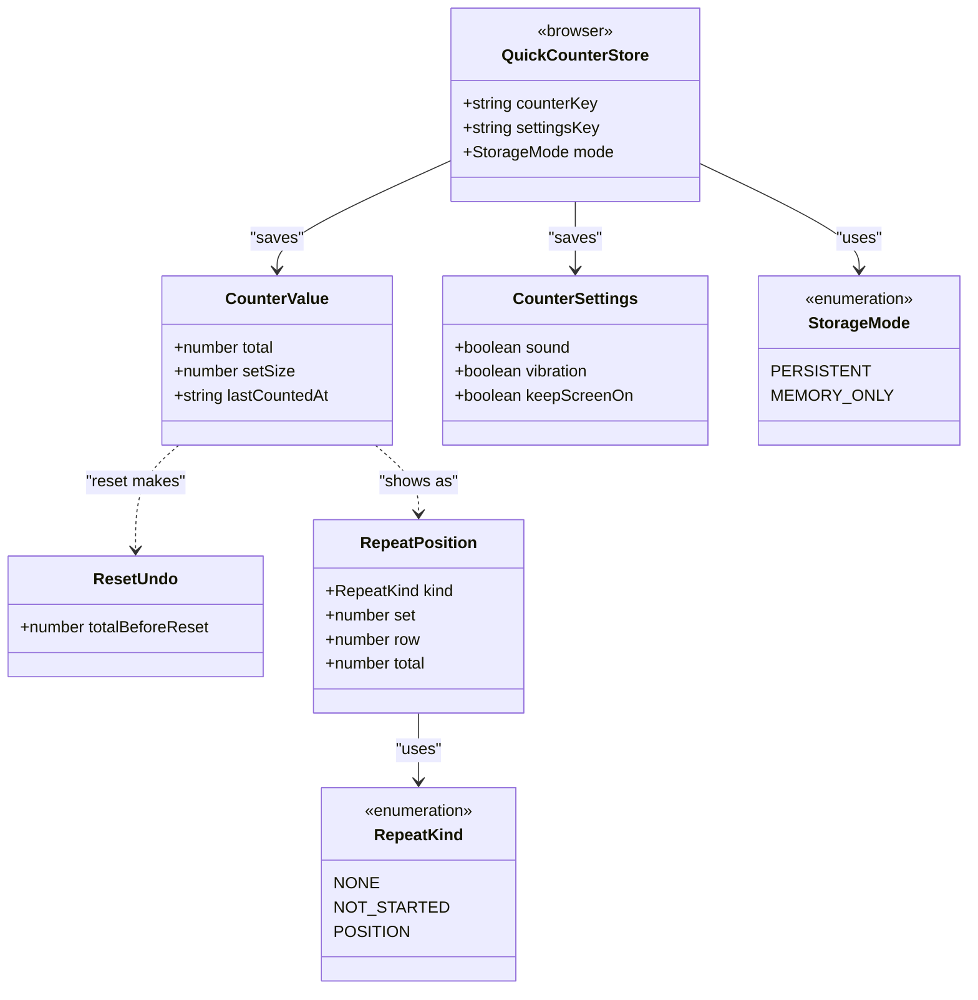
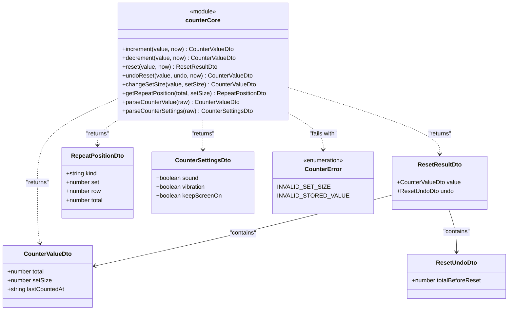

# 단수 카운터 도메인 모델

이 문서는 단수 카운터 기능의 도메인 개념과 packages/shared가 제공하는 함수 인터페이스를 classDiagram과 표로 정한다. 지금은 1차 설계로 로그인 없이 쓰는 퀵 카운터의 범위만 다루며, 구현하는 사람은 카운터 값 계산 함수와 브라우저 저장 형식을 이 문서에서 확인할 수 있다.

## 설계 범위

퀵 카운터는 값을 그 브라우저에만 저장하므로(FR-13) 계정과 DB 설계에 기대지 않는다. 그래서 로드맵의 예외에 따라 퀵 카운터를 001·002 설계보다 먼저 설계하고 만든다. 프로젝트 카운터에 필요한 테이블, RLS 정책, 서버 저장 흐름은 001·002 설계를 마친 뒤 2차 설계로 이 문서와 같은 폴더의 다른 문서에 더한다.

| 구분 | 요구사항 | 다루는 시점 |
|---|---|---|
| 1차 | FR-01~FR-06, FR-09~FR-15, FR-25, FR-26, FR-37, FR-39~FR-41, FR-38의 퀵 카운터 후보. NFR-02~NFR-09, NFR-11 | 이번 설계 |
| 2차 | FR-07, FR-08(이력), FR-16~FR-18(프로젝트로 옮기기), FR-19~FR-24, FR-34(다중 카운터와 삭제), FR-27~FR-32, FR-35, FR-36(연결 카운터), FR-33, FR-42(연결이 끊긴 동안의 저장), FR-38의 프로젝트 카운터 후보. NFR-01, NFR-10 | 001·002 설계 뒤 |

1차에서 만드는 계산 함수(값 바꾸기, 리셋과 되돌리기, 반복 위치 계산)는 2차의 프로젝트 카운터도 그대로 쓴다. 그래서 함수는 저장 위치를 모르는 순수 함수로 만든다.

## 도메인 개념

CounterValue는 카운터 하나의 전체 단수, 1세트당 단수, 마지막으로 센 시각이다. 리셋하면 되돌리기에 쓸 ResetUndo가 생기며, ResetUndo는 화면에만 두고 저장하지 않는다(FR-06). QuickCounterStore는 apps/web이 브라우저 저장소를 다루는 부분이다. 한 브라우저 탭에는 QuickCounterStore가 하나만 있고, 로그아웃 홈의 퀵 카운터 구역, 퀵 카운터 화면, 이어서 뜨기 바가 모두 이 저장소로 값을 읽고 쓴다. 저장소를 쓸 수 없으면 QuickCounterStore가 탭 안에 둔 메모리 사본 하나에만 값을 두므로, 같은 탭에서 화면을 오가도 값이 이어지고 탭을 닫거나 새로 고침하면 사라진다(NFR-11).

| 클래스 | 뜻 | 저장하는 곳 | 관련 FR |
|---|---|---|---|
| CounterValue | 카운터의 전체 단수(0 이상의 정수), 1세트당 단수(없거나 1 이상의 정수), 마지막으로 센 시각 | 브라우저 저장소의 퀵 카운터 항목. 저장소를 쓸 수 없으면 QuickCounterStore가 탭마다 하나 두는 메모리 사본 | FR-01~FR-04, FR-13, FR-25, FR-26 |
| ResetUndo | 리셋 직전의 전체 단수. 되돌리기 버튼이 보이는 동안만 있다 | 화면 메모리 | FR-05, FR-06 |
| RepeatPosition | 전체 단수를 'n세트 m단'으로 바꾼 표시 값. 1세트당 단수가 없으면 `NONE`, 전체 단수가 0이면 `NOT_STARTED`다 | 저장하지 않고 계산한다 | FR-25, FR-26 |
| CounterSettings | 소리 피드백, 진동 피드백, 화면 꺼짐 방지 설정 | 브라우저 저장소의 설정 항목 | FR-09~FR-11 |
| QuickCounterStore | 두 항목을 읽고 쓰는 apps/web 모듈. 탭마다 하나만 두고 모든 화면이 함께 쓴다. 저장 방식은 `PERSISTENT`나 `MEMORY_ONLY`이며, 실제 쓰기가 실패하면 `MEMORY_ONLY`로 바꾼다 | 해당 없음 | FR-13, FR-15, NFR-11 |

## shared 함수

counterCore는 `packages/shared/src/counter/`에 두는 순수 함수 모음이다. 네트워크나 브라우저 저장소를 직접 다루지 않고, 입력 값과 현재 시각(`now`, ISO 8601 문자열)을 받아 새 값을 만든다. DTO는 zod 스키마로 정의하고, 실패는 CounterError 값으로 알린다.

| 함수 | 입력 | 출력 DTO | 오류 | 관련 FR |
|---|---|---|---|---|
| `increment` | `CounterValueDto`, `now` | `CounterValueDto` (전체 단수 +1, 마지막으로 센 시각 = `now`) | 없음 | FR-01, FR-04, FR-41 |
| `decrement` | `CounterValueDto`, `now` | `CounterValueDto` (전체 단수 -1, 마지막으로 센 시각 = `now`). 전체 단수가 0이면 값을 바꾸지 않는다 | 없음 | FR-01, FR-02, FR-04 |
| `reset` | `CounterValueDto`, `now` | `ResetResultDto` (전체 단수 0, 리셋 전 값을 담은 ResetUndo) | 없음 | FR-05, FR-06 |
| `undoReset` | `CounterValueDto`, `ResetUndoDto`, `now` | `CounterValueDto` (전체 단수 = 리셋 전 값) | 없음 | FR-06 |
| `changeSetSize` | `CounterValueDto`, 1세트당 단수(1 이상의 정수 또는 없음) | `CounterValueDto` (전체 단수는 그대로) | `INVALID_SET_SIZE` | FR-25, FR-26 |
| `getRepeatPosition` | 전체 단수, 1세트당 단수 | `RepeatPositionDto` | 없음 | FR-25 |
| `parseCounterValue` | 브라우저 저장소에서 읽은 값 | `CounterValueDto` | `INVALID_STORED_VALUE` | FR-13 |
| `parseCounterSettings` | 브라우저 저장소에서 읽은 값 | `CounterSettingsDto`. 없는 항목은 꺼짐으로 채운다 | `INVALID_STORED_VALUE` | FR-11 |

`getRepeatPosition`은 요구사항의 반복 표시 식을 따른다. 전체 단수 `c`가 1 이상이면 `set = floor((c - 1) / k) + 1`, `row = (c - 1) % k + 1`이고, `c`가 0이면 `NOT_STARTED`다. `parseCounterValue`가 `INVALID_STORED_VALUE`로 실패하면 apps/web은 전체 단수 0인 새 값으로 시작한다.

## 브라우저 저장 항목

| 키 | 값 | 관련 FR |
|---|---|---|
| `hamtteukka.quickCounter.v1` | `CounterValueDto`를 JSON으로 저장한다. 예: `{"total":7,"setSize":4,"lastCountedAt":"2026-11-20T12:00:00.000Z"}` | FR-13 |
| `hamtteukka.counterSettings.v1` | `CounterSettingsDto`를 JSON으로 저장한다 | FR-11 |

두 항목은 localStorage에 둔다. 키 끝의 `v1`은 저장 형식의 버전이며, 형식을 바꾸면 새 키를 쓰고 이전 키의 값을 옮긴다.

같은 브라우저에서 여러 탭을 열어 둘 때는 아래 규칙을 따른다.

- 조작할 때마다 저장소의 최신 값을 다시 읽어 counterCore 함수를 적용하고 바로 쓴다. 읽기, 계산, 쓰기는 한 번의 동기 처리 안에서 끝낸다. 그래서 탭을 오가며 센 조작이 화면에 늦게 반영된 값 때문에 덮어써지지 않고 모두 더해진다.
- 다른 탭에서 값이 바뀌면 `storage` 이벤트로 화면 값을 맞춘다. 되돌리기 버튼이 보이던 탭은 되돌리기 정보를 버린다([상태 전이](state.md)).
- 서로 다른 탭에서 거의 같은 순간에 누른 조작까지 탭 사이에서 순서를 맞추지는 않는다. 한 사람이 한 번에 한 화면에서 센다는 전제이며, NFR-02가 다루는 빠른 연속 입력은 한 화면 안의 조작이다.

## 관련 문서

- [요구사항](../requirements.md): 이 설계의 근거인 FR과 AC
- [데이터 모델과 RLS 정책](erd.md): 1차 설계에 테이블이 없는 이유
- [상태 전이](state.md): 리셋과 되돌리기 버튼의 상태
- [ADR-0003 Supabase 접근을 packages/shared로 제한](../../../decisions/0003-data-access-boundary.md): shared 함수 경계를 정한 결정
- [도메인 지도](../../../architecture/domain-map.md): 기능 전체의 도메인 관계
