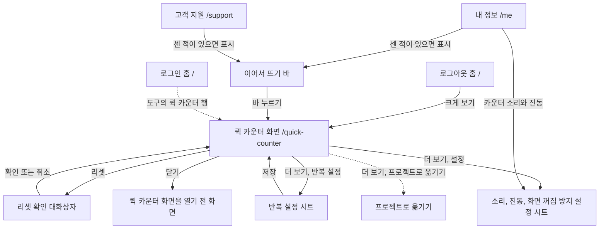

# 단수 카운터 화면 흐름

이 문서는 단수 카운터 기능의 화면과 화면 사이의 이동을 flowchart와 화면 표로 정한다. 1차 설계는 로그인 없이 쓰는 퀵 카운터의 화면을 다루며, 구현하는 사람은 화면마다 경로와 접근 조건, 근거가 되는 사용자 스토리를 확인할 수 있다.

## 화면 이동

점선은 2차 설계 뒤에 만드는 예정된 연결이다. 프로젝트로 옮기기(FR-16~FR-18)와 로그인 홈은 계정과 프로젝트가 있어야 하므로, 지금은 로그아웃 홈만 홈 화면이다.

퀵 카운터 화면은 [화면 구조](../../../design/information-architecture.md#카운터-화면)의 규칙대로 화면 전체 높이의 바텀 시트로 열고, 열려 있는 동안 하단 탭과 이어서 뜨기 바를 숨긴다. 이 화면도 `/quick-counter`라는 고유한 주소를 가지므로, 새로 고침하면 같은 화면이 다시 열린다. 주소로 바로 들어와 열기 전 화면이 없으면 닫을 때 로그아웃 홈으로 간다.

로그아웃 홈의 퀵 카운터 구역, 퀵 카운터 화면, 이어서 뜨기 바는 탭마다 하나인 QuickCounterStore로 같은 값을 읽고 쓴다([도메인 모델](domain.md)). 그래서 홈에서 센 값을 `크게 보기`로 열면 퀵 카운터 화면이 그대로 이어받고, 퀵 카운터 화면을 닫으면 홈과 바가 바뀐 값을 보여 준다. 브라우저 저장소를 쓸 수 없을 때도 같은 탭 안에서는 이 규칙이 그대로 적용된다.

## 화면 표

| 화면 | 경로 | 접근 조건 | 관련 US |
|---|---|---|---|
| 로그아웃 홈의 퀵 카운터 구역 | `/` | 모두. `counter-m` 값, 마지막으로 센 시각, 빼기와 `+1단` 버튼, `크게 보기`, 저장 안내를 보여 준다. 리셋 버튼은 두지 않는다(FR-12, FR-15) | US-01, US-06 |
| 퀵 카운터 화면 | `/quick-counter` | 모두. [R1 화면 구성](../../../design/r1-screens.md#카운터-화면)의 카운터 화면 배치에서 카운터 칩과 보조 카운터 구역을 빼고, 이력도 두지 않는다(FR-12, FR-14) | US-01~US-03, US-05, US-06, US-09 |
| 리셋 확인 대화상자 | 퀵 카운터 화면 위 | 모두. 현재 값을 보여 준다(FR-05) | US-03 |
| 반복 설정 시트 | 퀵 카운터 화면 위 | 모두. 1세트당 단수를 입력하거나 지운다(FR-25, FR-26) | US-09 |
| 소리, 진동, 화면 꺼짐 방지 설정 시트 | 퀵 카운터 화면이나 내 정보 위 | 모두. 지원하지 않는 기능은 비활성으로 보여 주고, 화면 꺼짐 방지를 지원하지 않으면 자동 잠금 시간을 늘리는 방법을 안내한다(FR-09~FR-11, NFR-04, NFR-07) | US-05 |
| 이어서 뜨기 바 | 탭 화면의 하단 탭 위 | 모두. 퀵 카운터로 센 적이 있을 때만 보이고, 누르면 퀵 카운터 화면을 연다(FR-37~FR-41) | US-11 |

모든 화면은 휴대폰 세로 화면을 기준으로 배치하고, `globals.css`의 색 토큰을 써서 라이트 모드와 다크 모드에서 모두 읽히게 한다(NFR-09). `+1단` 버튼은 화면에서 가장 큰 조작 요소로 맨 아래에 두고 높이를 88px 이상으로 한다(NFR-05). 값에는 고정폭 숫자를 쓰고, 값이 바뀌면 화면 읽기 프로그램이 새 값을 읽도록 알린다(NFR-08).

## 관련 문서

- [요구사항](../requirements.md): 화면의 근거인 사용자 스토리
- [시나리오 시퀀스](sequence.md): 화면에서 시작하는 요청 흐름
- [상태 전이](state.md): 리셋과 되돌리기 버튼의 상태
- [함뜨까 프로젝트 헌법](../../../constitution.md): 모바일 우선과 다크 모드 원칙(P-12)
- [화면 구조](../../../design/information-architecture.md), [R1 화면 구성](../../../design/r1-screens.md), [비주얼 시스템](../../../design/visual-system.md), [브랜드와 말투](../../../design/brand.md): 모든 화면이 따르는 공통 규칙
