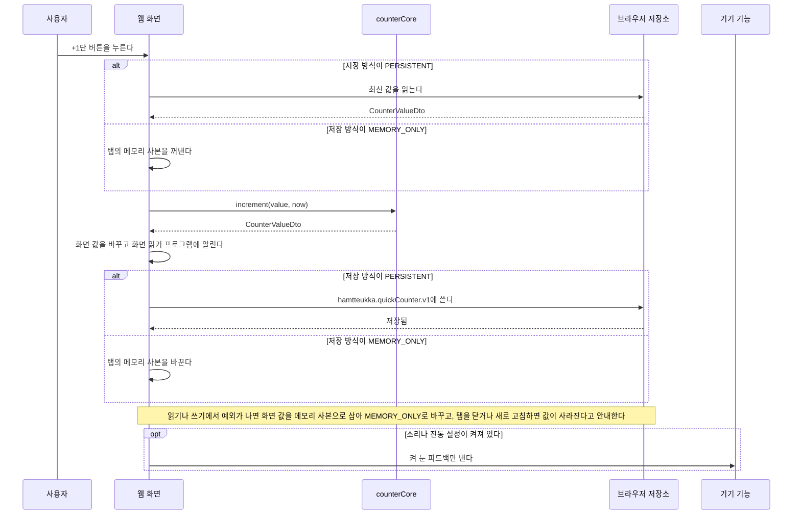
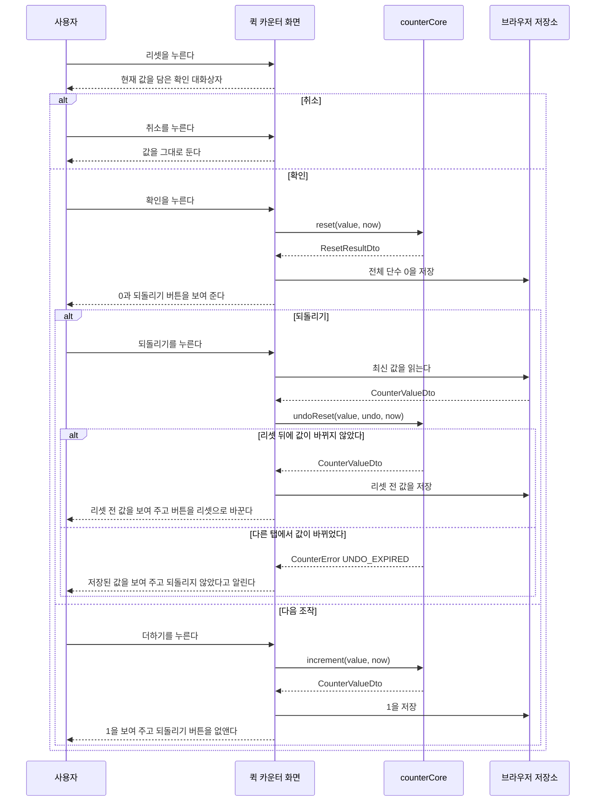
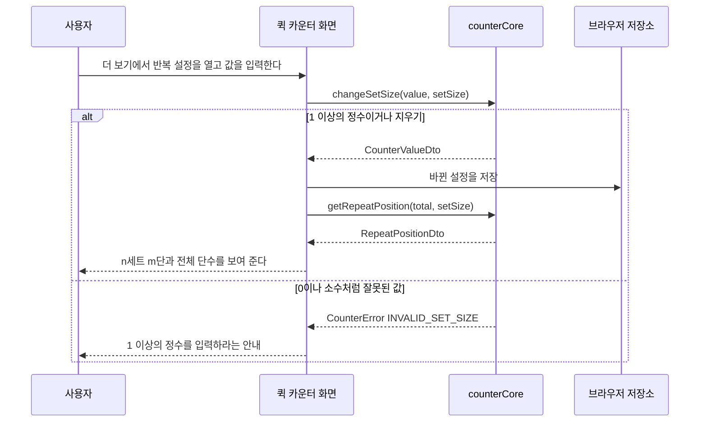
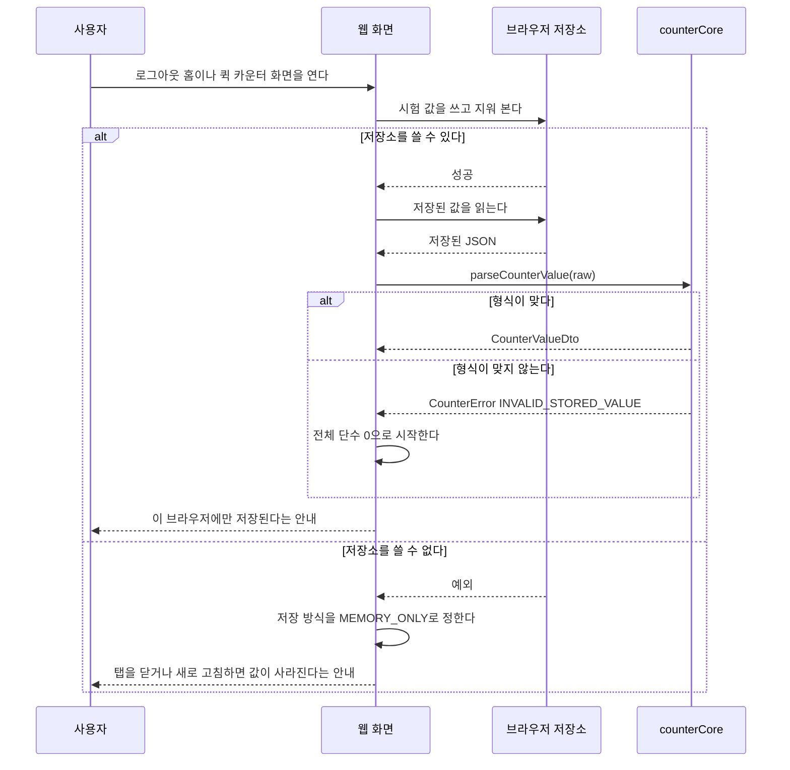
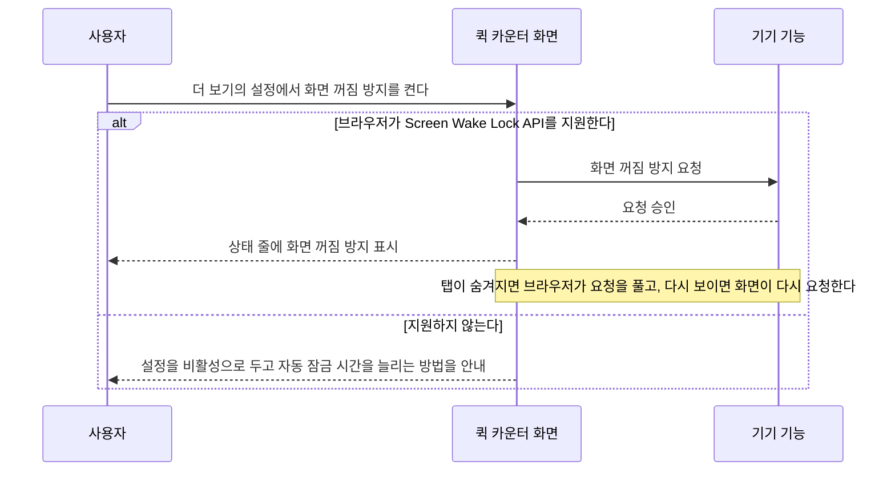
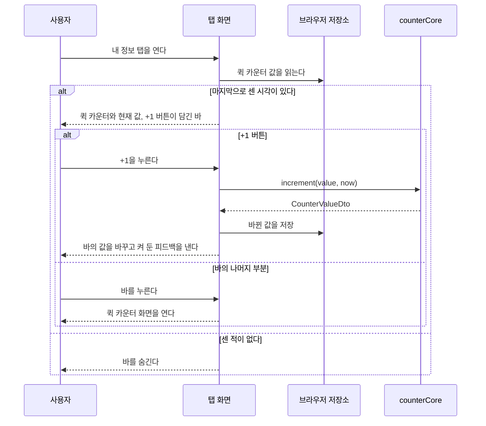

# 단수 카운터 시나리오 시퀀스

이 문서는 단수 카운터의 주요 시나리오에서 화면, shared 함수, 브라우저 저장소, 기기 기능이 주고받는 요청을 sequenceDiagram으로 정한다. 1차 설계인 퀵 카운터는 서버에 요청을 보내지 않으므로, 모든 시나리오가 브라우저 안에서 끝난다.

## 시나리오 목록

| 시나리오 | 관련 AC |
|---|---|
| [퀵 카운터로 센다](#퀵-카운터로-센다) | AC-03, AC-09, AC-10, AC-14, AC-17 |
| [리셋하고 되돌린다](#리셋하고-되돌린다) | AC-04, AC-05, AC-06, AC-07 |
| [1세트당 단수를 정하거나 지운다](#1세트당-단수를-정하거나-지운다) | AC-21, AC-22 |
| [브라우저 저장소를 쓸 수 없다](#브라우저-저장소를-쓸-수-없다) | AC-17, AC-37 |
| [화면 꺼짐 방지를 켠다](#화면-꺼짐-방지를-켠다) | AC-11, AC-12, AC-13 |
| [이어서 뜨기 바에서 센다](#이어서-뜨기-바에서-센다) | AC-36 |

AC-05와 AC-06의 이력 기록, AC-10의 서버 저장은 프로젝트 카운터에만 해당하므로 2차 설계에서 다룬다. 1차에서는 같은 AC의 값 변화와 버튼 동작을 확인한다.

## 퀵 카운터로 센다

읽기, 계산, 쓰기는 한 번의 동기 처리 안에서 끝나므로 화면은 저장 응답을 기다리지 않는다. 조작마다 저장소의 최신 값에 `increment`를 적용하므로, 버튼을 빠르게 연달아 눌러도 누른 횟수만큼 반영되고 탭을 오가며 센 값도 덮어쓰지 않는다(NFR-02, AC-10). 서로 다른 탭에서 거의 같은 순간에 누른 조작은 [도메인 모델](domain.md#브라우저-저장-항목)의 범위 밖이다. 처음에 저장소를 쓸 수 있었더라도 저장소 접근이 막히거나 저장 공간이 부족해 읽기나 쓰기에서 예외가 나면, 그때부터 `MEMORY_ONLY`로 바꾸고 안내 문구를 바꾼다(NFR-11, AC-17). 값이 0일 때 빼기를 누르면 `decrement`가 받은 값을 그대로 돌려주고, 저장과 피드백을 생략한다(AC-03). 이 흐름에는 서버로 보내는 요청이 없다(AC-14).

## 리셋하고 되돌린다

ResetUndo는 화면 메모리에만 두며, 상태별로 허용되는 조작은 [상태 전이](state.md)에서 정한다. 되돌리기는 저장소의 최신 값을 읽어 리셋 직후의 값(전체 단수 0, 마지막으로 센 시각 = `resetAt`)과 같을 때만 적용하므로, 다른 탭의 `storage` 이벤트가 아직 도착하지 않았더라도 그 탭에서 센 값을 덮어쓰지 않는다. `MEMORY_ONLY`이면 저장소 대신 탭의 메모리 사본을 읽는다. 리셋 버튼은 조작 버튼과 떨어진 상태 줄에 작게 둔다(NFR-06).

## 1세트당 단수를 정하거나 지운다

1세트당 단수를 바꾸거나 지워도 전체 단수는 그대로이고 표시만 바뀐다(FR-26, AC-22). 1세트당 단수를 지우면 `getRepeatPosition`이 `NONE`을 돌려주고, 화면은 전체 단수만 보여 준다.

## 브라우저 저장소를 쓸 수 없다

사생활 보호 모드처럼 저장소 접근이 예외를 던지는 환경에서도 카운터는 동작한다(NFR-11, AC-17). `MEMORY_ONLY`에서는 QuickCounterStore가 탭에 둔 메모리 사본 하나를 로그아웃 홈의 구역, 퀵 카운터 화면, 이어서 뜨기 바가 함께 쓴다. 그래서 홈에서 센 값을 `크게 보기`로 연 퀵 카운터 화면이 그대로 이어받고, 퀵 카운터 화면을 닫아도 같은 탭에서는 값이 남는다. 탭을 닫거나 새로 고침하면 값이 사라진다. 안내 문구는 퀵 카운터를 보여 주는 화면에 항상 보인다(FR-15, AC-37).

## 화면 꺼짐 방지를 켠다

화면 꺼짐 방지는 퀵 카운터 화면이 열려 있는 동안만 요청하고, 화면을 닫으면 푼다(NFR-03). 지원하지 않는 브라우저의 안내는 NFR-04를 따른다. 진동을 지원하지 않는 브라우저에서도 같은 방식으로 진동 설정만 비활성으로 두고 카운트는 그대로 동작한다(NFR-07, AC-13). 브라우저별 지원 범위는 구현 Task에서 실제 휴대폰으로 확인한다.

## 이어서 뜨기 바에서 센다

로그아웃 홈, 퀵 카운터 화면, 화면 키보드가 열린 동안에는 바를 숨긴다(FR-39). 로그인한 회원에게 진행 중 프로젝트의 카운터와 퀵 카운터 가운데 무엇을 보여 줄지는 2차 설계에서 FR-38에 따라 정한다.

## 관련 문서

- [요구사항](../requirements.md): 시나리오가 확인하는 AC
- [도메인 모델](domain.md): 시나리오에 나오는 counterCore 함수와 저장 항목
- [상태 전이](state.md): 리셋과 되돌리기의 상태
- [화면 흐름](screens.md): 시나리오가 시작되는 화면
