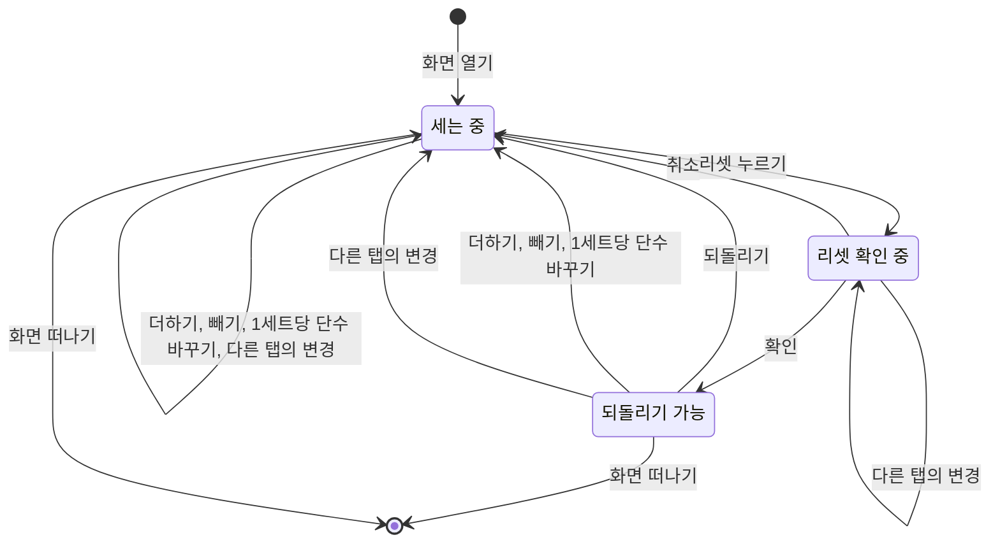

# 단수 카운터 상태 전이

이 문서는 카운터 화면에서 리셋 확인과 되돌리기 버튼이 어떤 조작으로 나타나고 사라지는지 stateDiagram-v2와 전이 표로 정한다. 구현하는 사람은 허용되는 전이와 조건을 확인하고, 되돌리기 버튼이 남거나 잘못 사라지는 경우를 막는 테스트를 쓸 수 있다.

## 상태 다이어그램

이 상태는 화면에만 있고 저장하지 않는다. 리셋을 확인하면 전체 단수를 0으로 저장하고, 리셋 전 값은 화면 메모리의 ResetUndo에만 둔다([도메인 모델](domain.md)). 그래서 화면을 떠났다가 다시 열면 되돌리기 버튼은 보이지 않는다.

## 전이 표

| 현재 | 이벤트 | 다음 | 결과 | 근거 |
|---|---|---|---|---|
| 없음 | 화면 열기 | 세는 중 | 저장된 값을 보여 준다 | FR-01, FR-13 |
| 세는 중 | 더하기, 빼기 | 세는 중 | `increment`, `decrement` 결과를 저장한다. 값이 0일 때 빼기는 아무것도 바꾸지 않는다 | FR-01~FR-04, AC-03 |
| 세는 중 | 다른 탭의 변경 | 세는 중 | `storage` 이벤트로 받은 값을 화면에 보여 준다 | FR-13 |
| 세는 중 | 리셋 누르기 | 리셋 확인 중 | 현재 값을 보여 주는 확인 대화상자를 연다 | FR-05 |
| 리셋 확인 중 | 다른 탭의 변경 | 리셋 확인 중 | 대화상자에 보이는 현재 값을 새 값으로 바꾼다 | FR-05 |
| 리셋 확인 중 | 취소 | 세는 중 | 값을 바꾸지 않는다 | FR-05, AC-04 |
| 리셋 확인 중 | 확인 | 되돌리기 가능 | `reset` 결과를 저장하고, 리셋 버튼 자리에 되돌리기 버튼을 보여 준다 | FR-05, FR-06, AC-05 |
| 되돌리기 가능 | 되돌리기 | 세는 중 | `undoReset` 결과를 저장한다 | FR-06, AC-06 |
| 되돌리기 가능 | 더하기, 빼기, 1세트당 단수 바꾸기 | 세는 중 | 조작을 적용하고 ResetUndo를 버린다 | FR-06, AC-07 |
| 되돌리기 가능 | 다른 탭의 변경 | 세는 중 | 받은 값을 화면에 보여 주고 ResetUndo를 버린다 | FR-06 |
| 되돌리기 가능 | 화면 떠나기 | 없음 | ResetUndo를 버린다 | FR-06 |

다른 탭의 변경은 같은 브라우저의 다른 탭에서 퀵 카운터 값을 바꿔 `storage` 이벤트가 들어온 경우다. 되돌리기 가능 상태에서 이 이벤트를 받으면 ResetUndo를 버리므로, 되돌리기가 다른 탭에서 센 값을 리셋 전 값으로 덮어쓰지 않는다. 같은 탭의 이어서 뜨기 바는 카운터 화면이 열려 있지 않을 때만 보이므로(FR-39), 되돌리기 가능 상태에 영향을 주지 않는다.

## 관련 문서

- [요구사항](../requirements.md): 상태 전이의 근거인 FR과 AC
- [도메인 모델](domain.md): 전이에서 호출하는 counterCore 함수
- [화면 흐름](screens.md): 리셋 대화상자가 열리는 화면
