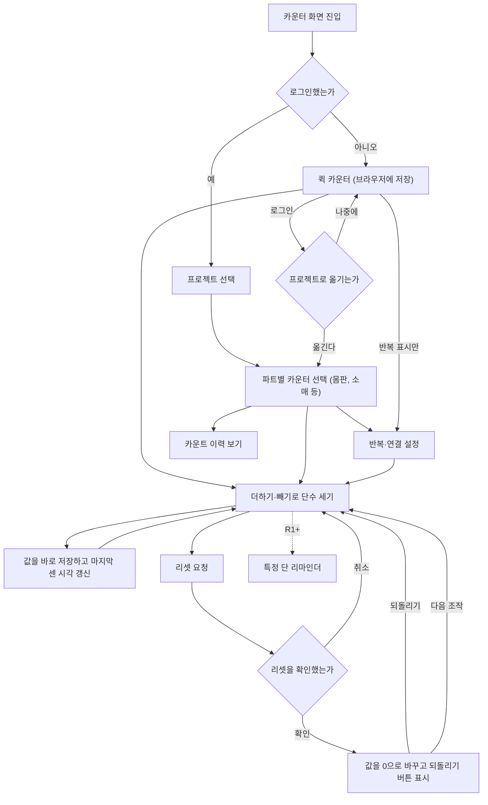

# 단수 카운터 요구사항

이 문서는 R1 MVP에 포함하는 단수 카운터의 요구사항을 정의한다. 기본 카운터, 로그인 없이 쓰는 퀵 카운터, 파트별 다중 카운터, 반복·연결 카운터를 다룬다. 설계, 작업 분해, 테스트 단계에서는 이 문서의 US, FR, NFR, AC ID로 각 항목을 참조한다.

> **이 문서는 승인을 기다리는 제안이다.** 아래 요구사항은 아직 확정되지 않았다. 확인 질문이 모두 해결되고 프로젝트 소유자가 승인하면 `status`를 `approved`로 바꾸며, 그때부터 `/sdd-design`이 이 문서를 기준으로 설계 다이어그램을 만든다.

## 상태와 승인

| 항목 | 값 |
|---|---|
| 상태 | 검토 대기 (`review`) |
| 출시 단계 | R1 MVP |
| 기능 ID | F-COUNTER-01, F-COUNTER-02, F-COUNTER-03, F-COUNTER-04 |
| Feature 이슈 | `[003] 단수 카운터` |
| 승인 위치 | Feature 이슈의 '요구사항 검토' Task (`[003] 요구사항 검토와 확인 질문 해결`) |
| 선행 명세 | [002 뜨개 프로젝트 기록](../002-projects/requirements.md) |
| 연결된 미결정 항목 | 없음 |
| 승인 조건 | 확인 질문(Q)을 모두 해결했다 |
| 승인 후 단계 | `/sdd-design` |

승인한 뒤 요구사항을 바꿔야 하면 이 문서를 먼저 고치고, 설계와 이슈를 다시 만든다. 설계 문서나 이슈를 먼저 고쳐서 이 문서와 어긋나게 만들지 않는다.

## 배경

단수 카운터는 뜨개를 하는 동안 매일 반복해서 쓰는 도구다. [ADR-0008](../../decisions/0008-mvp-personal-tools.md)은 혼자 써도 가치가 있는 개인 뜨개 도구를 MVP로 정했고, 카운터는 그 도구의 중심 기능이다. 실노트·니트플로우·단수링은 모바일 앱 중심이고 웹 버전이 확인되지 않았으므로, 함뜨까는 휴대폰 브라우저에서 바로 쓰는 카운터를 제공한다.

2026-11-18 조사에서 확인한 사실 가운데 이 명세의 근거가 되는 내용은 다음과 같다.

- 단수링은 '1세트당 단수'를 정하면 'n세트 m단'으로 위치를 보여 주고, 카운트를 실시간으로 저장하며, 마지막으로 센 시각을 표시한다([App Store](https://apps.apple.com/kr/app/%EB%8B%A8%EC%88%98%EB%A7%81/id6737157418)).
- 단수링 App Store 리뷰에는 리셋 버튼을 실수로 누르기 쉽다는 불만과 과거 기록을 보게 해 달라는 요청이 있다([리뷰](https://apps.apple.com/kr/app/id6737157418?see-all=reviews)). 이 명세의 리셋 확인, 되돌리기, 카운트 이력 요구사항은 이 리뷰를 근거로 한다.
- 니트플로우는 한 프로젝트에 몸판, 요크, 소매처럼 부위별 카운터를 여러 개 두며, 예시 화면에서 카운터마다 마지막 기록 시점을 보여 준다([공식 사이트](https://www.knitflow.io/ko/)).
- 니트플로우는 업데이트를 거치며 카운터 버튼을 키웠고, 누를 때 진동과 소리가 나도록 바꿨다([버전 기록](https://apps.apple.com/kr/app/knitflow-%EB%8B%88%ED%8A%B8%ED%94%8C%EB%A1%9C%EC%9A%B0-%EB%9C%A8%EA%B0%9C-%EA%B8%B0%EB%A1%9D-%EB%8F%84%EA%B5%AC/id6740465748?see-all=version-history)).
- YarnBuddy는 선택형 소리·햅틱 피드백과 프로젝트 없이 쓰는 퀵 카운터를 제공한다([App Store](https://apps.apple.com/app/id1267678125)). knitCompanion은 뜨개 중에 기기 잠자기를 허용할지 설정하게 한다([공식 사이트](https://www.knitcompanion.com/)).
- My Row Counter는 전체 단 카운터와 N단마다 초기화되는 보조 카운터를 제공하고, 보조 카운터를 전체 카운터와 연결한다([공식 사이트](https://rowcounterapp.com/counter.html)).

서비스별 조사 내용은 [참고 서비스 조사](../../research/2026-11-18-reference-services.md)에 정리되어 있다.

## 사용자 흐름

점선 화살표는 이 명세의 범위 밖이며 R1+에서 다룰 예정인 흐름이다.

로그인 여부에 따라 퀵 카운터와 프로젝트 카운터로 나뉘지만, 두 카운터는 같은 세기·리셋·되돌리기 흐름을 쓴다. 카운트 이력과 연결 설정은 프로젝트 카운터에만 있으며, 퀵 카운터는 로그인한 뒤 프로젝트 카운터로 옮길 수 있다.

## 사용자 스토리

| ID | 사용자 | 원하는 일 | 이유 | 기능 ID |
|---|---|---|---|---|
| US-01 | 뜨개 중인 회원 | 버튼 하나로 단수를 올리고 내리고 싶다 | 손을 오래 멈추지 않고 몇 단째인지 기록하려고 | F-COUNTER-01 |
| US-02 | 작업을 쉬었다가 다시 시작하는 회원 | 마지막으로 센 시각을 보고 싶다 | 방금 뜬 단을 이미 셌는지 판단하려고 | F-COUNTER-01, F-COUNTER-03 |
| US-03 | 리셋을 잘못 누른 회원 | 리셋하기 전에 확인하고, 리셋한 뒤에도 되돌리고 싶다 | 세어 둔 단수를 잃지 않으려고 | F-COUNTER-01 |
| US-04 | 진행 과정을 되짚는 회원 | 카운트 변경 이력을 보고 싶다 | 언제 몇 단을 떴는지 확인하려고 | F-COUNTER-01, F-COUNTER-04 |
| US-05 | 화면을 보지 않고 뜨는 회원 | 누를 때 소리나 진동으로 확인하고, 화면이 꺼지지 않기를 원한다 | 입력 여부를 알고 화면을 다시 켜는 수고를 덜려고 | F-COUNTER-01 |
| US-06 | 가입하지 않은 방문자 | 로그인 없이 카운터를 바로 쓰고 싶다 | 가입하기 전에 도구를 써 보려고 | F-COUNTER-02 |
| US-07 | 퀵 카운터를 쓰다가 가입한 회원 | 센 값을 프로젝트로 옮기고 싶다 | 기록을 프로젝트에서 이어서 관리하려고 | F-COUNTER-02 |
| US-08 | 여러 조각을 뜨는 회원 | 몸판, 소매처럼 파트별 카운터를 따로 두고 바꿔 가며 쓰고 싶다 | 조각마다 단수를 헷갈리지 않으려고 | F-COUNTER-03 |
| US-09 | 반복 무늬를 뜨는 회원 | 몇 번째 반복의 몇 번째 단인지 보고 싶다 | 도안의 반복 단위와 맞춰 보려고 | F-COUNTER-04 |
| US-10 | '몇 단마다 늘리기'를 함께 세는 회원 | 전체 단수에 따라 움직이는 보조 카운터를 쓰고 싶다 | 카운터 두 개를 따로 누르지 않으려고 | F-COUNTER-04 |

## 기능 요구사항

### 기본 카운터 (F-COUNTER-01)

| ID | 요구사항 | 관련 US |
|---|---|---|
| FR-01 | 카운터 화면은 현재 값과 더하기·빼기 버튼을 보여 준다. 더하기는 값을 1 올리고, 빼기는 값을 1 내린다. | US-01 |
| FR-02 | 값은 0 아래로 내려가지 않는다. 값이 0일 때 빼기를 눌러도 값과 이력은 바뀌지 않는다. | US-01 |
| FR-03 | 값이 바뀔 때마다 바로 저장한다. 사용자가 저장 버튼을 누르는 단계는 없다. | US-01 |
| FR-04 | 카운터마다 마지막으로 센 시각을 저장하고 카운터 화면에 표시한다. 더하기, 빼기, 리셋, 되돌리기가 이 시각을 갱신한다. | US-02 |
| FR-05 | 리셋은 확인 대화상자를 거친다. 대화상자는 현재 값을 보여 주고, 사용자가 확인해야 값을 0으로 바꾼다. | US-03 |
| FR-06 | 리셋 직후 되돌리기 버튼을 보여 준다. 버튼을 누르면 리셋 전 값으로 돌아가며, 버튼은 다음 조작을 하거나 화면을 떠날 때까지 유지한다. | US-03 |
| FR-07 | 증가, 감소, 리셋, 되돌리기를 카운트 이력에 남긴다. 각 기록은 변경 종류, 변경 전 값, 변경 후 값, 시각을 담는다. | US-04 |
| FR-08 | 카운터별 이력 화면은 최신 기록부터 날짜와 시각을 함께 보여 준다. 보관 범위는 Q-03에서 정한다. | US-04 |
| FR-09 | 소리 피드백과 진동 피드백을 각각 켜고 끌 수 있다. 버튼을 누르면 켜 둔 피드백만 낸다. | US-05 |
| FR-10 | 화면 꺼짐 방지를 켜고 끌 수 있다. 동작 조건은 NFR-03과 NFR-04를 따른다. | US-05 |
| FR-11 | 피드백 설정과 화면 꺼짐 방지 설정은 기기의 브라우저에 저장한다. 기기마다 지원하는 기능이 다르기 때문이다. | US-05 |

### 퀵 카운터 (F-COUNTER-02)

| ID | 요구사항 | 관련 US |
|---|---|---|
| FR-12 | 로그인 여부와 관계없이 퀵 카운터 화면에서 카운터 하나를 바로 쓸 수 있다. 프로젝트를 만들 필요가 없다. | US-06 |
| FR-13 | 퀵 카운터의 값, 설정, 마지막으로 센 시각은 그 브라우저에만 저장하고 서버로 보내지 않는다. | US-06 |
| FR-14 | 퀵 카운터는 더하기·빼기, 리셋 확인과 되돌리기, 마지막으로 센 시각, 반복 표시(FR-25)를 제공한다. 이력, 다중 카운터, 연결 카운터는 프로젝트 카운터에서만 제공한다. | US-06 |
| FR-15 | 퀵 카운터 화면은 값이 이 브라우저에만 남고, 브라우저 데이터를 지우면 사라진다고 안내한다. | US-06 |
| FR-16 | 퀵 카운터 값이 0보다 큰 상태에서 로그인하면 프로젝트로 옮길지 묻는다. 선택지는 새 프로젝트 만들기, 기존 프로젝트에 추가, 나중에 하기다. | US-07 |
| FR-17 | 옮기기를 고르면 퀵 카운터의 값과 '1세트당 단수' 설정을 가진 프로젝트 카운터를 만들고, 브라우저의 퀵 카운터 값을 지운다. 옮긴 카운터의 이력은 옮긴 시점부터 기록한다. | US-07 |
| FR-18 | '나중에 하기'를 고르면 퀵 카운터 값을 그대로 두고, 다음 로그인 때 다시 묻지 않는다. 사용자는 퀵 카운터 화면에서 옮기기를 직접 시작할 수 있다. | US-07 |

### 파트별 다중 카운터 (F-COUNTER-03)

| ID | 요구사항 | 관련 US |
|---|---|---|
| FR-19 | 로그인한 사용자는 프로젝트 하나에 카운터를 여러 개 만들고, 카운터마다 이름(예: 몸판, 소매)을 붙인다. 개수 상한은 Q-02에서 정한다. | US-08 |
| FR-20 | 프로젝트에 카운터가 없으면 첫 카운터를 만드는 버튼을 보여 준다. | US-08 |
| FR-21 | 카운터 화면에서 같은 프로젝트의 다른 카운터로 전환한다. 전환 목록은 카운터마다 이름, 현재 값, 마지막으로 센 시각을 보여 준다. | US-02, US-08 |
| FR-22 | 카운터 이름을 바꿀 수 있다. 전환 목록은 카운터를 만든 순서로 보여 준다. | US-08 |
| FR-23 | 카운터 삭제는 확인 대화상자를 거친다. 카운터를 삭제하면 그 카운터의 이력도 함께 지운다. | US-08 |
| FR-24 | 프로젝트 카운터 화면을 다시 열면 그 프로젝트에서 마지막으로 사용한 카운터를 먼저 보여 준다. | US-08 |

### 반복·연결 카운터 (F-COUNTER-04)

| ID | 요구사항 | 관련 US |
|---|---|---|
| FR-25 | 카운터에 '1세트당 단수'(1 이상의 정수)를 정하면 값을 'n세트 m단'으로 표시하고, 전체 단수를 함께 보여 준다. | US-09 |
| FR-26 | 저장하는 값은 전체 단수다. '1세트당 단수'를 바꾸거나 지워도 전체 단수는 그대로이며 표시만 바뀐다. | US-09 |
| FR-27 | 보조 카운터를 같은 프로젝트의 다른 카운터(주 카운터)에 연결할 수 있다. 주 카운터 하나에 보조 카운터를 여러 개 연결할 수 있다. | US-10 |
| FR-28 | 연결은 주 카운터에서 보조 카운터로 가는 한 방향이다. 보조 카운터를 직접 조작해도 주 카운터는 바뀌지 않는다. | US-10 |
| FR-29 | '따라가기' 방식에서는 주 카운터가 1 오르거나 내릴 때 보조 카운터도 같은 방향으로 1 바뀐다. | US-10 |
| FR-30 | 'N단마다 초기화' 방식에서는 주 카운터가 오를 때 보조 카운터를 1 올리고, N 다음에는 1로 돌아가며 반복 횟수를 1 늘린다. 주 카운터가 내리면 이 과정을 거꾸로 적용한다. | US-10 |
| FR-31 | 보조 카운터는 주 카운터를 하나만 가지며, 다른 카운터의 주 카운터가 될 수 없다. 주 카운터를 삭제하면 연결이 풀리고 보조 카운터는 일반 카운터로 남는다. | US-10 |
| FR-32 | 연결 때문에 바뀐 값도 보조 카운터 이력에 남기고, 어느 주 카운터의 변경 때문인지 표시한다. | US-04, US-10 |

반복 표시는 전체 단수 `c`와 '1세트당 단수' `k`로 계산한다. `c`가 1 이상이면 `n = floor((c - 1) / k) + 1`, `m = (c - 1) % k + 1`이고, `c`가 0이면 '시작 전'으로 표시한다. 아래 표는 `k`가 4일 때의 예시다.

| 전체 단수 | 표시 |
|---|---|
| 0 | 시작 전 |
| 1 | 1세트 1단 |
| 4 | 1세트 4단 |
| 5 | 2세트 1단 |
| 6 | 2세트 2단 |

'N단마다 초기화' 보조 카운터는 연결한 시점에 값 0, 반복 횟수 0에서 시작한다. 아래 표는 N이 6일 때 주 카운터 조작에 따라 보조 카운터가 바뀌는 예시다.

| 주 카운터 조작 | 보조 카운터 값 | 반복 횟수 |
|---|---|---|
| 연결 직후 | 0 | 0 |
| 더하기 6번 | 6 | 0 |
| 더하기 1번 | 1 | 1 |
| 빼기 1번 | 6 | 0 |

## 비기능 요구사항

| ID | 분류 | 요구사항 |
|---|---|---|
| NFR-01 | 반응성 | 버튼을 누르면 저장 응답을 기다리지 않고 화면 값을 먼저 바꾼다. 저장에 실패하면 실패를 표시하고 다시 시도한다. 연결이 끊긴 동안의 처리는 Q-01에서 정한다. |
| NFR-02 | 정확성 | 버튼을 빠르게 연달아 눌러도 누른 횟수만큼 값에 반영한다. 저장 순서가 뒤바뀌어 값이 틀어지는 일이 없어야 한다. |
| NFR-03 | 화면 꺼짐 방지 | Screen Wake Lock API를 지원하는 브라우저에서 설정을 켜면, 카운터 화면을 보는 동안 화면이 꺼지지 않게 한다. 탭이 숨겨졌다가 다시 보이면 다시 요청한다. |
| NFR-04 | 화면 꺼짐 방지 대체 | Screen Wake Lock API를 지원하지 않는 브라우저에서는 설정을 비활성으로 표시하고, 기기 설정에서 자동 잠금 시간을 늘리는 방법을 안내한다. |
| NFR-05 | 조작성 | 더하기 버튼을 화면에서 가장 큰 조작 요소로 만들고, 휴대폰을 한 손으로 잡은 채 엄지로 누를 수 있는 위치에 둔다. |
| NFR-06 | 오조작 방지 | 리셋 버튼은 더하기·빼기 버튼과 떨어진 곳에 더 작게 배치한다. |
| NFR-07 | 피드백 대체 | 진동이나 소리를 낼 수 없는 환경에서는 해당 설정을 비활성으로 표시하고, 카운트 기능은 그대로 동작한다. |
| NFR-08 | 접근성 | 값이 바뀌면 화면 읽기 프로그램이 새 값을 읽을 수 있게 알린다. 모든 버튼에는 동작을 설명하는 이름을 붙인다. |
| NFR-09 | 화면 환경 | 휴대폰 세로 화면을 기준으로 설계하고, R0에서 만든 다크 모드를 카운터 화면에도 적용한다. |
| NFR-10 | 권한 | 프로젝트 카운터와 이력은 프로젝트 소유자만 조회하고 바꿀 수 있다. RLS 정책으로 강제하고, 정책을 `design/erd.md` 정책 표에 기록한다. |
| NFR-11 | 저장소 제한 | 브라우저 저장소를 쓸 수 없는 환경에서는 퀵 카운터가 화면을 연 동안만 값을 유지하고, 그 사실을 화면에 알린다. |

## 수용 기준

수용 기준은 Given/When/Then 형식으로 쓴다. 구현 단계의 테스트 이름에는 `003/AC-01`처럼 기능 번호와 AC ID를 붙인다.

아래 표는 AC 번호 범위별로 확인하는 기능을 보여 준다.

| AC 범위 | 확인하는 기능 |
|---|---|
| AC-01~AC-10 | 기본 카운터 (F-COUNTER-01) |
| AC-11~AC-13 | 화면 꺼짐 방지와 피드백 대체 (F-COUNTER-01) |
| AC-14~AC-17 | 퀵 카운터 (F-COUNTER-02) |
| AC-18~AC-20 | 파트별 다중 카운터 (F-COUNTER-03) |
| AC-21~AC-27 | 반복·연결 카운터 (F-COUNTER-04) |
| AC-28 | 권한 |

### AC-01 더하기를 누르면 값이 바로 저장된다

관련 항목: FR-01, FR-03, FR-04

- **Given** 로그인한 회원이 값이 12인 '몸판' 카운터 화면을 보고 있다.
- **When** 더하기 버튼을 누른다.
- **Then** 값이 13으로 바뀌고 마지막으로 센 시각이 방금 시각으로 바뀐다. 페이지를 새로고침해도 13이 보인다.

### AC-02 빼기를 누르면 감소 기록이 남는다

관련 항목: FR-01, FR-07

- **Given** 카운터 값이 13이다.
- **When** 빼기 버튼을 누른다.
- **Then** 값이 12로 바뀌고, 이력에 감소 기록(13에서 12로)이 남는다.

### AC-03 값은 0 아래로 내려가지 않는다

관련 항목: FR-02

- **Given** 카운터 값이 0이다.
- **When** 빼기 버튼을 누른다.
- **Then** 값은 0으로 남고, 이력에 새 기록이 생기지 않는다.

### AC-04 리셋을 취소하면 값이 그대로 남는다

관련 항목: FR-05

- **Given** 카운터 값이 40이다.
- **When** 리셋 버튼을 누르고 확인 대화상자에서 취소를 누른다.
- **Then** 값은 40으로 남고, 이력에 새 기록이 생기지 않는다.

### AC-05 리셋을 확인하면 값이 0이 된다

관련 항목: FR-05, FR-06, FR-07

- **Given** 카운터 값이 40이다.
- **When** 리셋 버튼을 누르고 확인 대화상자에서 확인을 누른다.
- **Then** 값이 0으로 바뀌고 되돌리기 버튼이 보인다. 이력에 리셋 기록(40에서 0으로)이 남는다.

### AC-06 리셋을 되돌린다

관련 항목: FR-06, FR-07

- **Given** 값 40을 리셋한 직후라서 되돌리기 버튼이 보인다.
- **When** 되돌리기 버튼을 누른다.
- **Then** 값이 40으로 돌아가고, 이력에 되돌리기 기록(0에서 40으로)이 남는다.

### AC-07 다음 조작을 하면 되돌리기 버튼이 사라진다

관련 항목: FR-06

- **Given** 값 40을 리셋한 직후라서 되돌리기 버튼이 보인다.
- **When** 더하기 버튼을 누른다.
- **Then** 값이 1로 바뀌고 되돌리기 버튼이 사라진다.

### AC-08 카운트 이력을 최신 기록부터 본다

관련 항목: FR-07, FR-08

- **Given** 카운터에 증가, 감소, 리셋 기록이 쌓여 있다.
- **When** 그 카운터의 이력 화면을 연다.
- **Then** 최신 기록부터 변경 종류, 변경 전 값, 변경 후 값, 날짜와 시각이 보인다.

### AC-09 켜 둔 피드백만 낸다

관련 항목: FR-09, FR-11

- **Given** 소리 피드백은 켜고 진동 피드백은 끈 상태다.
- **When** 더하기 버튼을 누른다.
- **Then** 소리만 나고 진동은 없다. 같은 브라우저로 다시 접속해도 이 설정이 유지된다.

### AC-10 빠르게 눌러도 누른 횟수만큼 반영한다

관련 항목: NFR-01, NFR-02

- **Given** 카운터 값이 10이다.
- **When** 더하기 버튼을 빠르게 5번 누른다.
- **Then** 화면 값이 누를 때마다 바로 바뀌어 15가 되고, 새로고침한 뒤에도 15가 보인다.

### AC-11 화면 꺼짐 방지를 켜면 화면이 꺼지지 않는다

관련 항목: FR-10, NFR-03

- **Given** Screen Wake Lock API를 지원하는 브라우저에서 화면 꺼짐 방지를 켰다.
- **When** 카운터 화면을 띄운 채 기기의 자동 잠금 시간보다 오래 조작하지 않는다.
- **Then** 화면이 꺼지지 않는다.

### AC-12 화면 꺼짐 방지를 지원하지 않으면 다른 방법을 안내한다

관련 항목: NFR-04

- **Given** Screen Wake Lock API를 지원하지 않는 브라우저로 접속했다.
- **When** 카운터 설정을 연다.
- **Then** 화면 꺼짐 방지 설정이 비활성으로 보이고, 자동 잠금 시간을 늘리는 방법이 안내된다.

### AC-13 진동을 지원하지 않아도 카운트는 동작한다

관련 항목: NFR-07

- **Given** 진동을 지원하지 않는 브라우저로 접속했다.
- **When** 카운터 설정을 연다.
- **Then** 진동 피드백 설정이 비활성으로 보이고, 더하기·빼기는 그대로 동작한다.

### AC-14 퀵 카운터 값은 브라우저에만 남는다

관련 항목: FR-12, FR-13

- **Given** 로그인하지 않은 방문자가 퀵 카운터로 7까지 셌다.
- **When** 브라우저를 닫았다가 같은 브라우저로 퀵 카운터 화면을 다시 연다.
- **Then** 값 7과 마지막으로 센 시각이 보인다. 이 과정에서 카운터 값을 서버로 보내는 요청은 없다.

### AC-15 퀵 카운터를 기존 프로젝트로 옮긴다

관련 항목: FR-16, FR-17

- **Given** 퀵 카운터 값이 7이고 '1세트당 단수'가 4다.
- **When** 로그인한 뒤 '기존 프로젝트에 추가'를 고르고 프로젝트를 선택한다.
- **Then** 그 프로젝트에 값 7, '1세트당 단수' 4인 카운터가 생기고, 브라우저의 퀵 카운터 값은 지워진다.

### AC-16 '나중에 하기'를 고르면 다시 묻지 않는다

관련 항목: FR-16, FR-18

- **Given** 퀵 카운터 값이 7이다.
- **When** 로그인한 뒤 '나중에 하기'를 고르고, 로그아웃했다가 다시 로그인한다.
- **Then** 퀵 카운터 값은 7로 남고, 두 번째 로그인에서는 옮기기를 묻지 않는다.

### AC-17 브라우저 저장소를 쓸 수 없어도 퀵 카운터가 동작한다

관련 항목: NFR-11

- **Given** 브라우저 저장소를 쓸 수 없는 환경이다.
- **When** 퀵 카운터 화면을 연다.
- **Then** 카운터는 동작하고, 화면을 닫으면 값이 사라진다는 안내가 보인다.

### AC-18 파트별 카운터로 전환한다

관련 항목: FR-19, FR-21

- **Given** 프로젝트에 '몸판'(52단, 어제 마지막으로 셈)과 '소매'(10단, 오늘 마지막으로 셈) 카운터가 있다.
- **When** 카운터 전환 목록을 열고 '소매'를 고른다.
- **Then** 목록에는 두 카운터의 이름, 현재 값, 마지막으로 센 시각이 보이고, 화면이 '소매' 카운터로 바뀐다.

### AC-19 마지막으로 쓴 카운터를 먼저 보여 준다

관련 항목: FR-24

- **Given** 회원이 '소매' 카운터를 쓰다가 화면을 떠났다.
- **When** 같은 프로젝트의 카운터 화면을 다시 연다.
- **Then** '소매' 카운터가 먼저 보인다.

### AC-20 카운터를 삭제하면 그 이력도 지운다

관련 항목: FR-23

- **Given** 프로젝트에 '몸판'과 '소매' 카운터가 있다.
- **When** '소매' 카운터를 삭제하고 확인 대화상자에서 확인을 누른다.
- **Then** '소매' 카운터와 그 이력이 사라지고, '몸판' 카운터의 값과 이력은 그대로다.

### AC-21 반복 단위로 위치를 표시한다

관련 항목: FR-25

- **Given** '1세트당 단수'가 4인 카운터의 전체 단수가 5다.
- **When** 더하기 버튼을 누른다.
- **Then** '2세트 2단'으로 표시되고, 전체 단수 6이 함께 보인다.

### AC-22 반복 설정을 지워도 전체 단수는 그대로다

관련 항목: FR-25, FR-26

- **Given** '1세트당 단수'가 4인 카운터의 전체 단수가 8이다.
- **When** '1세트당 단수' 설정을 지운다.
- **Then** 값은 8로 표시되고, 저장된 전체 단수도 8이다.

### AC-23 '따라가기' 보조 카운터는 주 카운터와 같은 방향으로 바뀐다

관련 항목: FR-29

- **Given** 주 카운터 값이 20이고, '따라가기' 방식으로 연결된 보조 카운터 값이 3이다.
- **When** 주 카운터에서 더하기를 누른 뒤 빼기를 누른다.
- **Then** 더하기 뒤에는 주 카운터 21, 보조 카운터 4가 되고, 빼기 뒤에는 다시 20과 3이 된다.

### AC-24 'N단마다 초기화' 보조 카운터가 N 다음에 1로 돌아간다

관련 항목: FR-30

- **Given** 'N단마다 초기화' 방식(N=6)으로 연결된 보조 카운터의 값이 6이고 반복 횟수가 0이다.
- **When** 주 카운터에서 더하기를 누른다.
- **Then** 보조 카운터 값이 1, 반복 횟수가 1이 된다.

### AC-25 주 카운터를 빼면 'N단마다 초기화'를 거꾸로 적용한다

관련 항목: FR-30

- **Given** 'N단마다 초기화' 방식(N=6)으로 연결된 보조 카운터의 값이 1이고 반복 횟수가 1이다.
- **When** 주 카운터에서 빼기를 누른다.
- **Then** 보조 카운터 값이 6, 반복 횟수가 0이 된다.

### AC-26 보조 카운터를 눌러도 주 카운터는 바뀌지 않는다

관련 항목: FR-28

- **Given** 주 카운터 값이 20이고 보조 카운터가 연결되어 있다.
- **When** 보조 카운터에서 더하기를 누른다.
- **Then** 보조 카운터만 바뀌고 주 카운터는 20으로 남는다.

### AC-27 연결 때문에 바뀐 값은 이력에 주 카운터를 표시한다

관련 항목: FR-32

- **Given** 보조 카운터가 '몸판' 주 카운터에 연결되어 있다.
- **When** '몸판'에서 더하기를 누른 뒤 보조 카운터의 이력을 연다.
- **Then** 보조 카운터 이력에 증가 기록이 있고, '몸판'의 변경 때문에 바뀌었다고 표시된다.

### AC-28 다른 회원의 카운터는 조회하거나 바꿀 수 없다

관련 항목: NFR-10

- **Given** 회원 B가 회원 A의 프로젝트 카운터 ID를 알고 있다.
- **When** 회원 B가 그 카운터를 조회하거나 값을 바꾸려고 요청한다.
- **Then** 요청이 거부되고, 회원 A의 카운터 값과 이력은 바뀌지 않는다.

## 범위 밖

| 항목 | 다루는 시점 |
|---|---|
| 특정 단 리마인더 (F-COUNTER-05) | R1+ |
| 위젯·잠금 화면·워치·음성 카운트 (F-COUNTER-06) | A1 |
| 작업 타이머 (F-PROJ-03), 뜨개 통계 (F-PROJ-04) | R1+ |
| 데이터 내보내기와 백업 (F-UX-03) | R1+ |
| 차트 하이라이터와 카운터 연동 (F-VIEWER-05) | Later |
| 보조 카운터에서 주 카운터로 가는 연결, 최대 리셋 횟수, 특정 단 구간에서만 쓰는 보조 카운터 | 정하지 않음 |
| 퀵 카운터 여러 개, 퀵 카운터 이력 | 정하지 않음 |

## 제약 조건

- 프로젝트 카운터는 [002 뜨개 프로젝트 기록](../002-projects/requirements.md)의 프로젝트에 속한다. F-COUNTER-01은 F-PROJ-01에 의존한다.
- 앱 코드는 `packages/shared` 함수로만 데이터에 접근한다([ADR-0003](../../decisions/0003-data-access-boundary.md)).
- 권한 검사는 RLS가 1차로 맡는다([ADR-0004](../../decisions/0004-rls-authorization.md)).
- 개발과 비공개 베타는 Supabase Free에서 운영하며, Free의 DB 용량은 500MB다([Supabase 요금](https://supabase.com/pricing)). 이력 보관 범위(Q-03)를 정할 때 이 용량을 고려한다.
- 웹에서 Screen Wake Lock API로 화면 꺼짐을 막을 수 있다는 판단은 조사 단계의 추정이다. 브라우저별 지원 범위는 `/sdd-design` 단계에서 확인한다.
- 홈 화면 위젯, 잠금 화면 표시, 워치 카운트는 네이티브 앱이 필요하므로 A1 전에는 만들지 않는다.

## 확인 질문

| ID | 질문 | 선택지와 제안 | 관련 항목 | 상태 |
|---|---|---|---|---|
| Q-01 | 네트워크 연결이 끊긴 동안 프로젝트 카운터를 누르면 어떻게 처리할까? | A: 변경을 브라우저에 쌓아 두고 연결이 돌아오면 순서대로 서버에 보낸다. B: 저장 실패를 알리고 연결이 돌아올 때까지 조작을 막는다. 제안은 A다. | NFR-01 | 열림 |
| Q-02 | 프로젝트 하나에 만들 수 있는 카운터 개수에 상한을 둘까? | A: 상한을 두지 않는다. B: 상한을 두고 값은 답변에서 정한다. 제안은 A다. | FR-19 | 열림 |
| Q-03 | 카운트 이력을 얼마나 오래 보관할까? | A: 모든 변경을 계속 보관한다. B: 보관 기간을 정하고 지난 기록을 지운다. C: 카운터마다 최근 기록만 정해진 개수만큼 보관한다. 제안은 A로 시작하는 것이다. | FR-07, FR-08 | 열림 |
| Q-04 | 주 카운터를 리셋하거나 되돌릴 때 연결된 보조 카운터를 어떻게 처리할까? | A: 보조 카운터는 그대로 둔다. B: 보조 카운터도 함께 0으로 바꾼다. C: 리셋 확인 대화상자에서 함께 리셋할지 고르게 한다. 제안은 C이고, 기본값은 함께 리셋하지 않는 것이다. | FR-05, FR-06, FR-30 | 열림 |

### 질문 상세

#### Q-01 연결이 끊긴 동안의 카운트

A를 택하면, 다른 기기에서 같은 카운터를 바꾼 경우의 처리 규칙은 `/sdd-design`에서 정한다.

#### Q-02 카운터 개수 상한

A를 택한 뒤, 비공개 베타에서 프로젝트당 카운터 수를 확인하고 다시 판단한다.

#### Q-03 이력 보관 범위

A로 시작하고, 비공개 베타에서 DB 사용량을 확인한 뒤 다시 판단한다.

#### Q-04 주 카운터 리셋과 보조 카운터

C를 택하면 되돌리기는 리셋한 범위에 그대로 적용한다.

### 해결 기록

질문을 해결하면 아래 표에 한 행을 추가하고, 위 표에서 그 질문의 상태를 `해결`로 바꾼다. 결정에 따라 고친 US, FR, NFR, AC의 ID는 고친 항목 칸에 적는다. 아직 해결한 질문은 없다.

| 날짜 | ID | 결정 | 고친 항목 |
|---|---|---|---|
| - | - | - | - |

## 관련 문서

- [002 뜨개 프로젝트 기록 요구사항](../002-projects/requirements.md): 카운터가 속하는 프로젝트
- [004 내 도안 파일 첨부 요구사항](../004-pattern-files/requirements.md): 같은 R1에서 프로젝트에 붙는 도안 자료
- [제품 로드맵](../../product/roadmap.md): R1 MVP의 범위와 진입·완료 조건
- [기능 목록](../../product/feature-catalog.md): F-COUNTER-01~06의 출시 단계
- [ADR-0008 개인 뜨개 도구를 MVP로 정함](../../decisions/0008-mvp-personal-tools.md)
- [ADR-0003 Supabase 접근을 packages/shared로 제한](../../decisions/0003-data-access-boundary.md)
- [ADR-0004 RLS를 1차 권한 검사로 사용](../../decisions/0004-rls-authorization.md)
- [참고 서비스 조사](../../research/2026-11-18-reference-services.md): 단수링, 니트플로우, My Row Counter 등의 카운터 기능
- [SDD 진행 절차](../../sdd-guide.md): 요구사항 승인 뒤 설계로 넘어가는 절차
- [요구사항 템플릿](../_template/requirements.md)
