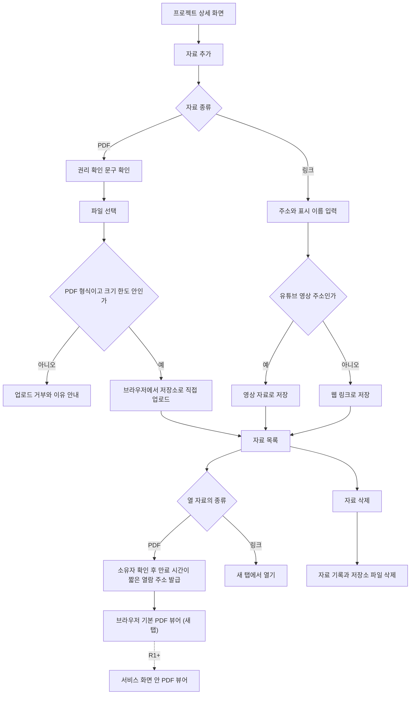

# 내 도안 파일 첨부 요구사항

이 문서는 R1 MVP에 포함하는 내 도안 파일 첨부 기능의 요구사항을 정의한다. 회원이 가진 PDF 도안, 웹 링크, 유튜브 링크를 프로젝트에 붙이고 본인만 열어 보는 흐름을 다룬다. 설계, 작업 분해, 테스트 단계에서는 이 문서의 US, FR, NFR, AC ID로 각 항목을 참조한다.

이 문서는 2026-11-20에 Feature 이슈 `[004] 내 도안 파일 첨부`의 '요구사항 검토' Task에서 승인된 기준 문서다. `/sdd-design` 단계의 설계와 이후의 작업 분해, 테스트는 이 문서를 기준으로 삼는다.

## 상태와 승인

| 항목 | 값 |
|---|---|
| 상태 | 승인 (`approved`) |
| 출시 단계 | R1 MVP |
| 기능 ID | F-VIEWER-01 |
| Feature 이슈 | [#20](https://github.com/god3v/hamtteukka/issues/20) `[004] 내 도안 파일 첨부` |
| 승인 위치 | Feature 이슈의 '요구사항 검토' Task ([#21](https://github.com/god3v/hamtteukka/issues/21) `[004] 요구사항 검토와 확인 질문 해결`) |
| 선행 명세 | [002 뜨개 프로젝트 기록](../002-projects/requirements.md), [001 계정](../001-account/requirements.md) |
| 연결된 미결정 항목 | [OD-03 개인 PDF 업로드 용량 한도](../../decisions/README.md) (2026-11-20 결정됨, Q-01과 Q-02의 해결 기록 참고) |
| 승인 조건 | 확인 질문(Q)을 모두 해결했다 |
| 승인 후 단계 | `/sdd-design` |

Q-01과 Q-02는 미결정 항목 OD-03과 같은 질문이다. 두 질문을 해결하면서 OD-03도 결정했고, [의사결정 기록](../../decisions/README.md)에 결정됨으로 반영했다.

승인한 뒤 요구사항을 바꿔야 하면 이 문서를 먼저 고치고, 설계와 이슈를 다시 만든다. 설계 문서나 이슈를 먼저 고쳐서 이 문서와 어긋나게 만들지 않는다.

## 배경

뜨개를 하는 사람은 이미 산 도안이나 받은 도안을 PDF로 가지고 있는 경우가 많고, 참고 영상은 유튜브 링크로 모아 둔다. 이 자료를 프로젝트에 붙여 두는 일은 뜨개 기록 도구의 기본 흐름이며, [ADR-0008](../../decisions/0008-mvp-personal-tools.md)이 정한 개인 도구 MVP에 포함된다. R2의 내 도안함 다운로드도 비공개 저장소와 만료 시간이 짧은 열람 주소를 쓸 예정이므로, 이 기능은 그 구조를 미리 검증하는 역할도 한다.

2026-11-18 조사에서 확인한 사실 가운데 이 명세의 근거가 되는 내용은 다음과 같다.

- 니트플로우는 PDF 도안 파일, 웹 링크, 유튜브 영상 링크를 프로젝트에 연결해 두고 뜨개를 하면서 보게 한다. 용량이 큰 PDF를 불러올 때는 로딩 표시를 보여 준다([App Store](https://apps.apple.com/kr/app/knitflow-%EB%8B%88%ED%8A%B8%ED%94%8C%EB%A1%9C%EC%9A%B0-%EB%9C%A8%EA%B0%9C-%EA%B8%B0%EB%A1%9D-%EB%8F%84%EA%B5%AC/id6740465748)).
- 니트플로우는 2025년 12월 업데이트부터 프로젝트 하나에 유튜브 영상을 여러 개 연결하게 했다([미국 App Store](https://apps.apple.com/us/app/knitflow-%EB%8B%88%ED%8A%B8%ED%94%8C%EB%A1%9C%EC%9A%B0-%EB%9C%A8%EA%B0%9C-%EA%B8%B0%EB%A1%9D-%EB%8F%84%EA%B5%AC/id6740465748)).
- 니트플로우 이용약관은 사용자가 올리는 도안이 저작권을 지키고 본인 소유이거나 사용 허락을 받은 것이어야 하며, 위반하면 이용을 정지할 수 있다고 정한다([이용약관](https://www.knitflow.io/terms-of-service)).
- 도아니티 FAQ는 iPhone Safari에서 PDF를 파일로 저장하는 방법과, 카카오톡·인스타그램·네이버 앱 내부 브라우저에서 다운로드가 실패할 때의 대처법을 안내한다([FAQ](https://doanity.notion.site/FAQ-5859c83e51f14ef49d76353fb95a8f2d)).
- Supabase Storage는 private bucket과 만료 시간이 있는 signed URL을 지원한다. 개별 signed URL은 취소할 수 없고, 객체 삭제·이동이나 서명 키 교체로만 무효화된다([Storage 문서](https://supabase.com/docs/guides/storage/serving/downloads)).

서비스별 조사 내용은 [참고 서비스 조사](../../research/2026-11-18-reference-services.md)에, 저장소와 요금 조사 내용은 [기술 스택 조사](../../research/2026-11-18-stack-options.md)에 정리되어 있다.

## 사용자 흐름

점선 화살표는 이 명세의 범위 밖이며 R1+에서 다룰 예정인 흐름이다.

PDF는 권리 확인과 형식·크기 검사를 거친 뒤에만 저장소에 올라가고, 열 때마다 소유자를 확인해 열람 주소를 새로 발급한다. 링크는 주소 형식에 따라 영상 자료나 웹 링크로 분류되며, 두 경우 모두 새 탭에서 연다.

## 사용자 스토리

| ID | 사용자 | 원하는 일 | 이유 | 기능 ID |
|---|---|---|---|---|
| US-01 | 도안 PDF를 가진 회원 | 프로젝트에 PDF를 올려 두고 싶다 | 뜰 때마다 도안 파일을 찾지 않으려고 | F-VIEWER-01 |
| US-02 | PDF를 올린 회원 | 올린 파일을 나만 볼 수 있기를 원한다 | 산 도안이나 받은 도안이 다른 사람에게 퍼지지 않게 하려고 | F-VIEWER-01 |
| US-03 | 휴대폰으로 뜨는 회원 | 휴대폰 브라우저에서 PDF를 바로 열고 싶다 | 뜨는 중에 도안을 확인하려고 | F-VIEWER-01 |
| US-04 | 웹에서 도안을 보는 회원 | 도안이 있는 웹 페이지 링크를 붙이고 싶다 | 웹에 있는 도안을 프로젝트와 함께 보려고 | F-VIEWER-01 |
| US-05 | 영상을 보며 뜨는 회원 | 유튜브 영상 링크를 여러 개 붙이고 싶다 | 기법 영상을 프로젝트에서 바로 열려고 | F-VIEWER-01 |
| US-06 | 자료를 정리하는 회원 | 필요 없는 자료를 지우고 싶다 | 목록을 정리하고 파일을 남기지 않으려고 | F-VIEWER-01 |
| US-07 | 탈퇴하는 회원 | 올린 파일이 모두 지워지기를 원한다 | 내 자료가 서비스에 남지 않게 하려고 | F-VIEWER-01 |

## 기능 요구사항

### 자료 추가

| ID | 요구사항 | 관련 US |
|---|---|---|
| FR-01 | 프로젝트 상세 화면에서 자료를 추가한다. 자료 종류는 PDF 파일, 웹 링크, 유튜브 링크 세 가지다. | US-01, US-04, US-05 |
| FR-02 | 프로젝트 하나에 자료를 여러 개 붙일 수 있다. 자료 개수에는 한도를 두지 않고, PDF 저장 용량은 회원당 합계로 제한한다(FR-18). | US-01, US-05 |
| FR-03 | PDF 업로드 화면은 권리 확인 문구와 확인란을 보여 준다. 사용자가 확인란을 선택해야 파일을 올릴 수 있다. | US-01 |
| FR-04 | 권리 확인 문구는 본인이 만든 도안이거나 사용 허락을 받은 도안만 올릴 수 있고, 올린 파일은 본인만 볼 수 있다고 알린다. | US-01, US-02 |
| FR-05 | 자료 기록에 권리를 확인한 시각과 확인한 문구의 버전을 남긴다. | US-01 |
| FR-06 | PDF가 아닌 파일과 크기 한도를 넘는 파일은 올리기 전에 거부하고 이유를 알린다. PDF 한 파일의 크기 한도는 50MB다. | US-01 |
| FR-07 | 업로드 중에는 진행 상태를 보여 준다. 실패하면 이유를 알리고 다시 시도하게 하며, 끝나지 않은 업로드는 자료 목록에 나타나지 않는다. | US-01 |
| FR-08 | 링크 자료는 주소와 표시 이름을 받는다. 표시 이름을 비우면 주소를 그대로 표시한다. | US-04, US-05 |
| FR-09 | 링크 주소가 유튜브 영상 주소 형식이면 영상 자료로, 그 밖의 주소는 웹 링크로 분류한다. | US-04, US-05 |
| FR-10 | 자료의 표시 이름을 바꿀 수 있다. PDF의 기본 표시 이름은 올린 파일의 이름이다. | US-01 |
| FR-18 | 회원이 올린 PDF 크기의 합계는 200MB를 넘을 수 없다. 올리려는 파일 때문에 합계가 200MB를 넘으면 올리기 전에 거부하고 남은 용량을 알린다. 프로젝트 사진(002)은 이 합계에 넣지 않는다. 이 한도는 비공개 베타 동안 적용하고 공개 출시 전에 다시 정한다. | US-01 |
| FR-19 | PDF 올리기 화면에 회원이 지금 쓰고 있는 PDF 용량과 회원당 한도를 보여 준다. PDF 자료를 삭제하면 그 크기만큼 사용량이 줄어든다. | US-01, US-06 |

### 목록과 열기

| ID | 요구사항 | 관련 US |
|---|---|---|
| FR-11 | 프로젝트 상세 화면은 자료 목록을 보여 준다. 각 자료는 종류, 표시 이름, 추가한 날짜를 보여 주고, PDF는 파일 크기도 보여 준다. | US-01, US-04 |
| FR-12 | PDF를 열면 요청한 사람이 소유자인지 확인한 뒤 만료 시간이 짧은 열람 주소를 발급하고, 새 탭의 브라우저 기본 PDF 뷰어로 연다. | US-02, US-03 |
| FR-13 | 열람 주소는 열 때마다 새로 발급한다. 화면에는 열람 주소를 복사하거나 다른 사람에게 공유하는 기능을 두지 않는다. | US-02 |
| FR-14 | 웹 링크와 영상 자료는 새 탭에서 연다. | US-04, US-05 |

### 삭제

| ID | 요구사항 | 관련 US |
|---|---|---|
| FR-15 | 자료 삭제는 확인 대화상자를 거친다. PDF 자료를 삭제하면 저장소의 파일도 함께 지운다. | US-06 |
| FR-16 | 프로젝트를 삭제하면 그 프로젝트의 모든 자료 기록과 저장소 파일을 바로 지운다. [002](../002-projects/requirements.md) Q-05에 따라 삭제한 프로젝트는 되돌릴 수 없으므로, 지운 자료도 되살릴 수 없다. | US-06 |
| FR-17 | 회원 탈퇴가 처리되면 그 회원의 모든 자료 기록과 저장소 파일을 지운다. [001](../001-account/requirements.md) FR-23, FR-25에 따라 탈퇴를 접수한 때부터 24시간 안에 지운다. | US-07 |

## 비기능 요구사항

| ID | 분류 | 요구사항 |
|---|---|---|
| NFR-01 | 비공개 저장 | PDF는 공개 주소가 없는 private 저장소에 둔다. 소유자가 아닌 회원과 비회원은 파일 경로를 알아도 파일을 열 수 없다. |
| NFR-02 | 열람 주소 만료 | 개별 signed URL은 취소할 수 없으므로, 만료 시간을 파일을 여는 데 필요한 만큼만 짧게 둔다. 구체적인 값은 `/sdd-design`에서 정해 `design/sequence.md`에 적는다. |
| NFR-03 | 직접 전송 | PDF 파일 내용은 Vercel 함수를 거치지 않는다. 브라우저가 서명된 업로드 주소와 열람 주소로 저장소와 직접 주고받는다. |
| NFR-04 | 권한 | 자료 기록과 저장소 객체 접근은 RLS 정책으로 소유자에게만 허용하고, 정책을 `design/erd.md` 정책 표에 기록한다. |
| NFR-05 | 앱 내부 브라우저 | 카카오톡·인스타그램·네이버 앱 내부 브라우저로 판단되면, PDF를 열기 전에 외부 브라우저로 여는 방법을 안내한다. |
| NFR-06 | iPhone 저장 안내 | iPhone Safari에서 PDF를 파일로 저장하는 방법은 R0 지원 페이지의 다운로드 환경 안내(F-UX-01)로 연결한다. |
| NFR-07 | 로딩 표시 | 열람 주소를 발급하는 동안과 큰 PDF를 여는 동안 로딩 상태를 보여 준다. |
| NFR-08 | 링크 안전 | `http`, `https` 주소만 받는다. 외부 페이지를 열 때 함뜨까 창의 제어권과 현재 페이지 주소를 외부 페이지에 넘기지 않는다. |
| NFR-09 | 남은 파일 정리 | 중단된 업로드나 삭제 실패 때문에 자료 기록 없이 저장소에 남은 파일을 주기적으로 찾아 지운다. |
| NFR-10 | 화면 환경 | 휴대폰 세로 화면을 기준으로 설계하고, R0에서 만든 다크 모드를 자료 화면에도 적용한다. |

## 수용 기준

수용 기준은 Given/When/Then 형식으로 쓴다. 구현 단계의 테스트 이름에는 `004/AC-01`처럼 기능 번호와 AC ID를 붙인다.

아래 표는 AC 번호 범위별로 확인하는 흐름을 보여 준다.

| AC 범위 | 확인하는 흐름 |
|---|---|
| AC-01~AC-05 | PDF 올리기 |
| AC-06~AC-10 | PDF 열기와 접근 제한 |
| AC-11~AC-14 | 링크 |
| AC-15~AC-17 | 삭제 |
| AC-18~AC-19 | 회원당 용량 한도 |
| AC-20~AC-23 | 여러 자료 붙이기, 권리 확인 문구, 표시 이름 바꾸기, 열람 주소 발급 |

### AC-01 권리를 확인하지 않으면 PDF를 올릴 수 없다

관련 항목: FR-03

- **Given** 회원이 자기 프로젝트에서 PDF 추가 화면을 열었다.
- **When** 권리 확인란을 선택하지 않은 채로 둔다.
- **Then** 파일 올리기 버튼이 비활성 상태이고, 업로드가 시작되지 않는다.

### AC-02 PDF를 올리면 권리 확인 기록이 남는다

관련 항목: FR-01, FR-05, FR-11

- **Given** 회원이 권리 확인란을 선택했다.
- **When** 크기 한도 안의 PDF 파일을 올린다.
- **Then** 업로드가 끝나면 자료 목록에 파일 이름과 크기가 보이고, 자료 기록에 권리 확인 시각과 문구 버전이 남는다.

### AC-03 PDF가 아닌 파일은 올리기 전에 거부한다

관련 항목: FR-06

- **Given** 회원이 권리 확인란을 선택했다.
- **When** 워드 문서(.docx) 파일을 고른다.
- **Then** 업로드 전에 PDF만 올릴 수 있다는 이유가 보이고, 저장소에 파일이 생기지 않는다.

### AC-04 크기 한도를 넘는 PDF는 올리기 전에 거부한다

관련 항목: FR-06

- **Given** 회원이 권리 확인란을 선택했다.
- **When** 50MB를 넘는 PDF 파일을 고른다.
- **Then** 업로드 전에 한 파일에 50MB까지 올릴 수 있다는 이유가 보이고, 저장소에 파일이 생기지 않는다.

### AC-05 업로드가 실패하면 다시 시도할 수 있다

관련 항목: FR-07

- **Given** 회원이 PDF 파일을 올리는 중이다.
- **When** 업로드 도중에 네트워크 연결이 끊긴다.
- **Then** 실패 이유와 다시 시도 버튼이 보이고, 자료 목록에는 그 파일이 나타나지 않는다.

### AC-06 내 PDF를 새 탭에서 연다

관련 항목: FR-12

- **Given** 회원이 자기 프로젝트에 PDF를 올렸다.
- **When** 자료 목록에서 그 PDF를 연다.
- **Then** 새 탭의 브라우저 기본 PDF 뷰어로 파일이 열린다.

### AC-07 다른 회원은 열람 주소를 받을 수 없다

관련 항목: NFR-01, NFR-04

- **Given** 회원 A가 자기 프로젝트에 PDF를 올렸다.
- **When** 회원 B가 그 자료의 열람 주소를 요청한다.
- **Then** 요청이 거부되고 열람 주소가 발급되지 않는다.

### AC-08 저장 경로를 알아도 로그인하지 않은 사용자는 파일을 받을 수 없다

관련 항목: NFR-01

- **Given** 회원 A가 올린 PDF의 저장 경로가 알려졌다.
- **When** 로그인하지 않은 사용자가 그 경로로 파일을 요청한다.
- **Then** 파일 내용이 전달되지 않는다.

### AC-09 만료된 열람 주소로는 파일을 열 수 없다

관련 항목: NFR-02

- **Given** 회원 A가 PDF를 열면서 열람 주소를 받았다.
- **When** 만료 시간이 지난 뒤 같은 열람 주소로 요청한다.
- **Then** 파일이 열리지 않는다.

### AC-10 앱 내부 브라우저에서는 외부 브라우저로 여는 방법을 먼저 안내한다

관련 항목: NFR-05

- **Given** 회원이 카카오톡 앱 내부 브라우저로 접속했다.
- **When** 자료 목록에서 PDF를 연다.
- **Then** 외부 브라우저로 여는 방법이 먼저 안내된다.

### AC-11 유튜브 영상 주소는 영상 자료로 분류한다

관련 항목: FR-08, FR-09

- **Given** 회원이 링크 추가 화면을 열었다.
- **When** 유튜브 영상 주소를 표시 이름 없이 저장한다.
- **Then** 영상 자료로 분류되고, 목록에는 주소가 표시 이름 자리에 보인다.

### AC-12 유튜브가 아닌 주소는 웹 링크로 분류한다

관련 항목: FR-09

- **Given** 회원이 링크 추가 화면을 열었다.
- **When** 유튜브가 아닌 `https` 웹 페이지 주소를 저장한다.
- **Then** 웹 링크로 분류된다.

### AC-13 http나 https가 아닌 주소는 거부한다

관련 항목: NFR-08

- **Given** 회원이 링크 추가 화면을 열었다.
- **When** `javascript:`로 시작하는 주소를 저장하려고 한다.
- **Then** 저장이 거부되고, `http`나 `https` 주소만 받는다는 안내가 보인다.

### AC-14 웹 링크는 새 탭에서 연다

관련 항목: FR-14

- **Given** 프로젝트에 웹 링크 자료가 있다.
- **When** 그 자료를 연다.
- **Then** 새 탭에서 외부 페이지가 열리고, 함뜨까 화면은 그대로 남는다.

### AC-15 PDF 자료를 삭제하면 이미 받은 열람 주소로도 열 수 없다

관련 항목: FR-15

- **Given** 회원 A가 PDF 자료를 열어 열람 주소를 받은 적이 있다.
- **When** 열람 주소가 만료되기 전에 그 자료를 삭제하고 확인을 누른다.
- **Then** 자료가 목록과 저장소에서 사라지고, 앞서 받은 열람 주소로도 파일이 열리지 않는다.

### AC-16 프로젝트를 삭제하면 그 프로젝트의 자료를 모두 지운다

관련 항목: FR-16

- **Given** 프로젝트에 PDF 자료 2개와 링크 자료 1개가 있다.
- **When** 프로젝트 삭제가 확정된다.
- **Then** 자료 기록 3개와 저장소의 PDF 파일 2개가 모두 지워진다.

### AC-17 탈퇴 처리가 끝나면 올린 파일이 남지 않는다

관련 항목: FR-17

- **Given** 회원이 여러 프로젝트에 PDF를 올린 적이 있다.
- **When** 그 회원의 탈퇴 처리가 끝난다.
- **Then** 저장소에 그 회원이 올린 파일이 남지 않는다.

### AC-18 회원당 용량을 넘는 PDF는 올리기 전에 거부한다

관련 항목: FR-18, FR-19

- **Given** 회원이 올린 PDF의 합계가 180MB이고, 프로젝트 사진도 여러 장 올렸다.
- **When** PDF 올리기 화면을 열고 30MB PDF 파일을 고른다.
- **Then** 화면에 사용량 180MB와 한도 200MB가 보이고, 사진은 사용량에 포함되지 않는다. 남은 용량 20MB보다 큰 파일이라 올릴 수 없다는 이유가 보이고, 저장소에 파일이 생기지 않는다.

### AC-19 PDF를 삭제하면 그만큼 용량이 돌아온다

관련 항목: FR-15, FR-19

- **Given** 회원이 올린 PDF의 합계가 180MB이고, 그 가운데 30MB짜리 PDF 자료가 있다.
- **When** 그 자료를 삭제하고 확인을 누른 뒤 PDF 올리기 화면을 연다.
- **Then** 사용량이 150MB로 보인다.

### AC-20 프로젝트 하나에 자료를 여러 개 붙인다

관련 항목: FR-01, FR-02

- **Given** 회원이 자기 프로젝트의 상세 화면을 열었다.
- **When** PDF 1개, 웹 링크 1개, 유튜브 링크 2개를 차례로 추가한다.
- **Then** 자료 목록에 자료 4개가 모두 보인다.

### AC-21 권리 확인 문구는 올릴 수 있는 도안과 공개 범위를 알린다

관련 항목: FR-03, FR-04

- **Given** 회원이 자기 프로젝트에서 PDF 추가 화면을 열었다.
- **When** 권리 확인 문구를 읽는다.
- **Then** 본인이 만들었거나 사용 허락을 받은 도안만 올릴 수 있다는 내용과, 올린 파일은 본인만 볼 수 있다는 내용이 보인다.

### AC-22 자료의 표시 이름을 바꾼다

관련 항목: FR-10

- **Given** 회원이 '가디건_도안_v2.pdf' 파일을 올렸다.
- **When** 자료 목록을 확인한 뒤, 표시 이름을 '봄 가디건 도안'으로 바꾼다.
- **Then** 처음에는 표시 이름 자리에 '가디건_도안_v2.pdf'가 보이고, 바꾼 뒤에는 '봄 가디건 도안'이 보인다.

### AC-23 열람 주소는 열 때마다 새로 발급하고 공유 기능을 두지 않는다

관련 항목: FR-12, FR-13

- **Given** 회원이 자기 프로젝트에 PDF를 올렸다.
- **When** 같은 PDF를 두 번 열고, 자료 목록과 자료 메뉴를 확인한다.
- **Then** 두 번 열 때 서로 다른 열람 주소가 발급되고, 화면 어디에도 열람 주소를 복사하거나 공유하는 기능이 없다.

## 범위 밖

| 항목 | 다루는 시점 |
|---|---|
| 서비스 화면 안 PDF 뷰어와 이어 보기 (F-VIEWER-02) | R1+ |
| 줄 하이라이터와 위치 마커 (F-VIEWER-03) | R1+ |
| PDF 필기·형광펜 주석 (F-VIEWER-04) | R1+ |
| 차트 하이라이터와 매직 마커 (F-VIEWER-05) | Later |
| 도안 스토어의 배포 파일, 내 도안함, 파일 버전과 업데이트 알림 (F-STORE-05, F-STORE-06) | R2 |
| 자료 공개 공유, 다른 회원에게 자료 보내기 | 정하지 않음 |
| 영상 파일 직접 업로드, 유튜브 영상을 서비스 화면 안에서 재생 | 정하지 않음 |
| 링크의 제목과 미리보기 이미지 자동 가져오기 | 정하지 않음 |

## 제약 조건

- 자료는 [002 뜨개 프로젝트 기록](../002-projects/requirements.md)의 프로젝트에 속한다. F-VIEWER-01은 F-PROJ-01에 의존한다.
- Supabase Storage의 업로드 파일 크기 상한은 Free 50MB, Pro 최대 500GB다([Storage 문서](https://supabase.com/docs/guides/storage/serving/downloads)). 개발과 비공개 베타는 Free에서 운영한다.
- Supabase Free는 파일 저장 1GB와 egress 5GB를 제공하고, Pro는 파일 저장 100GB와 비캐시 egress 250GB를 포함한다([Supabase 요금](https://supabase.com/pricing)). 회원당 한도 200MB(Q-02)는 Free의 공용 저장 용량 1GB를 기준으로 정한 값이므로, Pro로 바꾸는 공개 출시 전에 다시 정한다.
- 개별 signed URL은 취소할 수 없다. 이미 발급한 주소를 무효로 만들려면 객체를 삭제하거나 옮기거나 서명 키를 바꿔야 한다([Storage 문서](https://supabase.com/docs/guides/storage/serving/downloads)).
- Vercel Functions의 요청 본문은 4.5MB로 제한된다([Vercel 문서](https://vercel.com/docs/functions/limitations)). 그래서 PDF는 함수를 거치지 않고 저장소에 직접 올린다.
- Vercel 서울 리전(icn1)의 Fast Data Transfer 단가는 GB당 $0.35다([Vercel 요금](https://vercel.com/docs/pricing/regional-pricing/icn1)). 그래서 PDF는 저장소에서 브라우저로 직접 내려보낸다.
- 앱 코드는 `packages/shared` 함수로만 데이터와 저장소에 접근한다([ADR-0003](../../decisions/0003-data-access-boundary.md)). 권한 검사는 RLS가 1차로 맡는다([ADR-0004](../../decisions/0004-rls-authorization.md)).
- 업로드 자료의 권리 책임과 위반 때 조치는 이용약관 조항으로 다루며, 공개 출시 전에 약관을 확정할 때 쓴다(Q-05). 이 문서는 업로드 화면의 확인 문구와 확인 기록만 다룬다.

## 확인 질문

| ID | 질문 | 선택지와 제안 | 관련 항목 | 상태 |
|---|---|---|---|---|
| Q-01 | PDF 파일 하나의 최대 크기를 얼마로 할까? (OD-03) | A: Free 상한과 같은 50MB로 정한다. B: 50MB보다 작은 값으로 정한다. 제안은 A다. | FR-06 | 해결 |
| Q-02 | 회원 한 명이 올릴 수 있는 총 용량이나 파일 개수에 한도를 둘까? (OD-03) | A: 한도를 두지 않는다. B: 회원당 총 용량 한도를 둔다. C: 프로젝트당 파일 개수 한도를 둔다. 제안은 B다. | FR-02 | 해결 |
| Q-03 | PDF 말고 이미지 파일(JPG, PNG)도 받을까? | A: R1에서는 PDF만 받는다. B: JPG, PNG 이미지도 받는다. 제안은 A다. | FR-01, FR-06 | 해결 |
| Q-04 | 프로젝트를 삭제하면 파일을 언제 지울까? | A: 프로젝트를 삭제할 때 바로 지운다. B: 002 명세가 프로젝트 복구 기간을 둔다면 그 기간이 끝날 때 지운다. 제안은 002 명세의 프로젝트 삭제 방식을 따르는 것이다. | FR-16, 002 문서 Q-05 | 해결 |
| Q-05 | 업로드 자료의 권리 책임과 위반 시 조치를 이용약관에 넣는 작업을 어느 명세에서 다룰까? | A: 001 계정의 약관 버전 관리에서 이용약관 조항으로 다룬다. B: 이 명세에서 별도 안내 문서로 다룬다. 제안은 A다. | FR-04 | 해결 |

### 질문 상세

#### Q-01 파일당 크기 한도

Supabase Free의 업로드 파일 상한은 50MB이고, Pro는 최대 500GB다. A를 택한 뒤, 비공개 베타에서 실제 파일 크기를 확인하고 공개 출시 전에 다시 판단한다.

#### Q-02 회원당 한도

Supabase Free의 파일 저장 1GB는 모든 회원이 함께 쓰는 용량이다. B를 택하면 한도 값은 비공개 베타 사용량을 보고 정하며, 프리미엄 기능과 연결할지는 [OD-11](../../decisions/README.md)에서 다룬다.

#### Q-03 이미지 파일

이미지를 받으면 형식 검사와 열람 화면이 늘어난다. 그래서 R1에서는 PDF만 받고, 필요하면 R1 이후에 다시 판단하자고 제안한다.

#### Q-04 프로젝트 삭제와 파일 삭제 시점

002 명세에 복구 기간이 없으면 A가 된다.

#### Q-05 이용약관 조항

A에서 말하는 약관 버전 관리는 [001 계정](../001-account/requirements.md) 명세에 있다. A를 택하면 이 명세는 업로드 화면의 확인 문구와 확인 기록만 다룬다.

### 해결 기록

질문을 해결하면 아래 표에 한 행을 추가하고, 위 표에서 그 질문의 상태를 `해결`로 바꾼다. 결정에 따라 고친 US, FR, NFR, AC의 ID는 고친 항목 칸에 적는다.

| 날짜 | ID | 결정 | 고친 항목 |
|---|---|---|---|
| 2026-11-20 | Q-01 | PDF 한 파일의 크기 한도는 Supabase Free의 업로드 상한과 같은 50MB로 정한다. OD-03의 파일당 한도를 이 값으로 결정했다. | FR-06, AC-04 |
| 2026-11-20 | Q-02 | 회원이 올린 PDF 크기의 합계를 200MB로 제한하고, 올리기 화면에 사용량을 보여 준다. 자료 개수에는 한도를 두지 않는다. 비공개 베타 동안 적용하고, Pro로 바꾸는 공개 출시 전에 다시 정한다. OD-03의 회원당 한도를 이 값으로 결정했다. | FR-02, FR-18, FR-19, AC-18, AC-19, 제약 조건 |
| 2026-11-20 | Q-03 | R1에서는 PDF만 받는다. 이미지 파일은 필요하면 R1 이후에 다시 판단한다. | 없음 |
| 2026-11-20 | Q-04 | 002 Q-05에 따라 프로젝트를 삭제할 때 자료와 파일을 바로 지운다. 같은 날 탈퇴 때의 삭제 시점도 001 FR-23, FR-25에 맞췄다. | FR-16, FR-17 |
| 2026-11-20 | Q-05 | 업로드 자료의 권리 책임과 위반 때 조치는 이용약관 조항으로 다루고, 공개 출시 전에 약관을 확정할 때 쓴다. 이 문서는 업로드 화면의 확인 문구와 확인 기록만 다룬다. 처음 초안부터 수용 기준이 없던 FR-02, FR-04, FR-10, FR-13에는 AC-20~AC-23을 추가했다. | 제약 조건, AC-20~AC-23 |

## 관련 문서

- [002 뜨개 프로젝트 기록 요구사항](../002-projects/requirements.md): 자료가 붙는 프로젝트와 삭제 방식
- [001 계정 요구사항](../001-account/requirements.md): 탈퇴 처리와 이용약관 동의
- [003 단수 카운터 요구사항](../003-row-counter/requirements.md): 같은 R1에서 프로젝트에 붙는 카운터
- [의사결정 기록](../../decisions/README.md): OD-02, OD-03, OD-11 미결정 항목
- [제품 로드맵](../../product/roadmap.md): R1 MVP와 R1+ 뷰어 기능의 범위
- [기능 목록](../../product/feature-catalog.md): F-VIEWER-01~05의 출시 단계
- [ADR-0002 Next.js·Supabase·Vercel 스택과 서울 리전](../../decisions/0002-stack-nextjs-supabase-vercel.md)
- [ADR-0003 Supabase 접근을 packages/shared로 제한](../../decisions/0003-data-access-boundary.md)
- [ADR-0004 RLS를 1차 권한 검사로 사용](../../decisions/0004-rls-authorization.md)
- [ADR-0007 판매에 대비한 데이터 원칙](../../decisions/0007-sales-ready-data-model.md): R2 내 도안함과 같은 저장 구조
- [ADR-0008 개인 뜨개 도구를 MVP로 정함](../../decisions/0008-mvp-personal-tools.md)
- [참고 서비스 조사](../../research/2026-11-18-reference-services.md): 니트플로우, 도아니티의 자료 첨부와 다운로드 안내
- [기술 스택 조사](../../research/2026-11-18-stack-options.md): Supabase Storage와 Vercel 제한
- [SDD 진행 절차](../../sdd-guide.md): 요구사항 승인 뒤 설계로 넘어가는 절차
- [요구사항 템플릿](../_template/requirements.md)
