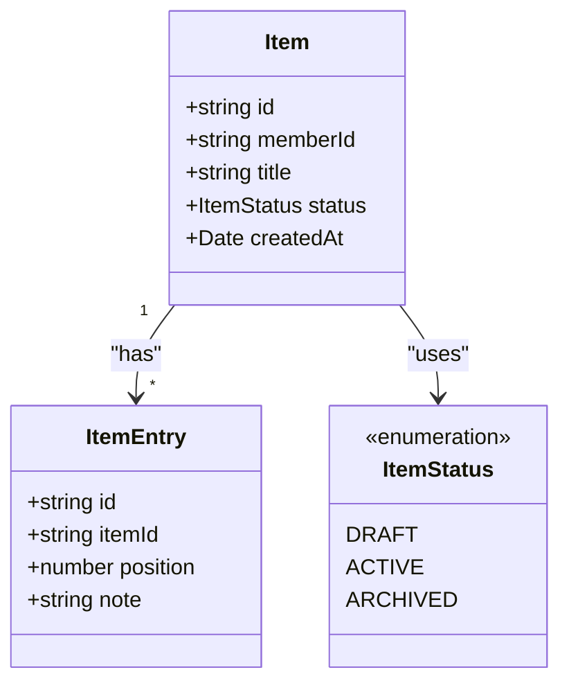
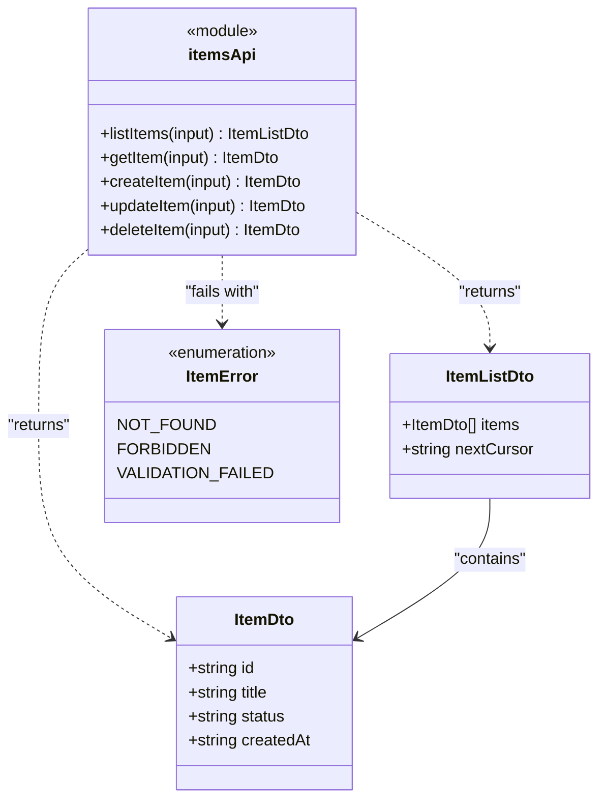

# {기능 제목} 도메인 모델

이 문서는 {기능 제목} 기능의 도메인 개념과 packages/shared가 제공하는 함수 인터페이스를 classDiagram과 표로 정한다. 구현하는 사람은 이 문서에서 어떤 입력을 받고 어떤 DTO와 오류 타입을 반환하는지 확인할 수 있다.

<!-- 이 파일을 docs/specs/NNN-name/design/domain.md로 복사한 뒤 예시 이름(Item, ItemEntry, itemsApi)을 이 기능의 이름으로 바꾼다. 안내 주석은 다 쓰고 나면 지운다. -->

## 도메인 개념

<!-- 클래스 이름은 영문 PascalCase로 쓰고, 한국어 뜻은 다이어그램 아래 표에 쓴다. 관계 라벨은 큰따옴표로 감싼다. -->

항목(Item) 하나는 여러 하위 기록(ItemEntry)을 가지며, 항목의 상태는 ItemStatus 값 가운데 하나다. 상태 전이가 있으면 [상태 전이 문서](state.md)에서 자세히 정한다.

| 클래스 | 뜻 | 저장하는 테이블 | 관련 FR |
|---|---|---|---|
| Item | {예시: 사용자가 만든 항목} | items | FR-01, FR-02 |
| ItemEntry | {예시: 항목에 딸린 하위 기록} | item_entries | FR-03 |
| ItemStatus | {예시: 항목의 진행 상태} | items.status 열 | FR-02 |

## shared 함수

<!-- supabase-js는 packages/shared 안에서만 쓴다. 함수는 zod로 정의한 자체 DTO와 자체 오류 타입만 반환하고, Supabase 타입이나 PostgrestError를 노출하지 않는다(ADR-0003). Server Action은 이 함수를 호출하는 얇은 래퍼다. -->

itemsApi는 packages/shared에 있는 함수 모음이고, 화면과 Server Action은 이 함수만 호출한다. 함수가 실패하면 ItemError 값 가운데 하나로 이유를 알린다.

| 함수 | 입력 | 출력 DTO | 오류 | 관련 FR |
|---|---|---|---|---|
| `listItems` | `ListItemsInput` | `ItemListDto` | `FORBIDDEN` | FR-01 |
| `getItem` | `GetItemInput` | `ItemDto` | `NOT_FOUND` | FR-01 |
| `createItem` | `CreateItemInput` | `ItemDto` | `VALIDATION_FAILED`, `FORBIDDEN` | FR-02 |
| `updateItem` | `UpdateItemInput` | `ItemDto` | `NOT_FOUND`, `VALIDATION_FAILED`, `FORBIDDEN` | FR-02 |
| `deleteItem` | `DeleteItemInput` | `ItemDto` | `NOT_FOUND`, `FORBIDDEN` | FR-02 |

## 관련 문서

- [요구사항](../requirements.md): 이 설계의 근거인 FR과 AC
- [데이터 모델과 RLS 정책](erd.md): 클래스가 저장되는 테이블과 권한 정책
- [ADR-0003 Supabase 접근을 packages/shared로 제한](../../../decisions/0003-data-access-boundary.md): shared 함수 경계를 정한 결정
- [도메인 지도](../../../architecture/domain-map.md): 기능 전체의 도메인 관계
