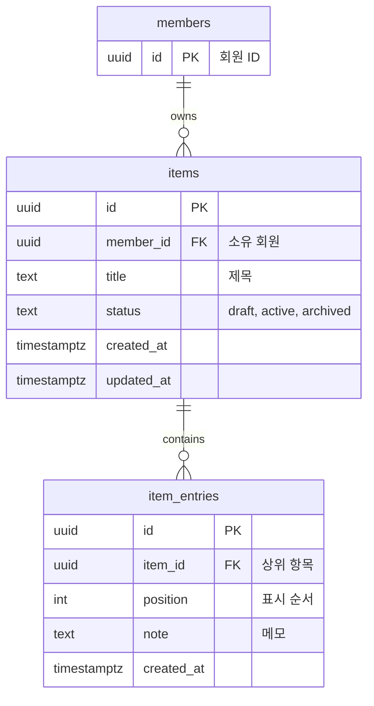

# {기능 제목} 데이터 모델과 RLS 정책

이 문서는 {기능 제목} 기능이 쓰는 테이블과 관계, 테이블마다 적용하는 RLS 정책을 erDiagram과 표로 정한다. 마이그레이션을 쓰는 사람은 이 문서에서 만들 열과 정책을 확인하고, 나중에 권한 검사를 Spring으로 옮길 때는 정책 표를 대조 목록으로 쓴다.

<!-- 이 파일을 docs/specs/NNN-name/design/erd.md로 복사한 뒤 예시 테이블(items, item_entries)을 이 기능의 테이블로 바꾼다. 바뀌는 테이블이 없으면 그 이유를 쓰고 다이어그램을 지운다. 안내 주석은 다 쓰고 나면 지운다. -->

## ERD

<!-- 테이블 이름은 영문 snake_case로 쓴다. 열은 "타입 이름 PK/FK" 순서로 쓰고, 설명은 큰따옴표로 감싼다. 관계 라벨도 큰따옴표로 감싼다. 이메일을 사용자 키로 쓰지 않는다(헌법 P-05). 회원이 소유하는 데이터는 001 계정 기능의 members 테이블을 member_id로 참조한다. 소유자 키와 auth.uid()의 관계는 001 설계를 따른다. -->

회원 한 명은 항목을 여러 개 가질 수 있고, 항목 하나는 하위 기록을 여러 개 가진다. members는 001 계정 기능이 만드는 회원 테이블이며, 이 기능에서는 참조만 한다.

## 테이블 설명

<!-- 스키마 열은 마이그레이션 소유권을 정한다. public 스키마는 supabase/migrations가 소유하고, commerce 스키마는 Spring의 Flyway가 소유한다(ADR-0006). -->

| 테이블 | 스키마 | 설명 | 관련 FR |
|---|---|---|---|
| items | public | {예시: 사용자가 만든 항목} | FR-01, FR-02 |
| item_entries | public | {예시: 항목에 딸린 하위 기록} | FR-03 |

## RLS 정책

<!-- 브라우저나 앱이 읽거나 쓰는 테이블에는 모두 RLS를 켠다(헌법 P-04). 테이블과 작업(SELECT, INSERT, UPDATE, DELETE)의 조합마다 한 행을 쓴다. 정책을 만들지 않아 거부되는 작업도 "허용하지 않음"으로 한 행을 남긴다. USING 조건은 SELECT, UPDATE, DELETE 행에, WITH CHECK 조건은 INSERT, UPDATE 행에 쓰고, 해당하지 않는 칸에는 "해당 없음"을 쓴다. {현재 회원 ID}는 001 설계가 정한 식으로 바꾼다. 마이그레이션 SQL의 정책과 이 표가 다르면 이 표를 먼저 고친다. -->

| 테이블 | 작업 | 허용 대상(역할) | USING 조건 | WITH CHECK 조건 | 근거 FR/AC |
|---|---|---|---|---|---|
| items | SELECT | `authenticated`, 소유 회원 | `member_id = {현재 회원 ID}` | 해당 없음 | FR-01, AC-01, AC-04 |
| items | INSERT | `authenticated` | 해당 없음 | `member_id = {현재 회원 ID}` | FR-02, AC-02 |
| items | UPDATE | `authenticated`, 소유 회원 | `member_id = {현재 회원 ID}` | `member_id = {현재 회원 ID}` | FR-02, AC-03 |
| items | DELETE | `authenticated`, 소유 회원 | `member_id = {현재 회원 ID}` 이고 `status = 'archived'` | 해당 없음 | FR-02, AC-07 |
| item_entries | SELECT | `authenticated`, 상위 항목의 소유 회원 | 상위 `items.member_id = {현재 회원 ID}` | 해당 없음 | FR-03, AC-05 |
| item_entries | INSERT | `authenticated`, 상위 항목의 소유 회원 | 해당 없음 | 상위 `items.member_id = {현재 회원 ID}` | FR-03, AC-06 |
| item_entries | UPDATE | 허용하지 않음 | 정책 없음 | 정책 없음 | FR-03, AC-06 |
| item_entries | DELETE | `authenticated`, 상위 항목의 소유 회원 | 상위 `items.member_id = {현재 회원 ID}` | 해당 없음 | FR-03, AC-06 |

items의 DELETE 정책은 보관됨 상태의 항목만 지울 수 있게 하며, [상태 전이 문서](state.md)의 삭제 전이와 같은 조건이다. item_entries는 수정하지 않고 지운 뒤 다시 추가한다는 예시이므로 UPDATE 정책을 만들지 않는다.

## 관련 문서

- [요구사항](../requirements.md): 정책의 근거인 FR과 AC
- [도메인 모델](domain.md): 테이블에 저장되는 도메인 개념
- [상태 전이](state.md): 상태에 따라 허용되는 작업
- [ERD 개요](../../../architecture/erd-overview.md): 기능 전체의 테이블 관계
- [ADR-0004 RLS를 1차 권한 검사로 사용](../../../decisions/0004-rls-authorization.md): RLS 정책을 표로 기록하는 이유
- [ADR-0006 DB 마이그레이션 소유권을 스키마별로 분리](../../../decisions/0006-migration-ownership.md): 스키마별 마이그레이션 소유 도구
