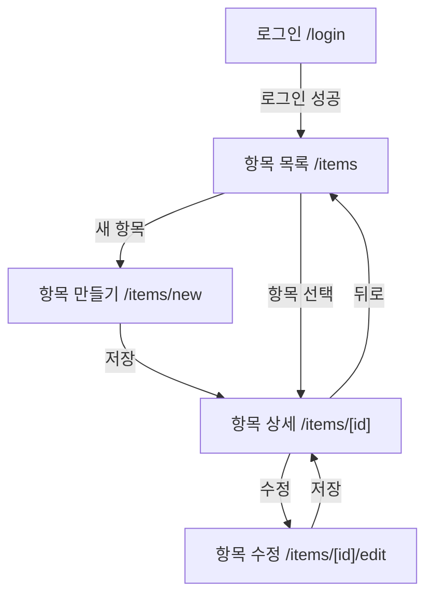

# {기능 제목} 화면 흐름

이 문서는 {기능 제목} 기능의 화면과 화면 사이의 이동을 flowchart와 화면 표로 정한다. 구현하는 사람은 화면마다 경로와 접근 조건, 근거가 되는 사용자 스토리를 확인할 수 있다.

<!-- 이 파일을 docs/specs/NNN-name/design/screens.md로 복사한 뒤 예시 화면을 이 기능의 화면으로 바꾼다. 화면은 모바일 너비를 기준으로 먼저 설계하고 다크 모드에서도 확인한다(헌법 P-12). 안내 주석은 다 쓰고 나면 지운다. -->

## 화면 이동

<!-- 노드 ID는 영문으로 쓰고, 라벨은 "화면 이름 경로" 형식으로 큰따옴표로 감싼다. 간선 라벨은 사용자 행동이며 역시 큰따옴표로 감싼다. -->

로그인한 사용자는 목록에서 새 항목을 만들거나 기존 항목을 연다. 수정을 마치면 상세 화면으로 돌아온다.

## 화면 표

| 화면 | 경로 | 접근 조건 | 관련 US |
|---|---|---|---|
| 로그인 | `/login` | 로그인하지 않은 사용자 | US-01 |
| 항목 목록 | `/items` | 로그인한 사용자 | US-01 |
| 항목 만들기 | `/items/new` | 로그인한 사용자 | US-02 |
| 항목 상세 | `/items/[id]` | 항목의 소유자 | US-02 |
| 항목 수정 | `/items/[id]/edit` | 항목의 소유자 | US-03 |

## 관련 문서

- [요구사항](../requirements.md): 화면의 근거인 사용자 스토리
- [시나리오 시퀀스](sequence.md): 화면에서 시작하는 요청 흐름
- [함뜨까 프로젝트 헌법](../../../constitution.md): 모바일 우선과 다크 모드 원칙(P-12)
