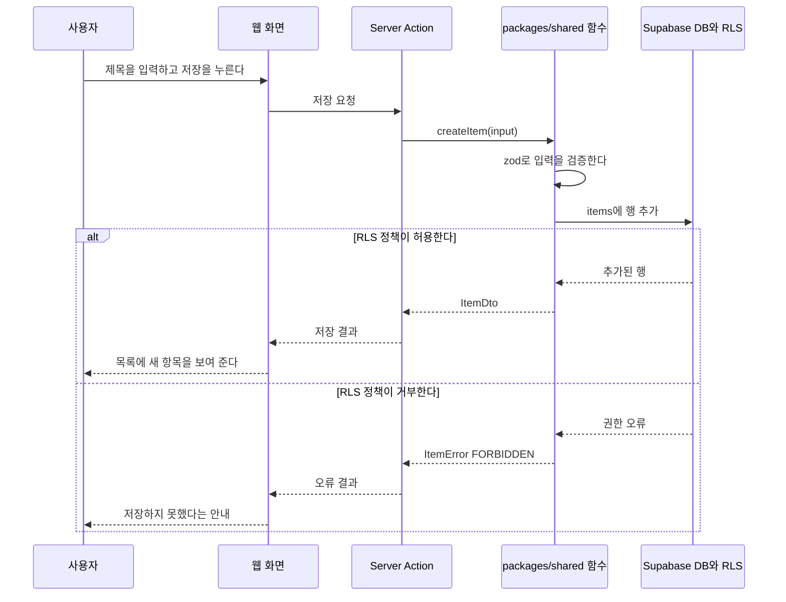
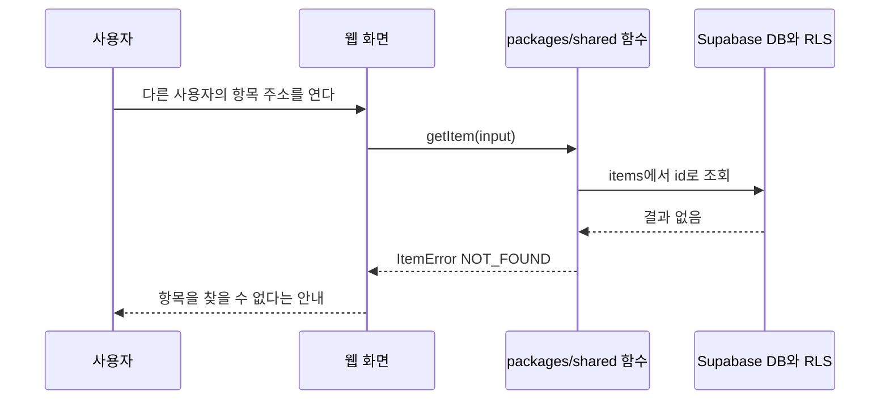

# {기능 제목} 시나리오 시퀀스

이 문서는 {기능 제목} 기능의 주요 시나리오에서 화면, Server Action, shared 함수, Supabase가 주고받는 요청을 sequenceDiagram으로 정한다. 구현하는 사람은 시나리오마다 어느 계층이 무엇을 호출하고 실패를 어디서 처리하는지 확인할 수 있다.

<!-- 이 파일을 docs/specs/NNN-name/design/sequence.md로 복사한 뒤 예시 시나리오를 이 기능의 시나리오로 바꾼다. 시나리오마다 H2 하나와 다이어그램 하나를 둔다. 안내 주석은 다 쓰고 나면 지운다. -->

## 시나리오 목록

| 시나리오 | 관련 AC |
|---|---|
| [항목을 만든다](#항목을-만든다) | AC-01, AC-02 |
| [다른 사용자의 항목을 열려고 한다](#다른-사용자의-항목을-열려고-한다) | AC-04 |

## 항목을 만든다

<!-- 참여자 이름은 participant ID as 한국어 이름 형식으로 쓰고, as 뒤에는 따옴표를 쓰지 않는다. 메시지에는 세미콜론과 # 기호를 쓰지 않는다. -->

Server Action은 shared 함수를 호출하기만 하고, 권한 검사는 Supabase의 RLS 정책이 맡는다. 브라우저에서 shared 함수를 바로 호출하는 시나리오라면 Action 참여자를 빼고 그린다.

## 다른 사용자의 항목을 열려고 한다

RLS 정책이 다른 사용자의 행을 조회 결과에서 빼므로, shared 함수는 권한 오류가 아니라 NOT_FOUND를 반환한다. 이 동작은 AC-04의 테스트로 확인한다.

## 관련 문서

- [요구사항](../requirements.md): 시나리오가 확인하는 AC
- [도메인 모델](domain.md): 시나리오에 나오는 shared 함수와 DTO
- [데이터 모델과 RLS 정책](erd.md): 시나리오에서 허용하거나 거부하는 정책
