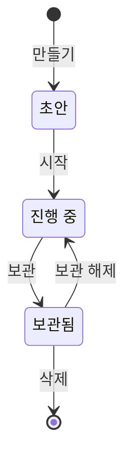

# {기능 제목} 상태 전이

이 문서는 {기능 제목} 기능에서 상태가 있는 대상이 어떤 이벤트로 어느 상태로 바뀌는지 stateDiagram-v2와 전이 표로 정한다. 구현하는 사람은 허용되는 전이와 그 조건을 확인하고, 표에 없는 전이를 막는 테스트를 쓸 수 있다.

<!-- 상태가 없는 기능이면 이 파일을 복사하지 않는다. 복사했다면 예시 상태(Draft, Active, Archived)를 이 기능의 상태로 바꾸고, 안내 주석은 다 쓰고 나면 지운다. -->

## 상태 다이어그램

<!-- 상태 ID는 영문으로 쓰고 한국어 이름은 state "이름" as ID 형식으로 붙인다. 상태 값은 erd.md의 열 값과 같은 이름을 쓴다. -->

항목은 초안으로 만들어지고, 시작하면 진행 중이 된다. 보관한 항목만 삭제할 수 있으며, 진행 중인 항목은 바로 삭제할 수 없다. 삭제 전이의 조건은 [erd.md](erd.md)에 있는 items DELETE 정책의 조건과 같다.

## 전이 표

| 현재 | 이벤트 | 다음 | 조건 |
|---|---|---|---|
| 없음 | 만들기 | 초안(Draft) | 로그인한 사용자 |
| 초안(Draft) | 시작 | 진행 중(Active) | 소유자이고 제목이 비어 있지 않다 |
| 진행 중(Active) | 보관 | 보관됨(Archived) | 소유자 |
| 보관됨(Archived) | 보관 해제 | 진행 중(Active) | 소유자 |
| 보관됨(Archived) | 삭제 | 없음 | 소유자 |

## 관련 문서

- [요구사항](../requirements.md): 상태 전이의 근거인 FR과 AC
- [데이터 모델과 RLS 정책](erd.md): 상태 값을 저장하는 열
- [도메인 모델](domain.md): 상태가 있는 도메인 개념
