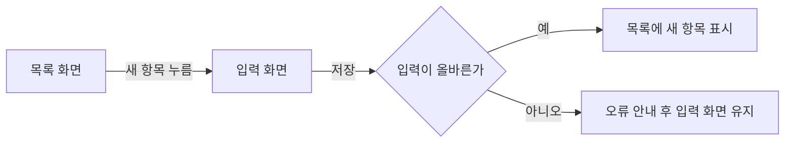

# {기능 제목} 요구사항

이 문서는 {기능 제목} 기능이 해야 하는 일을 사용자 스토리, 기능 요구사항, 수용 기준으로 정한다. 설계 문서와 Task 이슈는 이 문서가 승인된 뒤에 이 문서를 근거로 만든다.

<!-- 이 파일을 docs/specs/NNN-name/requirements.md로 복사한 뒤 중괄호 자리와 예시 행을 이 기능의 내용으로 바꾼다. 안내 주석은 다 쓰고 나면 지운다. -->

## 상태와 승인

이 문서는 승인을 기다리는 제안이다. 사용자가 승인하면 status를 approved로 바꾸고 `/sdd-design`으로 설계를 시작하며, 승인 전에는 이 문서를 근거로 설계나 Task 이슈를 만들지 않는다.

<!-- 아래 표는 9개 행을 이 순서대로 모두 쓴다. 해당하지 않는 행은 값에 없음이라고 쓴다. 승인되면 상태 값을 승인 (`approved`)으로 바꾸고, 위 안내 문장을 승인 날짜가 들어간 문장으로 바꾼다. -->

| 항목 | 값 |
|---|---|
| 상태 | 검토 대기 (`review`) |
| 출시 단계 | {R1 MVP} |
| 기능 ID | {F-XXX-01} |
| Feature 이슈 | `[NNN] {기능 제목}` |
| 승인 위치 | Feature 이슈의 '요구사항 검토' Task (`[NNN] 요구사항 검토와 확인 질문 해결`) |
| 선행 명세 | {이 기능이 의존하는 명세의 requirements.md 링크. 없으면 없음} |
| 연결된 미결정 항목 | {[OD-xx 제목](../../decisions/README.md) (결정 시점). 없으면 없음} |
| 승인 조건 | 확인 질문(Q)을 모두 해결했다 |
| 승인 후 단계 | `/sdd-design` |

## 배경

<!-- 이 기능이 왜 필요한지 2~3문장으로 쓴다. 근거가 되는 조사 문서나 ADR이 있으면 링크한다. -->

{이 기능이 필요한 이유를 쓴다.}

| 기능 ID | 이름 | 릴리스 |
|---|---|---|
| F-XXX-01 | {기능 목록에 적힌 이름} | {R1} |

기능 ID와 이름은 [기능 목록](../../product/feature-catalog.md)과 같게 쓴다.

## 사용자 흐름

<!-- 사용자가 이 기능을 처음부터 끝까지 쓰는 흐름을 그린다. 아래 예시 노드를 이 기능의 화면과 행동으로 바꾼다. 노드 ID는 영문으로 쓰고 라벨은 큰따옴표로 감싼다. -->

{다이어그램에서 읽어야 할 점을 1~3문장으로 쓴다.}

## 사용자 스토리

<!-- 누가, 무엇을, 왜 원하는지 쓴다. ID는 US-01부터 차례로 붙이고 지운 번호는 다시 쓰지 않는다. 기능 ID 칸에는 이 스토리를 다루는 F- ID를 쓰고, 둘 이상이면 쉼표로 나눈다. -->

| ID | 사용자 | 원하는 일 | 이유 | 기능 ID |
|---|---|---|---|---|
| US-01 | {회원} | {무엇을 하고 싶다} | {무엇을 하려고} | {F-XXX-01} |

## 기능 요구사항

<!-- 시스템이 해야 하는 동작을 한 행에 하나씩 쓴다. 구현 방법이 아니라 관찰할 수 있는 동작으로 쓴다. -->

| ID | 요구사항 | 관련 US |
|---|---|---|
| FR-01 | {조건}이면 시스템은 {동작}한다. | US-01 |

## 비기능 요구사항

<!-- 헌법이 이미 정한 원칙은 반복하지 않고, 이 기능에만 해당하는 성능, 보안, 개인정보, 접근성 요구를 쓴다. -->

| ID | 분류 | 요구사항 | 확인 방법 |
|---|---|---|---|
| NFR-01 | {개인정보} | {요구사항} | {테스트나 검토로 확인하는 방법} |

## 수용 기준

<!-- AC마다 제목 아래에 관련 항목 줄을 두고, Given/When/Then을 굵게 쓴다. 테스트 이름에는 test("NNN/AC-01 ...")처럼 기능 번호와 AC ID를 넣는다. -->

수용 기준은 Given/When/Then 형식으로 쓴다. 구현 단계의 테스트 이름에는 `NNN/AC-01`처럼 기능 번호와 AC ID를 붙인다.

### AC-01 {확인할 동작}

관련 항목: FR-01

- **Given** {전제 조건}
- **When** {사용자 행동이나 이벤트}
- **Then** {관찰할 수 있는 결과}

## 범위 밖

<!-- 이번 스펙에서 하지 않는 일과, 그 일을 다루는 릴리스나 문서를 쓴다. -->

- {이번 스펙에서 하지 않는 일}: {다루는 릴리스나 문서}

## 제약 조건

<!-- 이 기능에 특히 영향을 주는 결정만 쓴다. 모든 기능에 적용되는 원칙은 헌법을 따른다. -->

| 제약 | 근거 |
|---|---|
| {제약 내용} | [ADR-0004 RLS를 1차 권한 검사로 사용](../../decisions/0004-rls-authorization.md) |

## 확인 질문

<!-- /sdd-spec은 한 라운드에 질문을 최대 5개까지 묻는다. 상태가 열림인 질문이 하나도 없어야 승인을 요청할 수 있다. 상태 칸에는 열림이나 해결만 쓴다. 해결한 질문은 지우지 않고, 아래 해결 기록 표에 한 행을 추가한다. -->

| ID | 질문 | 선택지와 제안 | 관련 항목 | 상태 |
|---|---|---|---|---|
| Q-01 | {질문} | {선택지 A, 선택지 B. 제안은 선택지 A다.} | FR-01, AC-01 | 열림 |
| Q-02 | {질문} | {선택지 A, 선택지 B} | FR-02 | 해결 |

### 질문 상세

<!-- 이 절은 선택 사항이다. 표의 선택지와 제안 칸에 다 담기 어려운 참고 사실이나 제안 이유가 있는 질문만 아래처럼 쓴다. 필요 없으면 이 절을 지운다. -->

#### Q-01 {질문 요약}

{선택지를 고를 때 참고할 사실과 제안 이유를 쓴다.}

### 해결 기록

질문을 해결하면 아래 표에 한 행을 추가하고, 위 표에서 그 질문의 상태를 `해결`로 바꾼다. 결정에 따라 고친 US, FR, NFR, AC의 ID는 고친 항목 칸에 적는다.

<!-- 아직 해결한 질문이 없으면 표에 `| - | - | - | - |` 한 행만 둔다. 첫 질문을 해결할 때 이 행을 지운다. -->

| 날짜 | ID | 결정 | 고친 항목 |
|---|---|---|---|
| {YYYY-MM-DD} | Q-02 | {사용자가 고른 선택지와 이유} | FR-02, AC-01 |

## 관련 문서

- [함뜨까 프로젝트 헌법](../../constitution.md): 모든 기능에 적용되는 원칙
- [SDD 흐름으로 기능 만들기](../../sdd-guide.md): 이 문서를 쓰고 승인받는 절차
- [기능 목록](../../product/feature-catalog.md): 기능 ID와 릴리스
- {설계가 승인되면 design/ 문서 링크를 추가한다.}
